# PspCallProcessNotifyRoutines

- RVA: `0x00904928`–`0x00904C5C` (길이 `820` bytes)
- VA: `0x0000000140904928`
- 실행 섹션: `PAGE`
- PDB 이름 있음: `예`; PDB Function 태그: `아니요`
- unwind 정보 RVA: `0x00088B3C`
- 디코드: `210`개 명령, `820/820` bytes 표시
- 미해석 바이트: `0` (있으면 어셈블리에 `.byte`로 보존)

> 이 문서는 커널 이미지의 기계어와 PDB 기호를 분석해 생성했습니다. 4번과 5번은 함수 원형과 자료형을 바이너리 사용 방식에서 추정한 C 해석이며 원본 소스 복구 결과는 아닙니다.

## 1. Dependencies

- 직접 호출 지점: **15**; 고유 호출 대상: **10**
- 직접 호출자로 확인된 함수: **2**
- RIP 상대 이미지 참조: **5**

### Outgoing calls
- `0x0090495C` → [memset](../../text/6C/memset_function_006C6C40.md) (function, `0x006C6C40`)
- `0x00904968` → [ExGetExtensionTable](../../text/42/ExGetExtensionTable_function_00428814.md) (function, `0x00428814`)
- `0x0090497B` → [ExGetExtensionTable](../../text/42/ExGetExtensionTable_function_00428814.md) (function, `0x00428814`)
- `0x009049E6` → [guard_dispatch_icall](../../text/6B/guard_dispatch_icall_function_006BAAD0.md) (function, `0x006BAAD0`)
- `0x009049F2` → [ExReleaseExtensionTable](../../text/45/ExReleaseExtensionTable_function_00456DC0.md) (function, `0x00456DC0`)
- `0x00904A40` → [ExReferenceCallBackBlock](../../text/2F/ExReferenceCallBackBlock_function_002F0040.md) (function, `0x002F0040`)
- `0x00904A75` → [guard_dispatch_icall](../../text/6B/guard_dispatch_icall_function_006BAAD0.md) (function, `0x006BAAD0`)
- `0x00904A80` → [ExDereferenceCallBackBlock](../../text/44/ExDereferenceCallBackBlock_function_0044D730.md) (function, `0x0044D730`)
- `0x00904A99` → [PsTerminateProcess](PsTerminateProcess_function_00904C64.md) (function, `0x00904C64`)
- `0x00904AD7` → [KeReleaseSpinLock](../../text/39/KeReleaseSpinLock_function_00392BA0.md) (function, `0x00392BA0`)
- `0x00904AF7` → [guard_dispatch_icall](../../text/6B/guard_dispatch_icall_function_006BAAD0.md) (function, `0x006BAAD0`)
- `0x00904B03` → [ExReleaseExtensionTable](../../text/45/ExReleaseExtensionTable_function_00456DC0.md) (function, `0x00456DC0`)
- `0x00904BE2` → [PsReferenceProcessFilePointer](../8D/PsReferenceProcessFilePointer_function_008D6870.md) (function, `0x008D6870`)
- `0x00904C44` → [guard_dispatch_icall](../../text/6B/guard_dispatch_icall_function_006BAAD0.md) (function, `0x006BAAD0`)
- `0x00904C52` → [ObfDereferenceObject](../../text/2F/ObfDereferenceObject_function_002F9350.md) (function, `0x002F9350`)

### Direct callers
- [PspExitProcess](PspExitProcess_function_00904830.md) at `0x009048D2`
- [PspInsertThread](../9F/PspInsertThread_function_009F0314.md) at `0x009F0B45`

### Static image references
- `0x00904961` → RVA `0x00FC7028` (`ALMOSTRO`; read)
- `0x0090496D` → RVA `0x00FC6CA0` (`ALMOSTRO`; read)
- `0x00904980` → RVA `0x00FD9A88` (`PAGEDATA`; read)
- `0x00904A32` → RVA `0x00F06320` (`.data`; read)
- `0x00904AB5` → RVA `0x00392BA0` (`KeReleaseSpinLock`; read)

## 2. Other-region calls and transfers

- 다른 실행 섹션으로 향하는 call: **13**
  - `0x0090495C` → [memset](../../text/6C/memset_function_006C6C40.md) (`PAGE` → `.text`)
  - `0x00904968` → [ExGetExtensionTable](../../text/42/ExGetExtensionTable_function_00428814.md) (`PAGE` → `.text`)
  - `0x0090497B` → [ExGetExtensionTable](../../text/42/ExGetExtensionTable_function_00428814.md) (`PAGE` → `.text`)
  - `0x009049E6` → [guard_dispatch_icall](../../text/6B/guard_dispatch_icall_function_006BAAD0.md) (`PAGE` → `.text`)
  - `0x009049F2` → [ExReleaseExtensionTable](../../text/45/ExReleaseExtensionTable_function_00456DC0.md) (`PAGE` → `.text`)
  - `0x00904A40` → [ExReferenceCallBackBlock](../../text/2F/ExReferenceCallBackBlock_function_002F0040.md) (`PAGE` → `.text`)
  - `0x00904A75` → [guard_dispatch_icall](../../text/6B/guard_dispatch_icall_function_006BAAD0.md) (`PAGE` → `.text`)
  - `0x00904A80` → [ExDereferenceCallBackBlock](../../text/44/ExDereferenceCallBackBlock_function_0044D730.md) (`PAGE` → `.text`)
  - `0x00904AD7` → [KeReleaseSpinLock](../../text/39/KeReleaseSpinLock_function_00392BA0.md) (`PAGE` → `.text`)
  - `0x00904AF7` → [guard_dispatch_icall](../../text/6B/guard_dispatch_icall_function_006BAAD0.md) (`PAGE` → `.text`)
  - `0x00904B03` → [ExReleaseExtensionTable](../../text/45/ExReleaseExtensionTable_function_00456DC0.md) (`PAGE` → `.text`)
  - `0x00904C44` → [guard_dispatch_icall](../../text/6B/guard_dispatch_icall_function_006BAAD0.md) (`PAGE` → `.text`)
  - `0x00904C52` → [ObfDereferenceObject](../../text/2F/ObfDereferenceObject_function_002F9350.md) (`PAGE` → `.text`)
- 별도 외부 분기/꼬리 이동을 확인하지 못했습니다.

## 3. Assembly (complete function range)

```asm
00904928  48 89 5C 24 10                  mov qword ptr [rsp + 0x10], rbx
0090492D  44 88 44 24 18                  mov byte ptr [rsp + 0x18], r8b
00904932  55                              push rbp
00904933  56                              push rsi
00904934  57                              push rdi
00904935  41 54                           push r12
00904937  41 55                           push r13
00904939  41 56                           push r14
0090493B  41 57                           push r15
0090493D  48 8D 6C 24 D9                  lea rbp, [rsp - 0x27]
00904942  48 81 EC 90 00 00 00            sub rsp, 0x90
00904949  48 8B DA                        mov rbx, rdx
0090494C  45 8A F8                        mov r15b, r8b
0090494F  33 D2                           xor edx, edx
00904951  48 8B F9                        mov rdi, rcx
00904954  48 8D 4D D7                     lea rcx, [rbp - 0x29]
00904958  44 8D 42 48                     lea r8d, [rdx + 0x48]
0090495C  E8 DF 22 DC FF                  call 0x1406c6c40
00904961  48 8B 0D C0 26 6C 00            mov rcx, qword ptr [rip + 0x6c26c0]
00904968  E8 A7 3E B2 FF                  call 0x140428814
0090496D  48 8B 0D 2C 23 6C 00            mov rcx, qword ptr [rip + 0x6c232c]
00904974  4C 8B F0                        mov r14, rax
00904977  48 89 45 BF                     mov qword ptr [rbp - 0x41], rax
0090497B  E8 94 3E B2 FF                  call 0x140428814
00904980  44 8B 2D 01 51 6D 00            mov r13d, dword ptr [rip + 0x6d5101]
00904987  45 33 E4                        xor r12d, r12d
0090498A  48 83 65 7F 00                  and qword ptr [rbp + 0x7f], 0
0090498F  41 83 E5 04                     and r13d, 4
00904993  48 8B 8F 40 06 00 00            mov rcx, qword ptr [rdi + 0x640]
0090499A  48 8B F0                        mov rsi, rax
0090499D  48 89 45 B7                     mov qword ptr [rbp - 0x49], rax
009049A1  44 88 65 67                     mov byte ptr [rbp + 0x67], r12b
009049A5  41 8D 54 24 02                  lea edx, [r12 + 2]
009049AA  48 89 4D C7                     mov qword ptr [rbp - 0x39], rcx
009049AE  45 84 FF                        test r15b, r15b
009049B1  0F 85 65 01 00 00               jne 0x140904b1c
009049B7  33 DB                           xor ebx, ebx
009049B9  8B 05 C9 50 6D 00               mov eax, dword ptr [rip + 0x6d50c9]
009049BF  84 C2                           test dl, al
009049C1  75 66                           jne 0x140904a29
009049C3  45 85 ED                        test r13d, r13d
009049C6  75 61                           jne 0x140904a29
009049C8  48 85 F6                        test rsi, rsi
009049CB  74 2A                           je 0x1409049f7
009049CD  48 85 DB                        test rbx, rbx
009049D0  0F 85 37 01 00 00               jne 0x140904b0d
009049D6  48 8B 06                        mov rax, qword ptr [rsi]
009049D9  4C 8B C3                        mov r8, rbx
009049DC  48 8B 97 D0 01 00 00            mov rdx, qword ptr [rdi + 0x1d0]
009049E3  48 8B CF                        mov rcx, rdi
009049E6  E8 E5 60 DB FF                  call 0x1406baad0
009049EB  48 8B 0D AE 22 6C 00            mov rcx, qword ptr [rip + 0x6c22ae]
009049F2  E8 C9 23 B5 FF                  call 0x140456dc0
009049F7  4D 85 F6                        test r14, r14
009049FA  0F 85 DE 00 00 00               jne 0x140904ade
00904A00  80 7D 67 00                     cmp byte ptr [rbp + 0x67], 0
00904A04  0F 85 44 02 00 00               jne 0x140904c4e
00904A0A  48 8B 9C 24 D8 00 00 00         mov rbx, qword ptr [rsp + 0xd8]
00904A12  41 8B C4                        mov eax, r12d
00904A15  48 81 C4 90 00 00 00            add rsp, 0x90
00904A1C  41 5F                           pop r15
00904A1E  41 5E                           pop r14
00904A20  41 5D                           pop r13
00904A22  41 5C                           pop r12
00904A24  5F                              pop rdi
00904A25  5E                              pop rsi
00904A26  5D                              pop rbp
00904A27  C3                              ret
00904A28  CC                              int3
00904A29  45 33 F6                        xor r14d, r14d
00904A2C  41 83 FE 40                     cmp r14d, 0x40
00904A30  73 6C                           jae 0x140904a9e
00904A32  48 8D 0D E7 18 60 00            lea rcx, [rip + 0x6018e7]
00904A39  4E 8D 3C F1                     lea r15, [rcx + r14*8]
00904A3D  49 8B CF                        mov rcx, r15
00904A40  E8 FB B5 9E FF                  call 0x1402f0040
00904A45  48 8B F0                        mov rsi, rax
00904A48  48 85 C0                        test rax, rax
00904A4B  75 05                           jne 0x140904a52
00904A4D  41 FF C6                        inc r14d
00904A50  EB DA                           jmp 0x140904a2c
00904A52  8B 40 10                        mov eax, dword ptr [rax + 0x10]
00904A55  4C 39 65 C7                     cmp qword ptr [rbp - 0x39], r12
00904A59  75 50                           jne 0x140904aab
00904A5B  A8 02                           test al, 2
00904A5D  74 52                           je 0x140904ab1
00904A5F  45 85 ED                        test r13d, r13d
00904A62  74 16                           je 0x140904a7a
00904A64  48 8B 46 08                     mov rax, qword ptr [rsi + 8]
00904A68  4C 8B C3                        mov r8, rbx
00904A6B  48 8B 97 D0 01 00 00            mov rdx, qword ptr [rdi + 0x1d0]
00904A72  48 8B CF                        mov rcx, rdi
00904A75  E8 56 60 DB FF                  call 0x1406baad0
00904A7A  48 8B D6                        mov rdx, rsi
00904A7D  49 8B CF                        mov rcx, r15
00904A80  E8 AB 8C B4 FF                  call 0x14044d730
00904A85  48 85 DB                        test rbx, rbx
00904A88  74 C3                           je 0x140904a4d
00904A8A  8B 43 40                        mov eax, dword ptr [rbx + 0x40]
00904A8D  85 C0                           test eax, eax
00904A8F  79 BC                           jns 0x140904a4d
00904A91  8B D0                           mov edx, eax
00904A93  48 8B CF                        mov rcx, rdi
00904A96  44 8B E0                        mov r12d, eax
00904A99  E8 C6 01 00 00                  call 0x140904c64
00904A9E  4C 8B 75 BF                     mov r14, qword ptr [rbp - 0x41]
00904AA2  48 8B 75 B7                     mov rsi, qword ptr [rbp - 0x49]
00904AA6  E9 1D FF FF FF                  jmp 0x1409049c8
00904AAB  A8 04                           test al, 4
00904AAD  74 CB                           je 0x140904a7a
00904AAF  EB AA                           jmp 0x140904a5b
00904AB1  48 8B 46 08                     mov rax, qword ptr [rsi + 8]
00904AB5  4C 8D 05 E4 E0 A8 FF            lea r8, [rip - 0x571f1c]
00904ABC  48 8B 97 D0 01 00 00            mov rdx, qword ptr [rdi + 0x1d0]
00904AC3  49 3B C0                        cmp rax, r8
00904AC6  44 8A 45 77                     mov r8b, byte ptr [rbp + 0x77]
00904ACA  48 8B 8F D0 02 00 00            mov rcx, qword ptr [rdi + 0x2d0]
00904AD1  0F 85 6D 01 00 00               jne 0x140904c44
00904AD7  E8 C4 E0 A8 FF                  call 0x140392ba0
00904ADC  EB 9C                           jmp 0x140904a7a
00904ADE  48 85 DB                        test rbx, rbx
00904AE1  0F 85 CE 00 00 00               jne 0x140904bb5
00904AE7  49 8B 06                        mov rax, qword ptr [r14]
00904AEA  4C 8B C3                        mov r8, rbx
00904AED  48 8B 97 D0 01 00 00            mov rdx, qword ptr [rdi + 0x1d0]
00904AF4  48 8B CF                        mov rcx, rdi
00904AF7  E8 D4 5F DB FF                  call 0x1406baad0
00904AFC  48 8B 0D 25 25 6C 00            mov rcx, qword ptr [rip + 0x6c2525]
00904B03  E8 B8 22 B5 FF                  call 0x140456dc0
00904B08  E9 F3 FE FF FF                  jmp 0x140904a00
00904B0D  83 7B 40 00                     cmp dword ptr [rbx + 0x40], 0
00904B11  0F 8D BF FE FF FF               jge 0x1409049d6
00904B17  E9 DB FE FF FF                  jmp 0x1409049f7
00904B1C  45 85 ED                        test r13d, r13d
00904B1F  0F 84 9F 00 00 00               je 0x140904bc4
00904B25  33 C0                           xor eax, eax
00904B27  48 C7 45 D7 48 00 00 00         mov qword ptr [rbp - 0x29], 0x48
00904B2F  48 85 C9                        test rcx, rcx
00904B32  0F 45 C2                        cmovne eax, edx
00904B35  89 45 DF                        mov dword ptr [rbp - 0x21], eax
00904B38  48 8B 87 D0 02 00 00            mov rax, qword ptr [rdi + 0x2d0]
00904B3F  48 89 45 E7                     mov qword ptr [rbp - 0x19], rax
00904B43  65 48 8B 04 25 88 01 00 00      mov rax, qword ptr gs:[0x188]
00904B4C  0F 10 80 08 05 00 00            movups xmm0, xmmword ptr [rax + 0x508]
00904B53  44 21 65 17                     and dword ptr [rbp + 0x17], r12d
00904B57  F3 0F 7F 45 EF                  movdqu xmmword ptr [rbp - 0x11], xmm0
00904B5C  48 85 C9                        test rcx, rcx
00904B5F  0F 85 A6 00 00 00               jne 0x140904c0b
00904B65  48 85 DB                        test rbx, rbx
00904B68  74 71                           je 0x140904bdb
00904B6A  48 8B 8B B8 00 00 00            mov rcx, qword ptr [rbx + 0xb8]
00904B71  48 85 C9                        test rcx, rcx
00904B74  74 65                           je 0x140904bdb
00904B76  48 89 4D 7F                     mov qword ptr [rbp + 0x7f], rcx
00904B7A  48 89 4D FF                     mov qword ptr [rbp - 1], rcx
00904B7E  F6 43 08 20                     test byte ptr [rbx + 8], 0x20
00904B82  74 74                           je 0x140904bf8
00904B84  83 4D DF 01                     or dword ptr [rbp - 0x21], 1
00904B88  48 8D 83 F0 00 00 00            lea rax, [rbx + 0xf0]
00904B8F  48 89 45 07                     mov qword ptr [rbp + 7], rax
00904B93  48 8B 83 D8 00 00 00            mov rax, qword ptr [rbx + 0xd8]
00904B9A  48 85 C0                        test rax, rax
00904B9D  74 66                           je 0x140904c05
00904B9F  48 83 C0 70                     add rax, 0x70
00904BA3  48 89 45 0F                     mov qword ptr [rbp + 0xf], rax
00904BA7  BA 02 00 00 00                  mov edx, 2
00904BAC  48 8D 5D D7                     lea rbx, [rbp - 0x29]
00904BB0  E9 04 FE FF FF                  jmp 0x1409049b9
00904BB5  83 7B 40 00                     cmp dword ptr [rbx + 0x40], 0
00904BB9  0F 8D 28 FF FF FF               jge 0x140904ae7
00904BBF  E9 3C FE FF FF                  jmp 0x140904a00
00904BC4  4D 85 F6                        test r14, r14
00904BC7  0F 85 58 FF FF FF               jne 0x140904b25
00904BCD  48 85 C0                        test rax, rax
00904BD0  0F 84 E1 FD FF FF               je 0x1409049b7
00904BD6  E9 4A FF FF FF                  jmp 0x140904b25
00904BDB  48 8D 55 7F                     lea rdx, [rbp + 0x7f]
00904BDF  48 8B CF                        mov rcx, rdi
00904BE2  E8 89 1C FD FF                  call 0x1408d6870
00904BE7  48 8B 4D 7F                     mov rcx, qword ptr [rbp + 0x7f]
00904BEB  48 89 4D FF                     mov qword ptr [rbp - 1], rcx
00904BEF  C6 45 67 01                     mov byte ptr [rbp + 0x67], 1
00904BF3  48 85 DB                        test rbx, rbx
00904BF6  75 86                           jne 0x140904b7e
00904BF8  48 8D 41 58                     lea rax, [rcx + 0x58]
00904BFC  48 89 45 07                     mov qword ptr [rbp + 7], rax
00904C00  48 85 DB                        test rbx, rbx
00904C03  75 8E                           jne 0x140904b93
00904C05  4C 21 65 0F                     and qword ptr [rbp + 0xf], r12
00904C09  EB 9C                           jmp 0x140904ba7
00904C0B  4C 21 65 FF                     and qword ptr [rbp - 1], r12
00904C0F  0F 57 C0                        xorps xmm0, xmm0
00904C12  66 0F 7F 45 07                  movdqa xmmword ptr [rbp + 7], xmm0
00904C17  48 85 DB                        test rbx, rbx
00904C1A  74 90                           je 0x140904bac
00904C1C  48 8B 8B A0 01 00 00            mov rcx, qword ptr [rbx + 0x1a0]
00904C23  48 85 C9                        test rcx, rcx
00904C26  74 84                           je 0x140904bac
00904C28  48 8B 01                        mov rax, qword ptr [rcx]
00904C2B  48 89 45 FF                     mov qword ptr [rbp - 1], rax
00904C2F  48 8B 41 08                     mov rax, qword ptr [rcx + 8]
00904C33  48 89 45 07                     mov qword ptr [rbp + 7], rax
00904C37  48 8B 41 10                     mov rax, qword ptr [rcx + 0x10]
00904C3B  48 89 45 0F                     mov qword ptr [rbp + 0xf], rax
00904C3F  E9 68 FF FF FF                  jmp 0x140904bac
00904C44  E8 87 5E DB FF                  call 0x1406baad0
00904C49  E9 2C FE FF FF                  jmp 0x140904a7a
00904C4E  48 8B 4D 7F                     mov rcx, qword ptr [rbp + 0x7f]
00904C52  E8 F9 46 9F FF                  call 0x1402f9350
00904C57  E9 AE FD FF FF                  jmp 0x140904a0a
```

## 4. C-style interpretation (structured pseudocode)

```c
__int64 __fastcall PspCallProcessNotifyRoutines(__int64 a1, __int64 a2, unsigned __int8 a3)
{
    __int64 result;
    __int64 v_r12;
    __int64 v_r13;
    __int64 v_r14;
    __int64 v_rbx;
    __int64 v_rsp;
    unsigned int v_stack_m48;
    unsigned __int64 v_stack_m50;
    unsigned __int64 v_stack_m58;
    unsigned __int64 v_stack_m5F;
    unsigned __int64 v_stack_m60;
    unsigned __int64 v_stack_m70;
    unsigned __int64 v_stack_m78;
    unsigned int v_stack_m80;
    unsigned __int64 v_stack_m88;
    unsigned __int64 v_stack_m98;
    unsigned __int64 v_stack_mA0;
    unsigned __int64 v_stack_mA8;
    unsigned __int64 v_stack_p10;
    unsigned __int8 v_stack_p18;
    unsigned __int64 v_stack_p20;
    unsigned __int8 v_stack_p8;

    v_stack_p10 = v_rbx;
    v_stack_p18 = a3;
    v_rsp = (v_rsp) - (144);
    a2 = 0;
    result = memset(v_stack_m88, a2, a2 + 72, a4);
    result = ExGetExtensionTable(*(unsigned __int64 *)(v_rip + 7087808), a2, a2 + 72, a4);
    v_stack_mA0 = result;
    result = ExGetExtensionTable(*(unsigned __int64 *)(v_rip + 7086892), a2, a2 + 72, a4);
    v_r12 = 0;
    v_r13 = (unsigned int)(((unsigned int)(*(unsigned int *)(v_rip + 7164161))) & (4));
    v_stack_mA8 = result;
    v_stack_p8 = 0;
    v_stack_m98 = *(unsigned __int64 *)(a1 + 1600);
    if (a3 != 0) goto loc_00904B1C;
loc_009049B7:
    v_rbx = 0;
loc_009049B9:
    if ((((unsigned __int8)(v_r12 + 2)) & ((unsigned __int8)((unsigned int)(*(unsigned int *)(v_rip + 7164105))))) != 0) goto loc_00904A29;
    if ((unsigned int)(v_r13) != 0) goto loc_00904A29;
loc_009049C8:
    if (result == 0) goto loc_009049F7;
    if (0 != 0) goto loc_00904B0D;
loc_009049D6:
    result = guard_dispatch_icall(a1, *(unsigned __int64 *)(a1 + 464), 0, a4);
    result = ExReleaseExtensionTable(*(unsigned __int64 *)(v_rip + 7086766), *(unsigned __int64 *)(a1 + 464), 0, a4);
loc_009049F7:
    if (result != 0) goto loc_00904ADE;
loc_00904A00:
    if (v_stack_p8 != 0) goto loc_00904C4E;
loc_00904A0A:
    v_rsp = (v_rsp) + (144);
    return 0;
loc_00904A29:
    v_r14 = 0;
loc_00904A2C:
    if (0 >= 64) goto loc_00904A9E;
    result = ExReferenceCallBackBlock(v_rip + 6297831 + v_r14 * 8, *(unsigned __int64 *)(a1 + 464), 0, a4);
    if (result != 0) goto loc_00904A52;
loc_00904A4D:
    v_r14 = (unsigned int)((v_r14) + 1);
    goto loc_00904A2C;
loc_00904A52:
    if (v_stack_m98 != 0) goto loc_00904AAB;
loc_00904A5B:
    if ((((unsigned __int8)((unsigned int)(*(unsigned int *)(result + 16)))) & (2)) == 0) goto loc_00904AB1;
    result = (unsigned int)(*(unsigned int *)(result + 16));
    if ((unsigned int)(v_r13) != 0) {
        result = *(unsigned __int64 *)(result + 8);
        a3 = v_stack_p10;
        a2 = *(unsigned __int64 *)(a1 + 464);
        a1 = a1;
        result = guard_dispatch_icall(a1, a2, a3, a4);
    }
    result = ExDereferenceCallBackBlock(v_rip + 6297831 + v_r14 * 8, result, a3, a4);
    if (v_stack_p10 == 0) goto loc_00904A4D;
    if (!sign_flag) goto loc_00904A4D;
    result = PsTerminateProcess(a1, (unsigned int)((unsigned int)((unsigned int)(*(unsigned int *)(v_stack_p10 + 64)))), a3, a4);
loc_00904A9E:
    goto loc_009049C8;
loc_00904AAB:
    if ((((unsigned __int8)(result)) & (4)) == 0) goto loc_00904A7A;
    goto loc_00904A5B;
loc_00904AB1:
    if ((*(unsigned __int64 *)(v_stack_mA8 + 8)) != (v_rip - 5709596)) goto loc_00904C44;
    result = KeReleaseSpinLock(*(unsigned __int64 *)(a1 + 720), *(unsigned __int64 *)(a1 + 464), v_stack_p18, a4);
    goto loc_00904A7A;
loc_00904ADE:
    if (v_stack_p10 != 0) goto loc_00904BB5;
loc_00904AE7:
    result = guard_dispatch_icall(a1, *(unsigned __int64 *)(a1 + 464), v_stack_p10, a4);
    result = ExReleaseExtensionTable(*(unsigned __int64 *)(v_rip + 7087397), *(unsigned __int64 *)(a1 + 464), v_stack_p10, a4);
    goto loc_00904A00;
loc_00904B0D:
    if ((*(unsigned int *)(v_stack_p10 + 64)) >= 0) goto loc_009049D6;
    goto loc_009049F7;
loc_00904B1C:
    if ((unsigned int)(v_r13) == 0) goto loc_00904BC4;
loc_00904B25:
    result = 0;
    v_stack_m88 = 72;
    if (*(unsigned __int64 *)(v_rip + 7087397) != 0) { result = (unsigned int)(*(unsigned __int64 *)(a1 + 464)); }
    v_stack_m80 = (unsigned int)(result);
    v_stack_m78 = *(unsigned __int64 *)(a1 + 720);
    v_stack_m70 = v_xmm0;
    if (*(unsigned __int64 *)(v_rip + 7087397) != 0) goto loc_00904C0B;
    if (v_stack_p10 == 0) goto loc_00904BDB;
    if (*(unsigned __int64 *)(v_stack_p10 + 184) == 0) goto loc_00904BDB;
    v_stack_p20 = *(unsigned __int64 *)(v_stack_p10 + 184);
    v_stack_m60 = *(unsigned __int64 *)(v_stack_p10 + 184);
loc_00904B7E:
    if (((*(unsigned __int8 *)(v_stack_p10 + 8)) & (32)) == 0) goto loc_00904BF8;
    v_stack_m58 = v_stack_p10 + 240;
loc_00904B93:
    if (*(unsigned __int64 *)(v_stack_p10 + 216) == 0) goto loc_00904C05;
    result = (*(unsigned __int64 *)(v_stack_p10 + 216)) + (112);
    v_stack_m50 = result;
loc_00904BA7:
loc_00904BAC:
    goto loc_009049B9;
loc_00904BB5:
    if ((*(unsigned int *)(v_stack_m88 + 64)) >= 0) goto loc_00904AE7;
    goto loc_00904A00;
loc_00904BC4:
    if (v_stack_mA0 != 0) goto loc_00904B25;
    if (result == 0) goto loc_009049B7;
    goto loc_00904B25;
loc_00904BDB:
    result = PsReferenceProcessFilePointer(a1, v_stack_p20, v_stack_p10, a4);
    v_stack_m60 = v_stack_p20;
    v_stack_p8 = 1;
    if (v_stack_m88 != 0) goto loc_00904B7E;
loc_00904BF8:
    v_stack_m58 = v_stack_p20 + 88;
    if (v_stack_m88 != 0) goto loc_00904B93;
loc_00904C05:
    goto loc_00904BA7;
loc_00904C0B:
    v_stack_m58 = v_xmm0;
    if (v_stack_m88 == 0) goto loc_00904BAC;
    if (*(unsigned __int64 *)(v_stack_m88 + 416) == 0) goto loc_00904BAC;
    v_stack_m60 = *(unsigned __int64 *)(*(unsigned __int64 *)(v_stack_m88 + 416));
    v_stack_m58 = *(unsigned __int64 *)(*(unsigned __int64 *)(v_stack_m88 + 416) + 8);
    v_stack_m50 = *(unsigned __int64 *)(*(unsigned __int64 *)(v_stack_m88 + 416) + 16);
    goto loc_00904BAC;
loc_00904C44:
    result = guard_dispatch_icall(*(unsigned __int64 *)(v_stack_m88 + 416), v_stack_p20, v_stack_p10, a4);
    goto loc_00904A7A;
loc_00904C4E:
    result = ObfDereferenceObject(v_stack_p20, v_stack_p20, v_stack_p10, a4);
    goto loc_00904A0A;
}
```

## 5. (Beta) C Style

```c
int64_t PspCallProcessNotifyRoutines(void *Arg1, int64_t Arg2, uint8_t Arg3)
{
    uint8_t *arg1 = (uint8_t *)Arg1;

    int64_t result;
    int64_t local_r12;
    int64_t local_r13;
    int64_t local_r14;
    int64_t local_rbx;
    int64_t local_rsp;
    uint32_t v_stack_m48;
    uint64_t v_stack_m50;
    uint64_t v_stack_m58;
    uint64_t v_stack_m5F;
    uint64_t v_stack_m60;
    uint64_t v_stack_m70;
    uint64_t v_stack_m78;
    uint32_t v_stack_m80;
    uint64_t v_stack_m88;
    uint64_t v_stack_m98;
    uint64_t v_stack_mA0;
    uint64_t v_stack_mA8;
    uint64_t v_stack_p10;
    uint8_t v_stack_p18;
    uint64_t v_stack_p20;
    uint8_t v_stack_p8;

    v_stack_p10 = local_rbx;
    v_stack_p18 = Arg3;
    local_rsp = (local_rsp) - (144);
    Arg2 = 0;
    result = memset(v_stack_m88, Arg2, Arg2 + 72, a4);
    result = ExGetExtensionTable(*(uint64_t *)(v_rip + 0x6C26C0), Arg2, Arg2 + 72, a4);
    v_stack_mA0 = result;
    result = ExGetExtensionTable(*(uint64_t *)(v_rip + 0x6C232C), Arg2, Arg2 + 72, a4);
    local_r12 = 0;
    local_r13 = (uint32_t)(((uint32_t)(*(uint32_t *)(v_rip + 0x6D5101))) & (4));
    v_stack_mA8 = result;
    v_stack_p8 = 0;
    v_stack_m98 = *(uint64_t *)(arg1 + 0x640);
    if (Arg3 != 0) goto loc_00904B1C;
loc_009049B7:
    local_rbx = 0;
loc_009049B9:
    if ((((uint8_t)(local_r12 + 2)) & ((uint8_t)((uint32_t)(*(uint32_t *)(v_rip + 0x6D50C9))))) != 0) goto loc_00904A29;
    if ((uint32_t)(local_r13) != 0) goto loc_00904A29;
loc_009049C8:
    if (result == 0) goto loc_009049F7;
    if (0 != 0) goto loc_00904B0D;
loc_009049D6:
    result = guard_dispatch_icall(Arg1, *(uint64_t *)(arg1 + 0x1D0), 0, a4);
    result = ExReleaseExtensionTable(*(uint64_t *)(v_rip + 0x6C22AE), *(uint64_t *)(arg1 + 0x1D0), 0, a4);
loc_009049F7:
    if (result != 0) goto loc_00904ADE;
loc_00904A00:
    if (v_stack_p8 != 0) goto loc_00904C4E;
loc_00904A0A:
    local_rsp = (local_rsp) + (144);
    return 0;
loc_00904A29:
    local_r14 = 0;
loc_00904A2C:
    if (0 >= 64) goto loc_00904A9E;
    result = ExReferenceCallBackBlock(v_rip + 6297831 + local_r14 * 8, *(uint64_t *)(arg1 + 0x1D0), 0, a4);
    if (result != 0) goto loc_00904A52;
loc_00904A4D:
    local_r14 = (uint32_t)((local_r14) + 1);
    goto loc_00904A2C;
loc_00904A52:
    if (v_stack_m98 != 0) goto loc_00904AAB;
loc_00904A5B:
    if ((((uint8_t)((uint32_t)(*(uint32_t *)(result + 0x10)))) & (2)) == 0) goto loc_00904AB1;
    result = (uint32_t)(*(uint32_t *)(result + 0x10));
    if ((uint32_t)(local_r13) != 0) {
        result = *(uint64_t *)(result + 0x8);
        Arg3 = v_stack_p10;
        Arg2 = *(uint64_t *)(arg1 + 0x1D0);
        Arg1 = Arg1;
        result = guard_dispatch_icall(Arg1, Arg2, Arg3, a4);
    }
    result = ExDereferenceCallBackBlock(v_rip + 6297831 + local_r14 * 8, result, Arg3, a4);
    if (v_stack_p10 == 0) goto loc_00904A4D;
    if (!sign_flag) goto loc_00904A4D;
    result = PsTerminateProcess(Arg1, (uint32_t)((uint32_t)((uint32_t)(*(uint32_t *)(v_stack_p10 + 0x40)))), Arg3, a4);
loc_00904A9E:
    goto loc_009049C8;
loc_00904AAB:
    if ((((uint8_t)(result)) & (4)) == 0) goto loc_00904A7A;
    goto loc_00904A5B;
loc_00904AB1:
    if ((*(uint64_t *)(v_stack_mA8 + 0x8)) != (v_rip - 5709596)) goto loc_00904C44;
    result = KeReleaseSpinLock(*(uint64_t *)(arg1 + 0x2D0), *(uint64_t *)(arg1 + 0x1D0), v_stack_p18, a4);
    goto loc_00904A7A;
loc_00904ADE:
    if (v_stack_p10 != 0) goto loc_00904BB5;
loc_00904AE7:
    result = guard_dispatch_icall(Arg1, *(uint64_t *)(arg1 + 0x1D0), v_stack_p10, a4);
    result = ExReleaseExtensionTable(*(uint64_t *)(v_rip + 0x6C2525), *(uint64_t *)(arg1 + 0x1D0), v_stack_p10, a4);
    goto loc_00904A00;
loc_00904B0D:
    if ((*(uint32_t *)(v_stack_p10 + 0x40)) >= 0) goto loc_009049D6;
    goto loc_009049F7;
loc_00904B1C:
    if ((uint32_t)(local_r13) == 0) goto loc_00904BC4;
loc_00904B25:
    result = 0;
    v_stack_m88 = 72;
    if (*(uint64_t *)(v_rip + 0x6C2525) != 0) { result = (uint32_t)(*(uint64_t *)(arg1 + 0x1D0)); }
    v_stack_m80 = (uint32_t)(result);
    v_stack_m78 = *(uint64_t *)(arg1 + 0x2D0);
    v_stack_m70 = v_xmm0;
    if (*(uint64_t *)(v_rip + 0x6C2525) != 0) goto loc_00904C0B;
    if (v_stack_p10 == 0) goto loc_00904BDB;
    if (*(uint64_t *)(v_stack_p10 + 0xB8) == 0) goto loc_00904BDB;
    v_stack_p20 = *(uint64_t *)(v_stack_p10 + 0xB8);
    v_stack_m60 = *(uint64_t *)(v_stack_p10 + 0xB8);
loc_00904B7E:
    if (((*(uint8_t *)(v_stack_p10 + 0x8)) & (32)) == 0) goto loc_00904BF8;
    v_stack_m58 = v_stack_p10 + 240;
loc_00904B93:
    if (*(uint64_t *)(v_stack_p10 + 0xD8) == 0) goto loc_00904C05;
    result = (*(uint64_t *)(v_stack_p10 + 0xD8)) + (112);
    v_stack_m50 = result;
loc_00904BA7:
loc_00904BAC:
    goto loc_009049B9;
loc_00904BB5:
    if ((*(uint32_t *)(v_stack_m88 + 0x40)) >= 0) goto loc_00904AE7;
    goto loc_00904A00;
loc_00904BC4:
    if (v_stack_mA0 != 0) goto loc_00904B25;
    if (result == 0) goto loc_009049B7;
    goto loc_00904B25;
loc_00904BDB:
    result = PsReferenceProcessFilePointer(Arg1, v_stack_p20, v_stack_p10, a4);
    v_stack_m60 = v_stack_p20;
    v_stack_p8 = 1;
    if (v_stack_m88 != 0) goto loc_00904B7E;
loc_00904BF8:
    v_stack_m58 = v_stack_p20 + 88;
    if (v_stack_m88 != 0) goto loc_00904B93;
loc_00904C05:
    goto loc_00904BA7;
loc_00904C0B:
    v_stack_m58 = v_xmm0;
    if (v_stack_m88 == 0) goto loc_00904BAC;
    if (*(uint64_t *)(v_stack_m88 + 0x1A0) == 0) goto loc_00904BAC;
    v_stack_m60 = *(uint64_t *)(*(uint64_t *)(v_stack_m88 + 0x1A0));
    v_stack_m58 = *(uint64_t *)(*(uint64_t *)(v_stack_m88 + 0x1A0) + 0x8);
    v_stack_m50 = *(uint64_t *)(*(uint64_t *)(v_stack_m88 + 0x1A0) + 0x10);
    goto loc_00904BAC;
loc_00904C44:
    result = guard_dispatch_icall(*(uint64_t *)(v_stack_m88 + 0x1A0), v_stack_p20, v_stack_p10, a4);
    goto loc_00904A7A;
loc_00904C4E:
    result = ObfDereferenceObject(v_stack_p20, v_stack_p20, v_stack_p10, a4);
    goto loc_00904A0A;
}
```

### 관측된 메모리 오프셋

구조체 형식이 확인되지 않은 접근은 인자 기준의 오프셋으로만 기록했습니다.

| 기준 인자 | 오프셋 표현 | 폭 (bit) | 접근 |
|---|---:|---:|---|
| `Arg1` | `+ 0x1D0` | `64` | `R` |
| `Arg1` | `+ 0x2D0` | `64` | `R` |
| `Arg1` | `+ 0x640` | `64` | `R` |

## 6. Execution-region graph

[열기: 2D/3D 그래프와 함수 탐색 컨트롤 패널](../../../control-panel.html?section=page&rva=0x00904928&view=graph)

- 2D 그래프는 위에서 아래로 흐르고, 3D 그래프는 빈 공간을 드래그해 회전합니다. Shift+드래그는 이동, 휠은 확대·축소, 함수 노드 선택은 대상 보고서 이동입니다.

### Static fallback

```mermaid
flowchart TD
  bb_00904928[BB_00904928]
  bb_009049B7[BB_009049B7]
  bb_009049B9[BB_009049B9]
  bb_009049C3[BB_009049C3]
  bb_009049C8[BB_009049C8]
  bb_009049CD[BB_009049CD]
  bb_009049D6[BB_009049D6]
  bb_009049F7[BB_009049F7]
  bb_00904A00[BB_00904A00]
  bb_00904A0A[BB_00904A0A]
  bb_00904A28[BB_00904A28]
  bb_00904A29[BB_00904A29]
  bb_00904A2C[BB_00904A2C]
  bb_00904A32[BB_00904A32]
  bb_00904A4D[BB_00904A4D]
  bb_00904A52[BB_00904A52]
  bb_00904A5B[BB_00904A5B]
  bb_00904A5F[BB_00904A5F]
  bb_00904A64[BB_00904A64]
  bb_00904A7A[BB_00904A7A]
  bb_00904A8A[BB_00904A8A]
  bb_00904A91[BB_00904A91]
  bb_00904A9E[BB_00904A9E]
  bb_00904AAB[BB_00904AAB]
  bb_00904AAF[BB_00904AAF]
  bb_00904AB1[BB_00904AB1]
  bb_00904AD7[BB_00904AD7]
  bb_00904ADE[BB_00904ADE]
  bb_00904AE7[BB_00904AE7]
  bb_00904B0D[BB_00904B0D]
  bb_00904B17[BB_00904B17]
  bb_00904B1C[BB_00904B1C]
  bb_00904B25[BB_00904B25]
  bb_00904B65[BB_00904B65]
  bb_00904B6A[BB_00904B6A]
  bb_00904B76[BB_00904B76]
  bb_00904B7E[BB_00904B7E]
  bb_00904B84[BB_00904B84]
  bb_00904B93[BB_00904B93]
  bb_00904B9F[BB_00904B9F]
  bb_00904BA7[BB_00904BA7]
  bb_00904BAC[BB_00904BAC]
  bb_00904BB5[BB_00904BB5]
  bb_00904BBF[BB_00904BBF]
  bb_00904BC4[BB_00904BC4]
  bb_00904BCD[BB_00904BCD]
  bb_00904BD6[BB_00904BD6]
  bb_00904BDB[BB_00904BDB]
  bb_00904BF8[BB_00904BF8]
  bb_00904C05[BB_00904C05]
  bb_00904C0B[BB_00904C0B]
  bb_00904C1C[BB_00904C1C]
  bb_00904C28[BB_00904C28]
  bb_00904C44[BB_00904C44]
  bb_00904C4E[BB_00904C4E]
  bb_00904928 -->|branch| bb_00904B1C
  bb_00904928 -->|fallthrough| bb_009049B7
  bb_009049B7 -->|flow| bb_009049B9
  bb_009049B9 -->|branch| bb_00904A29
  bb_009049B9 -->|fallthrough| bb_009049C3
  bb_009049C3 -->|branch| bb_00904A29
  bb_009049C3 -->|fallthrough| bb_009049C8
  bb_009049C8 -->|branch| bb_009049F7
  bb_009049C8 -->|fallthrough| bb_009049CD
  bb_009049CD -->|branch| bb_00904B0D
  bb_009049CD -->|fallthrough| bb_009049D6
  bb_009049D6 -->|flow| bb_009049F7
  bb_009049F7 -->|branch| bb_00904ADE
  bb_009049F7 -->|fallthrough| bb_00904A00
  bb_00904A00 -->|branch| bb_00904C4E
  bb_00904A00 -->|fallthrough| bb_00904A0A
  bb_00904A28 -->|flow| bb_00904A29
  bb_00904A29 -->|flow| bb_00904A2C
  bb_00904A2C -->|branch| bb_00904A9E
  bb_00904A2C -->|fallthrough| bb_00904A32
  bb_00904A32 -->|branch| bb_00904A52
  bb_00904A32 -->|fallthrough| bb_00904A4D
  bb_00904A4D -->|branch| bb_00904A2C
  bb_00904A52 -->|branch| bb_00904AAB
  bb_00904A52 -->|fallthrough| bb_00904A5B
  bb_00904A5B -->|branch| bb_00904AB1
  bb_00904A5B -->|fallthrough| bb_00904A5F
  bb_00904A5F -->|branch| bb_00904A7A
  bb_00904A5F -->|fallthrough| bb_00904A64
  bb_00904A64 -->|flow| bb_00904A7A
  bb_00904A7A -->|branch| bb_00904A4D
  bb_00904A7A -->|fallthrough| bb_00904A8A
  bb_00904A8A -->|branch| bb_00904A4D
  bb_00904A8A -->|fallthrough| bb_00904A91
  bb_00904A91 -->|flow| bb_00904A9E
  bb_00904A9E -->|branch| bb_009049C8
  bb_00904AAB -->|branch| bb_00904A7A
  bb_00904AAB -->|fallthrough| bb_00904AAF
  bb_00904AAF -->|branch| bb_00904A5B
  bb_00904AB1 -->|branch| bb_00904C44
  bb_00904AB1 -->|fallthrough| bb_00904AD7
  bb_00904AD7 -->|branch| bb_00904A7A
  bb_00904ADE -->|branch| bb_00904BB5
  bb_00904ADE -->|fallthrough| bb_00904AE7
  bb_00904AE7 -->|branch| bb_00904A00
  bb_00904B0D -->|branch| bb_009049D6
  bb_00904B0D -->|fallthrough| bb_00904B17
  bb_00904B17 -->|branch| bb_009049F7
  bb_00904B1C -->|branch| bb_00904BC4
  bb_00904B1C -->|fallthrough| bb_00904B25
  bb_00904B25 -->|branch| bb_00904C0B
  bb_00904B25 -->|fallthrough| bb_00904B65
  bb_00904B65 -->|branch| bb_00904BDB
  bb_00904B65 -->|fallthrough| bb_00904B6A
  bb_00904B6A -->|branch| bb_00904BDB
  bb_00904B6A -->|fallthrough| bb_00904B76
  bb_00904B76 -->|flow| bb_00904B7E
  bb_00904B7E -->|branch| bb_00904BF8
  bb_00904B7E -->|fallthrough| bb_00904B84
  bb_00904B84 -->|flow| bb_00904B93
  bb_00904B93 -->|branch| bb_00904C05
  bb_00904B93 -->|fallthrough| bb_00904B9F
  bb_00904B9F -->|flow| bb_00904BA7
  bb_00904BA7 -->|flow| bb_00904BAC
  bb_00904BAC -->|branch| bb_009049B9
  bb_00904BB5 -->|branch| bb_00904AE7
  bb_00904BB5 -->|fallthrough| bb_00904BBF
  bb_00904BBF -->|branch| bb_00904A00
  bb_00904BC4 -->|branch| bb_00904B25
  bb_00904BC4 -->|fallthrough| bb_00904BCD
  bb_00904BCD -->|branch| bb_009049B7
  bb_00904BCD -->|fallthrough| bb_00904BD6
  bb_00904BD6 -->|branch| bb_00904B25
  bb_00904BDB -->|branch| bb_00904B7E
  bb_00904BDB -->|fallthrough| bb_00904BF8
  bb_00904BF8 -->|branch| bb_00904B93
  bb_00904BF8 -->|fallthrough| bb_00904C05
  bb_00904C05 -->|branch| bb_00904BA7
  bb_00904C0B -->|branch| bb_00904BAC
  bb_00904C0B -->|fallthrough| bb_00904C1C
  bb_00904C1C -->|branch| bb_00904BAC
  bb_00904C1C -->|fallthrough| bb_00904C28
  bb_00904C28 -->|branch| bb_00904BAC
  bb_00904C44 -->|branch| bb_00904A7A
  bb_00904C4E -->|branch| bb_00904A0A
```


