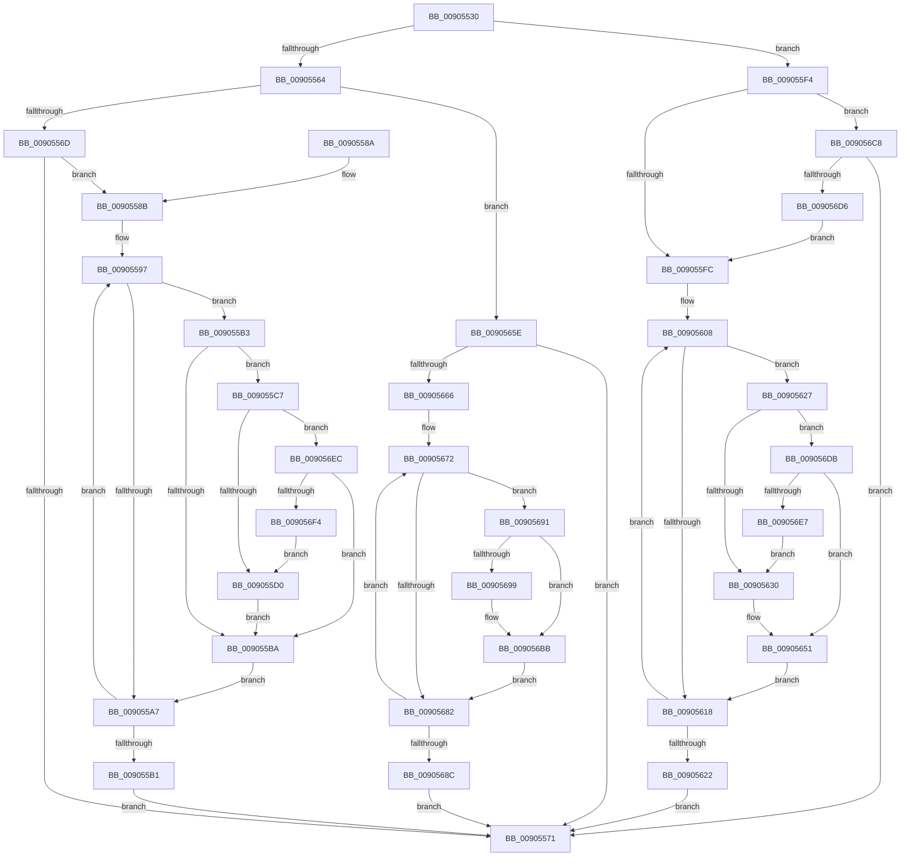

# PspCallThreadNotifyRoutines

- RVA: `0x00905530`–`0x009056F9` (길이 `457` bytes)
- VA: `0x0000000140905530`
- 실행 섹션: `PAGE`
- PDB 이름 있음: `예`; PDB Function 태그: `아니요`
- unwind 정보 RVA: `0x00088BD8`
- 디코드: `115`개 명령, `457/457` bytes 표시
- 미해석 바이트: `0` (있으면 어셈블리에 `.byte`로 보존)

> 이 문서는 커널 이미지의 기계어와 PDB 기호를 분석해 생성했습니다. 4번과 5번은 함수 원형과 자료형을 바이너리 사용 방식에서 추정한 C 해석이며 원본 소스 복구 결과는 아닙니다.

## 1. Dependencies

- 직접 호출 지점: **9**; 고유 호출 대상: **3**
- 직접 호출자로 확인된 함수: **2**
- RIP 상대 이미지 참조: **2**

### Outgoing calls
- `0x0090559A` → [ExReferenceCallBackBlock](../../text/2F/ExReferenceCallBackBlock_function_002F0040.md) (function, `0x002F0040`)
- `0x009055C0` → [ExDereferenceCallBackBlock](../../text/44/ExDereferenceCallBackBlock_function_0044D730.md) (function, `0x0044D730`)
- `0x009055ED` → [guard_dispatch_icall](../../text/6B/guard_dispatch_icall_function_006BAAD0.md) (function, `0x006BAAD0`)
- `0x0090560B` → [ExReferenceCallBackBlock](../../text/2F/ExReferenceCallBackBlock_function_002F0040.md) (function, `0x002F0040`)
- `0x0090564C` → [guard_dispatch_icall](../../text/6B/guard_dispatch_icall_function_006BAAD0.md) (function, `0x006BAAD0`)
- `0x00905657` → [ExDereferenceCallBackBlock](../../text/44/ExDereferenceCallBackBlock_function_0044D730.md) (function, `0x0044D730`)
- `0x00905675` → [ExReferenceCallBackBlock](../../text/2F/ExReferenceCallBackBlock_function_002F0040.md) (function, `0x002F0040`)
- `0x009056B6` → [guard_dispatch_icall](../../text/6B/guard_dispatch_icall_function_006BAAD0.md) (function, `0x006BAAD0`)
- `0x009056C1` → [ExDereferenceCallBackBlock](../../text/44/ExDereferenceCallBackBlock_function_0044D730.md) (function, `0x0044D730`)

### Direct callers
- [PspExitThread](PspExitThread_function_00905F60.md) at `0x009060A2`
- [PspInsertThread](../9F/PspInsertThread_function_009F0314.md) at `0x009F0B88`

### Static image references
- `0x00905553` → RVA `0x00FD9A88` (`PAGEDATA`; read)
- `0x0090558B` → RVA `0x00F06120` (`.data`; read)

## 2. Other-region calls and transfers

- 다른 실행 섹션으로 향하는 call: **9**
  - `0x0090559A` → [ExReferenceCallBackBlock](../../text/2F/ExReferenceCallBackBlock_function_002F0040.md) (`PAGE` → `.text`)
  - `0x009055C0` → [ExDereferenceCallBackBlock](../../text/44/ExDereferenceCallBackBlock_function_0044D730.md) (`PAGE` → `.text`)
  - `0x009055ED` → [guard_dispatch_icall](../../text/6B/guard_dispatch_icall_function_006BAAD0.md) (`PAGE` → `.text`)
  - `0x0090560B` → [ExReferenceCallBackBlock](../../text/2F/ExReferenceCallBackBlock_function_002F0040.md) (`PAGE` → `.text`)
  - `0x0090564C` → [guard_dispatch_icall](../../text/6B/guard_dispatch_icall_function_006BAAD0.md) (`PAGE` → `.text`)
  - `0x00905657` → [ExDereferenceCallBackBlock](../../text/44/ExDereferenceCallBackBlock_function_0044D730.md) (`PAGE` → `.text`)
  - `0x00905675` → [ExReferenceCallBackBlock](../../text/2F/ExReferenceCallBackBlock_function_002F0040.md) (`PAGE` → `.text`)
  - `0x009056B6` → [guard_dispatch_icall](../../text/6B/guard_dispatch_icall_function_006BAAD0.md) (`PAGE` → `.text`)
  - `0x009056C1` → [ExDereferenceCallBackBlock](../../text/44/ExDereferenceCallBackBlock_function_0044D730.md) (`PAGE` → `.text`)
- 별도 외부 분기/꼬리 이동을 확인하지 못했습니다.

## 3. Assembly (complete function range)

```asm
00905530  48 89 5C 24 08                  mov qword ptr [rsp + 8], rbx
00905535  48 89 6C 24 10                  mov qword ptr [rsp + 0x10], rbp
0090553A  48 89 74 24 18                  mov qword ptr [rsp + 0x18], rsi
0090553F  57                              push rdi
00905540  41 56                           push r14
00905542  41 57                           push r15
00905544  48 83 EC 20                     sub rsp, 0x20
00905548  4C 8B B9 70 06 00 00            mov r15, qword ptr [rcx + 0x670]
0090554F  44 0F B6 F2                     movzx r14d, dl
00905553  8B 05 2F 45 6D 00               mov eax, dword ptr [rip + 0x6d452f]
00905559  48 8B E9                        mov rbp, rcx
0090555C  84 D2                           test dl, dl
0090555E  0F 84 90 00 00 00               je 0x1409055f4
00905564  45 84 C0                        test r8b, r8b
00905567  0F 85 F1 00 00 00               jne 0x14090565e
0090556D  A8 08                           test al, 8
0090556F  75 1A                           jne 0x14090558b
00905571  48 8B 5C 24 40                  mov rbx, qword ptr [rsp + 0x40]
00905576  48 8B 6C 24 48                  mov rbp, qword ptr [rsp + 0x48]
0090557B  48 8B 74 24 50                  mov rsi, qword ptr [rsp + 0x50]
00905580  48 83 C4 20                     add rsp, 0x20
00905584  41 5F                           pop r15
00905586  41 5E                           pop r14
00905588  5F                              pop rdi
00905589  C3                              ret
0090558A  CC                              int3
0090558B  48 8D 1D 8E 0B 60 00            lea rbx, [rip + 0x600b8e]
00905592  BF 40 00 00 00                  mov edi, 0x40
00905597  48 8B CB                        mov rcx, rbx
0090559A  E8 A1 AA 9E FF                  call 0x1402f0040
0090559F  48 8B F0                        mov rsi, rax
009055A2  48 85 C0                        test rax, rax
009055A5  75 0C                           jne 0x1409055b3
009055A7  48 83 C3 08                     add rbx, 8
009055AB  48 83 EF 01                     sub rdi, 1
009055AF  75 E6                           jne 0x140905597
009055B1  EB BE                           jmp 0x140905571
009055B3  8B 40 10                        mov eax, dword ptr [rax + 0x10]
009055B6  A8 01                           test al, 1
009055B8  74 0D                           je 0x1409055c7
009055BA  48 8B D6                        mov rdx, rsi
009055BD  48 8B CB                        mov rcx, rbx
009055C0  E8 6B 81 B4 FF                  call 0x14044d730
009055C5  EB E0                           jmp 0x1409055a7
009055C7  4D 85 FF                        test r15, r15
009055CA  0F 85 1C 01 00 00               jne 0x1409056ec
009055D0  48 8B 8D 20 02 00 00            mov rcx, qword ptr [rbp + 0x220]
009055D7  45 0F B6 C6                     movzx r8d, r14b
009055DB  48 8B 46 08                     mov rax, qword ptr [rsi + 8]
009055DF  48 8B 95 10 05 00 00            mov rdx, qword ptr [rbp + 0x510]
009055E6  48 8B 89 D0 01 00 00            mov rcx, qword ptr [rcx + 0x1d0]
009055ED  E8 DE 54 DB FF                  call 0x1406baad0
009055F2  EB C6                           jmp 0x1409055ba
009055F4  A8 10                           test al, 0x10
009055F6  0F 84 CC 00 00 00               je 0x1409056c8
009055FC  48 8D 1D 1D 0B 60 00            lea rbx, [rip + 0x600b1d]
00905603  BF 40 00 00 00                  mov edi, 0x40
00905608  48 8B CB                        mov rcx, rbx
0090560B  E8 30 AA 9E FF                  call 0x1402f0040
00905610  48 8B F0                        mov rsi, rax
00905613  48 85 C0                        test rax, rax
00905616  75 0F                           jne 0x140905627
00905618  48 83 C3 08                     add rbx, 8
0090561C  48 83 EF 01                     sub rdi, 1
00905620  75 E6                           jne 0x140905608
00905622  E9 4A FF FF FF                  jmp 0x140905571
00905627  4D 85 FF                        test r15, r15
0090562A  0F 85 AB 00 00 00               jne 0x1409056db
00905630  48 8B 8D 20 02 00 00            mov rcx, qword ptr [rbp + 0x220]
00905637  45 33 C0                        xor r8d, r8d
0090563A  48 8B 40 08                     mov rax, qword ptr [rax + 8]
0090563E  48 8B 95 10 05 00 00            mov rdx, qword ptr [rbp + 0x510]
00905645  48 8B 89 D0 01 00 00            mov rcx, qword ptr [rcx + 0x1d0]
0090564C  E8 7F 54 DB FF                  call 0x1406baad0
00905651  48 8B D6                        mov rdx, rsi
00905654  48 8B CB                        mov rcx, rbx
00905657  E8 D4 80 B4 FF                  call 0x14044d730
0090565C  EB BA                           jmp 0x140905618
0090565E  A8 10                           test al, 0x10
00905660  0F 84 0B FF FF FF               je 0x140905571
00905666  48 8D 1D B3 0A 60 00            lea rbx, [rip + 0x600ab3]
0090566D  BF 40 00 00 00                  mov edi, 0x40
00905672  48 8B CB                        mov rcx, rbx
00905675  E8 C6 A9 9E FF                  call 0x1402f0040
0090567A  48 8B F0                        mov rsi, rax
0090567D  48 85 C0                        test rax, rax
00905680  75 0F                           jne 0x140905691
00905682  48 83 C3 08                     add rbx, 8
00905686  48 83 EF 01                     sub rdi, 1
0090568A  75 E6                           jne 0x140905672
0090568C  E9 E0 FE FF FF                  jmp 0x140905571
00905691  8B 48 10                        mov ecx, dword ptr [rax + 0x10]
00905694  F6 C1 01                        test cl, 1
00905697  74 22                           je 0x1409056bb
00905699  48 8B 8D 20 02 00 00            mov rcx, qword ptr [rbp + 0x220]
009056A0  45 0F B6 C6                     movzx r8d, r14b
009056A4  48 8B 40 08                     mov rax, qword ptr [rax + 8]
009056A8  48 8B 95 10 05 00 00            mov rdx, qword ptr [rbp + 0x510]
009056AF  48 8B 89 D0 01 00 00            mov rcx, qword ptr [rcx + 0x1d0]
009056B6  E8 15 54 DB FF                  call 0x1406baad0
009056BB  48 8B D6                        mov rdx, rsi
009056BE  48 8B CB                        mov rcx, rbx
009056C1  E8 6A 80 B4 FF                  call 0x14044d730
009056C6  EB BA                           jmp 0x140905682
009056C8  8B 05 BA 43 6D 00               mov eax, dword ptr [rip + 0x6d43ba]
009056CE  A8 08                           test al, 8
009056D0  0F 84 9B FE FF FF               je 0x140905571
009056D6  E9 21 FF FF FF                  jmp 0x1409055fc
009056DB  8B 48 10                        mov ecx, dword ptr [rax + 0x10]
009056DE  F6 C1 02                        test cl, 2
009056E1  0F 84 6A FF FF FF               je 0x140905651
009056E7  E9 44 FF FF FF                  jmp 0x140905630
009056EC  A8 02                           test al, 2
009056EE  0F 84 C6 FE FF FF               je 0x1409055ba
009056F4  E9 D7 FE FF FF                  jmp 0x1409055d0
```

## 4. C-style interpretation (structured pseudocode)

```c
__int64 __fastcall PspCallThreadNotifyRoutines(__int64 a1, unsigned __int8 a2, unsigned __int8 a3)
{
    __int64 result;
    __int64 v_rbx;
    __int64 v_rdi;
    __int64 v_rsp;
    unsigned __int64 v_stack_p10;
    unsigned __int64 v_stack_p18;
    unsigned __int64 v_stack_p8;

    v_stack_p8 = v_rbx;
    v_stack_p10 = v_rbp;
    v_stack_p18 = v_rsi;
    v_rsp = (v_rsp) - (32);
    if (a2 == 0) goto loc_009055F4;
    if (a3 != 0) goto loc_0090565E;
    if ((((unsigned __int8)((unsigned int)(*(unsigned int *)(v_rip + 7161135)))) & (8)) != 0) goto loc_0090558B;
loc_00905571:
    v_rsp = (v_rsp) + (32);
    return (unsigned int)(*(unsigned int *)(v_rip + 7161135));
loc_0090558B:
loc_00905597:
    result = ExReferenceCallBackBlock(v_rip + 6294414, a2, a3, a4);
    if (result != 0) goto loc_009055B3;
loc_009055A7:
    v_rbx = (v_rip + 6294414) + (8);
    v_rdi = (64) - (1);
    if (condition_is_not_equal) goto loc_00905597;
    goto loc_00905571;
loc_009055B3:
    if ((((unsigned __int8)((unsigned int)(*(unsigned int *)(result + 16)))) & (1)) == 0) goto loc_009055C7;
loc_009055BA:
    result = ExDereferenceCallBackBlock(v_rbx, result, a3, a4);
    goto loc_009055A7;
loc_009055C7:
    if (*(unsigned __int64 *)(a1 + 1648) != 0) goto loc_009056EC;
loc_009055D0:
    result = guard_dispatch_icall(*(unsigned __int64 *)(*(unsigned __int64 *)(v_stack_p10 + 544) + 464), *(unsigned __int64 *)(v_stack_p10 + 1296), a2, a4);
    goto loc_009055BA;
loc_009055F4:
    if ((((unsigned __int8)(result)) & (16)) == 0) goto loc_009056C8;
loc_009055FC:
loc_00905608:
    result = ExReferenceCallBackBlock(v_rip + 6294301, *(unsigned __int64 *)(v_stack_p10 + 1296), a2, a4);
    if (result != 0) goto loc_00905627;
loc_00905618:
    v_rbx = (v_rip + 6294301) + (8);
    v_rdi = (64) - (1);
    if (condition_is_not_equal) goto loc_00905608;
    goto loc_00905571;
loc_00905627:
    if (*(unsigned __int64 *)(a1 + 1648) != 0) goto loc_009056DB;
loc_00905630:
    a3 = 0;
    result = guard_dispatch_icall(*(unsigned __int64 *)(*(unsigned __int64 *)(v_stack_p10 + 544) + 464), *(unsigned __int64 *)(v_stack_p10 + 1296), a3, a4);
loc_00905651:
    result = ExDereferenceCallBackBlock(v_rbx, result, a3, a4);
    goto loc_00905618;
loc_0090565E:
    if ((((unsigned __int8)(result)) & (16)) == 0) goto loc_00905571;
loc_00905672:
    result = ExReferenceCallBackBlock(v_rip + 6294195, result, a3, a4);
    if (result != 0) goto loc_00905691;
loc_00905682:
    v_rbx = (v_rip + 6294195) + (8);
    v_rdi = (64) - (1);
    if (condition_is_not_equal) goto loc_00905672;
    goto loc_00905571;
loc_00905691:
    if ((((unsigned __int8)((unsigned int)(*(unsigned int *)(result + 16)))) & (1)) != 0) {
        a1 = *(unsigned __int64 *)(v_stack_p10 + 544);
        a3 = a2;
        result = *(unsigned __int64 *)(result + 8);
        a2 = *(unsigned __int64 *)(v_stack_p10 + 1296);
        a1 = *(unsigned __int64 *)(a1 + 464);
        result = guard_dispatch_icall(a1, a2, a3, a4);
    }
    result = ExDereferenceCallBackBlock(v_rbx, result, a3, a4);
    goto loc_00905682;
loc_009056C8:
    if ((((unsigned __int8)((unsigned int)(*(unsigned int *)(v_rip + 7160762)))) & (8)) == 0) goto loc_00905571;
    goto loc_009055FC;
loc_009056DB:
    if ((((unsigned __int8)((unsigned int)(*(unsigned int *)((unsigned int)(*(unsigned int *)(v_rip + 7160762)) + 16)))) & (2)) == 0) goto loc_00905651;
    goto loc_00905630;
loc_009056EC:
    if ((((unsigned __int8)((unsigned int)(*(unsigned int *)(v_rip + 7160762)))) & (2)) == 0) goto loc_009055BA;
    goto loc_009055D0;
}
```

## 5. (Beta) C Style

```c
int64_t PspCallThreadNotifyRoutines(void *Arg1, uint8_t Arg2, uint8_t Arg3)
{
    uint8_t *arg1 = (uint8_t *)Arg1;

    int64_t result;
    int64_t local_rbx;
    int64_t local_rdi;
    int64_t local_rsp;
    uint64_t v_stack_p10;
    uint64_t v_stack_p18;
    uint64_t v_stack_p8;

    v_stack_p8 = local_rbx;
    v_stack_p10 = local_rbp;
    v_stack_p18 = local_rsi;
    local_rsp = (local_rsp) - (32);
    if (Arg2 == 0) goto loc_009055F4;
    if (Arg3 != 0) goto loc_0090565E;
    if ((((uint8_t)((uint32_t)(*(uint32_t *)(v_rip + 0x6D452F)))) & (8)) != 0) goto loc_0090558B;
loc_00905571:
    local_rsp = (local_rsp) + (32);
    return (uint32_t)(*(uint32_t *)(v_rip + 0x6D452F));
loc_0090558B:
loc_00905597:
    result = ExReferenceCallBackBlock(v_rip + 6294414, Arg2, Arg3, a4);
    if (result != 0) goto loc_009055B3;
loc_009055A7:
    local_rbx = (v_rip + 6294414) + (8);
    local_rdi = (64) - (1);
    if (condition_is_not_equal) goto loc_00905597;
    goto loc_00905571;
loc_009055B3:
    if ((((uint8_t)((uint32_t)(*(uint32_t *)(result + 0x10)))) & (1)) == 0) goto loc_009055C7;
loc_009055BA:
    result = ExDereferenceCallBackBlock(local_rbx, result, Arg3, a4);
    goto loc_009055A7;
loc_009055C7:
    if (*(uint64_t *)(arg1 + 0x670) != 0) goto loc_009056EC;
loc_009055D0:
    result = guard_dispatch_icall(*(uint64_t *)(*(uint64_t *)(v_stack_p10 + 0x220) + 0x1D0), *(uint64_t *)(v_stack_p10 + 0x510), Arg2, a4);
    goto loc_009055BA;
loc_009055F4:
    if ((((uint8_t)(result)) & (16)) == 0) goto loc_009056C8;
loc_009055FC:
loc_00905608:
    result = ExReferenceCallBackBlock(v_rip + 6294301, *(uint64_t *)(v_stack_p10 + 0x510), Arg2, a4);
    if (result != 0) goto loc_00905627;
loc_00905618:
    local_rbx = (v_rip + 6294301) + (8);
    local_rdi = (64) - (1);
    if (condition_is_not_equal) goto loc_00905608;
    goto loc_00905571;
loc_00905627:
    if (*(uint64_t *)(arg1 + 0x670) != 0) goto loc_009056DB;
loc_00905630:
    Arg3 = 0;
    result = guard_dispatch_icall(*(uint64_t *)(*(uint64_t *)(v_stack_p10 + 0x220) + 0x1D0), *(uint64_t *)(v_stack_p10 + 0x510), Arg3, a4);
loc_00905651:
    result = ExDereferenceCallBackBlock(local_rbx, result, Arg3, a4);
    goto loc_00905618;
loc_0090565E:
    if ((((uint8_t)(result)) & (16)) == 0) goto loc_00905571;
loc_00905672:
    result = ExReferenceCallBackBlock(v_rip + 6294195, result, Arg3, a4);
    if (result != 0) goto loc_00905691;
loc_00905682:
    local_rbx = (v_rip + 6294195) + (8);
    local_rdi = (64) - (1);
    if (condition_is_not_equal) goto loc_00905672;
    goto loc_00905571;
loc_00905691:
    if ((((uint8_t)((uint32_t)(*(uint32_t *)(result + 0x10)))) & (1)) != 0) {
        Arg1 = *(uint64_t *)(v_stack_p10 + 0x220);
        Arg3 = Arg2;
        result = *(uint64_t *)(result + 0x8);
        Arg2 = *(uint64_t *)(v_stack_p10 + 0x510);
        Arg1 = *(uint64_t *)(arg1 + 0x1D0);
        result = guard_dispatch_icall(Arg1, Arg2, Arg3, a4);
    }
    result = ExDereferenceCallBackBlock(local_rbx, result, Arg3, a4);
    goto loc_00905682;
loc_009056C8:
    if ((((uint8_t)((uint32_t)(*(uint32_t *)(v_rip + 0x6D43BA)))) & (8)) == 0) goto loc_00905571;
    goto loc_009055FC;
loc_009056DB:
    if ((((uint8_t)((uint32_t)(*(uint32_t *)((uint32_t)(*(uint32_t *)(v_rip + 0x6D43BA)) + 0x10)))) & (2)) == 0) goto loc_00905651;
    goto loc_00905630;
loc_009056EC:
    if ((((uint8_t)((uint32_t)(*(uint32_t *)(v_rip + 0x6D43BA)))) & (2)) == 0) goto loc_009055BA;
    goto loc_009055D0;
}
```

### 관측된 메모리 오프셋

구조체 형식이 확인되지 않은 접근은 인자 기준의 오프셋으로만 기록했습니다.

| 기준 인자 | 오프셋 표현 | 폭 (bit) | 접근 |
|---|---:|---:|---|
| `Arg1` | `+ 0x220` | `64` | `R` |
| `Arg1` | `+ 0x510` | `64` | `R` |
| `Arg1` | `+ 0x670` | `64` | `R` |

## 6. Execution-region graph

[열기: 2D/3D 그래프와 함수 탐색 컨트롤 패널](../../../control-panel.html?section=page&rva=0x00905530&view=graph)

- 2D 그래프는 위에서 아래로 흐르고, 3D 그래프는 빈 공간을 드래그해 회전합니다. Shift+드래그는 이동, 휠은 확대·축소, 함수 노드 선택은 대상 보고서 이동입니다.

### Static fallback


