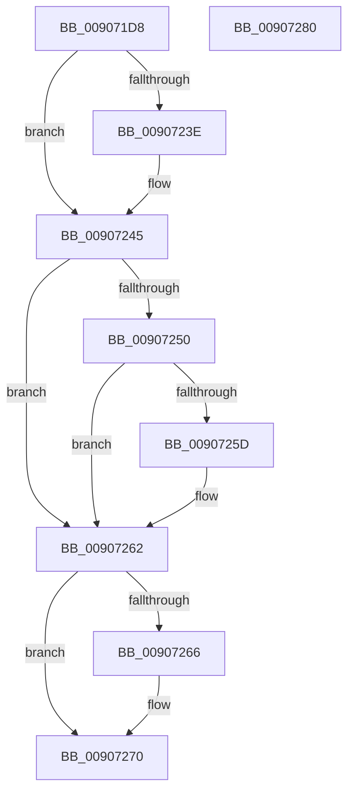

# PspClearProcessThreadCidRefs

- RVA: `0x009071D8`–`0x00907281` (길이 `169` bytes)
- VA: `0x00000001409071D8`
- 실행 섹션: `PAGE`
- PDB 이름 있음: `예`; PDB Function 태그: `아니요`
- unwind 정보 RVA: `0x000794E0`
- 디코드: `46`개 명령, `169/169` bytes 표시
- 미해석 바이트: `0` (있으면 어셈블리에 `.byte`로 보존)

> 이 문서는 커널 이미지의 기계어와 PDB 기호를 분석해 생성했습니다. 4번과 5번은 함수 원형과 자료형을 바이너리 사용 방식에서 추정한 C 해석이며 원본 소스 복구 결과는 아닙니다.

## 1. Dependencies

- 직접 호출 지점: **4**; 고유 호출 대상: **4**
- 직접 호출자로 확인된 함수: **2**
- RIP 상대 이미지 참조: **1**

### Outgoing calls
- `0x009071FC` → [ExMapHandleToPointer](../86/ExMapHandleToPointer_function_00868B60.md) (function, `0x00868B60`)
- `0x00907240` → [ExfUnblockPushLock](../../text/2A/ExfUnblockPushLock_function_002A3FE0.md) (function, `0x002A3FE0`)
- `0x0090725D` → [KiCheckForKernelApcDelivery](../../text/2E/KiCheckForKernelApcDelivery_function_002E2C80.md) (function, `0x002E2C80`)
- `0x0090726B` → [ObDereferenceObjectEx](../../text/43/ObDereferenceObjectEx_function_0043BD80.md) (function, `0x0043BD80`)

### Direct callers
- [PspExitThread](PspExitThread_function_00905F60.md) at `0x00905FC6`
- [PspRundownSingleProcess](PspRundownSingleProcess_function_00906D50.md) at `0x00906F61`

### Static image references
- `0x009071F5` → RVA `0x00FC6CA8` (`ALMOSTRO`; read)

## 2. Other-region calls and transfers

- 다른 실행 섹션으로 향하는 call: **3**
  - `0x00907240` → [ExfUnblockPushLock](../../text/2A/ExfUnblockPushLock_function_002A3FE0.md) (`PAGE` → `.text`)
  - `0x0090725D` → [KiCheckForKernelApcDelivery](../../text/2E/KiCheckForKernelApcDelivery_function_002E2C80.md) (`PAGE` → `.text`)
  - `0x0090726B` → [ObDereferenceObjectEx](../../text/43/ObDereferenceObjectEx_function_0043BD80.md) (`PAGE` → `.text`)
- 별도 외부 분기/꼬리 이동을 확인하지 못했습니다.

## 3. Assembly (complete function range)

```asm
009071D8  48 89 5C 24 08                  mov qword ptr [rsp + 8], rbx
009071DD  48 89 74 24 10                  mov qword ptr [rsp + 0x10], rsi
009071E2  57                              push rdi
009071E3  48 83 EC 30                     sub rsp, 0x30
009071E7  66 FF 89 E6 01 00 00            dec word ptr [rcx + 0x1e6]
009071EE  48 8B D9                        mov rbx, rcx
009071F1  90                              nop
009071F2  49 8B F0                        mov rsi, r8
009071F5  48 8B 0D AC FA 6B 00            mov rcx, qword ptr [rip + 0x6bfaac]
009071FC  E8 5F 19 F6 FF                  call 0x140868b60
00907201  0F 57 C0                        xorps xmm0, xmm0
00907204  0F 11 44 24 20                  movups xmmword ptr [rsp + 0x20], xmm0
00907209  48 8B 10                        mov rdx, qword ptr [rax]
0090720C  48 8B CA                        mov rcx, rdx
0090720F  48 81 E1 01 00 FE FF            and rcx, 0xfffffffffffe0001
00907216  48 89 4C 24 20                  mov qword ptr [rsp + 0x20], rcx
0090721B  48 D1 EA                        shr rdx, 1
0090721E  48 89 08                        mov qword ptr [rax], rcx
00907221  48 8B 0D 80 FA 6B 00            mov rcx, qword ptr [rip + 0x6bfa80]
00907228  0F B7 FA                        movzx edi, dx
0090722B  F0 48 FF 00                     lock inc qword ptr [rax]
0090722F  48 83 C1 30                     add rcx, 0x30
00907233  F0 83 0C 24 00                  lock or dword ptr [rsp], 0
00907238  48 83 39 00                     cmp qword ptr [rcx], 0
0090723C  74 07                           je 0x140907245
0090723E  33 D2                           xor edx, edx
00907240  E8 9B CD 99 FF                  call 0x1402a3fe0
00907245  90                              nop
00907246  66 83 83 E6 01 00 00 01         add word ptr [rbx + 0x1e6], 1
0090724E  75 12                           jne 0x140907262
00907250  48 8D 83 98 00 00 00            lea rax, [rbx + 0x98]
00907257  90                              nop
00907258  48 39 00                        cmp qword ptr [rax], rax
0090725B  74 05                           je 0x140907262
0090725D  E8 1E BA 9D FF                  call 0x1402e2c80
00907262  85 FF                           test edi, edi
00907264  74 0A                           je 0x140907270
00907266  8B D7                           mov edx, edi
00907268  48 8B CE                        mov rcx, rsi
0090726B  E8 10 4B B3 FF                  call 0x14043bd80
00907270  48 8B 5C 24 40                  mov rbx, qword ptr [rsp + 0x40]
00907275  48 8B 74 24 48                  mov rsi, qword ptr [rsp + 0x48]
0090727A  48 83 C4 30                     add rsp, 0x30
0090727E  5F                              pop rdi
0090727F  C3                              ret
00907280  CC                              int3
```

## 4. C-style interpretation (structured pseudocode)

```c
__int64 __fastcall PspClearProcessThreadCidRefs(__int64 a1, __int64 a2, __int64 a3)
{
    __int64 result;
    __int64 v_rsp;
    unsigned __int64 v_stack_m18;
    unsigned int v_stack_m38;
    unsigned __int64 v_stack_p10;
    unsigned __int64 v_stack_p8;

    v_stack_p8 = v_rbx;
    v_stack_p10 = v_rsi;
    v_rsp = (v_rsp) - (48);
    result = ExMapHandleToPointer(*(unsigned __int64 *)(v_rip + 7076524), a2, a3, a4);
    v_stack_m18 = v_xmm0;
    a1 = (*(unsigned __int64 *)(result)) & (0xFFFFFFFFFFFE0001ULL);
    v_stack_m18 = a1;
    a2 = (*(unsigned __int64 *)(result)) >> (1);
    *(unsigned __int64 *)(result) = a1;
    a1 = (*(unsigned __int64 *)(v_rip + 7076480)) + (48);
    if ((*(unsigned __int64 *)(a1)) != 0) {
        a2 = 0;
        result = ExfUnblockPushLock(a1, a2, a3, a4);
    }
    if (condition_is_not_equal) goto loc_00907262;
    result = a1 + 152;
    if ((*(unsigned __int64 *)(a1 + 152)) != (a1 + 152)) {
        result = KiCheckForKernelApcDelivery(a1, a2, a3, a4);
    }
    if ((unsigned int)((unsigned __int16)(a2)) != 0) {
        a2 = (unsigned int)((unsigned __int16)(a2));
        a1 = a3;
        result = ObDereferenceObjectEx(a1, a2, a3, a4);
    }
    v_rsp = (v_rsp) + (48);
    return result;
}
```

## 5. (Beta) C Style

```c
int64_t PspClearProcessThreadCidRefs(void *Arg1, int64_t Arg2, int64_t Arg3)
{
    uint8_t *arg1 = (uint8_t *)Arg1;

    int64_t result;
    int64_t local_rsp;
    uint64_t v_stack_m18;
    uint32_t v_stack_m38;
    uint64_t v_stack_p10;
    uint64_t v_stack_p8;

    v_stack_p8 = local_rbx;
    v_stack_p10 = local_rsi;
    local_rsp = (local_rsp) - (48);
    result = ExMapHandleToPointer(*(uint64_t *)(v_rip + 0x6BFAAC), Arg2, Arg3, a4);
    v_stack_m18 = v_xmm0;
    Arg1 = (*(uint64_t *)(result)) & (0xFFFFFFFFFFFE0001ULL);
    v_stack_m18 = Arg1;
    Arg2 = (*(uint64_t *)(result)) >> (1);
    *(void **)(result) = Arg1;
    Arg1 = (*(uint64_t *)(v_rip + 0x6BFA80)) + (48);
    if ((*(uint64_t *)(arg1)) != 0) {
        Arg2 = 0;
        result = ExfUnblockPushLock(Arg1, Arg2, Arg3, a4);
    }
    if (condition_is_not_equal) goto loc_00907262;
    result = Arg1 + 152;
    if ((*(uint64_t *)(arg1 + 0x98)) != (Arg1 + 152)) {
        result = KiCheckForKernelApcDelivery(Arg1, Arg2, Arg3, a4);
    }
    if ((uint32_t)((uint16_t)(Arg2)) != 0) {
        Arg2 = (uint32_t)((uint16_t)(Arg2));
        Arg1 = Arg3;
        result = ObDereferenceObjectEx(Arg1, Arg2, Arg3, a4);
    }
    local_rsp = (local_rsp) + (48);
    return result;
}
```

### 관측된 메모리 오프셋

구조체 형식이 확인되지 않은 접근은 인자 기준의 오프셋으로만 기록했습니다.

| 기준 인자 | 오프셋 표현 | 폭 (bit) | 접근 |
|---|---:|---:|---|
| `Arg1` | `+ 0x0` | `64` | `R` |
| `Arg1` | `+ 0x98` | `64` | `R` |
| `Arg1` | `+ 0x1E6` | `16` | `R/W` |

## 6. Execution-region graph

[열기: 2D/3D 그래프와 함수 탐색 컨트롤 패널](../../../control-panel.html?section=page&rva=0x009071D8&view=graph)

- 2D 그래프는 위에서 아래로 흐르고, 3D 그래프는 빈 공간을 드래그해 회전합니다. Shift+드래그는 이동, 휠은 확대·축소, 함수 노드 선택은 대상 보고서 이동입니다.

### Static fallback


