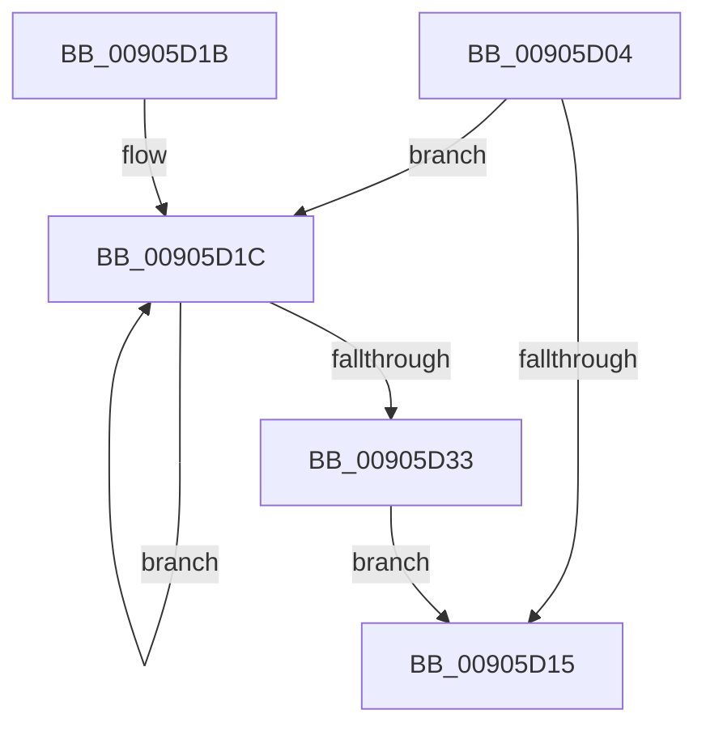

# PspEmptyPropertySet

- RVA: `0x00905D04`–`0x00905D35` (길이 `49` bytes)
- VA: `0x0000000140905D04`
- 실행 섹션: `PAGE`
- PDB 이름 있음: `예`; PDB Function 태그: `아니요`
- unwind 정보 RVA: `0x00064C68`
- 디코드: `18`개 명령, `49/49` bytes 표시
- 미해석 바이트: `0` (있으면 어셈블리에 `.byte`로 보존)

> 이 문서는 커널 이미지의 기계어와 PDB 기호를 분석해 생성했습니다. 4번과 5번은 함수 원형과 자료형을 바이너리 사용 방식에서 추정한 C 해석이며 원본 소스 복구 결과는 아닙니다.

## 1. Dependencies

- 직접 호출 지점: **1**; 고유 호출 대상: **1**
- 직접 호출자로 확인된 함수: **2**
- RIP 상대 이미지 참조: **0**

### Outgoing calls
- `0x00905D26` → [PspRemoveProperty](../../text/43/PspRemoveProperty_function_00434C10.md) (function, `0x00434C10`)

### Direct callers
- [PspJobDelete](../../text/4B/PspJobDelete_function_004BF8F0.md) at `0x004BF951`
- [PspExitThread](PspExitThread_function_00905F60.md) at `0x0090602B`

### Static image references
- 디코드된 RIP-relative 메모리 참조가 없습니다.

## 2. Other-region calls and transfers

- 다른 실행 섹션으로 향하는 call: **1**
  - `0x00905D26` → [PspRemoveProperty](../../text/43/PspRemoveProperty_function_00434C10.md) (`PAGE` → `.text`)
- 별도 외부 분기/꼬리 이동을 확인하지 못했습니다.

## 3. Assembly (complete function range)

```asm
00905D04  40 53                           push rbx
00905D06  48 83 EC 20                     sub rsp, 0x20
00905D0A  48 8B 01                        mov rax, qword ptr [rcx]
00905D0D  48 8B D9                        mov rbx, rcx
00905D10  48 3B C1                        cmp rax, rcx
00905D13  75 07                           jne 0x140905d1c
00905D15  48 83 C4 20                     add rsp, 0x20
00905D19  5B                              pop rbx
00905D1A  C3                              ret
00905D1B  CC                              int3
00905D1C  48 8B 50 10                     mov rdx, qword ptr [rax + 0x10]
00905D20  45 33 C0                        xor r8d, r8d
00905D23  48 8B CB                        mov rcx, rbx
00905D26  E8 E5 EE B2 FF                  call 0x140434c10
00905D2B  48 8B 03                        mov rax, qword ptr [rbx]
00905D2E  48 3B C3                        cmp rax, rbx
00905D31  75 E9                           jne 0x140905d1c
00905D33  EB E0                           jmp 0x140905d15
```

## 4. C-style interpretation (structured pseudocode)

```c
__int64 __fastcall PspEmptyPropertySet(__int64 a1, __int64 a2, int a3)
{
    __int64 result;
    __int64 v_rsp;

    v_rsp = (v_rsp) - (32);
    if ((*(unsigned __int64 *)(a1)) != a1) goto loc_00905D1C;
loc_00905D15:
    v_rsp = (v_rsp) + (32);
    return *(unsigned __int64 *)(a1);
loc_00905D1C:
    a3 = 0;
    result = PspRemoveProperty(a1, *(unsigned __int64 *)(*(unsigned __int64 *)(a1) + 16), a3, a4);
    if ((*(unsigned __int64 *)(a1)) != a1) goto loc_00905D1C;
    goto loc_00905D15;
}
```

## 5. (Beta) C Style

```c
int64_t PspEmptyPropertySet(void *Arg1, int64_t Arg2, int32_t Arg3)
{
    uint8_t *arg1 = (uint8_t *)Arg1;

    int64_t result;
    int64_t local_rsp;

    local_rsp = (local_rsp) - (32);
    if ((*(uint64_t *)(arg1)) != Arg1) goto loc_00905D1C;
loc_00905D15:
    local_rsp = (local_rsp) + (32);
    return *(uint64_t *)(arg1);
loc_00905D1C:
    Arg3 = 0;
    result = PspRemoveProperty(Arg1, *(uint64_t *)(*(uint64_t *)(arg1) + 0x10), Arg3, a4);
    if ((*(uint64_t *)(arg1)) != Arg1) goto loc_00905D1C;
    goto loc_00905D15;
}
```

### 관측된 메모리 오프셋

구조체 형식이 확인되지 않은 접근은 인자 기준의 오프셋으로만 기록했습니다.

| 기준 인자 | 오프셋 표현 | 폭 (bit) | 접근 |
|---|---:|---:|---|
| `Arg1` | `+ 0x0` | `64` | `R` |

## 6. Execution-region graph

[열기: 2D/3D 그래프와 함수 탐색 컨트롤 패널](../../../control-panel.html?section=page&rva=0x00905D04&view=graph)

- 2D 그래프는 위에서 아래로 흐르고, 3D 그래프는 빈 공간을 드래그해 회전합니다. Shift+드래그는 이동, 휠은 확대·축소, 함수 노드 선택은 대상 보고서 이동입니다.

### Static fallback


