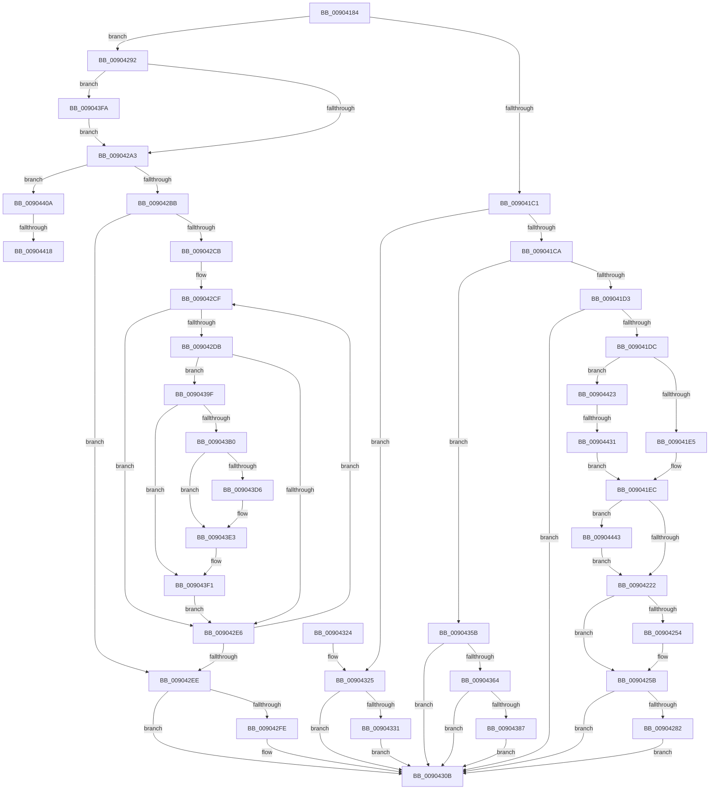

# PspExitLastThread

- RVA: `0x00904184`–`0x00904456` (길이 `722` bytes)
- VA: `0x0000000140904184`
- 실행 섹션: `PAGE`
- PDB 이름 있음: `예`; PDB Function 태그: `예`
- unwind 정보 RVA: `0x00088AB4`
- 디코드: `181`개 명령, `722/722` bytes 표시
- 미해석 바이트: `0` (있으면 어셈블리에 `.byte`로 보존)

> 이 문서는 커널 이미지의 기계어와 PDB 기호를 분석해 생성했습니다. 4번과 5번은 함수 원형과 자료형을 바이너리 사용 방식에서 추정한 C 해석이며 원본 소스 복구 결과는 아닙니다.

## 1. Dependencies

- 직접 호출 지점: **26**; 고유 호출 대상: **23**
- 직접 호출자로 확인된 함수: **2**
- RIP 상대 이미지 참조: **1**

### Outgoing calls
- `0x009041F8` → [PspExitProcess](PspExitProcess_function_00904830.md) (function, `0x00904830`)
- `0x00904205` → [PsReferencePrimaryTokenWithTag](../../text/20/PsReferencePrimaryTokenWithTag_function_0020FF80.md) (function, `0x0020FF80`)
- `0x00904215` → [SeAuditingWithTokenForSubcategory](SeAuditingWithTokenForSubcategory_function_009047D0.md) (function, `0x009047D0`)
- `0x00904232` → [ObFastDereferenceObject](../../text/3E/ObFastDereferenceObject_function_003ED5F0.md) (function, `0x003ED5F0`)
- `0x00904256` → [ExpWnfDeleteProcessContext](ExpWnfDeleteProcessContext_function_00908270.md) (function, `0x00908270`)
- `0x0090425B` → [KeLeaveCriticalRegion](../../text/25/KeLeaveCriticalRegion_function_0025D8B0.md) (function, `0x0025D8B0`)
- `0x00904265` → [PspRundownSingleProcess](PspRundownSingleProcess_function_00906D50.md) (function, `0x00906D50`)
- `0x0090426D` → [LpcExitProcess](LpcExitProcess_function_00907920.md) (function, `0x00907920`)
- `0x00904284` → [ExFreePoolWithTag](../../poolcode/B8/ExFreePoolWithTag_function_00B82870.md) (function, `0x00B82870`)
- `0x009042A6` → [KeForceResumeProcess](../../text/3C/KeForceResumeProcess_function_003C1BE4.md) (function, `0x003C1BE4`)
- `0x009042F4` → [PspUnlockProcessExclusive](../../text/46/PspUnlockProcessExclusive_function_004601C0.md) (function, `0x004601C0`)
- `0x00904306` → [ObfDereferenceObjectWithTag](../../text/2F/ObfDereferenceObjectWithTag_function_002F78E0.md) (function, `0x002F78E0`)
- `0x00904334` → [PsGetProcessServerSilo](../../text/44/PsGetProcessServerSilo_function_0044BEE0.md) (function, `0x0044BEE0`)
- `0x00904354` → [PspCatchCriticalBreak](../78/PspCatchCriticalBreak_function_00786408.md) (function, `0x00786408`)
- `0x0090437E` → [PspUpdateCalloutParameters](../../text/49/PspUpdateCalloutParameters_function_0049BBA4.md) (function, `0x0049BBA4`)
- `0x00904387` → [PsSessionGetWin32Callouts](../../text/47/PsSessionGetWin32Callouts_function_00474F98.md) (function, `0x00474F98`)
- `0x00904395` → [ExCallCallBack](ExCallCallBack_function_009054B4.md) (function, `0x009054B4`)
- `0x009043A7` → [ObReferenceObjectSafeWithTag](../../text/21/ObReferenceObjectSafeWithTag_function_00210EE0.md) (function, `0x00210EE0`)
- `0x009043B6` → [PspUnlockProcessExclusive](../../text/46/PspUnlockProcessExclusive_function_004601C0.md) (function, `0x004601C0`)
- `0x009043CC` → [KeWaitForSingleObject](../../text/20/KeWaitForSingleObject_function_0020E6B0.md) (function, `0x0020E6B0`)
- `0x009043DE` → [ObfDereferenceObjectWithTag](../../text/2F/ObfDereferenceObjectWithTag_function_002F78E0.md) (function, `0x002F78E0`)
- `0x009043EC` → [PspLockProcessExclusive](../../text/46/PspLockProcessExclusive_function_00460164.md) (function, `0x00460164`)
- `0x00904400` → [PspLockProcessExclusive](../../text/46/PspLockProcessExclusive_function_00460164.md) (function, `0x00460164`)
- `0x00904423` → [KeQuerySystemTimeUnsafe](../../text/48/KeQuerySystemTimeUnsafe_function_00484438.md) (function, `0x00484438`)
- `0x00904435` → [KeQuerySystemTimePrecise](../../text/37/KeQuerySystemTimePrecise_function_0037DA40.md) (function, `0x0037DA40`)
- `0x0090444C` → [SeAuditProcessExit](../79/SeAuditProcessExit_function_0079EA08.md) (function, `0x0079EA08`)

### Direct callers
- [PsTerminateMinimalProcess](../78/PsTerminateMinimalProcess_function_007861A8.md) at `0x00786297`
- [PsTerminateMinimalProcess](../78/PsTerminateMinimalProcess_function_007861A8.md) at `0x007862AB`
- [PsTerminateMinimalProcess](../78/PsTerminateMinimalProcess_function_007861A8.md) at `0x007862C0`
- [PsTerminateMinimalProcess](../78/PsTerminateMinimalProcess_function_007861A8.md) at `0x007862D5`
- [PspExitThread](PspExitThread_function_00905F60.md) at `0x009064ED`
- [PspExitThread](PspExitThread_function_00905F60.md) at `0x00906506`
- [PspExitThread](PspExitThread_function_00905F60.md) at `0x0090651F`
- [PspExitThread](PspExitThread_function_00905F60.md) at `0x00906601`

### Static image references
- `0x00904346` → RVA `0x00B05060` (` ?? ::NNGAKEGL::`string'`; read)

## 2. Other-region calls and transfers

- 다른 실행 섹션으로 향하는 call: **18**
  - `0x00904205` → [PsReferencePrimaryTokenWithTag](../../text/20/PsReferencePrimaryTokenWithTag_function_0020FF80.md) (`PAGE` → `.text`)
  - `0x00904232` → [ObFastDereferenceObject](../../text/3E/ObFastDereferenceObject_function_003ED5F0.md) (`PAGE` → `.text`)
  - `0x0090425B` → [KeLeaveCriticalRegion](../../text/25/KeLeaveCriticalRegion_function_0025D8B0.md) (`PAGE` → `.text`)
  - `0x00904284` → [ExFreePoolWithTag](../../poolcode/B8/ExFreePoolWithTag_function_00B82870.md) (`PAGE` → `POOLCODE`)
  - `0x009042A6` → [KeForceResumeProcess](../../text/3C/KeForceResumeProcess_function_003C1BE4.md) (`PAGE` → `.text`)
  - `0x009042F4` → [PspUnlockProcessExclusive](../../text/46/PspUnlockProcessExclusive_function_004601C0.md) (`PAGE` → `.text`)
  - `0x00904306` → [ObfDereferenceObjectWithTag](../../text/2F/ObfDereferenceObjectWithTag_function_002F78E0.md) (`PAGE` → `.text`)
  - `0x00904334` → [PsGetProcessServerSilo](../../text/44/PsGetProcessServerSilo_function_0044BEE0.md) (`PAGE` → `.text`)
  - `0x0090437E` → [PspUpdateCalloutParameters](../../text/49/PspUpdateCalloutParameters_function_0049BBA4.md) (`PAGE` → `.text`)
  - `0x00904387` → [PsSessionGetWin32Callouts](../../text/47/PsSessionGetWin32Callouts_function_00474F98.md) (`PAGE` → `.text`)
  - `0x009043A7` → [ObReferenceObjectSafeWithTag](../../text/21/ObReferenceObjectSafeWithTag_function_00210EE0.md) (`PAGE` → `.text`)
  - `0x009043B6` → [PspUnlockProcessExclusive](../../text/46/PspUnlockProcessExclusive_function_004601C0.md) (`PAGE` → `.text`)
  - `0x009043CC` → [KeWaitForSingleObject](../../text/20/KeWaitForSingleObject_function_0020E6B0.md) (`PAGE` → `.text`)
  - `0x009043DE` → [ObfDereferenceObjectWithTag](../../text/2F/ObfDereferenceObjectWithTag_function_002F78E0.md) (`PAGE` → `.text`)
  - `0x009043EC` → [PspLockProcessExclusive](../../text/46/PspLockProcessExclusive_function_00460164.md) (`PAGE` → `.text`)
  - `0x00904400` → [PspLockProcessExclusive](../../text/46/PspLockProcessExclusive_function_00460164.md) (`PAGE` → `.text`)
  - `0x00904423` → [KeQuerySystemTimeUnsafe](../../text/48/KeQuerySystemTimeUnsafe_function_00484438.md) (`PAGE` → `.text`)
  - `0x00904435` → [KeQuerySystemTimePrecise](../../text/37/KeQuerySystemTimePrecise_function_0037DA40.md) (`PAGE` → `.text`)
- call이 아닌 외부 분기/꼬리 이동: **3**
  - `0x00904412` → [sub_00B20CFC](../B2/Unknown_function_00B20CFC.md) (`tail-transfer`)
  - `0x0090441E` → [sub_00B20CFC](../B2/Unknown_function_00B20CFC.md) (`tail-transfer`)
  - `0x0090442B` → [sub_00B20CFC + 0xB](../B2/Unknown_function_00B20CFC.md) (`tail-transfer`)

## 3. Assembly (complete function range)

```asm
00904184  48 89 5C 24 08                  mov qword ptr [rsp + 8], rbx
00904189  48 89 74 24 10                  mov qword ptr [rsp + 0x10], rsi
0090418E  4C 89 4C 24 20                  mov qword ptr [rsp + 0x20], r9
00904193  55                              push rbp
00904194  57                              push rdi
00904195  41 54                           push r12
00904197  41 55                           push r13
00904199  41 57                           push r15
0090419B  48 8B EC                        mov rbp, rsp
0090419E  48 83 EC 60                     sub rsp, 0x60
009041A2  33 F6                           xor esi, esi
009041A4  49 8B D8                        mov rbx, r8
009041A7  45 33 C0                        xor r8d, r8d
009041AA  48 89 75 D0                     mov qword ptr [rbp - 0x30], rsi
009041AE  48 89 75 E0                     mov qword ptr [rbp - 0x20], rsi
009041B2  49 8B C1                        mov rax, r9
009041B5  48 89 75 E8                     mov qword ptr [rbp - 0x18], rsi
009041B9  85 C9                           test ecx, ecx
009041BB  0F 84 D1 00 00 00               je 0x140904292
009041C1  83 F9 01                        cmp ecx, 1
009041C4  0F 84 5B 01 00 00               je 0x140904325
009041CA  83 F9 02                        cmp ecx, 2
009041CD  0F 84 88 01 00 00               je 0x14090435b
009041D3  83 F9 03                        cmp ecx, 3
009041D6  0F 85 2F 01 00 00               jne 0x14090430b
009041DC  48 85 C0                        test rax, rax
009041DF  0F 84 3E 02 00 00               je 0x140904423
009041E5  49 8B 81 C8 04 00 00            mov rax, qword ptr [r9 + 0x4c8]
009041EC  48 8B D3                        mov rdx, rbx
009041EF  48 89 83 C0 05 00 00            mov qword ptr [rbx + 0x5c0], rax
009041F6  B1 01                           mov cl, 1
009041F8  E8 33 06 00 00                  call 0x140904830
009041FD  BA 50 73 54 65                  mov edx, 0x65547350
00904202  48 8B CB                        mov rcx, rbx
00904205  E8 76 BD 90 FF                  call 0x14020ff80
0090420A  48 8B D0                        mov rdx, rax
0090420D  B9 87 00 00 00                  mov ecx, 0x87
00904212  48 8B F8                        mov rdi, rax
00904215  E8 B6 05 00 00                  call 0x1409047d0
0090421A  84 C0                           test al, al
0090421C  0F 85 21 02 00 00               jne 0x140904443
00904222  48 8D 8B 48 02 00 00            lea rcx, [rbx + 0x248]
00904229  41 B8 50 73 54 65               mov r8d, 0x65547350
0090422F  48 8B D7                        mov rdx, rdi
00904232  E8 B9 93 AE FF                  call 0x1403ed5f0
00904237  65 48 8B 04 25 88 01 00 00      mov rax, qword ptr gs:[0x188]
00904240  66 FF 88 E4 01 00 00            dec word ptr [rax + 0x1e4]
00904247  90                              nop
00904248  48 8B 8B E8 05 00 00            mov rcx, qword ptr [rbx + 0x5e8]
0090424F  48 85 C9                        test rcx, rcx
00904252  74 07                           je 0x14090425b
00904254  33 D2                           xor edx, edx
00904256  E8 15 40 00 00                  call 0x140908270
0090425B  E8 50 96 95 FF                  call 0x14025d8b0
00904260  B2 01                           mov dl, 1
00904262  48 8B CB                        mov rcx, rbx
00904265  E8 E6 2A 00 00                  call 0x140906d50
0090426A  48 8B CB                        mov rcx, rbx
0090426D  E8 AE 36 00 00                  call 0x140907920
00904272  48 8B 8B C8 05 00 00            mov rcx, qword ptr [rbx + 0x5c8]
00904279  48 85 C9                        test rcx, rcx
0090427C  0F 84 89 00 00 00               je 0x14090430b
00904282  33 D2                           xor edx, edx
00904284  E8 E7 E5 27 00                  call 0x140b82870
00904289  48 89 B3 C8 05 00 00            mov qword ptr [rbx + 0x5c8], rsi
00904290  EB 79                           jmp 0x14090430b
00904292  65 4C 8B 24 25 88 01 00 00      mov r12, qword ptr gs:[0x188]
0090429B  84 D2                           test dl, dl
0090429D  0F 84 57 01 00 00               je 0x1409043fa
009042A3  48 8B CB                        mov rcx, rbx
009042A6  E8 39 D9 AB FF                  call 0x1403c1be4
009042AB  81 BB 54 05 00 00 03 01 00 00   cmp dword ptr [rbx + 0x554], 0x103
009042B5  0F 84 4F 01 00 00               je 0x14090440a
009042BB  4C 8D AB 70 03 00 00            lea r13, [rbx + 0x370]
009042C2  49 8B 7D 00                     mov rdi, qword ptr [r13]
009042C6  49 3B FD                        cmp rdi, r13
009042C9  74 23                           je 0x1409042ee
009042CB  48 8B 45 48                     mov rax, qword ptr [rbp + 0x48]
009042CF  4C 8D BF 88 FA FF FF            lea r15, [rdi - 0x578]
009042D6  4C 3B F8                        cmp r15, rax
009042D9  74 0B                           je 0x1409042e6
009042DB  41 80 7F 04 00                  cmp byte ptr [r15 + 4], 0
009042E0  0F 84 B9 00 00 00               je 0x14090439f
009042E6  48 8B 3F                        mov rdi, qword ptr [rdi]
009042E9  49 3B FD                        cmp rdi, r13
009042EC  75 E1                           jne 0x1409042cf
009042EE  49 8B D4                        mov rdx, r12
009042F1  48 8B CB                        mov rcx, rbx
009042F4  E8 C7 BE B5 FF                  call 0x1404601c0
009042F9  48 85 F6                        test rsi, rsi
009042FC  74 0D                           je 0x14090430b
009042FE  BA 50 73 54 65                  mov edx, 0x65547350
00904303  48 8B CE                        mov rcx, rsi
00904306  E8 D5 35 9F FF                  call 0x1402f78e0
0090430B  4C 8D 5C 24 60                  lea r11, [rsp + 0x60]
00904310  49 8B 5B 30                     mov rbx, qword ptr [r11 + 0x30]
00904314  49 8B 73 38                     mov rsi, qword ptr [r11 + 0x38]
00904318  49 8B E3                        mov rsp, r11
0090431B  41 5F                           pop r15
0090431D  41 5D                           pop r13
0090431F  41 5C                           pop r12
00904321  5F                              pop rdi
00904322  5D                              pop rbp
00904323  C3                              ret
00904324  CC                              int3
00904325  F7 83 F4 01 00 00 00 20 00 00   test dword ptr [rbx + 0x1f4], 0x2000
0090432F  74 DA                           je 0x14090430b
00904331  48 8B CB                        mov rcx, rbx
00904334  E8 A7 7B B4 FF                  call 0x14044bee0
00904339  4C 8B C8                        mov r9, rax
0090433C  4C 8D 83 38 03 00 00            lea r8, [rbx + 0x338]
00904343  8B 45 50                        mov eax, dword ptr [rbp + 0x50]
00904346  48 8D 0D 13 0D 20 00            lea rcx, [rip + 0x200d13]
0090434D  48 8B D3                        mov rdx, rbx
00904350  89 44 24 20                     mov dword ptr [rsp + 0x20], eax
00904354  E8 AF 20 E8 FF                  call 0x140786408
00904359  EB B0                           jmp 0x14090430b
0090435B  48 39 B3 98 02 00 00            cmp qword ptr [rbx + 0x298], rsi
00904362  74 A7                           je 0x14090430b
00904364  33 C0                           xor eax, eax
00904366  48 89 5D F0                     mov qword ptr [rbp - 0x10], rbx
0090436A  48 89 45 D4                     mov qword ptr [rbp - 0x2c], rax
0090436E  48 8D 55 E0                     lea rdx, [rbp - 0x20]
00904372  45 33 C9                        xor r9d, r9d
00904375  48 89 45 D0                     mov qword ptr [rbp - 0x30], rax
00904379  33 C9                           xor ecx, ecx
0090437B  89 75 F8                        mov dword ptr [rbp - 8], esi
0090437E  E8 21 78 B9 FF                  call 0x14049bba4
00904383  85 C0                           test eax, eax
00904385  74 84                           je 0x14090430b
00904387  E8 0C 0C B7 FF                  call 0x140474f98
0090438C  48 8B C8                        mov rcx, rax
0090438F  4C 8D 45 E0                     lea r8, [rbp - 0x20]
00904393  33 D2                           xor edx, edx
00904395  E8 1A 11 00 00                  call 0x1409054b4
0090439A  E9 6C FF FF FF                  jmp 0x14090430b
0090439F  BA 50 73 54 65                  mov edx, 0x65547350
009043A4  49 8B CF                        mov rcx, r15
009043A7  E8 34 CB 90 FF                  call 0x140210ee0
009043AC  84 C0                           test al, al
009043AE  74 41                           je 0x1409043f1
009043B0  49 8B D4                        mov rdx, r12
009043B3  48 8B CB                        mov rcx, rbx
009043B6  E8 05 BE B5 FF                  call 0x1404601c0
009043BB  48 83 64 24 20 00               and qword ptr [rsp + 0x20], 0
009043C1  45 33 C9                        xor r9d, r9d
009043C4  45 33 C0                        xor r8d, r8d
009043C7  33 D2                           xor edx, edx
009043C9  49 8B CF                        mov rcx, r15
009043CC  E8 DF A2 90 FF                  call 0x14020e6b0
009043D1  48 85 F6                        test rsi, rsi
009043D4  74 0D                           je 0x1409043e3
009043D6  BA 50 73 54 65                  mov edx, 0x65547350
009043DB  48 8B CE                        mov rcx, rsi
009043DE  E8 FD 34 9F FF                  call 0x1402f78e0
009043E3  49 8B D4                        mov rdx, r12
009043E6  48 8B CB                        mov rcx, rbx
009043E9  49 8B F7                        mov rsi, r15
009043EC  E8 73 BD B5 FF                  call 0x140460164
009043F1  48 8B 45 48                     mov rax, qword ptr [rbp + 0x48]
009043F5  E9 EC FE FF FF                  jmp 0x1409042e6
009043FA  49 8B D4                        mov rdx, r12
009043FD  48 8B CB                        mov rcx, rbx
00904400  E8 5F BD B5 FF                  call 0x140460164
00904405  E9 99 FE FF FF                  jmp 0x1409042a3
0090440A  8B 45 50                        mov eax, dword ptr [rbp + 0x50]
0090440D  3D 4B 00 00 C0                  cmp eax, 0xc000004b
00904412  0F 85 E4 C8 21 00               jne 0x140b20cfc
00904418  8B 83 8C 03 00 00               mov eax, dword ptr [rbx + 0x38c]
0090441E  E9 D9 C8 21 00                  jmp 0x140b20cfc
00904423  E8 10 00 B8 FF                  call 0x140484438
00904428  48 85 C0                        test rax, rax
0090442B  0F 84 D6 C8 21 00               je 0x140b20d07
00904431  48 8D 4D D0                     lea rcx, [rbp - 0x30]
00904435  E8 06 96 A7 FF                  call 0x14037da40
0090443A  48 8B 45 D0                     mov rax, qword ptr [rbp - 0x30]
0090443E  E9 A9 FD FF FF                  jmp 0x1409041ec
00904443  8B 93 54 05 00 00               mov edx, dword ptr [rbx + 0x554]
00904449  48 8B CB                        mov rcx, rbx
0090444C  E8 B7 A5 E9 FF                  call 0x14079ea08
00904451  E9 CC FD FF FF                  jmp 0x140904222
```

## 4. C-style interpretation (structured pseudocode)

```c
__int64 __fastcall PspExitLastThread(int a1, __int64 a2, __int64 a3, __int64 a4, unsigned int a5)
{
    __int64 result;
    __int64 v_rsi;
    __int64 v_rsp;
    unsigned __int64 v_stack_m28;
    unsigned int v_stack_m30;
    unsigned __int64 v_stack_m38;
    unsigned __int64 v_stack_m40;
    unsigned __int64 v_stack_m48;
    unsigned __int64 v_stack_m54;
    unsigned __int64 v_stack_m58;
    unsigned __int64 v_stack_p10;
    unsigned __int64 v_stack_p20;
    unsigned __int64 v_stack_p8;

    v_stack_p8 = v_rbx;
    v_stack_p10 = v_rsi;
    v_stack_p20 = a4;
    v_rsp = (v_rsp) - (96);
    v_rsi = 0;
    a3 = 0;
    v_stack_m58 = 0;
    v_stack_m48 = 0;
    v_stack_m40 = 0;
    if (a1 == 0) goto loc_00904292;
    if (a1 == 1) goto loc_00904325;
    if (a1 == 2) goto loc_0090435B;
    if (a1 != 3) goto loc_0090430B;
    if (a4 == 0) goto loc_00904423;
loc_009041EC:
    *(unsigned __int64 *)(a3 + 1472) = *(unsigned __int64 *)(a4 + 1224);
    result = PspExitProcess(1, 0, a3, a4);
    result = PsReferencePrimaryTokenWithTag(0, (unsigned int)(0x65547350ULL), a3, a4);
    result = SeAuditingWithTokenForSubcategory(135, result, a3, a4);
    if ((unsigned __int8)(result) != 0) goto loc_00904443;
loc_00904222:
    result = ObFastDereferenceObject(a3 + 584, result, (unsigned int)(0x65547350ULL), a4);
    result = *(unsigned __int64 *)(gs_base + (0 + 392));
    if (*(unsigned __int64 *)(a3 + 1512) != 0) {
        a2 = 0;
        result = ExpWnfDeleteProcessContext(*(unsigned __int64 *)(a3 + 1512), a2, (unsigned int)(0x65547350ULL), a4);
    }
    result = KeLeaveCriticalRegion(*(unsigned __int64 *)(a3 + 1512), a2, (unsigned int)(0x65547350ULL), a4);
    result = PspRundownSingleProcess(0, 1, (unsigned int)(0x65547350ULL), a4);
    result = LpcExitProcess(0, 1, (unsigned int)(0x65547350ULL), a4);
    if (*(unsigned __int64 *)(a3 + 1480) == 0) goto loc_0090430B;
    a2 = 0;
    result = ExFreePoolWithTag(*(unsigned __int64 *)(a3 + 1480), a2, (unsigned int)(0x65547350ULL), a4);
    *(unsigned __int64 *)(a3 + 1480) = 0;
    goto loc_0090430B;
loc_00904292:
    if (0 == 0) goto loc_009043FA;
loc_009042A3:
    result = KeForceResumeProcess(0, a2, (unsigned int)(0x65547350ULL), a4);
    if ((*(unsigned int *)(a3 + 1364)) == 259) goto loc_0090440A;
    if ((*(unsigned __int64 *)(a3 + 880)) == (a3 + 880)) goto loc_009042EE;
loc_009042CF:
    if ((*(unsigned __int64 *)(a3 + 880) - 1400) == v_stack_p20) goto loc_009042E6;
    if ((*(unsigned __int8 *)(*(unsigned __int64 *)(a3 + 880) - 1400 + 4)) == 0) goto loc_0090439F;
loc_009042E6:
    if ((*(unsigned __int64 *)(*(unsigned __int64 *)(a3 + 880))) != (a3 + 880)) goto loc_009042CF;
loc_009042EE:
    result = PspUnlockProcessExclusive(0, *(unsigned __int64 *)(gs_base + (0 + 392)), (unsigned int)(0x65547350ULL), a4);
    if (0 != 0) {
        a2 = 0x65547350ULL;
        a1 = 0;
        result = ObfDereferenceObjectWithTag(a1, a2, (unsigned int)(0x65547350ULL), a4);
    }
    return result;
loc_00904325:
    if (((*(unsigned int *)(*(unsigned __int64 *)(v_stack_m28 + 48) + 500)) & (0x2000ULL)) == 0) goto loc_0090430B;
    result = PsGetProcessServerSilo(*(unsigned __int64 *)(v_stack_m28 + 48), a2, (unsigned int)(0x65547350ULL), a4);
    v_stack_m40 = (unsigned int)((unsigned int)(a5));
    result = PspCatchCriticalBreak(v_rip + 2100499, *(unsigned __int64 *)(v_stack_m28 + 48), *(unsigned __int64 *)(v_stack_m28 + 48) + 824, result);
    goto loc_0090430B;
loc_0090435B:
    if ((*(unsigned __int64 *)(*(unsigned __int64 *)(v_stack_m28 + 48) + 664)) == (*(unsigned __int64 *)(v_stack_m28 + 56))) goto loc_0090430B;
    result = 0;
    v_stack_m38 = *(unsigned __int64 *)(v_stack_m28 + 48);
    v_stack_m54 = 0;
    a4 = 0;
    v_stack_m58 = 0;
    a1 = 0;
    v_stack_m30 = (unsigned int)(*(unsigned __int64 *)(v_stack_m28 + 56));
    result = PspUpdateCalloutParameters(a1, v_stack_m48, *(unsigned __int64 *)(v_stack_m28 + 48) + 824, a4);
    if ((unsigned int)(result) == 0) goto loc_0090430B;
    result = PsSessionGetWin32Callouts(a1, v_stack_m48, *(unsigned __int64 *)(v_stack_m28 + 48) + 824, a4);
    a2 = 0;
    result = ExCallCallBack(result, a2, v_stack_m48, a4);
    goto loc_0090430B;
loc_0090439F:
    result = ObReferenceObjectSafeWithTag(*(unsigned __int64 *)(a3 + 880) - 1400, (unsigned int)(0x65547350ULL), v_stack_m48, a4);
    if ((unsigned __int8)(result) == 0) goto loc_009043F1;
    result = PspUnlockProcessExclusive(*(unsigned __int64 *)(v_stack_m28 + 48), *(unsigned __int64 *)(gs_base + (0 + 392)), v_stack_m48, a4);
    a4 = 0;
    a3 = 0;
    a2 = 0;
    result = KeWaitForSingleObject(*(unsigned __int64 *)(a3 + 880) - 1400, a2, a3, a4);
    if (*(unsigned __int64 *)(v_stack_m28 + 56) != 0) {
        a2 = 0x65547350ULL;
        a1 = *(unsigned __int64 *)(v_stack_m28 + 56);
        result = ObfDereferenceObjectWithTag(a1, a2, a3, a4);
    }
    result = PspLockProcessExclusive(*(unsigned __int64 *)(v_stack_m28 + 48), *(unsigned __int64 *)(gs_base + (0 + 392)), a3, a4);
loc_009043F1:
    goto loc_009042E6;
loc_009043FA:
    result = PspLockProcessExclusive(*(unsigned __int64 *)(v_stack_m28 + 48), *(unsigned __int64 *)(gs_base + (0 + 392)), a3, a4);
    goto loc_009042A3;
loc_0090440A:
loc_00904423:
    result = KeQuerySystemTimeUnsafe(*(unsigned __int64 *)(v_stack_m28 + 48), *(unsigned __int64 *)(gs_base + (0 + 392)), a3, a4);
    result = KeQuerySystemTimePrecise(v_stack_m58, *(unsigned __int64 *)(gs_base + (0 + 392)), a3, a4);
    goto loc_009041EC;
loc_00904443:
    result = SeAuditProcessExit(*(unsigned __int64 *)(v_stack_m28 + 48), (unsigned int)(*(unsigned int *)(*(unsigned __int64 *)(v_stack_m28 + 48) + 1364)), a3, a4);
    goto loc_00904222;
}
```

## 5. (Beta) C Style

```c
int64_t PspExitLastThread(int32_t Arg1, int64_t Arg2, void *Arg3, void *Arg4, uint32_t Arg5)
{
    uint8_t *arg3 = (uint8_t *)Arg3;
    uint8_t *arg4 = (uint8_t *)Arg4;

    int64_t result;
    int64_t local_rsi;
    int64_t local_rsp;
    uint64_t v_stack_m28;
    uint32_t v_stack_m30;
    uint64_t v_stack_m38;
    uint64_t v_stack_m40;
    uint64_t v_stack_m48;
    uint64_t v_stack_m54;
    uint64_t v_stack_m58;
    uint64_t v_stack_p10;
    uint64_t v_stack_p20;
    uint64_t v_stack_p8;

    v_stack_p8 = local_rbx;
    v_stack_p10 = local_rsi;
    v_stack_p20 = Arg4;
    local_rsp = (local_rsp) - (96);
    local_rsi = 0;
    Arg3 = 0;
    v_stack_m58 = 0;
    v_stack_m48 = 0;
    v_stack_m40 = 0;
    if (Arg1 == 0) goto loc_00904292;
    if (Arg1 == 1) goto loc_00904325;
    if (Arg1 == 2) goto loc_0090435B;
    if (Arg1 != 3) goto loc_0090430B;
    if (Arg4 == NULL) goto loc_00904423;
loc_009041EC:
    *(uint64_t *)(arg3 + 0x5C0) = *(uint64_t *)(arg4 + 0x4C8);
    result = PspExitProcess(1, 0, Arg3, Arg4);
    result = PsReferencePrimaryTokenWithTag(0, (uint32_t)(0x65547350ULL), Arg3, Arg4);
    result = SeAuditingWithTokenForSubcategory(135, result, Arg3, Arg4);
    if ((uint8_t)(result) != 0) goto loc_00904443;
loc_00904222:
    result = ObFastDereferenceObject(Arg3 + 584, result, (uint32_t)(0x65547350ULL), Arg4);
    result = *(uint64_t *)(gs_base + (0 + 0x188));
    if (*(uint64_t *)(arg3 + 0x5E8) != 0) {
        Arg2 = 0;
        result = ExpWnfDeleteProcessContext(*(uint64_t *)(arg3 + 0x5E8), Arg2, (uint32_t)(0x65547350ULL), Arg4);
    }
    result = KeLeaveCriticalRegion(*(uint64_t *)(arg3 + 0x5E8), Arg2, (uint32_t)(0x65547350ULL), Arg4);
    result = PspRundownSingleProcess(0, 1, (uint32_t)(0x65547350ULL), Arg4);
    result = LpcExitProcess(0, 1, (uint32_t)(0x65547350ULL), Arg4);
    if (*(uint64_t *)(arg3 + 0x5C8) == 0) goto loc_0090430B;
    Arg2 = 0;
    result = ExFreePoolWithTag(*(uint64_t *)(arg3 + 0x5C8), Arg2, (uint32_t)(0x65547350ULL), Arg4);
    *(uint64_t *)(arg3 + 0x5C8) = 0;
    goto loc_0090430B;
loc_00904292:
    if (0 == 0) goto loc_009043FA;
loc_009042A3:
    result = KeForceResumeProcess(0, Arg2, (uint32_t)(0x65547350ULL), Arg4);
    if ((*(uint32_t *)(arg3 + 0x554)) == 259) goto loc_0090440A;
    if ((*(uint64_t *)(arg3 + 0x370)) == (Arg3 + 880)) goto loc_009042EE;
loc_009042CF:
    if ((*(uint64_t *)(arg3 + 0x370) - 1400) == v_stack_p20) goto loc_009042E6;
    if ((*(uint8_t *)(*(uint64_t *)(arg3 + 0x370) - 0x578 + 0x4)) == 0) goto loc_0090439F;
loc_009042E6:
    if ((*(uint64_t *)(*(uint64_t *)(arg3 + 0x370))) != (Arg3 + 880)) goto loc_009042CF;
loc_009042EE:
    result = PspUnlockProcessExclusive(0, *(uint64_t *)(gs_base + (0 + 0x188)), (uint32_t)(0x65547350ULL), Arg4);
    if (0 != 0) {
        Arg2 = 0x65547350ULL;
        Arg1 = 0;
        result = ObfDereferenceObjectWithTag(Arg1, Arg2, (uint32_t)(0x65547350ULL), Arg4);
    }
    return result;
loc_00904325:
    if (((*(uint32_t *)(*(uint64_t *)(v_stack_m28 + 0x30) + 0x1F4)) & (0x2000ULL)) == 0) goto loc_0090430B;
    result = PsGetProcessServerSilo(*(uint64_t *)(v_stack_m28 + 0x30), Arg2, (uint32_t)(0x65547350ULL), Arg4);
    v_stack_m40 = (uint32_t)((uint32_t)(Arg5));
    result = PspCatchCriticalBreak(v_rip + 2100499, *(uint64_t *)(v_stack_m28 + 0x30), *(uint64_t *)(v_stack_m28 + 0x30) + 824, result);
    goto loc_0090430B;
loc_0090435B:
    if ((*(uint64_t *)(*(uint64_t *)(v_stack_m28 + 0x30) + 0x298)) == (*(uint64_t *)(v_stack_m28 + 0x38))) goto loc_0090430B;
    result = 0;
    v_stack_m38 = *(uint64_t *)(v_stack_m28 + 0x30);
    v_stack_m54 = 0;
    Arg4 = 0;
    v_stack_m58 = 0;
    Arg1 = 0;
    v_stack_m30 = (uint32_t)(*(uint64_t *)(v_stack_m28 + 0x38));
    result = PspUpdateCalloutParameters(Arg1, v_stack_m48, *(uint64_t *)(v_stack_m28 + 0x30) + 824, Arg4);
    if ((uint32_t)(result) == 0) goto loc_0090430B;
    result = PsSessionGetWin32Callouts(Arg1, v_stack_m48, *(uint64_t *)(v_stack_m28 + 0x30) + 824, Arg4);
    Arg2 = 0;
    result = ExCallCallBack(result, Arg2, v_stack_m48, Arg4);
    goto loc_0090430B;
loc_0090439F:
    result = ObReferenceObjectSafeWithTag(*(uint64_t *)(arg3 + 0x370) - 1400, (uint32_t)(0x65547350ULL), v_stack_m48, Arg4);
    if ((uint8_t)(result) == 0) goto loc_009043F1;
    result = PspUnlockProcessExclusive(*(uint64_t *)(v_stack_m28 + 0x30), *(uint64_t *)(gs_base + (0 + 0x188)), v_stack_m48, Arg4);
    Arg4 = 0;
    Arg3 = 0;
    Arg2 = 0;
    result = KeWaitForSingleObject(*(uint64_t *)(arg3 + 0x370) - 1400, Arg2, Arg3, Arg4);
    if (*(uint64_t *)(v_stack_m28 + 0x38) != 0) {
        Arg2 = 0x65547350ULL;
        Arg1 = *(uint64_t *)(v_stack_m28 + 0x38);
        result = ObfDereferenceObjectWithTag(Arg1, Arg2, Arg3, Arg4);
    }
    result = PspLockProcessExclusive(*(uint64_t *)(v_stack_m28 + 0x30), *(uint64_t *)(gs_base + (0 + 0x188)), Arg3, Arg4);
loc_009043F1:
    goto loc_009042E6;
loc_009043FA:
    result = PspLockProcessExclusive(*(uint64_t *)(v_stack_m28 + 0x30), *(uint64_t *)(gs_base + (0 + 0x188)), Arg3, Arg4);
    goto loc_009042A3;
loc_0090440A:
loc_00904423:
    result = KeQuerySystemTimeUnsafe(*(uint64_t *)(v_stack_m28 + 0x30), *(uint64_t *)(gs_base + (0 + 0x188)), Arg3, Arg4);
    result = KeQuerySystemTimePrecise(v_stack_m58, *(uint64_t *)(gs_base + (0 + 0x188)), Arg3, Arg4);
    goto loc_009041EC;
loc_00904443:
    result = SeAuditProcessExit(*(uint64_t *)(v_stack_m28 + 0x30), (uint32_t)(*(uint32_t *)(*(uint64_t *)(v_stack_m28 + 0x30) + 0x554)), Arg3, Arg4);
    goto loc_00904222;
}
```

### 관측된 메모리 오프셋

구조체 형식이 확인되지 않은 접근은 인자 기준의 오프셋으로만 기록했습니다.

| 기준 인자 | 오프셋 표현 | 폭 (bit) | 접근 |
|---|---:|---:|---|
| `Arg3` | `+ 0x0` | `64` | `R` |
| `Arg3` | `+ 0x1F4` | `32` | `R` |
| `Arg3` | `+ 0x248` | `64` | `R` |
| `Arg3` | `+ 0x298` | `64` | `R` |
| `Arg3` | `+ 0x338` | `64` | `R` |
| `Arg3` | `+ 0x370` | `64` | `R` |
| `Arg3` | `+ 0x38C` | `32` | `R` |
| `Arg3` | `+ 0x554` | `32` | `R` |
| `Arg3` | `+ 0x5C0` | `64` | `W` |
| `Arg3` | `+ 0x5C8` | `64` | `R` |
| `Arg3` | `+ 0x5C8` | `64` | `W` |
| `Arg3` | `+ 0x5E8` | `64` | `R` |
| `Arg4` | `+ 0x4C8` | `64` | `R` |

## 6. Execution-region graph

[열기: 2D/3D 그래프와 함수 탐색 컨트롤 패널](../../../control-panel.html?section=page&rva=0x00904184&view=graph)

- 2D 그래프는 위에서 아래로 흐르고, 3D 그래프는 빈 공간을 드래그해 회전합니다. Shift+드래그는 이동, 휠은 확대·축소, 함수 노드 선택은 대상 보고서 이동입니다.

### Static fallback


