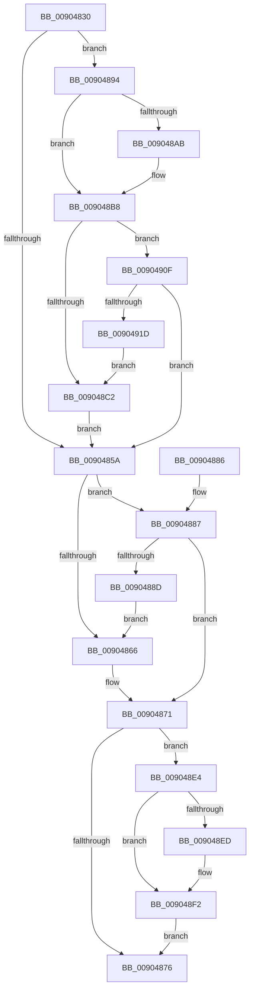

# PspExitProcess

- RVA: `0x00904830`–`0x0090491F` (길이 `239` bytes)
- VA: `0x0000000140904830`
- 실행 섹션: `PAGE`
- PDB 이름 있음: `예`; PDB Function 태그: `아니요`
- unwind 정보 RVA: `0x00088B28`
- 디코드: `60`개 명령, `239/239` bytes 표시
- 미해석 바이트: `0` (있으면 어셈블리에 `.byte`로 보존)

> 이 문서는 커널 이미지의 기계어와 PDB 기호를 분석해 생성했습니다. 4번과 5번은 함수 원형과 자료형을 바이너리 사용 방식에서 추정한 C 해석이며 원본 소스 복구 결과는 아닙니다.

## 1. Dependencies

- 직접 호출 지점: **9**; 고유 호출 대상: **9**
- 직접 호출자로 확인된 함수: **1**
- RIP 상대 이미지 참조: **1**

### Outgoing calls
- `0x0090488D` → [ObfDereferenceObject](../../text/2F/ObfDereferenceObject_function_002F9350.md) (function, `0x002F9350`)
- `0x0090489C` → [PsSetProcessTelemetryAppState](../8A/PsSetProcessTelemetryAppState_function_008A35F0.md) (function, `0x008A35F0`)
- `0x009048B3` → [EtwTraceProcess](../8A/EtwTraceProcess_function_008A4004.md) (function, `0x008A4004`)
- `0x009048D2` → [PspCallProcessNotifyRoutines](PspCallProcessNotifyRoutines_function_00904928.md) (function, `0x00904928`)
- `0x009048DA` → [KeLeaveCriticalRegionThread](../../text/25/KeLeaveCriticalRegionThread_function_0025EFF0.md) (function, `0x0025EFF0`)
- `0x009048ED` → [ExCleanTimerResolutionRequest](../../text/4B/ExCleanTimerResolutionRequest_function_004B0C58.md) (function, `0x004B0C58`)
- `0x009048F5` → [DbgkFlushErrorPort](DbgkFlushErrorPort_function_00903FA4.md) (function, `0x00903FA4`)
- `0x009048FD` → [PfProcessExitNotification](PfProcessExitNotification_function_00903CA4.md) (function, `0x00903CA4`)
- `0x00904905` → [PspProcessUnbindVirtualizedTimers](../../text/22/PspProcessUnbindVirtualizedTimers_function_0022FC3C.md) (function, `0x0022FC3C`)

### Direct callers
- [PspExitLastThread](PspExitLastThread_function_00904184.md) at `0x009041F8`

### Static image references
- `0x009048A1` → RVA `0x00FC6B00` (`ALMOSTRO`; read)

## 2. Other-region calls and transfers

- 다른 실행 섹션으로 향하는 call: **4**
  - `0x0090488D` → [ObfDereferenceObject](../../text/2F/ObfDereferenceObject_function_002F9350.md) (`PAGE` → `.text`)
  - `0x009048DA` → [KeLeaveCriticalRegionThread](../../text/25/KeLeaveCriticalRegionThread_function_0025EFF0.md) (`PAGE` → `.text`)
  - `0x009048ED` → [ExCleanTimerResolutionRequest](../../text/4B/ExCleanTimerResolutionRequest_function_004B0C58.md) (`PAGE` → `.text`)
  - `0x00904905` → [PspProcessUnbindVirtualizedTimers](../../text/22/PspProcessUnbindVirtualizedTimers_function_0022FC3C.md) (`PAGE` → `.text`)
- 별도 외부 분기/꼬리 이동을 확인하지 못했습니다.

## 3. Assembly (complete function range)

```asm
00904830  48 89 5C 24 08                  mov qword ptr [rsp + 8], rbx
00904835  48 89 74 24 10                  mov qword ptr [rsp + 0x10], rsi
0090483A  57                              push rdi
0090483B  48 83 EC 20                     sub rsp, 0x20
0090483F  48 8B DA                        mov rbx, rdx
00904842  40 8A F1                        mov sil, cl
00904845  F0 83 8A F4 01 00 00 04         lock or dword ptr [rdx + 0x1f4], 4
0090484D  65 48 8B 3C 25 88 01 00 00      mov rdi, qword ptr gs:[0x188]
00904856  84 C9                           test cl, cl
00904858  75 3A                           jne 0x140904894
0090485A  48 8B 8B 48 03 00 00            mov rcx, qword ptr [rbx + 0x348]
00904861  48 85 C9                        test rcx, rcx
00904864  75 21                           jne 0x140904887
00904866  48 C7 83 48 03 00 00 01 00 00 00  mov qword ptr [rbx + 0x348], 1
00904871  40 84 F6                        test sil, sil
00904874  75 6E                           jne 0x1409048e4
00904876  48 8B 5C 24 30                  mov rbx, qword ptr [rsp + 0x30]
0090487B  48 8B 74 24 38                  mov rsi, qword ptr [rsp + 0x38]
00904880  48 83 C4 20                     add rsp, 0x20
00904884  5F                              pop rdi
00904885  C3                              ret
00904886  CC                              int3
00904887  48 83 F9 01                     cmp rcx, 1
0090488B  74 E4                           je 0x140904871
0090488D  E8 BE 4A 9F FF                  call 0x1402f9350
00904892  EB D2                           jmp 0x140904866
00904894  BA 03 00 00 00                  mov edx, 3
00904899  48 8B CB                        mov rcx, rbx
0090489C  E8 4F ED F9 FF                  call 0x1408a35f0
009048A1  8B 05 59 22 6C 00               mov eax, dword ptr [rip + 0x6c2259]
009048A7  A8 01                           test al, 1
009048A9  74 0D                           je 0x1409048b8
009048AB  BA 02 03 00 00                  mov edx, 0x302
009048B0  48 8B CB                        mov rcx, rbx
009048B3  E8 4C F7 F9 FF                  call 0x1408a4004
009048B8  8B 83 FC 05 00 00               mov eax, dword ptr [rbx + 0x5fc]
009048BE  A8 01                           test al, 1
009048C0  75 4D                           jne 0x14090490f
009048C2  66 FF 8F E4 01 00 00            dec word ptr [rdi + 0x1e4]
009048C9  45 33 C0                        xor r8d, r8d
009048CC  33 D2                           xor edx, edx
009048CE  48 8B CB                        mov rcx, rbx
009048D1  90                              nop
009048D2  E8 51 00 00 00                  call 0x140904928
009048D7  48 8B CF                        mov rcx, rdi
009048DA  E8 11 A7 95 FF                  call 0x14025eff0
009048DF  E9 76 FF FF FF                  jmp 0x14090485a
009048E4  83 BB F4 01 00 00 00            cmp dword ptr [rbx + 0x1f4], 0
009048EB  7D 05                           jge 0x1409048f2
009048ED  E8 66 C3 BA FF                  call 0x1404b0c58
009048F2  48 8B CB                        mov rcx, rbx
009048F5  E8 AA F6 FF FF                  call 0x140903fa4
009048FA  48 8B CB                        mov rcx, rbx
009048FD  E8 A2 F3 FF FF                  call 0x140903ca4
00904902  48 8B CB                        mov rcx, rbx
00904905  E8 32 B3 92 FF                  call 0x14022fc3c
0090490A  E9 67 FF FF FF                  jmp 0x140904876
0090490F  48 83 BB 40 06 00 00 00         cmp qword ptr [rbx + 0x640], 0
00904917  0F 84 3D FF FF FF               je 0x14090485a
0090491D  EB A3                           jmp 0x1409048c2
```

## 4. C-style interpretation (structured pseudocode)

```c
__int64 __fastcall PspExitProcess(unsigned __int8 a1, __int64 a2, int a3)
{
    __int64 result;
    __int64 v_rsp;
    unsigned __int64 v_stack_p10;
    unsigned __int64 v_stack_p8;

    v_stack_p8 = v_rbx;
    v_stack_p10 = v_rsi;
    v_rsp = (v_rsp) - (32);
    if (a1 != 0) goto loc_00904894;
loc_0090485A:
    if (*(unsigned __int64 *)(a2 + 840) != 0) goto loc_00904887;
loc_00904866:
    *(unsigned __int64 *)(a2 + 840) = 1;
loc_00904871:
    if (a1 != 0) goto loc_009048E4;
loc_00904876:
    v_rsp = (v_rsp) + (32);
    return result;
loc_00904887:
    if ((*(unsigned __int64 *)(a2 + 840)) == 1) goto loc_00904871;
    result = ObfDereferenceObject(*(unsigned __int64 *)(a2 + 840), a2, a3, a4);
    goto loc_00904866;
loc_00904894:
    result = PsSetProcessTelemetryAppState(v_stack_p8, 3, a3, a4);
    result = (unsigned int)(*(unsigned int *)(v_rip + 7086681));
    if ((((unsigned __int8)((unsigned int)(*(unsigned int *)(v_rip + 7086681)))) & (1)) != 0) {
        a2 = 770;
        a1 = v_stack_p8;
        result = EtwTraceProcess(a1, a2, a3, a4);
    }
    if ((((unsigned __int8)((unsigned int)(*(unsigned int *)(v_stack_p8 + 1532)))) & (1)) != 0) goto loc_0090490F;
loc_009048C2:
    a3 = 0;
    a2 = 0;
    result = PspCallProcessNotifyRoutines(v_stack_p8, a2, a3, a4);
    result = KeLeaveCriticalRegionThread(*(unsigned __int64 *)(gs_base + (0 + 392)), a2, a3, a4);
    goto loc_0090485A;
loc_009048E4:
    if ((*(unsigned int *)(v_stack_p8 + 500)) < 0) {
        result = ExCleanTimerResolutionRequest(*(unsigned __int64 *)(gs_base + (0 + 392)), a2, a3, a4);
    }
    result = DbgkFlushErrorPort(v_stack_p8, a2, a3, a4);
    result = PfProcessExitNotification(v_stack_p8, a2, a3, a4);
    result = PspProcessUnbindVirtualizedTimers(v_stack_p8, a2, a3, a4);
    goto loc_00904876;
loc_0090490F:
    if ((*(unsigned __int64 *)(v_stack_p8 + 1600)) == 0) goto loc_0090485A;
    goto loc_009048C2;
}
```

## 5. (Beta) C Style

```c
int64_t PspExitProcess(uint8_t Arg1, void *Arg2, int32_t Arg3)
{
    uint8_t *arg2 = (uint8_t *)Arg2;

    int64_t result;
    int64_t local_rsp;
    uint64_t v_stack_p10;
    uint64_t v_stack_p8;

    v_stack_p8 = local_rbx;
    v_stack_p10 = local_rsi;
    local_rsp = (local_rsp) - (32);
    if (Arg1 != 0) goto loc_00904894;
loc_0090485A:
    if (*(uint64_t *)(arg2 + 0x348) != 0) goto loc_00904887;
loc_00904866:
    *(uint64_t *)(arg2 + 0x348) = 1;
loc_00904871:
    if (Arg1 != 0) goto loc_009048E4;
loc_00904876:
    local_rsp = (local_rsp) + (32);
    return result;
loc_00904887:
    if ((*(uint64_t *)(arg2 + 0x348)) == 1) goto loc_00904871;
    result = ObfDereferenceObject(*(uint64_t *)(arg2 + 0x348), Arg2, Arg3, a4);
    goto loc_00904866;
loc_00904894:
    result = PsSetProcessTelemetryAppState(v_stack_p8, 3, Arg3, a4);
    result = (uint32_t)(*(uint32_t *)(v_rip + 0x6C2259));
    if ((((uint8_t)((uint32_t)(*(uint32_t *)(v_rip + 0x6C2259)))) & (1)) != 0) {
        Arg2 = 770;
        Arg1 = v_stack_p8;
        result = EtwTraceProcess(Arg1, Arg2, Arg3, a4);
    }
    if ((((uint8_t)((uint32_t)(*(uint32_t *)(v_stack_p8 + 0x5FC)))) & (1)) != 0) goto loc_0090490F;
loc_009048C2:
    Arg3 = 0;
    Arg2 = 0;
    result = PspCallProcessNotifyRoutines(v_stack_p8, Arg2, Arg3, a4);
    result = KeLeaveCriticalRegionThread(*(uint64_t *)(gs_base + (0 + 0x188)), Arg2, Arg3, a4);
    goto loc_0090485A;
loc_009048E4:
    if ((*(uint32_t *)(v_stack_p8 + 0x1F4)) < 0) {
        result = ExCleanTimerResolutionRequest(*(uint64_t *)(gs_base + (0 + 0x188)), Arg2, Arg3, a4);
    }
    result = DbgkFlushErrorPort(v_stack_p8, Arg2, Arg3, a4);
    result = PfProcessExitNotification(v_stack_p8, Arg2, Arg3, a4);
    result = PspProcessUnbindVirtualizedTimers(v_stack_p8, Arg2, Arg3, a4);
    goto loc_00904876;
loc_0090490F:
    if ((*(uint64_t *)(v_stack_p8 + 0x640)) == 0) goto loc_0090485A;
    goto loc_009048C2;
}
```

### 관측된 메모리 오프셋

구조체 형식이 확인되지 않은 접근은 인자 기준의 오프셋으로만 기록했습니다.

| 기준 인자 | 오프셋 표현 | 폭 (bit) | 접근 |
|---|---:|---:|---|
| `Arg2` | `+ 0x1F4` | `32` | `R` |
| `Arg2` | `+ 0x1F4` | `32` | `R/W` |
| `Arg2` | `+ 0x348` | `64` | `R` |
| `Arg2` | `+ 0x348` | `64` | `W` |
| `Arg2` | `+ 0x5FC` | `32` | `R` |
| `Arg2` | `+ 0x640` | `64` | `R` |

## 6. Execution-region graph

[열기: 2D/3D 그래프와 함수 탐색 컨트롤 패널](../../../control-panel.html?section=page&rva=0x00904830&view=graph)

- 2D 그래프는 위에서 아래로 흐르고, 3D 그래프는 빈 공간을 드래그해 회전합니다. Shift+드래그는 이동, 휠은 확대·축소, 함수 노드 선택은 대상 보고서 이동입니다.

### Static fallback


