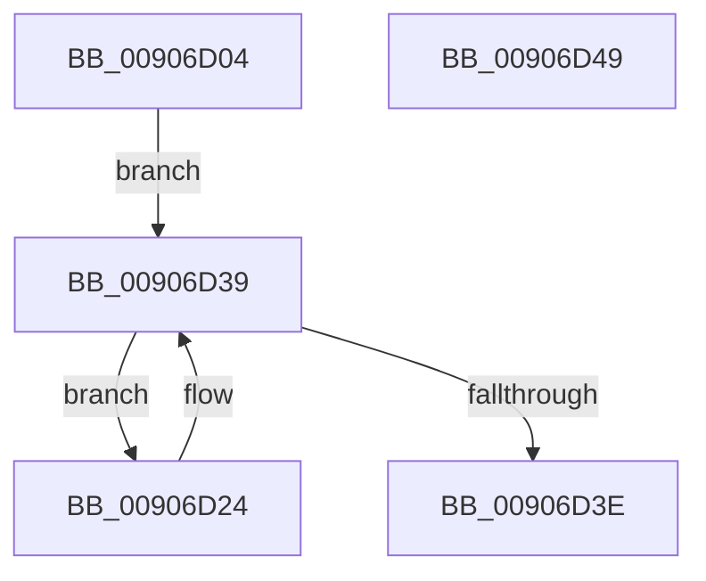

# PspNotifyEmptyJobsInJobChain

- RVA: `0x00906D04`–`0x00906D4A` (길이 `70` bytes)
- VA: `0x0000000140906D04`
- 실행 섹션: `PAGE`
- PDB 이름 있음: `예`; PDB Function 태그: `아니요`
- unwind 정보 RVA: `0x0005CAAC`
- 디코드: `19`개 명령, `70/70` bytes 표시
- 미해석 바이트: `0` (있으면 어셈블리에 `.byte`로 보존)

> 이 문서는 커널 이미지의 기계어와 PDB 기호를 분석해 생성했습니다. 4번과 5번은 함수 원형과 자료형을 바이너리 사용 방식에서 추정한 C 해석이며 원본 소스 복구 결과는 아닙니다.

## 1. Dependencies

- 직접 호출 지점: **1**; 고유 호출 대상: **1**
- 직접 호출자로 확인된 함수: **1**
- RIP 상대 이미지 참조: **0**

### Outgoing calls
- `0x00906D2D` → [PspEvaluateAndNotifyEmptyJob](../91/PspEvaluateAndNotifyEmptyJob_function_00917D88.md) (function, `0x00917D88`)

### Direct callers
- [PspRundownSingleProcess](PspRundownSingleProcess_function_00906D50.md) at `0x00906F4A`

### Static image references
- 디코드된 RIP-relative 메모리 참조가 없습니다.

## 2. Other-region calls and transfers

- 다른 실행 섹션으로 향하는 call: **0**
- 별도 외부 분기/꼬리 이동을 확인하지 못했습니다.

## 3. Assembly (complete function range)

```asm
00906D04  48 89 5C 24 08                  mov qword ptr [rsp + 8], rbx
00906D09  57                              push rdi
00906D0A  48 83 EC 20                     sub rsp, 0x20
00906D0E  F0 0F BA A9 F0 01 00 00 0B      lock bts dword ptr [rcx + 0x1f0], 0xb
00906D17  48 8B 99 A0 02 00 00            mov rbx, qword ptr [rcx + 0x2a0]
00906D1E  40 0F 93 C7                     setae dil
00906D22  EB 15                           jmp 0x140906d39
00906D24  41 B0 01                        mov r8b, 1
00906D27  40 8A D7                        mov dl, dil
00906D2A  48 8B CB                        mov rcx, rbx
00906D2D  E8 56 10 01 00                  call 0x140917d88
00906D32  48 8B 9B 18 05 00 00            mov rbx, qword ptr [rbx + 0x518]
00906D39  48 85 DB                        test rbx, rbx
00906D3C  75 E6                           jne 0x140906d24
00906D3E  48 8B 5C 24 30                  mov rbx, qword ptr [rsp + 0x30]
00906D43  48 83 C4 20                     add rsp, 0x20
00906D47  5F                              pop rdi
00906D48  C3                              ret
00906D49  CC                              int3
```

## 4. C-style interpretation (structured pseudocode)

```c
__int64 __fastcall PspNotifyEmptyJobsInJobChain(__int64 a1)
{
    __int64 result;
    __int64 v_rdi;
    __int64 v_rsp;
    unsigned __int64 v_stack_p8;

    v_stack_p8 = v_rbx;
    v_rsp = (v_rsp) - (32);
    v_rdi = (condition_is_above_or_equal) ? 1 : 0;
    goto loc_00906D39;
loc_00906D24:
    result = PspEvaluateAndNotifyEmptyJob(*(unsigned __int64 *)(a1 + 672), (unsigned __int8)(v_rdi), 1, a4);
loc_00906D39:
    if (*(unsigned __int64 *)(*(unsigned __int64 *)(a1 + 672) + 1304) != 0) goto loc_00906D24;
    v_rsp = (v_rsp) + (32);
    return result;
}
```

## 5. (Beta) C Style

```c
int64_t PspNotifyEmptyJobsInJobChain(void *Arg1)
{
    uint8_t *arg1 = (uint8_t *)Arg1;

    int64_t result;
    int64_t local_rdi;
    int64_t local_rsp;
    uint64_t v_stack_p8;

    v_stack_p8 = local_rbx;
    local_rsp = (local_rsp) - (32);
    local_rdi = (condition_is_above_or_equal) ? 1 : 0;
    goto loc_00906D39;
loc_00906D24:
    result = PspEvaluateAndNotifyEmptyJob(*(uint64_t *)(arg1 + 0x2A0), (uint8_t)(local_rdi), 1, a4);
loc_00906D39:
    if (*(uint64_t *)(*(uint64_t *)(arg1 + 0x2A0) + 0x518) != 0) goto loc_00906D24;
    local_rsp = (local_rsp) + (32);
    return result;
}
```

### 관측된 메모리 오프셋

구조체 형식이 확인되지 않은 접근은 인자 기준의 오프셋으로만 기록했습니다.

| 기준 인자 | 오프셋 표현 | 폭 (bit) | 접근 |
|---|---:|---:|---|
| `Arg1` | `+ 0x1F0` | `32` | `R/W` |
| `Arg1` | `+ 0x2A0` | `64` | `R` |

## 6. Execution-region graph

[열기: 2D/3D 그래프와 함수 탐색 컨트롤 패널](../../../control-panel.html?section=page&rva=0x00906D04&view=graph)

- 2D 그래프는 위에서 아래로 흐르고, 3D 그래프는 빈 공간을 드래그해 회전합니다. Shift+드래그는 이동, 휠은 확대·축소, 함수 노드 선택은 대상 보고서 이동입니다.

### Static fallback


