# PspRemoveProcessFromJobChain

- RVA: `0x00907288`–`0x0090759B` (길이 `787` bytes)
- VA: `0x0000000140907288`
- 실행 섹션: `PAGE`
- PDB 이름 있음: `예`; PDB Function 태그: `아니요`
- unwind 정보 RVA: `0x00088D80`
- 디코드: `210`개 명령, `787/787` bytes 표시
- 미해석 바이트: `0` (있으면 어셈블리에 `.byte`로 보존)

> 이 문서는 커널 이미지의 기계어와 PDB 기호를 분석해 생성했습니다. 4번과 5번은 함수 원형과 자료형을 바이너리 사용 방식에서 추정한 C 해석이며 원본 소스 복구 결과는 아닙니다.

## 1. Dependencies

- 직접 호출 지점: **24**; 고유 호출 대상: **19**
- 직접 호출자로 확인된 함수: **5**
- RIP 상대 이미지 참조: **2**

### Outgoing calls
- `0x009072E4` → [memset](../../text/6C/memset_function_006C6C40.md) (function, `0x006C6C40`)
- `0x0090732C` → [PsTerminateProcess](PsTerminateProcess_function_00904C64.md) (function, `0x00904C64`)
- `0x0090734A` → [PspLockRootJobFromProcess](../A4/PspLockRootJobFromProcess_function_00A45BD8.md) (function, `0x00A45BD8`)
- `0x00907364` → [EtwTraceJobRemoveProcess](../A7/EtwTraceJobRemoveProcess_function_00A74650.md) (function, `0x00A74650`)
- `0x00907389` → [PsQueryStatisticsProcess](../91/PsQueryStatisticsProcess_function_00919350.md) (function, `0x00919350`)
- `0x009073B3` → [PspLockJobConditionally](../9F/PspLockJobConditionally_function_009F7C20.md) (function, `0x009F7C20`)
- `0x00907423` → [PspSendJobNotification](../../text/49/PspSendJobNotification_function_0049EC28.md) (function, `0x0049EC28`)
- `0x00907437` → [PspFoldProcessAccountingIntoJob](../9F/PspFoldProcessAccountingIntoJob_function_009F59F8.md) (function, `0x009F59F8`)
- `0x0090748D` → [PspSubtractAccountingValues](../78/PspSubtractAccountingValues_function_00785CE8.md) (function, `0x00785CE8`)
- `0x0090749E` → [PspUnlockJobConditionally](../A4/PspUnlockJobConditionally_function_00A454A4.md) (function, `0x00A454A4`)
- `0x009074CA` → [PspLockJobConditionally](../9F/PspLockJobConditionally_function_009F7C20.md) (function, `0x009F7C20`)
- `0x009074DB` → [PspUnlinkJobProcess](../87/PspUnlinkJobProcess_function_0087D404.md) (function, `0x0087D404`)
- `0x009074E7` → [PspUnlockJobConditionally](../A4/PspUnlockJobConditionally_function_00A454A4.md) (function, `0x00A454A4`)
- `0x009074F3` → [PspUnlockJob](../91/PspUnlockJob_function_00919E00.md) (function, `0x00919E00`)
- `0x00907516` → [PspInitializeProcessExecutionState](../../text/4B/PspInitializeProcessExecutionState_function_004BE450.md) (function, `0x004BE450`)
- `0x0090751B` → [Feature_ProcesDirectSwap__private_IsEnabledDeviceUsageNoInline](../../text/5E/Feature_ProcesDirectSwap__private_IsEnabledDeviceUsageNoInline_function_005E3264.md) (function, `0x005E3264`)
- `0x0090752D` → [PspRequestProcessExecutionStateLegacy](../../text/5E/PspRequestProcessExecutionStateLegacy_function_005E42D8.md) (function, `0x005E42D8`)
- `0x0090753A` → [PspRequestProcessExecutionState](../AE/PspRequestProcessExecutionState_function_00AEC7EC.md) (function, `0x00AEC7EC`)
- `0x00907546` → [PspUnlockJobConditionally](../A4/PspUnlockJobConditionally_function_00A454A4.md) (function, `0x00A454A4`)
- `0x00907552` → [PspUnlockJob](../91/PspUnlockJob_function_00919E00.md) (function, `0x00919E00`)
- `0x0090755F` → [Feature_ProcesDirectSwap__private_IsEnabledDeviceUsageNoInline](../../text/5E/Feature_ProcesDirectSwap__private_IsEnabledDeviceUsageNoInline_function_005E3264.md) (function, `0x005E3264`)
- `0x0090756B` → [PspChangeProcessExecutionStateLegacy](../../text/5E/PspChangeProcessExecutionStateLegacy_function_005E4098.md) (function, `0x005E4098`)
- `0x00907572` → [PspChangeProcessExecutionState](../AE/PspChangeProcessExecutionState_function_00AEC594.md) (function, `0x00AEC594`)
- `0x0090757A` → [KiLeaveCriticalRegionUnsafe](../../text/25/KiLeaveCriticalRegionUnsafe_function_0025F010.md) (function, `0x0025F010`)

### Direct callers
- [PspRundownSingleProcess](PspRundownSingleProcess_function_00906D50.md) at `0x00906F42`
- [PspProcessDelete](PspProcessDelete_function_00907B90.md) at `0x00907D3B`
- [PspTerminateProcessesJobCallback](../91/PspTerminateProcessesJobCallback_function_00917430.md) at `0x009174D7`
- [PspEnforceLimitsJobPostCallback](../91/PspEnforceLimitsJobPostCallback_function_00919720.md) at `0x00919D6D`
- [PspAssignProcessToJob](../A2/PspAssignProcessToJob_function_00A23370.md) at `0x00A238B6`

### Static image references
- `0x0090734F` → RVA `0x00FC6B00` (`ALMOSTRO`; read)
- `0x00907448` → RVA `0x00FD9C70` (`PAGEDATA`; read)

## 2. Other-region calls and transfers

- 다른 실행 섹션으로 향하는 call: **8**
  - `0x009072E4` → [memset](../../text/6C/memset_function_006C6C40.md) (`PAGE` → `.text`)
  - `0x00907423` → [PspSendJobNotification](../../text/49/PspSendJobNotification_function_0049EC28.md) (`PAGE` → `.text`)
  - `0x00907516` → [PspInitializeProcessExecutionState](../../text/4B/PspInitializeProcessExecutionState_function_004BE450.md) (`PAGE` → `.text`)
  - `0x0090751B` → [Feature_ProcesDirectSwap__private_IsEnabledDeviceUsageNoInline](../../text/5E/Feature_ProcesDirectSwap__private_IsEnabledDeviceUsageNoInline_function_005E3264.md) (`PAGE` → `.text`)
  - `0x0090752D` → [PspRequestProcessExecutionStateLegacy](../../text/5E/PspRequestProcessExecutionStateLegacy_function_005E42D8.md) (`PAGE` → `.text`)
  - `0x0090755F` → [Feature_ProcesDirectSwap__private_IsEnabledDeviceUsageNoInline](../../text/5E/Feature_ProcesDirectSwap__private_IsEnabledDeviceUsageNoInline_function_005E3264.md) (`PAGE` → `.text`)
  - `0x0090756B` → [PspChangeProcessExecutionStateLegacy](../../text/5E/PspChangeProcessExecutionStateLegacy_function_005E4098.md) (`PAGE` → `.text`)
  - `0x0090757A` → [KiLeaveCriticalRegionUnsafe](../../text/25/KiLeaveCriticalRegionUnsafe_function_0025F010.md) (`PAGE` → `.text`)
- 별도 외부 분기/꼬리 이동을 확인하지 못했습니다.

## 3. Assembly (complete function range)

```asm
00907288  48 89 5C 24 10                  mov qword ptr [rsp + 0x10], rbx
0090728D  44 89 44 24 18                  mov dword ptr [rsp + 0x18], r8d
00907292  55                              push rbp
00907293  56                              push rsi
00907294  57                              push rdi
00907295  41 54                           push r12
00907297  41 55                           push r13
00907299  41 56                           push r14
0090729B  41 57                           push r15
0090729D  48 8D 6C 24 D9                  lea rbp, [rsp - 0x27]
009072A2  48 81 EC C0 00 00 00            sub rsp, 0xc0
009072A9  45 33 FF                        xor r15d, r15d
009072AC  41 8B D9                        mov ebx, r9d
009072AF  F7 81 FC 05 00 00 00 10 00 00   test dword ptr [rcx + 0x5fc], 0x1000
009072B9  45 8B F0                        mov r14d, r8d
009072BC  4C 8B EA                        mov r13, rdx
009072BF  4C 89 7D 9F                     mov qword ptr [rbp - 0x61], r15
009072C3  48 8B F9                        mov rdi, rcx
009072C6  4C 89 7D 8F                     mov qword ptr [rbp - 0x71], r15
009072CA  44 88 7D 67                     mov byte ptr [rbp + 0x67], r15b
009072CE  74 0A                           je 0x1409072da
009072D0  41 F6 C6 01                     test r14b, 1
009072D4  0F 84 A5 02 00 00               je 0x14090757f
009072DA  33 D2                           xor edx, edx
009072DC  48 8D 4D B7                     lea rcx, [rbp - 0x49]
009072E0  44 8D 42 68                     lea r8d, [rdx + 0x68]
009072E4  E8 57 F9 DB FF                  call 0x1406c6c40
009072E9  65 48 8B 34 25 88 01 00 00      mov rsi, qword ptr gs:[0x188]
009072F2  F0 0F BA AF F0 01 00 00 00      lock bts dword ptr [rdi + 0x1f0], 0
009072FB  48 89 75 A7                     mov qword ptr [rbp - 0x59], rsi
009072FF  41 0F 93 C4                     setae r12b
00907303  44 88 7D 88                     mov byte ptr [rbp - 0x78], r15b
00907307  44 88 65 87                     mov byte ptr [rbp - 0x79], r12b
0090730B  41 F6 C6 02                     test r14b, 2
0090730F  74 24                           je 0x140907335
00907311  F7 87 F4 01 00 00 00 00 00 04   test dword ptr [rdi + 0x1f4], 0x4000000
0090731B  74 18                           je 0x140907335
0090731D  8B 87 FC 05 00 00               mov eax, dword ptr [rdi + 0x5fc]
00907323  A8 40                           test al, 0x40
00907325  75 0E                           jne 0x140907335
00907327  8B D3                           mov edx, ebx
00907329  48 8B CF                        mov rcx, rdi
0090732C  E8 33 D9 FF FF                  call 0x140904c64
00907331  C6 45 88 01                     mov byte ptr [rbp - 0x78], 1
00907335  4C 8D 4D 8F                     lea r9, [rbp - 0x71]
00907339  C7 45 97 01 00 00 00            mov dword ptr [rbp - 0x69], 1
00907340  4C 8D 45 9F                     lea r8, [rbp - 0x61]
00907344  48 8B D6                        mov rdx, rsi
00907347  48 8B CF                        mov rcx, rdi
0090734A  E8 89 E8 13 00                  call 0x140a45bd8
0090734F  F7 05 A7 F7 6B 00 00 00 08 00   test dword ptr [rip + 0x6bf7a7], 0x80000
00907359  74 0E                           je 0x140907369
0090735B  44 8B C3                        mov r8d, ebx
0090735E  41 8B D6                        mov edx, r14d
00907361  48 8B CF                        mov rcx, rdi
00907364  E8 E7 D2 16 00                  call 0x140a74650
00907369  41 F6 C6 04                     test r14b, 4
0090736D  74 22                           je 0x140907391
0090736F  F0 0F BA AF F0 01 00 00 01      lock bts dword ptr [rdi + 0x1f0], 1
00907378  72 17                           jb 0x140907391
0090737A  F0 83 A7 F0 01 00 00 DF         lock and dword ptr [rdi + 0x1f0], 0xffffffdf
00907382  48 8D 55 B7                     lea rdx, [rbp - 0x49]
00907386  48 8B CF                        mov rcx, rdi
00907389  E8 C2 1F 01 00                  call 0x140919350
0090738E  41 B7 01                        mov r15b, 1
00907391  48 8B 5D 9F                     mov rbx, qword ptr [rbp - 0x61]
00907395  48 85 DB                        test rbx, rbx
00907398  0F 84 25 01 00 00               je 0x1409074c3
0090739E  8B 75 97                        mov esi, dword ptr [rbp - 0x69]
009073A1  45 8B E6                        mov r12d, r14d
009073A4  44 8A 75 87                     mov r14b, byte ptr [rbp - 0x79]
009073A8  41 83 E4 08                     and r12d, 8
009073AC  48 8D 55 8F                     lea rdx, [rbp - 0x71]
009073B0  48 8B CB                        mov rcx, rbx
009073B3  E8 68 08 0F 00                  call 0x1409f7c20
009073B8  45 84 F6                        test r14b, r14b
009073BB  74 19                           je 0x1409073d6
009073BD  83 C9 FF                        or ecx, 0xffffffff
009073C0  01 8B D8 00 00 00               add dword ptr [rbx + 0xd8], ecx
009073C6  8B 87 FC 05 00 00               mov eax, dword ptr [rdi + 0x5fc]
009073CC  A8 20                           test al, 0x20
009073CE  74 06                           je 0x1409073d6
009073D0  01 8B B4 05 00 00               add dword ptr [rbx + 0x5b4], ecx
009073D6  45 85 E4                        test r12d, r12d
009073D9  74 0B                           je 0x1409073e6
009073DB  45 84 F6                        test r14b, r14b
009073DE  74 06                           je 0x1409073e6
009073E0  FF 83 DC 00 00 00               inc dword ptr [rbx + 0xdc]
009073E6  4D 85 ED                        test r13, r13
009073E9  74 3D                           je 0x140907428
009073EB  49 8B 45 00                     mov rax, qword ptr [r13]
009073EF  48 85 C0                        test rax, rax
009073F2  74 05                           je 0x1409073f9
009073F4  48 3B C3                        cmp rax, rbx
009073F7  75 2F                           jne 0x140907428
009073F9  48 83 BB 28 02 00 00 00         cmp qword ptr [rbx + 0x228], 0
00907401  74 25                           je 0x140907428
00907403  49 8B 4D 08                     mov rcx, qword ptr [r13 + 8]
00907407  B8 01 00 00 00                  mov eax, 1
0090740C  D3 E0                           shl eax, cl
0090740E  85 83 50 04 00 00               test dword ptr [rbx + 0x450], eax
00907414  74 12                           je 0x140907428
00907416  4D 8B 45 10                     mov r8, qword ptr [r13 + 0x10]
0090741A  48 8B D1                        mov rdx, rcx
0090741D  48 8B CB                        mov rcx, rbx
00907420  45 33 C9                        xor r9d, r9d
00907423  E8 00 78 B9 FF                  call 0x14049ec28
00907428  45 84 FF                        test r15b, r15b
0090742B  74 6A                           je 0x140907497
0090742D  4C 8D 45 B7                     lea r8, [rbp - 0x49]
00907431  48 8B D7                        mov rdx, rdi
00907434  48 8B CB                        mov rcx, rbx
00907437  E8 BC E5 0E 00                  call 0x1409f59f8
0090743C  48 8B 87 A0 02 00 00            mov rax, qword ptr [rdi + 0x2a0]
00907443  48 3B D8                        cmp rbx, rax
00907446  75 12                           jne 0x14090745a
00907448  8B 05 22 28 6D 00               mov eax, dword ptr [rip + 0x6d2822]
0090744E  39 83 B8 05 00 00               cmp dword ptr [rbx + 0x5b8], eax
00907454  74 04                           je 0x14090745a
00907456  33 F6                           xor esi, esi
00907458  EB 3D                           jmp 0x140907497
0090745A  83 FE 01                        cmp esi, 1
0090745D  75 38                           jne 0x140907497
0090745F  4C 8D 83 48 05 00 00            lea r8, [rbx + 0x548]
00907466  48 8D 8B B0 05 00 00            lea rcx, [rbx + 0x5b0]
0090746D  49 8B C0                        mov rax, r8
00907470  4C 3B C1                        cmp r8, rcx
00907473  73 22                           jae 0x140907497
00907475  48 83 38 00                     cmp qword ptr [rax], 0
00907479  75 0B                           jne 0x140907486
0090747B  48 83 C0 08                     add rax, 8
0090747F  48 3B C1                        cmp rax, rcx
00907482  72 F1                           jb 0x140907475
00907484  EB 11                           jmp 0x140907497
00907486  48 8D 55 B7                     lea rdx, [rbp - 0x49]
0090748A  49 8B C8                        mov rcx, r8
0090748D  E8 56 E8 E7 FF                  call 0x140785ce8
00907492  BE 02 00 00 00                  mov esi, 2
00907497  48 8D 55 8F                     lea rdx, [rbp - 0x71]
0090749B  48 8B CB                        mov rcx, rbx
0090749E  E8 01 E0 13 00                  call 0x140a454a4
009074A3  48 8B 9B 18 05 00 00            mov rbx, qword ptr [rbx + 0x518]
009074AA  48 85 DB                        test rbx, rbx
009074AD  0F 85 F9 FE FF FF               jne 0x1409073ac
009074B3  48 8B 5D 9F                     mov rbx, qword ptr [rbp - 0x61]
009074B7  48 8B 75 A7                     mov rsi, qword ptr [rbp - 0x59]
009074BB  44 8B 75 77                     mov r14d, dword ptr [rbp + 0x77]
009074BF  44 8A 65 87                     mov r12b, byte ptr [rbp - 0x79]
009074C3  48 8D 55 8F                     lea rdx, [rbp - 0x71]
009074C7  48 8B CB                        mov rcx, rbx
009074CA  E8 51 07 0F 00                  call 0x1409f7c20
009074CF  41 F6 C6 01                     test r14b, 1
009074D3  74 28                           je 0x1409074fd
009074D5  48 8B D7                        mov rdx, rdi
009074D8  48 8B CB                        mov rcx, rbx
009074DB  E8 24 5F F7 FF                  call 0x14087d404
009074E0  48 8D 55 8F                     lea rdx, [rbp - 0x71]
009074E4  48 8B CB                        mov rcx, rbx
009074E7  E8 B8 DF 13 00                  call 0x140a454a4
009074EC  48 8B 4D 8F                     mov rcx, qword ptr [rbp - 0x71]
009074F0  48 8B D6                        mov rdx, rsi
009074F3  E8 08 29 01 00                  call 0x140919e00
009074F8  E9 82 00 00 00                  jmp 0x14090757f
009074FD  45 84 E4                        test r12b, r12b
00907500  74 3D                           je 0x14090753f
00907502  8B 87 F0 01 00 00               mov eax, dword ptr [rdi + 0x1f0]
00907508  A8 04                           test al, 4
0090750A  74 33                           je 0x14090753f
0090750C  80 7D 88 00                     cmp byte ptr [rbp - 0x78], 0
00907510  75 2D                           jne 0x14090753f
00907512  48 8D 4D 67                     lea rcx, [rbp + 0x67]
00907516  E8 35 6F BB FF                  call 0x1404be450
0090751B  E8 44 BD CD FF                  call 0x1405e3264
00907520  8A 55 67                        mov dl, byte ptr [rbp + 0x67]
00907523  45 33 C0                        xor r8d, r8d
00907526  48 8B CF                        mov rcx, rdi
00907529  85 C0                           test eax, eax
0090752B  75 07                           jne 0x140907534
0090752D  E8 A6 CD CD FF                  call 0x1405e42d8
00907532  EB 0B                           jmp 0x14090753f
00907534  41 B9 07 00 00 00               mov r9d, 7
0090753A  E8 AD 52 1E 00                  call 0x140aec7ec
0090753F  48 8D 55 8F                     lea rdx, [rbp - 0x71]
00907543  48 8B CB                        mov rcx, rbx
00907546  E8 59 DF 13 00                  call 0x140a454a4
0090754B  48 8B 4D 8F                     mov rcx, qword ptr [rbp - 0x71]
0090754F  48 8B D6                        mov rdx, rsi
00907552  E8 A9 28 01 00                  call 0x140919e00
00907557  66 FF 8E E4 01 00 00            dec word ptr [rsi + 0x1e4]
0090755E  90                              nop
0090755F  E8 00 BD CD FF                  call 0x1405e3264
00907564  48 8B CF                        mov rcx, rdi
00907567  85 C0                           test eax, eax
00907569  75 07                           jne 0x140907572
0090756B  E8 28 CB CD FF                  call 0x1405e4098
00907570  EB 05                           jmp 0x140907577
00907572  E8 1D 50 1E 00                  call 0x140aec594
00907577  48 8B CE                        mov rcx, rsi
0090757A  E8 91 7A 95 FF                  call 0x14025f010
0090757F  48 8B 9C 24 08 01 00 00         mov rbx, qword ptr [rsp + 0x108]
00907587  48 81 C4 C0 00 00 00            add rsp, 0xc0
0090758E  41 5F                           pop r15
00907590  41 5E                           pop r14
00907592  41 5D                           pop r13
00907594  41 5C                           pop r12
00907596  5F                              pop rdi
00907597  5E                              pop rsi
00907598  5D                              pop rbp
00907599  C3                              ret
0090759A  CC                              int3
```

## 4. C-style interpretation (structured pseudocode)

```c
__int64 __fastcall PspRemoveProcessFromJobChain(__int64 a1, __int64 a2, int a3, int a4)
{
    __int64 result;
    __int64 v_r12;
    __int64 v_r15;
    __int64 v_rsi;
    __int64 v_rsp;
    unsigned __int64 v_stack_m5F;
    unsigned __int64 v_stack_mA8;
    unsigned __int64 v_stack_mB8;
    unsigned __int64 v_stack_mC0;
    unsigned int v_stack_mC8;
    unsigned __int64 v_stack_mD0;
    unsigned __int8 v_stack_mD7;
    unsigned __int8 v_stack_mD8;
    unsigned __int64 v_stack_p10;
    unsigned int v_stack_p18;
    unsigned __int8 v_stack_p8;

    v_stack_p10 = v_rbx;
    v_stack_p18 = a3;
    v_rsp = (v_rsp) - (192);
    v_r15 = 0;
    v_stack_mC0 = 0;
    v_stack_mD0 = 0;
    v_stack_p8 = 0;
    if (((*(unsigned int *)(a1 + 1532)) & (0x1000ULL)) == 0) goto loc_009072DA;
    if ((((unsigned __int8)((unsigned int)(a3))) & (1)) == 0) goto loc_0090757F;
loc_009072DA:
    a2 = 0;
    result = memset(v_stack_mA8, a2, a2 + 104, a4);
    v_stack_mB8 = *(unsigned __int64 *)(gs_base + (0 + 392));
    v_r12 = (condition_is_above_or_equal) ? 1 : 0;
    v_stack_mD7 = 0;
    v_stack_mD8 = (unsigned __int8)(v_r12);
    if ((((unsigned __int8)((unsigned int)(a3))) & (2)) == 0) goto loc_00907335;
    if (((*(unsigned int *)(a1 + 500)) & (0x4000000ULL)) == 0) goto loc_00907335;
    result = (unsigned int)(*(unsigned int *)(a1 + 1532));
    if ((((unsigned __int8)((unsigned int)(*(unsigned int *)(a1 + 1532)))) & (64)) == 0) {
        a2 = (unsigned int)((unsigned int)(a4));
        a1 = a1;
        result = PsTerminateProcess(a1, a2, a2 + 104, a4);
        v_stack_mD7 = 1;
    }
    v_stack_mC8 = 1;
    result = PspLockRootJobFromProcess(a1, *(unsigned __int64 *)(gs_base + (0 + 392)), v_stack_mC0, v_stack_mD0);
    if (((*(unsigned int *)(v_rip + 7075751)) & (0x80000ULL)) != 0) {
        a3 = (unsigned int)((unsigned int)(a4));
        a2 = (unsigned int)((unsigned int)(a3));
        a1 = a1;
        result = EtwTraceJobRemoveProcess(a1, a2, a3, v_stack_mD0);
    }
    if ((((unsigned __int8)((unsigned int)(a3))) & (4)) == 0) goto loc_00907391;
    if (!(condition_is_below)) {
        a2 = v_stack_mA8;
        a1 = a1;
        result = PsQueryStatisticsProcess(a1, a2, a3, v_stack_mD0);
        v_r15 = 1;
    }
    if (v_stack_mC0 == 0) goto loc_009074C3;
    v_r12 = (unsigned int)(((unsigned int)((unsigned int)((unsigned int)(a3)))) & (8));
loc_009073AC:
    result = PspLockJobConditionally(v_stack_mC0, v_stack_mD0, a3, v_stack_mD0);
    if ((unsigned __int8)(v_stack_mD8) == 0) goto loc_009073D6;
    a1 = (unsigned int)((v_stack_mC0) | (0xFFFFFFFFULL));
    if ((((unsigned __int8)((unsigned int)(*(unsigned int *)(a1 + 1532)))) & (32)) != 0) {
    }
    if ((unsigned int)(v_r12) == 0) goto loc_009073E6;
    if ((unsigned __int8)(v_stack_mD8) != 0) {
    }
    if (a2 == 0) goto loc_00907428;
    if (*(unsigned __int64 *)(a2) == 0) goto loc_009073F9;
    if ((*(unsigned __int64 *)(a2)) != v_stack_mC0) goto loc_00907428;
loc_009073F9:
    if ((*(unsigned __int64 *)(v_stack_mC0 + 552)) == 0) goto loc_00907428;
    result = (unsigned int)((1) << ((unsigned __int8)(*(unsigned __int64 *)(a2 + 8))));
    if (((*(unsigned int *)(v_stack_mC0 + 1104)) & ((unsigned int)(result))) != 0) {
        a3 = *(unsigned __int64 *)(a2 + 16);
        a2 = *(unsigned __int64 *)(a2 + 8);
        a1 = v_stack_mC0;
        a4 = 0;
        result = PspSendJobNotification(a1, a2, a3, a4);
    }
    if ((unsigned __int8)(v_r15) == 0) goto loc_00907497;
    result = PspFoldProcessAccountingIntoJob(v_stack_mC0, a1, v_stack_mA8, a4);
    if (v_stack_mC0 != (*(unsigned __int64 *)(a1 + 672))) goto loc_0090745A;
    if ((*(unsigned int *)(v_stack_mC0 + 1464)) == ((unsigned int)((unsigned int)(*(unsigned int *)(v_rip + 7153698))))) goto loc_0090745A;
    v_rsi = 0;
    goto loc_00907497;
loc_0090745A:
    if (0 != 1) goto loc_00907497;
    if ((v_stack_mC0 + 1352) >= (v_stack_mC0 + 1456)) goto loc_00907497;
loc_00907475:
    if ((*(unsigned __int64 *)(v_stack_mC0 + 1352)) != 0) goto loc_00907486;
    result = (v_stack_mC0 + 1352) + (8);
    if (result < (v_stack_mC0 + 1456)) goto loc_00907475;
    goto loc_00907497;
loc_00907486:
    result = PspSubtractAccountingValues(v_stack_mC0 + 1352, v_stack_mA8, v_stack_mC0 + 1352, a4);
loc_00907497:
    result = PspUnlockJobConditionally(v_stack_mC0, v_stack_mD0, v_stack_mC0 + 1352, a4);
    if (*(unsigned __int64 *)(v_stack_mC0 + 1304) != 0) goto loc_009073AC;
loc_009074C3:
    result = PspLockJobConditionally(v_stack_mC0, v_stack_mD0, v_stack_mC0 + 1352, a4);
    if ((((unsigned __int8)((unsigned int)(v_stack_p18))) & (1)) == 0) goto loc_009074FD;
    result = PspUnlinkJobProcess(v_stack_mC0, a1, v_stack_mC0 + 1352, a4);
    result = PspUnlockJobConditionally(v_stack_mC0, v_stack_mD0, v_stack_mC0 + 1352, a4);
    result = PspUnlockJob(v_stack_mD0, v_stack_mB8, v_stack_mC0 + 1352, a4);
    goto loc_0090757F;
loc_009074FD:
    if ((unsigned __int8)(v_stack_mD8) == 0) goto loc_0090753F;
    if ((((unsigned __int8)((unsigned int)(*(unsigned int *)(a1 + 496)))) & (4)) == 0) goto loc_0090753F;
    if (v_stack_mD7 != 0) goto loc_0090753F;
    result = PspInitializeProcessExecutionState(v_stack_p8, v_stack_mB8, v_stack_mC0 + 1352, a4);
    result = Feature_ProcesDirectSwap__private_IsEnabledDeviceUsageNoInline(v_stack_p8, v_stack_mB8, v_stack_mC0 + 1352, a4);
    a3 = 0;
    if ((unsigned int)(result) != 0) goto loc_00907534;
    result = PspRequestProcessExecutionStateLegacy(a1, v_stack_p8, a3, a4);
    goto loc_0090753F;
loc_00907534:
    result = PspRequestProcessExecutionState(a1, v_stack_p8, a3, 7);
loc_0090753F:
    result = PspUnlockJobConditionally(v_stack_mC0, v_stack_mD0, a3, 7);
    result = PspUnlockJob(v_stack_mD0, v_stack_mB8, a3, 7);
    result = Feature_ProcesDirectSwap__private_IsEnabledDeviceUsageNoInline(v_stack_mD0, v_stack_mB8, a3, 7);
    if ((unsigned int)(result) != 0) goto loc_00907572;
    result = PspChangeProcessExecutionStateLegacy(a1, v_stack_mB8, a3, 7);
    goto loc_00907577;
loc_00907572:
    result = PspChangeProcessExecutionState(a1, v_stack_mB8, a3, 7);
loc_00907577:
    result = KiLeaveCriticalRegionUnsafe(v_stack_mB8, v_stack_mB8, a3, 7);
loc_0090757F:
    v_rsp = (v_rsp) + (192);
    return result;
}
```

## 5. (Beta) C Style

```c
int64_t PspRemoveProcessFromJobChain(void *Arg1, int64_t Arg2, int32_t Arg3, int32_t Arg4)
{
    uint8_t *arg1 = (uint8_t *)Arg1;

    int64_t result;
    int64_t local_r12;
    int64_t local_r15;
    int64_t local_rsi;
    int64_t local_rsp;
    uint64_t v_stack_m5F;
    uint64_t v_stack_mA8;
    uint64_t v_stack_mB8;
    uint64_t v_stack_mC0;
    uint32_t v_stack_mC8;
    uint64_t v_stack_mD0;
    uint8_t v_stack_mD7;
    uint8_t v_stack_mD8;
    uint64_t v_stack_p10;
    uint32_t v_stack_p18;
    uint8_t v_stack_p8;

    v_stack_p10 = local_rbx;
    v_stack_p18 = Arg3;
    local_rsp = (local_rsp) - (192);
    local_r15 = 0;
    v_stack_mC0 = 0;
    v_stack_mD0 = 0;
    v_stack_p8 = 0;
    if (((*(uint32_t *)(arg1 + 0x5FC)) & (0x1000ULL)) == 0) goto loc_009072DA;
    if ((((uint8_t)((uint32_t)(Arg3))) & (1)) == 0) goto loc_0090757F;
loc_009072DA:
    Arg2 = 0;
    result = memset(v_stack_mA8, Arg2, Arg2 + 104, Arg4);
    v_stack_mB8 = *(uint64_t *)(gs_base + (0 + 0x188));
    local_r12 = (condition_is_above_or_equal) ? 1 : 0;
    v_stack_mD7 = 0;
    v_stack_mD8 = (uint8_t)(local_r12);
    if ((((uint8_t)((uint32_t)(Arg3))) & (2)) == 0) goto loc_00907335;
    if (((*(uint32_t *)(arg1 + 0x1F4)) & (0x4000000ULL)) == 0) goto loc_00907335;
    result = (uint32_t)(*(uint32_t *)(arg1 + 0x5FC));
    if ((((uint8_t)((uint32_t)(*(uint32_t *)(arg1 + 0x5FC)))) & (64)) == 0) {
        Arg2 = (uint32_t)((uint32_t)(Arg4));
        Arg1 = Arg1;
        result = PsTerminateProcess(Arg1, Arg2, Arg2 + 104, Arg4);
        v_stack_mD7 = 1;
    }
    v_stack_mC8 = 1;
    result = PspLockRootJobFromProcess(Arg1, *(uint64_t *)(gs_base + (0 + 0x188)), v_stack_mC0, v_stack_mD0);
    if (((*(uint32_t *)(v_rip + 0x6BF7A7)) & (0x80000ULL)) != 0) {
        Arg3 = (uint32_t)((uint32_t)(Arg4));
        Arg2 = (uint32_t)((uint32_t)(Arg3));
        Arg1 = Arg1;
        result = EtwTraceJobRemoveProcess(Arg1, Arg2, Arg3, v_stack_mD0);
    }
    if ((((uint8_t)((uint32_t)(Arg3))) & (4)) == 0) goto loc_00907391;
    if (!(condition_is_below)) {
        Arg2 = v_stack_mA8;
        Arg1 = Arg1;
        result = PsQueryStatisticsProcess(Arg1, Arg2, Arg3, v_stack_mD0);
        local_r15 = 1;
    }
    if (v_stack_mC0 == 0) goto loc_009074C3;
    local_r12 = (uint32_t)(((uint32_t)((uint32_t)((uint32_t)(Arg3)))) & (8));
loc_009073AC:
    result = PspLockJobConditionally(v_stack_mC0, v_stack_mD0, Arg3, v_stack_mD0);
    if ((uint8_t)(v_stack_mD8) == 0) goto loc_009073D6;
    Arg1 = (uint32_t)((v_stack_mC0) | (0xFFFFFFFFULL));
    if ((((uint8_t)((uint32_t)(*(uint32_t *)(arg1 + 0x5FC)))) & (32)) != 0) {
    }
    if ((uint32_t)(local_r12) == 0) goto loc_009073E6;
    if ((uint8_t)(v_stack_mD8) != 0) {
    }
    if (Arg2 == 0) goto loc_00907428;
    if (*(uint64_t *)(Arg2) == 0) goto loc_009073F9;
    if ((*(uint64_t *)(Arg2)) != v_stack_mC0) goto loc_00907428;
loc_009073F9:
    if ((*(uint64_t *)(v_stack_mC0 + 0x228)) == 0) goto loc_00907428;
    result = (uint32_t)((1) << ((uint8_t)(*(uint64_t *)(Arg2 + 0x8))));
    if (((*(uint32_t *)(v_stack_mC0 + 0x450)) & ((uint32_t)(result))) != 0) {
        Arg3 = *(uint64_t *)(Arg2 + 0x10);
        Arg2 = *(uint64_t *)(Arg2 + 0x8);
        Arg1 = v_stack_mC0;
        Arg4 = 0;
        result = PspSendJobNotification(Arg1, Arg2, Arg3, Arg4);
    }
    if ((uint8_t)(local_r15) == 0) goto loc_00907497;
    result = PspFoldProcessAccountingIntoJob(v_stack_mC0, Arg1, v_stack_mA8, Arg4);
    if (v_stack_mC0 != (*(uint64_t *)(arg1 + 0x2A0))) goto loc_0090745A;
    if ((*(uint32_t *)(v_stack_mC0 + 0x5B8)) == ((uint32_t)((uint32_t)(*(uint32_t *)(v_rip + 0x6D2822))))) goto loc_0090745A;
    local_rsi = 0;
    goto loc_00907497;
loc_0090745A:
    if (0 != 1) goto loc_00907497;
    if ((v_stack_mC0 + 1352) >= (v_stack_mC0 + 1456)) goto loc_00907497;
loc_00907475:
    if ((*(uint64_t *)(v_stack_mC0 + 0x548)) != 0) goto loc_00907486;
    result = (v_stack_mC0 + 1352) + (8);
    if (result < (v_stack_mC0 + 1456)) goto loc_00907475;
    goto loc_00907497;
loc_00907486:
    result = PspSubtractAccountingValues(v_stack_mC0 + 1352, v_stack_mA8, v_stack_mC0 + 1352, Arg4);
loc_00907497:
    result = PspUnlockJobConditionally(v_stack_mC0, v_stack_mD0, v_stack_mC0 + 1352, Arg4);
    if (*(uint64_t *)(v_stack_mC0 + 0x518) != 0) goto loc_009073AC;
loc_009074C3:
    result = PspLockJobConditionally(v_stack_mC0, v_stack_mD0, v_stack_mC0 + 1352, Arg4);
    if ((((uint8_t)((uint32_t)(v_stack_p18))) & (1)) == 0) goto loc_009074FD;
    result = PspUnlinkJobProcess(v_stack_mC0, Arg1, v_stack_mC0 + 1352, Arg4);
    result = PspUnlockJobConditionally(v_stack_mC0, v_stack_mD0, v_stack_mC0 + 1352, Arg4);
    result = PspUnlockJob(v_stack_mD0, v_stack_mB8, v_stack_mC0 + 1352, Arg4);
    goto loc_0090757F;
loc_009074FD:
    if ((uint8_t)(v_stack_mD8) == 0) goto loc_0090753F;
    if ((((uint8_t)((uint32_t)(*(uint32_t *)(arg1 + 0x1F0)))) & (4)) == 0) goto loc_0090753F;
    if (v_stack_mD7 != 0) goto loc_0090753F;
    result = PspInitializeProcessExecutionState(v_stack_p8, v_stack_mB8, v_stack_mC0 + 1352, Arg4);
    result = Feature_ProcesDirectSwap__private_IsEnabledDeviceUsageNoInline(v_stack_p8, v_stack_mB8, v_stack_mC0 + 1352, Arg4);
    Arg3 = 0;
    if ((uint32_t)(result) != 0) goto loc_00907534;
    result = PspRequestProcessExecutionStateLegacy(Arg1, v_stack_p8, Arg3, Arg4);
    goto loc_0090753F;
loc_00907534:
    result = PspRequestProcessExecutionState(Arg1, v_stack_p8, Arg3, 7);
loc_0090753F:
    result = PspUnlockJobConditionally(v_stack_mC0, v_stack_mD0, Arg3, 7);
    result = PspUnlockJob(v_stack_mD0, v_stack_mB8, Arg3, 7);
    result = Feature_ProcesDirectSwap__private_IsEnabledDeviceUsageNoInline(v_stack_mD0, v_stack_mB8, Arg3, 7);
    if ((uint32_t)(result) != 0) goto loc_00907572;
    result = PspChangeProcessExecutionStateLegacy(Arg1, v_stack_mB8, Arg3, 7);
    goto loc_00907577;
loc_00907572:
    result = PspChangeProcessExecutionState(Arg1, v_stack_mB8, Arg3, 7);
loc_00907577:
    result = KiLeaveCriticalRegionUnsafe(v_stack_mB8, v_stack_mB8, Arg3, 7);
loc_0090757F:
    local_rsp = (local_rsp) + (192);
    return result;
}
```

### 관측된 메모리 오프셋

구조체 형식이 확인되지 않은 접근은 인자 기준의 오프셋으로만 기록했습니다.

| 기준 인자 | 오프셋 표현 | 폭 (bit) | 접근 |
|---|---:|---:|---|
| `Arg1` | `+ 0x1F0` | `32` | `R` |
| `Arg1` | `+ 0x1F0` | `32` | `R/W` |
| `Arg1` | `+ 0x1F4` | `32` | `R` |
| `Arg1` | `+ 0x2A0` | `64` | `R` |
| `Arg1` | `+ 0x5FC` | `32` | `R` |

## 6. Execution-region graph

[열기: 2D/3D 그래프와 함수 탐색 컨트롤 패널](../../../control-panel.html?section=page&rva=0x00907288&view=graph)

- 2D 그래프는 위에서 아래로 흐르고, 3D 그래프는 빈 공간을 드래그해 회전합니다. Shift+드래그는 이동, 휠은 확대·축소, 함수 노드 선택은 대상 보고서 이동입니다.

### Static fallback

```mermaid
flowchart TD
  bb_00907288[BB_00907288]
  bb_009072D0[BB_009072D0]
  bb_009072DA[BB_009072DA]
  bb_00907311[BB_00907311]
  bb_0090731D[BB_0090731D]
  bb_00907327[BB_00907327]
  bb_00907335[BB_00907335]
  bb_0090735B[BB_0090735B]
  bb_00907369[BB_00907369]
  bb_0090736F[BB_0090736F]
  bb_0090737A[BB_0090737A]
  bb_00907391[BB_00907391]
  bb_0090739E[BB_0090739E]
  bb_009073AC[BB_009073AC]
  bb_009073BD[BB_009073BD]
  bb_009073D0[BB_009073D0]
  bb_009073D6[BB_009073D6]
  bb_009073DB[BB_009073DB]
  bb_009073E0[BB_009073E0]
  bb_009073E6[BB_009073E6]
  bb_009073EB[BB_009073EB]
  bb_009073F4[BB_009073F4]
  bb_009073F9[BB_009073F9]
  bb_00907403[BB_00907403]
  bb_00907416[BB_00907416]
  bb_00907428[BB_00907428]
  bb_0090742D[BB_0090742D]
  bb_00907448[BB_00907448]
  bb_00907456[BB_00907456]
  bb_0090745A[BB_0090745A]
  bb_0090745F[BB_0090745F]
  bb_00907475[BB_00907475]
  bb_0090747B[BB_0090747B]
  bb_00907484[BB_00907484]
  bb_00907486[BB_00907486]
  bb_00907497[BB_00907497]
  bb_009074B3[BB_009074B3]
  bb_009074C3[BB_009074C3]
  bb_009074D5[BB_009074D5]
  bb_009074FD[BB_009074FD]
  bb_00907502[BB_00907502]
  bb_0090750C[BB_0090750C]
  bb_00907512[BB_00907512]
  bb_0090752D[BB_0090752D]
  bb_00907534[BB_00907534]
  bb_0090753F[BB_0090753F]
  bb_0090756B[BB_0090756B]
  bb_00907572[BB_00907572]
  bb_00907577[BB_00907577]
  bb_0090757F[BB_0090757F]
  bb_0090759A[BB_0090759A]
  bb_00907288 -->|branch| bb_009072DA
  bb_00907288 -->|fallthrough| bb_009072D0
  bb_009072D0 -->|branch| bb_0090757F
  bb_009072D0 -->|fallthrough| bb_009072DA
  bb_009072DA -->|branch| bb_00907335
  bb_009072DA -->|fallthrough| bb_00907311
  bb_00907311 -->|branch| bb_00907335
  bb_00907311 -->|fallthrough| bb_0090731D
  bb_0090731D -->|branch| bb_00907335
  bb_0090731D -->|fallthrough| bb_00907327
  bb_00907327 -->|flow| bb_00907335
  bb_00907335 -->|branch| bb_00907369
  bb_00907335 -->|fallthrough| bb_0090735B
  bb_0090735B -->|flow| bb_00907369
  bb_00907369 -->|branch| bb_00907391
  bb_00907369 -->|fallthrough| bb_0090736F
  bb_0090736F -->|branch| bb_00907391
  bb_0090736F -->|fallthrough| bb_0090737A
  bb_0090737A -->|flow| bb_00907391
  bb_00907391 -->|branch| bb_009074C3
  bb_00907391 -->|fallthrough| bb_0090739E
  bb_0090739E -->|flow| bb_009073AC
  bb_009073AC -->|branch| bb_009073D6
  bb_009073AC -->|fallthrough| bb_009073BD
  bb_009073BD -->|branch| bb_009073D6
  bb_009073BD -->|fallthrough| bb_009073D0
  bb_009073D0 -->|flow| bb_009073D6
  bb_009073D6 -->|branch| bb_009073E6
  bb_009073D6 -->|fallthrough| bb_009073DB
  bb_009073DB -->|branch| bb_009073E6
  bb_009073DB -->|fallthrough| bb_009073E0
  bb_009073E0 -->|flow| bb_009073E6
  bb_009073E6 -->|branch| bb_00907428
  bb_009073E6 -->|fallthrough| bb_009073EB
  bb_009073EB -->|branch| bb_009073F9
  bb_009073EB -->|fallthrough| bb_009073F4
  bb_009073F4 -->|branch| bb_00907428
  bb_009073F4 -->|fallthrough| bb_009073F9
  bb_009073F9 -->|branch| bb_00907428
  bb_009073F9 -->|fallthrough| bb_00907403
  bb_00907403 -->|branch| bb_00907428
  bb_00907403 -->|fallthrough| bb_00907416
  bb_00907416 -->|flow| bb_00907428
  bb_00907428 -->|branch| bb_00907497
  bb_00907428 -->|fallthrough| bb_0090742D
  bb_0090742D -->|branch| bb_0090745A
  bb_0090742D -->|fallthrough| bb_00907448
  bb_00907448 -->|branch| bb_0090745A
  bb_00907448 -->|fallthrough| bb_00907456
  bb_00907456 -->|branch| bb_00907497
  bb_0090745A -->|branch| bb_00907497
  bb_0090745A -->|fallthrough| bb_0090745F
  bb_0090745F -->|branch| bb_00907497
  bb_0090745F -->|fallthrough| bb_00907475
  bb_00907475 -->|branch| bb_00907486
  bb_00907475 -->|fallthrough| bb_0090747B
  bb_0090747B -->|branch| bb_00907475
  bb_0090747B -->|fallthrough| bb_00907484
  bb_00907484 -->|branch| bb_00907497
  bb_00907486 -->|flow| bb_00907497
  bb_00907497 -->|branch| bb_009073AC
  bb_00907497 -->|fallthrough| bb_009074B3
  bb_009074B3 -->|flow| bb_009074C3
  bb_009074C3 -->|branch| bb_009074FD
  bb_009074C3 -->|fallthrough| bb_009074D5
  bb_009074D5 -->|branch| bb_0090757F
  bb_009074FD -->|branch| bb_0090753F
  bb_009074FD -->|fallthrough| bb_00907502
  bb_00907502 -->|branch| bb_0090753F
  bb_00907502 -->|fallthrough| bb_0090750C
  bb_0090750C -->|branch| bb_0090753F
  bb_0090750C -->|fallthrough| bb_00907512
  bb_00907512 -->|branch| bb_00907534
  bb_00907512 -->|fallthrough| bb_0090752D
  bb_0090752D -->|branch| bb_0090753F
  bb_00907534 -->|flow| bb_0090753F
  bb_0090753F -->|branch| bb_00907572
  bb_0090753F -->|fallthrough| bb_0090756B
  bb_0090756B -->|branch| bb_00907577
  bb_00907572 -->|flow| bb_00907577
  bb_00907577 -->|flow| bb_0090757F
```


