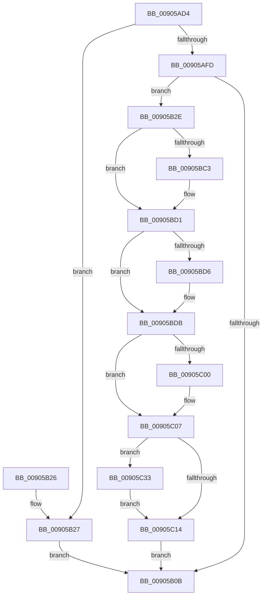

# PspSchedulerSharedDataRegionSlotFree

- RVA: `0x00905AD4`–`0x00905C3D` (길이 `361` bytes)
- VA: `0x0000000140905AD4`
- 실행 섹션: `PAGE`
- PDB 이름 있음: `예`; PDB Function 태그: `아니요`
- unwind 정보 RVA: `0x00088C3C`
- 디코드: `90`개 명령, `361/361` bytes 표시
- 미해석 바이트: `0` (있으면 어셈블리에 `.byte`로 보존)

> 이 문서는 커널 이미지의 기계어와 PDB 기호를 분석해 생성했습니다. 4번과 5번은 함수 원형과 자료형을 바이너리 사용 방식에서 추정한 C 해석이며 원본 소스 복구 결과는 아닙니다.

## 1. Dependencies

- 직접 호출 지점: **7**; 고유 호출 대상: **7**
- 직접 호출자로 확인된 함수: **2**
- RIP 상대 이미지 참조: **0**

### Outgoing calls
- `0x00905B3C` → [KeSwappablePageDereference](../../text/29/KeSwappablePageDereference_function_0029F540.md) (function, `0x0029F540`)
- `0x00905BB3` → [KeAbPreAcquire](../../text/21/KeAbPreAcquire_function_00210230.md) (function, `0x00210230`)
- `0x00905BCC` → [ExfAcquirePushLockExclusiveEx](../../text/20/ExfAcquirePushLockExclusiveEx_function_0020FC90.md) (function, `0x0020FC90`)
- `0x00905C17` → [KeAbPostRelease](../../text/2E/KeAbPostRelease_function_002E1600.md) (function, `0x002E1600`)
- `0x00905C1C` → [KeLeaveCriticalRegion](../../text/25/KeLeaveCriticalRegion_function_0025D8B0.md) (function, `0x0025D8B0`)
- `0x00905C29` → [ObfDereferenceObjectWithTag](../../text/2F/ObfDereferenceObjectWithTag_function_002F78E0.md) (function, `0x002F78E0`)
- `0x00905C36` → [ExfTryToWakePushLock](../../text/26/ExfTryToWakePushLock_function_00265DD0.md) (function, `0x00265DD0`)

### Direct callers
- [NtSetInformationThread](../8C/NtSetInformationThread_function_008C9F60.md) at `0x008CB86C`
- [PspExitThread](PspExitThread_function_00905F60.md) at `0x009062C3`

### Static image references
- 디코드된 RIP-relative 메모리 참조가 없습니다.

## 2. Other-region calls and transfers

- 다른 실행 섹션으로 향하는 call: **7**
  - `0x00905B3C` → [KeSwappablePageDereference](../../text/29/KeSwappablePageDereference_function_0029F540.md) (`PAGE` → `.text`)
  - `0x00905BB3` → [KeAbPreAcquire](../../text/21/KeAbPreAcquire_function_00210230.md) (`PAGE` → `.text`)
  - `0x00905BCC` → [ExfAcquirePushLockExclusiveEx](../../text/20/ExfAcquirePushLockExclusiveEx_function_0020FC90.md) (`PAGE` → `.text`)
  - `0x00905C17` → [KeAbPostRelease](../../text/2E/KeAbPostRelease_function_002E1600.md) (`PAGE` → `.text`)
  - `0x00905C1C` → [KeLeaveCriticalRegion](../../text/25/KeLeaveCriticalRegion_function_0025D8B0.md) (`PAGE` → `.text`)
  - `0x00905C29` → [ObfDereferenceObjectWithTag](../../text/2F/ObfDereferenceObjectWithTag_function_002F78E0.md) (`PAGE` → `.text`)
  - `0x00905C36` → [ExfTryToWakePushLock](../../text/26/ExfTryToWakePushLock_function_00265DD0.md) (`PAGE` → `.text`)
- 별도 외부 분기/꼬리 이동을 확인하지 못했습니다.

## 3. Assembly (complete function range)

```asm
00905AD4  48 89 5C 24 08                  mov qword ptr [rsp + 8], rbx
00905AD9  48 89 6C 24 10                  mov qword ptr [rsp + 0x10], rbp
00905ADE  48 89 74 24 18                  mov qword ptr [rsp + 0x18], rsi
00905AE3  57                              push rdi
00905AE4  41 56                           push r14
00905AE6  41 57                           push r15
00905AE8  48 83 EC 20                     sub rsp, 0x20
00905AEC  65 48 8B 04 25 88 01 00 00      mov rax, qword ptr gs:[0x188]
00905AF5  48 8B D9                        mov rbx, rcx
00905AF8  48 3B C8                        cmp rcx, rax
00905AFB  75 2A                           jne 0x140905b27
00905AFD  48 8B A9 E0 06 00 00            mov rbp, qword ptr [rcx + 0x6e0]
00905B04  33 FF                           xor edi, edi
00905B06  48 85 ED                        test rbp, rbp
00905B09  75 23                           jne 0x140905b2e
00905B0B  48 8B 5C 24 40                  mov rbx, qword ptr [rsp + 0x40]
00905B10  8B C7                           mov eax, edi
00905B12  48 8B 6C 24 48                  mov rbp, qword ptr [rsp + 0x48]
00905B17  48 8B 74 24 50                  mov rsi, qword ptr [rsp + 0x50]
00905B1C  48 83 C4 20                     add rsp, 0x20
00905B20  41 5F                           pop r15
00905B22  41 5E                           pop r14
00905B24  5F                              pop rdi
00905B25  C3                              ret
00905B26  CC                              int3
00905B27  BF BB 00 00 C0                  mov edi, 0xc00000bb
00905B2C  EB DD                           jmp 0x140905b0b
00905B2E  48 89 B9 20 03 00 00            mov qword ptr [rcx + 0x320], rdi
00905B35  48 8B 89 68 04 00 00            mov rcx, qword ptr [rcx + 0x468]
00905B3C  E8 FF 99 99 FF                  call 0x14029f540
00905B41  48 8B 8B 68 04 00 00            mov rcx, qword ptr [rbx + 0x468]
00905B48  48 8D B5 C8 00 00 00            lea rsi, [rbp + 0xc8]
00905B4F  44 8B 83 64 04 00 00            mov r8d, dword ptr [rbx + 0x464]
00905B56  48 2B CD                        sub rcx, rbp
00905B59  48 89 BB 68 04 00 00            mov qword ptr [rbx + 0x468], rdi
00905B60  48 B8 67 66 66 66 66 66 66 66   movabs rax, 0x6666666666666667
00905B6A  48 F7 E9                        imul rcx
00905B6D  89 BB 64 04 00 00               mov dword ptr [rbx + 0x464], edi
00905B73  48 8B CE                        mov rcx, rsi
00905B76  48 89 BB E0 06 00 00            mov qword ptr [rbx + 0x6e0], rdi
00905B7D  4C 8B F2                        mov r14, rdx
00905B80  49 C1 FE 05                     sar r14, 5
00905B84  48 83 CB FF                     or rbx, 0xffffffffffffffff
00905B88  49 8B C6                        mov rax, r14
00905B8B  41 C1 E8 06                     shr r8d, 6
00905B8F  48 C1 E8 3F                     shr rax, 0x3f
00905B93  33 D2                           xor edx, edx
00905B95  4C 03 F0                        add r14, rax
00905B98  65 48 8B 04 25 88 01 00 00      mov rax, qword ptr gs:[0x188]
00905BA1  41 C1 E6 06                     shl r14d, 6
00905BA5  45 03 F0                        add r14d, r8d
00905BA8  45 33 C0                        xor r8d, r8d
00905BAB  66 01 98 E4 01 00 00            add word ptr [rax + 0x1e4], bx
00905BB2  90                              nop
00905BB3  E8 78 A6 90 FF                  call 0x140210230
00905BB8  F0 48 0F BA 2E 00               lock bts qword ptr [rsi], 0
00905BBE  4C 8B F8                        mov r15, rax
00905BC1  73 0E                           jae 0x140905bd1
00905BC3  4C 8B C6                        mov r8, rsi
00905BC6  48 8B D0                        mov rdx, rax
00905BC9  48 8B CE                        mov rcx, rsi
00905BCC  E8 BF A0 90 FF                  call 0x14020fc90
00905BD1  4D 85 FF                        test r15, r15
00905BD4  74 05                           je 0x140905bdb
00905BD6  41 C6 47 0A 01                  mov byte ptr [r15 + 0xa], 1
00905BDB  41 8B D6                        mov edx, r14d
00905BDE  41 8B C6                        mov eax, r14d
00905BE1  48 C1 EA 03                     shr rdx, 3
00905BE5  83 E0 07                        and eax, 7
00905BE8  48 03 95 D8 00 00 00            add rdx, qword ptr [rbp + 0xd8]
00905BEF  0F BE 0A                        movsx ecx, byte ptr [rdx]
00905BF2  0F B3 C1                        btr ecx, eax
00905BF5  88 0A                           mov byte ptr [rdx], cl
00905BF7  44 39 B5 E0 00 00 00            cmp dword ptr [rbp + 0xe0], r14d
00905BFE  76 07                           jbe 0x140905c07
00905C00  44 89 B5 E0 00 00 00            mov dword ptr [rbp + 0xe0], r14d
00905C07  F0 48 0F C1 1E                  lock xadd qword ptr [rsi], rbx
00905C0C  80 E3 06                        and bl, 6
00905C0F  80 FB 02                        cmp bl, 2
00905C12  74 1F                           je 0x140905c33
00905C14  48 8B CE                        mov rcx, rsi
00905C17  E8 E4 B9 9D FF                  call 0x1402e1600
00905C1C  E8 8F 7C 95 FF                  call 0x14025d8b0
00905C21  BA 50 73 53 61                  mov edx, 0x61537350
00905C26  48 8B CD                        mov rcx, rbp
00905C29  E8 B2 1C 9F FF                  call 0x1402f78e0
00905C2E  E9 D8 FE FF FF                  jmp 0x140905b0b
00905C33  48 8B CE                        mov rcx, rsi
00905C36  E8 95 01 96 FF                  call 0x140265dd0
00905C3B  EB D7                           jmp 0x140905c14
```

## 4. C-style interpretation (structured pseudocode)

```c
__int64 __fastcall PspSchedulerSharedDataRegionSlotFree(__int64 a1, __int64 a2)
{
    __int64 result;
    __int64 v_r14;
    __int64 v_rbx;
    __int64 v_rdi;
    __int64 v_rsp;
    unsigned __int64 v_stack_p10;
    unsigned __int64 v_stack_p18;
    unsigned __int64 v_stack_p8;

    v_stack_p8 = v_rbx;
    v_stack_p10 = v_rbp;
    v_stack_p18 = v_rsi;
    v_rsp = (v_rsp) - (32);
    if (a1 != (*(unsigned __int64 *)(gs_base + (0 + 392)))) goto loc_00905B27;
    v_rdi = 0;
    if (*(unsigned __int64 *)(a1 + 1760) != 0) goto loc_00905B2E;
loc_00905B0B:
    v_rsp = (v_rsp) + (32);
    return 0;
loc_00905B27:
    goto loc_00905B0B;
loc_00905B2E:
    *(unsigned __int64 *)(a1 + 800) = (unsigned int)(0xC00000BBULL);
    result = KeSwappablePageDereference(*(unsigned __int64 *)(a1 + 1128), a2, a3, a4);
    a1 = (*(unsigned __int64 *)(v_stack_p8 + 1128)) - (v_stack_p10);
    *(unsigned __int64 *)(v_stack_p8 + 1128) = (unsigned int)(0xC00000BBULL);
    *(unsigned int *)(v_stack_p8 + 1124) = (unsigned int)((unsigned int)(0xC00000BBULL));
    *(unsigned __int64 *)(v_stack_p8 + 1760) = (unsigned int)(0xC00000BBULL);
    v_r14 = (a2) >> (5);
    v_rbx = (v_stack_p8) | (-1);
    a3 = (unsigned int)(((unsigned int)(*(unsigned int *)(v_stack_p8 + 1124))) >> (6));
    result = (v_r14) >> (63);
    a2 = 0;
    v_r14 = (v_r14) + (result);
    v_r14 = (unsigned int)((v_r14) << (6));
    v_r14 = (unsigned int)((v_r14) + ((unsigned int)(a3)));
    a3 = 0;
    result = KeAbPreAcquire(v_stack_p10 + 200, a2, a3, a4);
    if (!(condition_is_above_or_equal)) {
        a3 = v_stack_p10 + 200;
        a2 = result;
        a1 = v_stack_p10 + 200;
        result = ExfAcquirePushLockExclusiveEx(a1, a2, a3, a4);
    }
    if (result != 0) {
        *(unsigned __int8 *)(result + 10) = 1;
    }
    a2 = ((unsigned int)((unsigned int)(v_r14))) >> (3);
    result = (unsigned int)(((unsigned int)((unsigned int)(v_r14))) & (7));
    a2 = (a2) + (*(unsigned __int64 *)(v_stack_p10 + 216));
    *(unsigned __int8 *)(a2) = (unsigned __int8)((__int8)(*(unsigned __int8 *)(a2)));
    if ((*(unsigned int *)(v_stack_p10 + 224)) >= = ((unsigned int)(v_r14))) {
        *(unsigned int *)(v_stack_p10 + 224) = (unsigned int)(v_r14);
    }
    v_rbx = (unsigned __int8)((v_rbx) & (6));
    if (((unsigned __int8)(v_rbx)) == 2) goto loc_00905C33;
loc_00905C14:
    result = KeAbPostRelease(v_stack_p10 + 200, a2, a3, a4);
    result = KeLeaveCriticalRegion(v_stack_p10 + 200, a2, a3, a4);
    result = ObfDereferenceObjectWithTag(v_stack_p10, (unsigned int)(0x61537350ULL), a3, a4);
    goto loc_00905B0B;
loc_00905C33:
    result = ExfTryToWakePushLock(v_stack_p10 + 200, (unsigned int)(0x61537350ULL), a3, a4);
    goto loc_00905C14;
}
```

## 5. (Beta) C Style

```c
int64_t PspSchedulerSharedDataRegionSlotFree(void *Arg1, int64_t Arg2)
{
    uint8_t *arg1 = (uint8_t *)Arg1;

    int64_t result;
    int64_t local_r14;
    int64_t local_rbx;
    int64_t local_rdi;
    int64_t local_rsp;
    uint64_t v_stack_p10;
    uint64_t v_stack_p18;
    uint64_t v_stack_p8;

    v_stack_p8 = local_rbx;
    v_stack_p10 = local_rbp;
    v_stack_p18 = local_rsi;
    local_rsp = (local_rsp) - (32);
    if (Arg1 != (*(uint64_t *)(gs_base + (0 + 0x188)))) goto loc_00905B27;
    local_rdi = 0;
    if (*(uint64_t *)(arg1 + 0x6E0) != 0) goto loc_00905B2E;
loc_00905B0B:
    local_rsp = (local_rsp) + (32);
    return 0;
loc_00905B27:
    goto loc_00905B0B;
loc_00905B2E:
    *(uint64_t *)(arg1 + 0x320) = (uint32_t)(0xC00000BBULL);
    result = KeSwappablePageDereference(*(uint64_t *)(arg1 + 0x468), Arg2, a3, a4);
    Arg1 = (*(uint64_t *)(v_stack_p8 + 0x468)) - (v_stack_p10);
    *(uint64_t *)(v_stack_p8 + 0x468) = (uint32_t)(0xC00000BBULL);
    *(uint32_t *)(v_stack_p8 + 0x464) = (uint32_t)((uint32_t)(0xC00000BBULL));
    *(uint64_t *)(v_stack_p8 + 0x6E0) = (uint32_t)(0xC00000BBULL);
    local_r14 = (Arg2) >> (5);
    local_rbx = (v_stack_p8) | (-1);
    a3 = (uint32_t)(((uint32_t)(*(uint32_t *)(v_stack_p8 + 0x464))) >> (6));
    result = (local_r14) >> (63);
    Arg2 = 0;
    local_r14 = (local_r14) + (result);
    local_r14 = (uint32_t)((local_r14) << (6));
    local_r14 = (uint32_t)((local_r14) + ((uint32_t)(a3)));
    a3 = 0;
    result = KeAbPreAcquire(v_stack_p10 + 200, Arg2, a3, a4);
    if (!(condition_is_above_or_equal)) {
        a3 = v_stack_p10 + 200;
        Arg2 = result;
        Arg1 = v_stack_p10 + 200;
        result = ExfAcquirePushLockExclusiveEx(Arg1, Arg2, a3, a4);
    }
    if (result != 0) {
        *(uint8_t *)(result + 0xA) = 1;
    }
    Arg2 = ((uint32_t)((uint32_t)(local_r14))) >> (3);
    result = (uint32_t)(((uint32_t)((uint32_t)(local_r14))) & (7));
    Arg2 = (Arg2) + (*(uint64_t *)(v_stack_p10 + 0xD8));
    *(uint8_t *)(Arg2) = (uint8_t)((int8_t)(*(uint8_t *)(Arg2)));
    if ((*(uint32_t *)(v_stack_p10 + 0xE0)) >= = ((uint32_t)(local_r14))) {
        *(uint32_t *)(v_stack_p10 + 0xE0) = (uint32_t)(local_r14);
    }
    local_rbx = (uint8_t)((local_rbx) & (6));
    if (((uint8_t)(local_rbx)) == 2) goto loc_00905C33;
loc_00905C14:
    result = KeAbPostRelease(v_stack_p10 + 200, Arg2, a3, a4);
    result = KeLeaveCriticalRegion(v_stack_p10 + 200, Arg2, a3, a4);
    result = ObfDereferenceObjectWithTag(v_stack_p10, (uint32_t)(0x61537350ULL), a3, a4);
    goto loc_00905B0B;
loc_00905C33:
    result = ExfTryToWakePushLock(v_stack_p10 + 200, (uint32_t)(0x61537350ULL), a3, a4);
    goto loc_00905C14;
}
```

### 관측된 메모리 오프셋

구조체 형식이 확인되지 않은 접근은 인자 기준의 오프셋으로만 기록했습니다.

| 기준 인자 | 오프셋 표현 | 폭 (bit) | 접근 |
|---|---:|---:|---|
| `Arg1` | `+ 0x464` | `32` | `R` |
| `Arg1` | `+ 0x464` | `32` | `W` |
| `Arg1` | `+ 0x468` | `64` | `R` |
| `Arg1` | `+ 0x468` | `64` | `W` |
| `Arg1` | `+ 0x6E0` | `64` | `W` |

## 6. Execution-region graph

[열기: 2D/3D 그래프와 함수 탐색 컨트롤 패널](../../../control-panel.html?section=page&rva=0x00905AD4&view=graph)

- 2D 그래프는 위에서 아래로 흐르고, 3D 그래프는 빈 공간을 드래그해 회전합니다. Shift+드래그는 이동, 휠은 확대·축소, 함수 노드 선택은 대상 보고서 이동입니다.

### Static fallback


