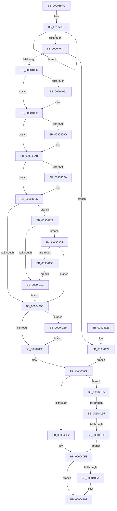

# PspTerminateProcess

- RVA: `0x00903FFC`–`0x0090417E` (길이 `386` bytes)
- VA: `0x0000000140903FFC`
- 실행 섹션: `PAGE`
- PDB 이름 있음: `예`; PDB Function 태그: `예`
- unwind 정보 RVA: `0x00088A84`
- 디코드: `104`개 명령, `386/386` bytes 표시
- 미해석 바이트: `0` (있으면 어셈블리에 `.byte`로 보존)

> 이 문서는 커널 이미지의 기계어와 PDB 기호를 분석해 생성했습니다. 4번과 5번은 함수 원형과 자료형을 바이너리 사용 방식에서 추정한 C 해석이며 원본 소스 복구 결과는 아닙니다.

## 1. Dependencies

- 직접 호출 지점: **9**; 고유 호출 대상: **9**
- 직접 호출자로 확인된 함수: **3**
- RIP 상대 이미지 참조: **2**

### Outgoing calls
- `0x00904064` → [EtwTraceProcessTerminate](../../text/49/EtwTraceProcessTerminate_function_0049612C.md) (function, `0x0049612C`)
- `0x0090406E` → [KeSetProcessSchedulingGroup](../../text/46/KeSetProcessSchedulingGroup_function_0046E378.md) (function, `0x0046E378`)
- `0x0090408D` → [KeAbPreAcquire](../../text/21/KeAbPreAcquire_function_00210230.md) (function, `0x00210230`)
- `0x009040A6` → [ExfAcquirePushLockExclusiveEx](../../text/20/ExfAcquirePushLockExclusiveEx_function_0020FC90.md) (function, `0x0020FC90`)
- `0x009040D1` → [KeAbPostRelease](../../text/2E/KeAbPostRelease_function_002E1600.md) (function, `0x002E1600`)
- `0x009040EE` → [PspTerminateAllThreads](../8C/PspTerminateAllThreads_function_008C97D0.md) (function, `0x008C97D0`)
- `0x009040FD` → [KeForceResumeProcess](../../text/3C/KeForceResumeProcess_function_003C1BE4.md) (function, `0x003C1BE4`)
- `0x0090413C` → [ExfTryToWakePushLock](../../text/26/ExfTryToWakePushLock_function_00265DD0.md) (function, `0x00265DD0`)
- `0x00904174` → [guard_dispatch_icall](../../text/6B/guard_dispatch_icall_function_006BAAD0.md) (function, `0x006BAAD0`)

### Direct callers
- [PspTerminatePicoProcess](../78/PspTerminatePicoProcess_function_00787710.md) at `0x00787737`
- [PsTerminateProcess](PsTerminateProcess_function_00904C64.md) at `0x00904C8B`
- [NtTerminateProcess](../AE/NtTerminateProcess_function_00AEC320.md) at `0x00AEC433`

### Static image references
- `0x00904056` → RVA `0x00FC6B00` (`ALMOSTRO`; read)
- `0x00904155` → RVA `0x00F06548` (`.data`; read)

## 2. Other-region calls and transfers

- 다른 실행 섹션으로 향하는 call: **8**
  - `0x00904064` → [EtwTraceProcessTerminate](../../text/49/EtwTraceProcessTerminate_function_0049612C.md) (`PAGE` → `.text`)
  - `0x0090406E` → [KeSetProcessSchedulingGroup](../../text/46/KeSetProcessSchedulingGroup_function_0046E378.md) (`PAGE` → `.text`)
  - `0x0090408D` → [KeAbPreAcquire](../../text/21/KeAbPreAcquire_function_00210230.md) (`PAGE` → `.text`)
  - `0x009040A6` → [ExfAcquirePushLockExclusiveEx](../../text/20/ExfAcquirePushLockExclusiveEx_function_0020FC90.md) (`PAGE` → `.text`)
  - `0x009040D1` → [KeAbPostRelease](../../text/2E/KeAbPostRelease_function_002E1600.md) (`PAGE` → `.text`)
  - `0x009040FD` → [KeForceResumeProcess](../../text/3C/KeForceResumeProcess_function_003C1BE4.md) (`PAGE` → `.text`)
  - `0x0090413C` → [ExfTryToWakePushLock](../../text/26/ExfTryToWakePushLock_function_00265DD0.md) (`PAGE` → `.text`)
  - `0x00904174` → [guard_dispatch_icall](../../text/6B/guard_dispatch_icall_function_006BAAD0.md) (`PAGE` → `.text`)
- call이 아닌 외부 분기/꼬리 이동: **2**
  - `0x0090415F` → [sub_00B20CE6](../B2/Unknown_function_00B20CE6.md) (`tail-transfer`)
  - `0x00904169` → [sub_00B20CE6](../B2/Unknown_function_00B20CE6.md) (`tail-transfer`)

## 3. Assembly (complete function range)

```asm
00903FFC  48 8B C4                        mov rax, rsp
00903FFF  48 89 58 08                     mov qword ptr [rax + 8], rbx
00904003  48 89 68 10                     mov qword ptr [rax + 0x10], rbp
00904007  48 89 70 18                     mov qword ptr [rax + 0x18], rsi
0090400B  48 89 78 20                     mov qword ptr [rax + 0x20], rdi
0090400F  41 54                           push r12
00904011  41 56                           push r14
00904013  41 57                           push r15
00904015  48 83 EC 20                     sub rsp, 0x20
00904019  41 8B F9                        mov edi, r9d
0090401C  41 8B E8                        mov ebp, r8d
0090401F  4C 8B E2                        mov r12, rdx
00904022  48 8B D9                        mov rbx, rcx
00904025  45 8B F1                        mov r14d, r9d
00904028  0F 0D 89 F4 01 00 00            prefetchw byte ptr [rcx + 0x1f4]
0090402F  8B 81 F4 01 00 00               mov eax, dword ptr [rcx + 0x1f4]
00904035  44 8B D0                        mov r10d, eax
00904038  41 83 CA 08                     or r10d, 8
0090403C  F0 44 0F B1 91 F4 01 00 00      lock cmpxchg dword ptr [rcx + 0x1f4], r10d
00904045  75 EE                           jne 0x140904035
00904047  44 8B F8                        mov r15d, eax
0090404A  8B F0                           mov esi, eax
0090404C  41 83 E7 08                     and r15d, 8
00904050  0F 85 CE 00 00 00               jne 0x140904124
00904056  8B 0D A4 2A 6C 00               mov ecx, dword ptr [rip + 0x6c2aa4]
0090405C  F6 C1 01                        test cl, 1
0090405F  74 08                           je 0x140904069
00904061  48 8B CB                        mov rcx, rbx
00904064  E8 C3 20 B9 FF                  call 0x14049612c
00904069  33 D2                           xor edx, edx
0090406B  48 8B CB                        mov rcx, rbx
0090406E  E8 05 A3 B6 FF                  call 0x14046e378
00904073  83 CF 04                        or edi, 4
00904076  0F BA E6 1E                     bt esi, 0x1e
0090407A  48 8D B3 C8 01 00 00            lea rsi, [rbx + 0x1c8]
00904081  48 8B CE                        mov rcx, rsi
00904084  41 0F 43 FE                     cmovae edi, r14d
00904088  45 33 C0                        xor r8d, r8d
0090408B  33 D2                           xor edx, edx
0090408D  E8 9E C1 90 FF                  call 0x140210230
00904092  F0 48 0F BA 2E 00               lock bts qword ptr [rsi], 0
00904098  4C 8B F0                        mov r14, rax
0090409B  73 0E                           jae 0x1409040ab
0090409D  4C 8B C6                        mov r8, rsi
009040A0  48 8B D0                        mov rdx, rax
009040A3  48 8B CE                        mov rcx, rsi
009040A6  E8 E5 BB 90 FF                  call 0x14020fc90
009040AB  4D 85 F6                        test r14, r14
009040AE  74 05                           je 0x1409040b5
009040B0  41 C6 46 0A 01                  mov byte ptr [r14 + 0xa], 1
009040B5  8B 83 80 03 00 00               mov eax, dword ptr [rbx + 0x380]
009040BB  85 C0                           test eax, eax
009040BD  75 6A                           jne 0x140904129
009040BF  48 83 C8 FF                     or rax, 0xffffffffffffffff
009040C3  F0 48 0F C1 06                  lock xadd qword ptr [rsi], rax
009040C8  24 06                           and al, 6
009040CA  3C 02                           cmp al, 2
009040CC  74 6B                           je 0x140904139
009040CE  48 8B CE                        mov rcx, rsi
009040D1  E8 2A D5 9D FF                  call 0x1402e1600
009040D6  F7 83 F0 01 00 00 00 04 00 00   test dword ptr [rbx + 0x1f0], 0x400
009040E0  75 73                           jne 0x140904155
009040E2  44 8B CF                        mov r9d, edi
009040E5  44 8B C5                        mov r8d, ebp
009040E8  49 8B D4                        mov rdx, r12
009040EB  48 8B CB                        mov rcx, rbx
009040EE  E8 DD 56 FC FF                  call 0x1408c97d0
009040F3  8B F8                           mov edi, eax
009040F5  45 85 FF                        test r15d, r15d
009040F8  75 08                           jne 0x140904102
009040FA  48 8B CB                        mov rcx, rbx
009040FD  E8 E2 DA AB FF                  call 0x1403c1be4
00904102  48 8B 5C 24 40                  mov rbx, qword ptr [rsp + 0x40]
00904107  8B C7                           mov eax, edi
00904109  48 8B 7C 24 58                  mov rdi, qword ptr [rsp + 0x58]
0090410E  48 8B 6C 24 48                  mov rbp, qword ptr [rsp + 0x48]
00904113  48 8B 74 24 50                  mov rsi, qword ptr [rsp + 0x50]
00904118  48 83 C4 20                     add rsp, 0x20
0090411C  41 5F                           pop r15
0090411E  41 5E                           pop r14
00904120  41 5C                           pop r12
00904122  C3                              ret
00904123  CC                              int3
00904124  83 CF 02                        or edi, 2
00904127  EB AD                           jmp 0x1409040d6
00904129  81 FD 4B 00 00 C0               cmp ebp, 0xc000004b
0090412F  74 12                           je 0x140904143
00904131  89 AB 54 05 00 00               mov dword ptr [rbx + 0x554], ebp
00904137  EB 86                           jmp 0x1409040bf
00904139  48 8B CE                        mov rcx, rsi
0090413C  E8 8F 1C 96 FF                  call 0x140265dd0
00904141  EB 8B                           jmp 0x1409040ce
00904143  81 BB 54 05 00 00 03 01 00 00   cmp dword ptr [rbx + 0x554], 0x103
0090414D  0F 85 6C FF FF FF               jne 0x1409040bf
00904153  EB DC                           jmp 0x140904131
00904155  48 8B 05 EC 23 60 00            mov rax, qword ptr [rip + 0x6023ec]
0090415C  48 85 C0                        test rax, rax
0090415F  0F 84 81 CB 21 00               je 0x140b20ce6
00904165  40 F6 C7 08                     test dil, 8
00904169  0F 85 77 CB 21 00               jne 0x140b20ce6
0090416F  8B D5                           mov edx, ebp
00904171  48 8B CB                        mov rcx, rbx
00904174  E8 57 69 DB FF                  call 0x1406baad0
00904179  E9 75 FF FF FF                  jmp 0x1409040f3
```

## 4. C-style interpretation (structured pseudocode)

```c
__int64 __fastcall PspTerminateProcess(__int64 a1, __int64 a2, int a3, int a4)
{
    __int64 result;
    __int64 v_r10;
    __int64 v_r15;
    __int64 v_rdi;
    __int64 v_rsp;
    unsigned __int64 v_stack_p10;
    unsigned __int64 v_stack_p18;
    unsigned __int64 v_stack_p20;
    unsigned __int64 v_stack_p8;

    *(unsigned __int64 *)(v_rsp + 8) = v_rbx;
    *(unsigned __int64 *)(v_rsp + 16) = v_rbp;
    *(unsigned __int64 *)(v_rsp + 24) = v_rsi;
    *(unsigned __int64 *)(v_rsp + 32) = v_rdi;
    v_rsp = (v_rsp) - (32);
loc_00904035:
    v_r10 = (unsigned int)(((unsigned int)((unsigned int)((unsigned int)(*(unsigned int *)(a1 + 500))))) | (8));
    if (condition_is_not_equal) goto loc_00904035;
    v_r15 = (unsigned int)(((unsigned int)((unsigned int)((unsigned int)(*(unsigned int *)(a1 + 500))))) & (8));
    if (condition_is_not_equal) goto loc_00904124;
    result = (unsigned int)(*(unsigned int *)(a1 + 500));
    if ((((unsigned __int8)((unsigned int)(*(unsigned int *)(v_rip + 7088804)))) & (1)) != 0) {
        a1 = a1;
        result = EtwTraceProcessTerminate(a1, a2, a3, a4);
    }
    a2 = 0;
    result = KeSetProcessSchedulingGroup(a1, a2, a3, a4);
    v_rdi = (unsigned int)(((unsigned int)(a4)) | (4));
    if (condition_is_above_or_equal) { v_rdi = (unsigned int)((unsigned int)(a4)); }
    a3 = 0;
    a2 = 0;
    result = KeAbPreAcquire(a1 + 456, a2, a3, a4);
    if (!(condition_is_above_or_equal)) {
        a3 = a1 + 456;
        a2 = result;
        a1 = a1 + 456;
        result = ExfAcquirePushLockExclusiveEx(a1, a2, a3, a4);
    }
    if (result != 0) {
        *(unsigned __int8 *)(result + 10) = 1;
    }
    if ((unsigned int)((unsigned int)(*(unsigned int *)(a1 + 896))) != 0) goto loc_00904129;
loc_009040BF:
    result = ((unsigned int)(*(unsigned int *)(a1 + 896))) | (-1);
    result = (unsigned __int8)((result) & (6));
    if (((unsigned __int8)(result)) == 2) goto loc_00904139;
loc_009040CE:
    result = KeAbPostRelease(a1 + 456, a2, a3, a4);
loc_009040D6:
    if (((*(unsigned int *)(a1 + 496)) & (0x400ULL)) != 0) goto loc_00904155;
    result = PspTerminateAllThreads(a1, a2, (unsigned int)((unsigned int)((unsigned int)(a3))), (unsigned int)((unsigned int)(v_rdi)));
loc_009040F3:
    if ((unsigned int)(v_r15) == 0) {
        a1 = a1;
        result = KeForceResumeProcess(a1, a2, (unsigned int)((unsigned int)((unsigned int)(a3))), (unsigned int)((unsigned int)(v_rdi)));
    }
    v_rsp = (v_rsp) + (32);
    return (unsigned int)((unsigned int)((unsigned int)((unsigned int)(result))));
loc_00904124:
    v_rdi = (unsigned int)((v_stack_p20) | (2));
    goto loc_009040D6;
loc_00904129:
    if (((unsigned int)(v_stack_p10)) == 0xC000004BULL) goto loc_00904143;
loc_00904131:
    *(unsigned int *)(v_stack_p8 + 1364) = (unsigned int)(v_stack_p10);
    goto loc_009040BF;
loc_00904139:
    result = ExfTryToWakePushLock(v_stack_p18, a2, (unsigned int)((unsigned int)((unsigned int)(a3))), (unsigned int)((unsigned int)(v_rdi)));
    goto loc_009040CE;
loc_00904143:
    if ((*(unsigned int *)(v_stack_p8 + 1364)) != 259) goto loc_009040BF;
    goto loc_00904131;
loc_00904155:
    result = guard_dispatch_icall(v_stack_p8, (unsigned int)((unsigned int)(v_stack_p10)), (unsigned int)((unsigned int)((unsigned int)(a3))), (unsigned int)((unsigned int)(v_rdi)));
    goto loc_009040F3;
}
```

## 5. (Beta) C Style

```c
int64_t PspTerminateProcess(void *Arg1, int64_t Arg2, int32_t Arg3, int32_t Arg4)
{
    uint8_t *arg1 = (uint8_t *)Arg1;

    int64_t result;
    int64_t local_r10;
    int64_t local_r15;
    int64_t local_rdi;
    int64_t local_rsp;
    uint64_t v_stack_p10;
    uint64_t v_stack_p18;
    uint64_t v_stack_p20;
    uint64_t v_stack_p8;

    *(uint64_t *)(local_rsp + 0x8) = local_rbx;
    *(uint64_t *)(local_rsp + 0x10) = local_rbp;
    *(uint64_t *)(local_rsp + 0x18) = local_rsi;
    *(uint64_t *)(local_rsp + 0x20) = local_rdi;
    local_rsp = (local_rsp) - (32);
loc_00904035:
    local_r10 = (uint32_t)(((uint32_t)((uint32_t)((uint32_t)(*(uint32_t *)(arg1 + 0x1F4))))) | (8));
    if (condition_is_not_equal) goto loc_00904035;
    local_r15 = (uint32_t)(((uint32_t)((uint32_t)((uint32_t)(*(uint32_t *)(arg1 + 0x1F4))))) & (8));
    if (condition_is_not_equal) goto loc_00904124;
    result = (uint32_t)(*(uint32_t *)(arg1 + 0x1F4));
    if ((((uint8_t)((uint32_t)(*(uint32_t *)(v_rip + 0x6C2AA4)))) & (1)) != 0) {
        Arg1 = Arg1;
        result = EtwTraceProcessTerminate(Arg1, Arg2, Arg3, Arg4);
    }
    Arg2 = 0;
    result = KeSetProcessSchedulingGroup(Arg1, Arg2, Arg3, Arg4);
    local_rdi = (uint32_t)(((uint32_t)(Arg4)) | (4));
    if (condition_is_above_or_equal) { local_rdi = (uint32_t)((uint32_t)(Arg4)); }
    Arg3 = 0;
    Arg2 = 0;
    result = KeAbPreAcquire(Arg1 + 456, Arg2, Arg3, Arg4);
    if (!(condition_is_above_or_equal)) {
        Arg3 = Arg1 + 456;
        Arg2 = result;
        Arg1 = Arg1 + 456;
        result = ExfAcquirePushLockExclusiveEx(Arg1, Arg2, Arg3, Arg4);
    }
    if (result != 0) {
        *(uint8_t *)(result + 0xA) = 1;
    }
    if ((uint32_t)((uint32_t)(*(uint32_t *)(arg1 + 0x380))) != 0) goto loc_00904129;
loc_009040BF:
    result = ((uint32_t)(*(uint32_t *)(arg1 + 0x380))) | (-1);
    result = (uint8_t)((result) & (6));
    if (((uint8_t)(result)) == 2) goto loc_00904139;
loc_009040CE:
    result = KeAbPostRelease(Arg1 + 456, Arg2, Arg3, Arg4);
loc_009040D6:
    if (((*(uint32_t *)(arg1 + 0x1F0)) & (0x400ULL)) != 0) goto loc_00904155;
    result = PspTerminateAllThreads(Arg1, Arg2, (uint32_t)((uint32_t)((uint32_t)(Arg3))), (uint32_t)((uint32_t)(local_rdi)));
loc_009040F3:
    if ((uint32_t)(local_r15) == 0) {
        Arg1 = Arg1;
        result = KeForceResumeProcess(Arg1, Arg2, (uint32_t)((uint32_t)((uint32_t)(Arg3))), (uint32_t)((uint32_t)(local_rdi)));
    }
    local_rsp = (local_rsp) + (32);
    return (uint32_t)((uint32_t)((uint32_t)((uint32_t)(result))));
loc_00904124:
    local_rdi = (uint32_t)((v_stack_p20) | (2));
    goto loc_009040D6;
loc_00904129:
    if (((uint32_t)(v_stack_p10)) == 0xC000004BULL) goto loc_00904143;
loc_00904131:
    *(uint32_t *)(v_stack_p8 + 0x554) = (uint32_t)(v_stack_p10);
    goto loc_009040BF;
loc_00904139:
    result = ExfTryToWakePushLock(v_stack_p18, Arg2, (uint32_t)((uint32_t)((uint32_t)(Arg3))), (uint32_t)((uint32_t)(local_rdi)));
    goto loc_009040CE;
loc_00904143:
    if ((*(uint32_t *)(v_stack_p8 + 0x554)) != 259) goto loc_009040BF;
    goto loc_00904131;
loc_00904155:
    result = guard_dispatch_icall(v_stack_p8, (uint32_t)((uint32_t)(v_stack_p10)), (uint32_t)((uint32_t)((uint32_t)(Arg3))), (uint32_t)((uint32_t)(local_rdi)));
    goto loc_009040F3;
}
```

### 관측된 메모리 오프셋

구조체 형식이 확인되지 않은 접근은 인자 기준의 오프셋으로만 기록했습니다.

| 기준 인자 | 오프셋 표현 | 폭 (bit) | 접근 |
|---|---:|---:|---|
| `Arg1` | `+ 0x0` | `64` | `R/W` |
| `Arg1` | `+ 0x1C8` | `64` | `R` |
| `Arg1` | `+ 0x1F0` | `32` | `R` |
| `Arg1` | `+ 0x1F4` | `8` | `R` |
| `Arg1` | `+ 0x1F4` | `32` | `R` |
| `Arg1` | `+ 0x380` | `32` | `R` |
| `Arg1` | `+ 0x554` | `32` | `R` |
| `Arg1` | `+ 0x554` | `32` | `W` |

## 6. Execution-region graph

[열기: 2D/3D 그래프와 함수 탐색 컨트롤 패널](../../../control-panel.html?section=page&rva=0x00903FFC&view=graph)

- 2D 그래프는 위에서 아래로 흐르고, 3D 그래프는 빈 공간을 드래그해 회전합니다. Shift+드래그는 이동, 휠은 확대·축소, 함수 노드 선택은 대상 보고서 이동입니다.

### Static fallback


