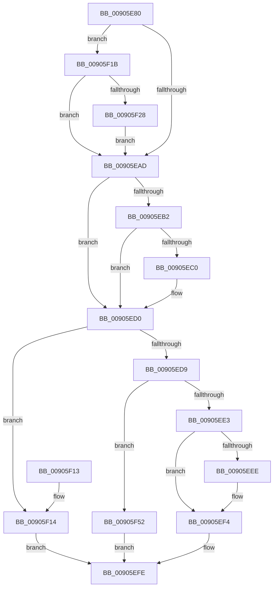

# PspTerminateThreadByPointer

- RVA: `0x00905E80`–`0x00905F59` (길이 `217` bytes)
- VA: `0x0000000140905E80`
- 실행 섹션: `PAGE`
- PDB 이름 있음: `예`; PDB Function 태그: `아니요`
- unwind 정보 RVA: `0x00088C80`
- 디코드: `55`개 명령, `217/217` bytes 표시
- 미해석 바이트: `0` (있으면 어셈블리에 `.byte`로 보존)

> 이 문서는 커널 이미지의 기계어와 PDB 기호를 분석해 생성했습니다. 4번과 5번은 함수 원형과 자료형을 바이너리 사용 방식에서 추정한 C 해석이며 원본 소스 복구 결과는 아닙니다.

## 1. Dependencies

- 직접 호출 지점: **4**; 고유 호출 대상: **4**
- 직접 호출자로 확인된 함수: **8**
- RIP 상대 이미지 참조: **1**

### Outgoing calls
- `0x00905ECA` → [PspExitThread](PspExitThread_function_00905F60.md) (function, `0x00905F60`)
- `0x00905EF7` → [KeRequestTerminationThread](../../text/48/KeRequestTerminationThread_function_00489A58.md) (function, `0x00489A58`)
- `0x00905F2B` → [PsGetProcessServerSilo](../../text/44/PsGetProcessServerSilo_function_0044BEE0.md) (function, `0x0044BEE0`)
- `0x00905F48` → [PspCatchCriticalBreak](../78/PspCatchCriticalBreak_function_00786408.md) (function, `0x00786408`)

### Direct callers
- [PspSystemThreadStartup](../../text/49/PspSystemThreadStartup_function_004932C0.md) at `0x0049332F`
- [PsDispatchIumService](../../text/4A/PsDispatchIumService_function_004A2F0C.md) at `0x004A3145`
- [PsDispatchIumService](../../text/4A/PsDispatchIumService_function_004A2F0C.md) at `0x004A32C2`
- [PspTerminateAllThreads](../8C/PspTerminateAllThreads_function_008C97D0.md) at `0x008C98A4`
- [PspTerminateAllThreads](../8C/PspTerminateAllThreads_function_008C97D0.md) at `0x008C99F1`
- [PspUserThreadStartup](../8D/PspUserThreadStartup_function_008D5B10.md) at `0x008D5C00`
- [NtTerminateThread](NtTerminateThread_function_00905DA0.md) at `0x00905DE1`
- [NtTerminateThread](NtTerminateThread_function_00905DA0.md) at `0x00905E4F`
- [PsTerminateSystemThread](../9B/PsTerminateSystemThread_function_009BCE50.md) at `0x009BCE76`
- [PspSecureThreadStartup](../AA/PspSecureThreadStartup_function_00AABDF0.md) at `0x00AABE3F`
- [PspSecureThreadStartup](../AA/PspSecureThreadStartup_function_00AABDF0.md) at `0x00AABE56`
- [NtTerminateProcess](../AE/NtTerminateProcess_function_00AEC320.md) at `0x00AEC4EC`

### Static image references
- `0x00905F41` → RVA `0x00B05030` (` ?? ::NNGAKEGL::`string'`; read)

## 2. Other-region calls and transfers

- 다른 실행 섹션으로 향하는 call: **2**
  - `0x00905EF7` → [KeRequestTerminationThread](../../text/48/KeRequestTerminationThread_function_00489A58.md) (`PAGE` → `.text`)
  - `0x00905F2B` → [PsGetProcessServerSilo](../../text/44/PsGetProcessServerSilo_function_0044BEE0.md) (`PAGE` → `.text`)
- 별도 외부 분기/꼬리 이동을 확인하지 못했습니다.

## 3. Assembly (complete function range)

```asm
00905E80  48 89 5C 24 08                  mov qword ptr [rsp + 8], rbx
00905E85  48 89 6C 24 10                  mov qword ptr [rsp + 0x10], rbp
00905E8A  48 89 74 24 18                  mov qword ptr [rsp + 0x18], rsi
00905E8F  57                              push rdi
00905E90  48 83 EC 30                     sub rsp, 0x30
00905E94  8B 81 A0 05 00 00               mov eax, dword ptr [rcx + 0x5a0]
00905E9A  41 8A E8                        mov bpl, r8b
00905E9D  48 8B B9 20 02 00 00            mov rdi, qword ptr [rcx + 0x220]
00905EA4  8B F2                           mov esi, edx
00905EA6  48 8B D9                        mov rbx, rcx
00905EA9  A8 20                           test al, 0x20
00905EAB  75 6E                           jne 0x140905f1b
00905EAD  40 84 ED                        test bpl, bpl
00905EB0  74 1E                           je 0x140905ed0
00905EB2  65 48 8B 04 25 88 01 00 00      mov rax, qword ptr gs:[0x188]
00905EBB  48 3B D8                        cmp rbx, rax
00905EBE  75 10                           jne 0x140905ed0
00905EC0  F0 83 8B A0 05 00 00 01         lock or dword ptr [rbx + 0x5a0], 1
00905EC8  8B CE                           mov ecx, esi
00905ECA  E8 91 00 00 00                  call 0x140905f60
00905ECF  CC                              int3
00905ED0  F7 43 74 00 04 00 00            test dword ptr [rbx + 0x74], 0x400
00905ED7  75 3B                           jne 0x140905f14
00905ED9  8B 87 FC 05 00 00               mov eax, dword ptr [rdi + 0x5fc]
00905EDF  A8 01                           test al, 1
00905EE1  75 6F                           jne 0x140905f52
00905EE3  F0 0F BA AB A0 05 00 00 00      lock bts dword ptr [rbx + 0x5a0], 0
00905EEC  72 06                           jb 0x140905ef4
00905EEE  89 B3 D8 05 00 00               mov dword ptr [rbx + 0x5d8], esi
00905EF4  48 8B CB                        mov rcx, rbx
00905EF7  E8 5C 3B B8 FF                  call 0x140489a58
00905EFC  33 C0                           xor eax, eax
00905EFE  48 8B 5C 24 40                  mov rbx, qword ptr [rsp + 0x40]
00905F03  48 8B 6C 24 48                  mov rbp, qword ptr [rsp + 0x48]
00905F08  48 8B 74 24 50                  mov rsi, qword ptr [rsp + 0x50]
00905F0D  48 83 C4 30                     add rsp, 0x30
00905F11  5F                              pop rdi
00905F12  C3                              ret
00905F13  CC                              int3
00905F14  B8 22 00 00 C0                  mov eax, 0xc0000022
00905F19  EB E3                           jmp 0x140905efe
00905F1B  8B 87 F4 01 00 00               mov eax, dword ptr [rdi + 0x1f4]
00905F21  A9 08 00 00 40                  test eax, 0x40000008
00905F26  75 85                           jne 0x140905ead
00905F28  48 8B CF                        mov rcx, rdi
00905F2B  E8 B0 5F B4 FF                  call 0x14044bee0
00905F30  4C 8B C8                        mov r9, rax
00905F33  89 74 24 20                     mov dword ptr [rsp + 0x20], esi
00905F37  4C 8D 87 38 03 00 00            lea r8, [rdi + 0x338]
00905F3E  48 8B D3                        mov rdx, rbx
00905F41  48 8D 0D E8 F0 1F 00            lea rcx, [rip + 0x1ff0e8]
00905F48  E8 BB 04 E8 FF                  call 0x140786408
00905F4D  E9 5B FF FF FF                  jmp 0x140905ead
00905F52  B8 BB 00 00 C0                  mov eax, 0xc00000bb
00905F57  EB A5                           jmp 0x140905efe
```

## 4. C-style interpretation (structured pseudocode)

```c
__int64 __fastcall PspTerminateThreadByPointer(__int64 a1, int a2, unsigned __int8 a3)
{
    __int64 result;
    __int64 v_rsp;
    unsigned __int64 v_stack_p10;
    unsigned __int64 v_stack_p18;
    unsigned int v_stack_p20;
    unsigned __int64 v_stack_p8;

    v_stack_p8 = v_rbx;
    v_stack_p10 = v_rbp;
    v_stack_p18 = v_rsi;
    v_rsp = (v_rsp) - (48);
    if ((((unsigned __int8)((unsigned int)(*(unsigned int *)(a1 + 1440)))) & (32)) != 0) goto loc_00905F1B;
loc_00905EAD:
    if (a3 == 0) goto loc_00905ED0;
    result = *(unsigned __int64 *)(gs_base + (0 + 392));
    if (a1 == (*(unsigned __int64 *)(gs_base + (0 + 392)))) {
        a1 = (unsigned int)((unsigned int)(a2));
        result = PspExitThread(a1, a2, a3, a4);
    }
    if (((*(unsigned int *)(a1 + 116)) & (0x400ULL)) != 0) goto loc_00905F14;
    if ((((unsigned __int8)((unsigned int)(*(unsigned int *)(*(unsigned __int64 *)(a1 + 544) + 1532)))) & (1)) != 0) goto loc_00905F52;
    if (!(condition_is_below)) {
        *(unsigned int *)(a1 + 1496) = (unsigned int)((unsigned int)(a2));
    }
    result = KeRequestTerminationThread(a1, a2, a3, a4);
    result = 0;
loc_00905EFE:
    v_rsp = (v_rsp) + (48);
    return result;
loc_00905F14:
    goto loc_00905EFE;
loc_00905F1B:
    if ((((unsigned int)((unsigned int)(*(unsigned int *)(*(unsigned __int64 *)(a1 + 544) + 500)))) & (0x40000008ULL)) != 0) goto loc_00905EAD;
    result = PsGetProcessServerSilo(*(unsigned __int64 *)(a1 + 544), a2, a3, a4);
    v_stack_p20 = (unsigned int)(v_stack_p18);
    result = PspCatchCriticalBreak(v_rip + 2093288, v_stack_p8, *(unsigned __int64 *)(a1 + 544) + 824, result);
    goto loc_00905EAD;
loc_00905F52:
    goto loc_00905EFE;
}
```

## 5. (Beta) C Style

```c
int64_t PspTerminateThreadByPointer(void *Arg1, int32_t Arg2, uint8_t Arg3)
{
    uint8_t *arg1 = (uint8_t *)Arg1;

    int64_t result;
    int64_t local_rsp;
    uint64_t v_stack_p10;
    uint64_t v_stack_p18;
    uint32_t v_stack_p20;
    uint64_t v_stack_p8;

    v_stack_p8 = local_rbx;
    v_stack_p10 = local_rbp;
    v_stack_p18 = local_rsi;
    local_rsp = (local_rsp) - (48);
    if ((((uint8_t)((uint32_t)(*(uint32_t *)(arg1 + 0x5A0)))) & (32)) != 0) goto loc_00905F1B;
loc_00905EAD:
    if (Arg3 == 0) goto loc_00905ED0;
    result = *(uint64_t *)(gs_base + (0 + 0x188));
    if (Arg1 == (*(uint64_t *)(gs_base + (0 + 0x188)))) {
        Arg1 = (uint32_t)((uint32_t)(Arg2));
        result = PspExitThread(Arg1, Arg2, Arg3, a4);
    }
    if (((*(uint32_t *)(arg1 + 0x74)) & (0x400ULL)) != 0) goto loc_00905F14;
    if ((((uint8_t)((uint32_t)(*(uint32_t *)(*(uint64_t *)(arg1 + 0x220) + 0x5FC)))) & (1)) != 0) goto loc_00905F52;
    if (!(condition_is_below)) {
        *(uint32_t *)(arg1 + 0x5D8) = (uint32_t)((uint32_t)(Arg2));
    }
    result = KeRequestTerminationThread(Arg1, Arg2, Arg3, a4);
    result = 0;
loc_00905EFE:
    local_rsp = (local_rsp) + (48);
    return result;
loc_00905F14:
    goto loc_00905EFE;
loc_00905F1B:
    if ((((uint32_t)((uint32_t)(*(uint32_t *)(*(uint64_t *)(arg1 + 0x220) + 0x1F4)))) & (0x40000008ULL)) != 0) goto loc_00905EAD;
    result = PsGetProcessServerSilo(*(uint64_t *)(arg1 + 0x220), Arg2, Arg3, a4);
    v_stack_p20 = (uint32_t)(v_stack_p18);
    result = PspCatchCriticalBreak(v_rip + 2093288, v_stack_p8, *(uint64_t *)(arg1 + 0x220) + 824, result);
    goto loc_00905EAD;
loc_00905F52:
    goto loc_00905EFE;
}
```

### 관측된 메모리 오프셋

구조체 형식이 확인되지 않은 접근은 인자 기준의 오프셋으로만 기록했습니다.

| 기준 인자 | 오프셋 표현 | 폭 (bit) | 접근 |
|---|---:|---:|---|
| `Arg1` | `+ 0x220` | `64` | `R` |
| `Arg1` | `+ 0x5A0` | `32` | `R` |

## 6. Execution-region graph

[열기: 2D/3D 그래프와 함수 탐색 컨트롤 패널](../../../control-panel.html?section=page&rva=0x00905E80&view=graph)

- 2D 그래프는 위에서 아래로 흐르고, 3D 그래프는 빈 공간을 드래그해 회전합니다. Shift+드래그는 이동, 휠은 확대·축소, 함수 노드 선택은 대상 보고서 이동입니다.

### Static fallback


