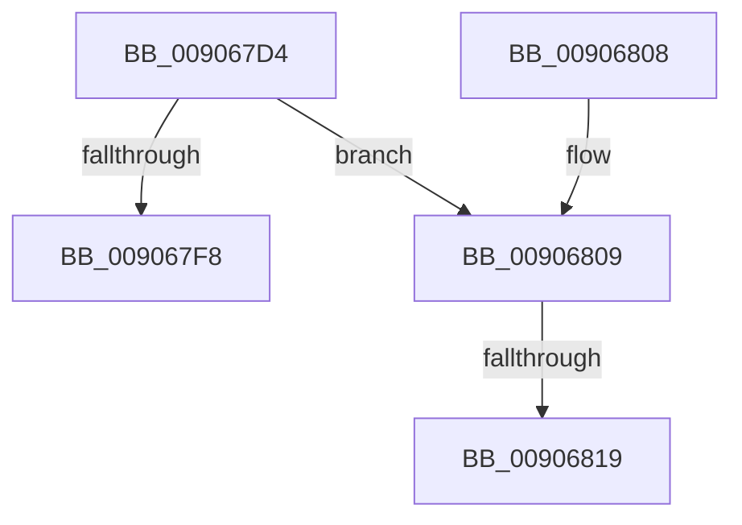

# PspThreadIndexCleanup

- RVA: `0x009067D4`–`0x00906827` (길이 `83` bytes)
- VA: `0x00000001409067D4`
- 실행 섹션: `PAGE`
- PDB 이름 있음: `예`; PDB Function 태그: `예`
- unwind 정보 RVA: `0x00088CDC`
- 디코드: `22`개 명령, `83/83` bytes 표시
- 미해석 바이트: `0` (있으면 어셈블리에 `.byte`로 보존)

> 이 문서는 커널 이미지의 기계어와 PDB 기호를 분석해 생성했습니다. 4번과 5번은 함수 원형과 자료형을 바이너리 사용 방식에서 추정한 C 해석이며 원본 소스 복구 결과는 아닙니다.

## 1. Dependencies

- 직접 호출 지점: **1**; 고유 호출 대상: **1**
- 직접 호출자로 확인된 함수: **1**
- RIP 상대 이미지 참조: **0**

### Outgoing calls
- `0x0090681C` → [ExpInterlockedPushEntrySList](../../text/6B/ExpInterlockedPushEntrySList_function_006BA5B0.md) (function, `0x006BA5B0`)

### Direct callers
- [PspExitThread](PspExitThread_function_00905F60.md) at `0x00906485`

### Static image references
- 디코드된 RIP-relative 메모리 참조가 없습니다.

## 2. Other-region calls and transfers

- 다른 실행 섹션으로 향하는 call: **1**
  - `0x0090681C` → [ExpInterlockedPushEntrySList](../../text/6B/ExpInterlockedPushEntrySList_function_006BA5B0.md) (`PAGE` → `.text`)
- call이 아닌 외부 분기/꼬리 이동: **2**
  - `0x00906813` → [sub_00B20E5A](../B2/Unknown_function_00B20E5A.md) (`tail-transfer`)
  - `0x00906822` → [sub_00B20E5A](../B2/Unknown_function_00B20E5A.md) (`tail-transfer`)

## 3. Assembly (complete function range)

```asm
009067D4  48 89 5C 24 08                  mov qword ptr [rsp + 8], rbx
009067D9  48 89 74 24 10                  mov qword ptr [rsp + 0x10], rsi
009067DE  57                              push rdi
009067DF  48 83 EC 20                     sub rsp, 0x20
009067E3  48 8B B9 20 02 00 00            mov rdi, qword ptr [rcx + 0x220]
009067EA  8B F2                           mov esi, edx
009067EC  48 8B 9F 00 08 00 00            mov rbx, qword ptr [rdi + 0x800]
009067F3  48 85 DB                        test rbx, rbx
009067F6  75 11                           jne 0x140906809
009067F8  48 8B 5C 24 30                  mov rbx, qword ptr [rsp + 0x30]
009067FD  48 8B 74 24 38                  mov rsi, qword ptr [rsp + 0x38]
00906802  48 83 C4 20                     add rsp, 0x20
00906806  5F                              pop rdi
00906807  C3                              ret
00906808  CC                              int3
00906809  48 8B 91 80 07 00 00            mov rdx, qword ptr [rcx + 0x780]
00906810  48 85 D2                        test rdx, rdx
00906813  0F 84 41 A6 21 00               je 0x140b20e5a
00906819  48 8B CB                        mov rcx, rbx
0090681C  E8 8F 3D DB FF                  call 0x1406ba5b0
00906821  90                              nop
00906822  E9 33 A6 21 00                  jmp 0x140b20e5a
```

## 4. C-style interpretation (structured pseudocode)

```c
__int64 __fastcall PspThreadIndexCleanup(__int64 a1, int a2)
{
    __int64 result;
    __int64 v_rsp;
    unsigned __int64 v_stack_p10;
    unsigned __int64 v_stack_p8;

    v_stack_p8 = v_rbx;
    v_stack_p10 = v_rsi;
    v_rsp = (v_rsp) - (32);
    if (*(unsigned __int64 *)(*(unsigned __int64 *)(a1 + 544) + 2048) != 0) goto loc_00906809;
    v_rsp = (v_rsp) + (32);
    return result;
loc_00906809:
    result = ExpInterlockedPushEntrySList(v_stack_p8, *(unsigned __int64 *)(a1 + 1920), a3, a4);
}
```

## 5. (Beta) C Style

```c
int64_t PspThreadIndexCleanup(void *Arg1, int32_t Arg2)
{
    uint8_t *arg1 = (uint8_t *)Arg1;

    int64_t result;
    int64_t local_rsp;
    uint64_t v_stack_p10;
    uint64_t v_stack_p8;

    v_stack_p8 = local_rbx;
    v_stack_p10 = local_rsi;
    local_rsp = (local_rsp) - (32);
    if (*(uint64_t *)(*(uint64_t *)(arg1 + 0x220) + 0x800) != 0) goto loc_00906809;
    local_rsp = (local_rsp) + (32);
    return result;
loc_00906809:
    result = ExpInterlockedPushEntrySList(v_stack_p8, *(uint64_t *)(arg1 + 0x780), a3, a4);
}
```

### 관측된 메모리 오프셋

구조체 형식이 확인되지 않은 접근은 인자 기준의 오프셋으로만 기록했습니다.

| 기준 인자 | 오프셋 표현 | 폭 (bit) | 접근 |
|---|---:|---:|---|
| `Arg1` | `+ 0x220` | `64` | `R` |
| `Arg1` | `+ 0x780` | `64` | `R` |

## 6. Execution-region graph

[열기: 2D/3D 그래프와 함수 탐색 컨트롤 패널](../../../control-panel.html?section=page&rva=0x009067D4&view=graph)

- 2D 그래프는 위에서 아래로 흐르고, 3D 그래프는 빈 공간을 드래그해 회전합니다. Shift+드래그는 이동, 휠은 확대·축소, 함수 노드 선택은 대상 보고서 이동입니다.

### Static fallback


