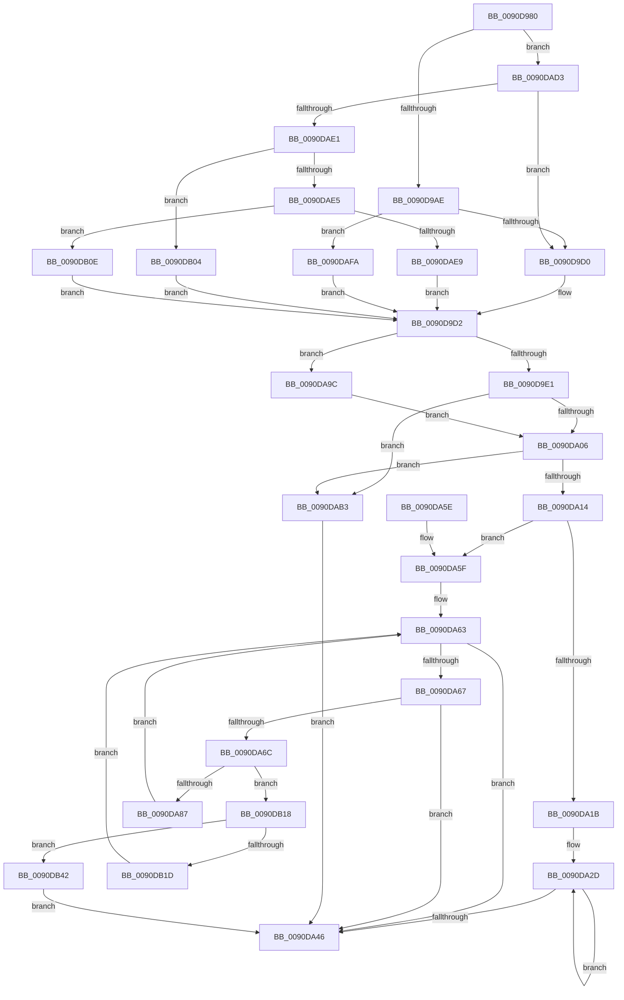

# RtlAnsiCharToUnicodeChar

- RVA: `0x0090D980`–`0x0090DB4D` (길이 `461` bytes)
- VA: `0x000000014090D980`
- 실행 섹션: `PAGE`
- PDB 이름 있음: `예`; PDB Function 태그: `아니요`
- unwind 정보 RVA: `0x000894A4`
- 디코드: `124`개 명령, `461/461` bytes 표시
- 미해석 바이트: `0` (있으면 어셈블리에 `.byte`로 보존)

> 이 문서는 커널 이미지의 기계어와 PDB 기호를 분석해 생성했습니다. 4번과 5번은 함수 원형과 자료형을 바이너리 사용 방식에서 추정한 C 해석이며 원본 소스 복구 결과는 아닙니다.

## 1. Dependencies

- 직접 호출 지점: **5**; 고유 호출 대상: **3**
- 직접 호출자로 확인된 함수: **3**
- RIP 상대 이미지 참조: **1**

### Outgoing calls
- `0x0090D99C` → [RtlpIsUtf8Process](RtlpIsUtf8Process_function_0090DB60.md) (function, `0x0090DB60`)
- `0x0090D9B3` → [PsGetCurrentServerSiloGlobals](../../text/2F/PsGetCurrentServerSiloGlobals_function_002FE1F0.md) (function, `0x002FE1F0`)
- `0x0090D9D4` → [RtlpIsUtf8Process](RtlpIsUtf8Process_function_0090DB60.md) (function, `0x0090DB60`)
- `0x0090D9E6` → [PsGetCurrentServerSiloGlobals](../../text/2F/PsGetCurrentServerSiloGlobals_function_002FE1F0.md) (function, `0x002FE1F0`)
- `0x0090DAC9` → [RtlUTF8ToUnicodeN](RtlUTF8ToUnicodeN_function_0090E060.md) (function, `0x0090E060`)

### Direct callers
- [mbtowc](../../text/50/mbtowc_function_005008E0.md) at `0x00500914`
- [toupper](../../text/50/toupper_function_00501870.md) at `0x0050188C`
- [mbstrlen](../../text/50/mbstrlen_function_00503DCC.md) at `0x00503DDF`

### Static image references
- `0x0090DA9C` → RVA `0x00FD8720` (`PAGEDATA`; read)

## 2. Other-region calls and transfers

- 다른 실행 섹션으로 향하는 call: **2**
  - `0x0090D9B3` → [PsGetCurrentServerSiloGlobals](../../text/2F/PsGetCurrentServerSiloGlobals_function_002FE1F0.md) (`PAGE` → `.text`)
  - `0x0090D9E6` → [PsGetCurrentServerSiloGlobals](../../text/2F/PsGetCurrentServerSiloGlobals_function_002FE1F0.md) (`PAGE` → `.text`)
- 별도 외부 분기/꼬리 이동을 확인하지 못했습니다.

## 3. Assembly (complete function range)

```asm
0090D980  48 89 5C 24 18                  mov qword ptr [rsp + 0x18], rbx
0090D985  56                              push rsi
0090D986  57                              push rdi
0090D987  41 56                           push r14
0090D989  48 83 EC 30                     sub rsp, 0x30
0090D98D  4C 8B F1                        mov r14, rcx
0090D990  B8 20 00 00 00                  mov eax, 0x20
0090D995  33 C9                           xor ecx, ecx
0090D997  66 89 44 24 50                  mov word ptr [rsp + 0x50], ax
0090D99C  E8 BF 01 00 00                  call 0x14090db60
0090D9A1  BE 01 00 00 00                  mov esi, 1
0090D9A6  84 C0                           test al, al
0090D9A8  0F 85 25 01 00 00               jne 0x14090dad3
0090D9AE  F0 83 0C 24 00                  lock or dword ptr [rsp], 0
0090D9B3  E8 38 08 9F FF                  call 0x1402fe1f0
0090D9B8  49 8B 1E                        mov rbx, qword ptr [r14]
0090D9BB  48 8B 80 98 04 00 00            mov rax, qword ptr [rax + 0x498]
0090D9C2  0F B6 0B                        movzx ecx, byte ptr [rbx]
0090D9C5  66 83 3C 48 00                  cmp word ptr [rax + rcx*2], 0
0090D9CA  0F 85 2A 01 00 00               jne 0x14090dafa
0090D9D0  8B FE                           mov edi, esi
0090D9D2  33 C9                           xor ecx, ecx
0090D9D4  E8 87 01 00 00                  call 0x14090db60
0090D9D9  84 C0                           test al, al
0090D9DB  0F 85 BB 00 00 00               jne 0x14090da9c
0090D9E1  F0 83 0C 24 00                  lock or dword ptr [rsp], 0
0090D9E6  E8 05 08 9F FF                  call 0x1402fe1f0
0090D9EB  48 8B D0                        mov rdx, rax
0090D9EE  4C 8D 44 24 50                  lea r8, [rsp + 0x50]
0090D9F3  44 8B D7                        mov r10d, edi
0090D9F6  4C 8B CB                        mov r9, rbx
0090D9F9  48 81 C2 08 04 00 00            add rdx, 0x408
0090DA00  0F 84 AD 00 00 00               je 0x14090dab3
0090DA06  B8 E9 FD 00 00                  mov eax, 0xfde9
0090DA0B  66 39 02                        cmp word ptr [rdx], ax
0090DA0E  0F 84 9F 00 00 00               je 0x14090dab3
0090DA14  66 83 7A 0C 00                  cmp word ptr [rdx + 0xc], 0
0090DA19  75 44                           jne 0x14090da5f
0090DA1B  4C 8B 4A 20                     mov r9, qword ptr [rdx + 0x20]
0090DA1F  3B FE                           cmp edi, esi
0090DA21  44 8B C7                        mov r8d, edi
0090DA24  48 8D 54 24 50                  lea rdx, [rsp + 0x50]
0090DA29  44 0F 47 C6                     cmova r8d, esi
0090DA2D  0F B6 03                        movzx eax, byte ptr [rbx]
0090DA30  48 8D 52 02                     lea rdx, [rdx + 2]
0090DA34  48 8D 5B 01                     lea rbx, [rbx + 1]
0090DA38  41 0F B7 0C 41                  movzx ecx, word ptr [r9 + rax*2]
0090DA3D  66 89 4A FE                     mov word ptr [rdx - 2], cx
0090DA41  4C 2B C6                        sub r8, rsi
0090DA44  75 E7                           jne 0x14090da2d
0090DA46  48 8B 5C 24 60                  mov rbx, qword ptr [rsp + 0x60]
0090DA4B  8B C7                           mov eax, edi
0090DA4D  49 01 06                        add qword ptr [r14], rax
0090DA50  0F B7 44 24 50                  movzx eax, word ptr [rsp + 0x50]
0090DA55  48 83 C4 30                     add rsp, 0x30
0090DA59  41 5E                           pop r14
0090DA5B  5F                              pop rdi
0090DA5C  5E                              pop rsi
0090DA5D  C3                              ret
0090DA5E  CC                              int3
0090DA5F  4C 8B 5A 38                     mov r11, qword ptr [rdx + 0x38]
0090DA63  85 F6                           test esi, esi
0090DA65  74 DF                           je 0x14090da46
0090DA67  45 85 D2                        test r10d, r10d
0090DA6A  74 DA                           je 0x14090da46
0090DA6C  41 0F B6 01                     movzx eax, byte ptr [r9]
0090DA70  FF CE                           dec esi
0090DA72  41 FF CA                        dec r10d
0090DA75  48 8D 0C 00                     lea rcx, [rax + rax]
0090DA79  42 0F B7 04 19                  movzx eax, word ptr [rcx + r11]
0090DA7E  66 85 C0                        test ax, ax
0090DA81  0F 85 91 00 00 00               jne 0x14090db18
0090DA87  48 8B 42 20                     mov rax, qword ptr [rdx + 0x20]
0090DA8B  0F B7 0C 01                     movzx ecx, word ptr [rcx + rax]
0090DA8F  66 41 89 08                     mov word ptr [r8], cx
0090DA93  49 83 C0 02                     add r8, 2
0090DA97  49 FF C1                        inc r9
0090DA9A  EB C7                           jmp 0x14090da63
0090DA9C  48 8D 15 7D AC 6C 00            lea rdx, [rip + 0x6cac7d]
0090DAA3  44 8B D7                        mov r10d, edi
0090DAA6  4C 8D 44 24 50                  lea r8, [rsp + 0x50]
0090DAAB  4C 8B CB                        mov r9, rbx
0090DAAE  E9 53 FF FF FF                  jmp 0x14090da06
0090DAB3  4C 8B CB                        mov r9, rbx
0090DAB6  89 7C 24 20                     mov dword ptr [rsp + 0x20], edi
0090DABA  4C 8D 44 24 58                  lea r8, [rsp + 0x58]
0090DABF  BA 02 00 00 00                  mov edx, 2
0090DAC4  48 8D 4C 24 50                  lea rcx, [rsp + 0x50]
0090DAC9  E8 92 05 00 00                  call 0x14090e060
0090DACE  E9 73 FF FF FF                  jmp 0x14090da46
0090DAD3  49 8B 1E                        mov rbx, qword ptr [r14]
0090DAD6  0F B6 03                        movzx eax, byte ptr [rbx]
0090DAD9  3C C0                           cmp al, 0xc0
0090DADB  0F 82 EF FE FF FF               jb 0x14090d9d0
0090DAE1  3C E0                           cmp al, 0xe0
0090DAE3  72 1F                           jb 0x14090db04
0090DAE5  3C F0                           cmp al, 0xf0
0090DAE7  72 25                           jb 0x14090db0e
0090DAE9  3C F8                           cmp al, 0xf8
0090DAEB  8B FE                           mov edi, esi
0090DAED  B9 04 00 00 00                  mov ecx, 4
0090DAF2  0F 42 F9                        cmovb edi, ecx
0090DAF5  E9 D8 FE FF FF                  jmp 0x14090d9d2
0090DAFA  BF 02 00 00 00                  mov edi, 2
0090DAFF  E9 CE FE FF FF                  jmp 0x14090d9d2
0090DB04  BF 02 00 00 00                  mov edi, 2
0090DB09  E9 C4 FE FF FF                  jmp 0x14090d9d2
0090DB0E  BF 03 00 00 00                  mov edi, 3
0090DB13  E9 BA FE FF FF                  jmp 0x14090d9d2
0090DB18  45 85 D2                        test r10d, r10d
0090DB1B  74 25                           je 0x14090db42
0090DB1D  48 8B C8                        mov rcx, rax
0090DB20  49 FF C1                        inc r9
0090DB23  41 FF CA                        dec r10d
0090DB26  41 0F B6 01                     movzx eax, byte ptr [r9]
0090DB2A  48 03 C8                        add rcx, rax
0090DB2D  41 0F B7 04 4B                  movzx eax, word ptr [r11 + rcx*2]
0090DB32  66 41 89 00                     mov word ptr [r8], ax
0090DB36  49 83 C0 02                     add r8, 2
0090DB3A  49 FF C1                        inc r9
0090DB3D  E9 21 FF FF FF                  jmp 0x14090da63
0090DB42  33 C0                           xor eax, eax
0090DB44  66 41 89 00                     mov word ptr [r8], ax
0090DB48  E9 F9 FE FF FF                  jmp 0x14090da46
```

## 4. C-style interpretation (structured pseudocode)

```c
__int64 __fastcall RtlAnsiCharToUnicodeChar(__int64 a1)
{
    __int64 result;
    __int64 v_r10;
    __int64 v_rdi;
    __int64 v_rsi;
    __int64 v_rsp;
    unsigned int v_stack_m48;
    unsigned __int64 v_stack_p18;
    unsigned int v_stack_p20;
    unsigned __int64 v_stack_p50;
    unsigned __int64 v_stack_p58;
    unsigned __int16 v_stack_p8;

    v_stack_p18 = v_rbx;
    v_rsp = (v_rsp) - (48);
    a1 = 0;
    v_stack_p8 = 32;
    result = RtlpIsUtf8Process(a1, a2, a3, a4);
    if ((unsigned __int8)(result) != 0) goto loc_0090DAD3;
    result = PsGetCurrentServerSiloGlobals(a1, a2, a3, a4);
    if ((*(unsigned __int16 *)(*(unsigned __int64 *)(result + 1176) + *(unsigned __int8 *)(*(unsigned __int64 *)(a1)) * 2)) != 0) goto loc_0090DAFA;
loc_0090D9D0:
loc_0090D9D2:
    a1 = 0;
    result = RtlpIsUtf8Process(a1, a2, a3, a4);
    if ((unsigned __int8)(result) != 0) goto loc_0090DA9C;
    result = PsGetCurrentServerSiloGlobals(a1, a2, a3, a4);
    a2 = (result) + (0x408ULL);
    if (condition_is_equal) goto loc_0090DAB3;
loc_0090DA06:
    if ((*(unsigned __int16 *)(a2)) == ((unsigned __int16)((unsigned int)(0xFDE9ULL)))) goto loc_0090DAB3;
    if ((*(unsigned __int16 *)(a2 + 12)) != 0) goto loc_0090DA5F;
    a3 = 1;
    if (1 > 1) { a3 = 1; }
loc_0090DA2D:
    *(unsigned __int16 *)(v_stack_p8 + 2 - 2) = (unsigned __int16)(*(unsigned __int16 *)(*(unsigned __int64 *)(a2 + 32) + *(unsigned __int8 *)(*(unsigned __int64 *)(a1)) * 2));
    a3 = (a3) - (1);
    if (condition_is_not_equal) goto loc_0090DA2D;
loc_0090DA46:
    v_rsp = (v_rsp) + (48);
    return v_stack_p8;
loc_0090DA5F:
loc_0090DA63:
    if (1 == 0) goto loc_0090DA46;
    if (1 == 0) goto loc_0090DA46;
    v_rsi = (unsigned int)((1) - 1);
    v_r10 = (unsigned int)((1) - 1);
    if ((unsigned __int16)(*(unsigned __int16 *)(*(unsigned __int8 *)(*(unsigned __int64 *)(a2 + 32)) + *(unsigned __int8 *)(*(unsigned __int64 *)(a2 + 32)) * 1 + *(unsigned __int64 *)(v_stack_p8 + 2 + 56) * 1)) != 0) goto loc_0090DB18;
    *(unsigned __int16 *)(a3) = (unsigned __int16)(*(unsigned __int16 *)(*(unsigned __int8 *)(*(unsigned __int64 *)(a2 + 32)) + *(unsigned __int8 *)(*(unsigned __int64 *)(a2 + 32)) * 1 + *(unsigned __int64 *)(v_stack_p8 + 2 + 32) * 1));
    a3 = (a3) + (2);
    a4 = (*(unsigned __int64 *)(a2 + 32)) + 1;
    goto loc_0090DA63;
loc_0090DA9C:
    goto loc_0090DA06;
loc_0090DAB3:
    v_stack_p20 = 1;
    result = RtlUTF8ToUnicodeN(v_stack_p50, 2, v_stack_p58, v_stack_p18);
    goto loc_0090DA46;
loc_0090DAD3:
    if (((unsigned __int8)(*(unsigned __int8 *)(*(unsigned __int64 *)(a1)))) < 192) goto loc_0090D9D0;
    if (((unsigned __int8)(*(unsigned __int8 *)(*(unsigned __int64 *)(a1)))) < 224) goto loc_0090DB04;
    if (((unsigned __int8)(*(unsigned __int8 *)(*(unsigned __int64 *)(a1)))) < 240) goto loc_0090DB0E;
    v_rdi = (unsigned int)((unsigned int)(v_rsi));
    if (((unsigned __int8)(*(unsigned __int8 *)(*(unsigned __int64 *)(a1)))) < 248) { v_rdi = 4; }
    goto loc_0090D9D2;
loc_0090DAFA:
    goto loc_0090D9D2;
loc_0090DB04:
    goto loc_0090D9D2;
loc_0090DB0E:
    goto loc_0090D9D2;
loc_0090DB18:
    if (1 == 0) goto loc_0090DB42;
    a4 = (v_stack_p18) + 1;
    v_r10 = (unsigned int)((1) - 1);
    a1 = (*(unsigned __int8 *)(*(unsigned __int64 *)(a1))) + (*(unsigned __int8 *)(a4));
    *(unsigned __int16 *)(v_stack_p58) = (unsigned __int16)(*(unsigned __int16 *)(*(unsigned __int64 *)(v_stack_p8 + 2 + 56) + a1 * 2));
    a3 = (v_stack_p58) + (2);
    a4 = (a4) + 1;
    goto loc_0090DA63;
loc_0090DB42:
    result = 0;
    *(unsigned __int16 *)(a3) = 0;
    goto loc_0090DA46;
}
```

## 5. (Beta) C Style

```c
int64_t RtlAnsiCharToUnicodeChar(void *Arg1)
{
    uint8_t *arg1 = (uint8_t *)Arg1;

    int64_t result;
    int64_t local_r10;
    int64_t local_rdi;
    int64_t local_rsi;
    int64_t local_rsp;
    uint32_t v_stack_m48;
    uint64_t v_stack_p18;
    uint32_t v_stack_p20;
    uint64_t v_stack_p50;
    uint64_t v_stack_p58;
    uint16_t v_stack_p8;

    v_stack_p18 = local_rbx;
    local_rsp = (local_rsp) - (48);
    Arg1 = 0;
    v_stack_p8 = 32;
    result = RtlpIsUtf8Process(Arg1, a2, a3, a4);
    if ((uint8_t)(result) != 0) goto loc_0090DAD3;
    result = PsGetCurrentServerSiloGlobals(Arg1, a2, a3, a4);
    if ((*(uint16_t *)(*(uint64_t *)(result + 0x498) + *(uint8_t *)(*(uint64_t *)(arg1)) * 2)) != 0) goto loc_0090DAFA;
loc_0090D9D0:
loc_0090D9D2:
    Arg1 = 0;
    result = RtlpIsUtf8Process(Arg1, a2, a3, a4);
    if ((uint8_t)(result) != 0) goto loc_0090DA9C;
    result = PsGetCurrentServerSiloGlobals(Arg1, a2, a3, a4);
    a2 = (result) + (0x408ULL);
    if (condition_is_equal) goto loc_0090DAB3;
loc_0090DA06:
    if ((*(uint16_t *)(a2)) == ((uint16_t)((uint32_t)(0xFDE9ULL)))) goto loc_0090DAB3;
    if ((*(uint16_t *)(a2 + 0xC)) != 0) goto loc_0090DA5F;
    a3 = 1;
    if (1 > 1) { a3 = 1; }
loc_0090DA2D:
    *(uint16_t *)(v_stack_p8 + 0x2 - 0x2) = (uint16_t)(*(uint16_t *)(*(uint64_t *)(a2 + 0x20) + *(uint8_t *)(*(uint64_t *)(arg1)) * 2));
    a3 = (a3) - (1);
    if (condition_is_not_equal) goto loc_0090DA2D;
loc_0090DA46:
    local_rsp = (local_rsp) + (48);
    return v_stack_p8;
loc_0090DA5F:
loc_0090DA63:
    if (1 == 0) goto loc_0090DA46;
    if (1 == 0) goto loc_0090DA46;
    local_rsi = (uint32_t)((1) - 1);
    local_r10 = (uint32_t)((1) - 1);
    if ((uint16_t)(*(uint16_t *)(*(uint8_t *)(*(uint64_t *)(a2 + 0x20)) + *(uint8_t *)(*(uint64_t *)(a2 + 0x20)) * 1 + *(uint64_t *)(v_stack_p8 + 0x2 + 0x38) * 1)) != 0) goto loc_0090DB18;
    *(uint16_t *)(a3) = (uint16_t)(*(uint16_t *)(*(uint8_t *)(*(uint64_t *)(a2 + 0x20)) + *(uint8_t *)(*(uint64_t *)(a2 + 0x20)) * 1 + *(uint64_t *)(v_stack_p8 + 0x2 + 0x20) * 1));
    a3 = (a3) + (2);
    a4 = (*(uint64_t *)(a2 + 0x20)) + 1;
    goto loc_0090DA63;
loc_0090DA9C:
    goto loc_0090DA06;
loc_0090DAB3:
    v_stack_p20 = 1;
    result = RtlUTF8ToUnicodeN(v_stack_p50, 2, v_stack_p58, v_stack_p18);
    goto loc_0090DA46;
loc_0090DAD3:
    if (((uint8_t)(*(uint8_t *)(*(uint64_t *)(arg1)))) < 192) goto loc_0090D9D0;
    if (((uint8_t)(*(uint8_t *)(*(uint64_t *)(arg1)))) < 224) goto loc_0090DB04;
    if (((uint8_t)(*(uint8_t *)(*(uint64_t *)(arg1)))) < 240) goto loc_0090DB0E;
    local_rdi = (uint32_t)((uint32_t)(local_rsi));
    if (((uint8_t)(*(uint8_t *)(*(uint64_t *)(arg1)))) < 248) { local_rdi = 4; }
    goto loc_0090D9D2;
loc_0090DAFA:
    goto loc_0090D9D2;
loc_0090DB04:
    goto loc_0090D9D2;
loc_0090DB0E:
    goto loc_0090D9D2;
loc_0090DB18:
    if (1 == 0) goto loc_0090DB42;
    a4 = (v_stack_p18) + 1;
    local_r10 = (uint32_t)((1) - 1);
    Arg1 = (*(uint8_t *)(*(uint64_t *)(arg1))) + (*(uint8_t *)(a4));
    *(uint16_t *)(v_stack_p58) = (uint16_t)(*(uint16_t *)(*(uint64_t *)(v_stack_p8 + 0x2 + 0x38) + arg1 * 2));
    a3 = (v_stack_p58) + (2);
    a4 = (a4) + 1;
    goto loc_0090DA63;
loc_0090DB42:
    result = 0;
    *(uint16_t *)(a3) = 0;
    goto loc_0090DA46;
}
```

### 관측된 메모리 오프셋

구조체 형식이 확인되지 않은 접근은 인자 기준의 오프셋으로만 기록했습니다.

| 기준 인자 | 오프셋 표현 | 폭 (bit) | 접근 |
|---|---:|---:|---|
| `Arg1` | `+ 0x0` | `64` | `R` |
| `Arg1` | `+ 0x0` | `64` | `R/W` |

## 6. Execution-region graph

[열기: 2D/3D 그래프와 함수 탐색 컨트롤 패널](../../../control-panel.html?section=page&rva=0x0090D980&view=graph)

- 2D 그래프는 위에서 아래로 흐르고, 3D 그래프는 빈 공간을 드래그해 회전합니다. Shift+드래그는 이동, 휠은 확대·축소, 함수 노드 선택은 대상 보고서 이동입니다.

### Static fallback


