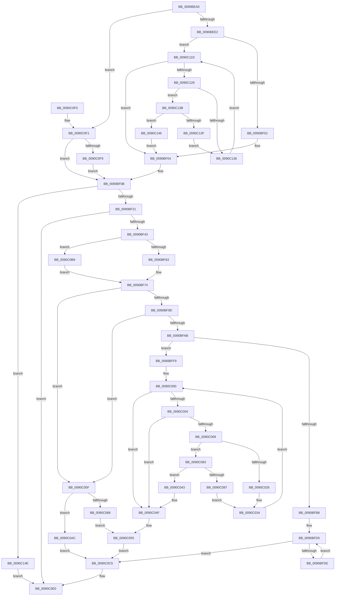

# RtlAnsiStringToUnicodeString

- RVA: `0x0090BEA0`–`0x0090C155` (길이 `693` bytes)
- VA: `0x000000014090BEA0`
- 실행 섹션: `PAGE`
- PDB 이름 있음: `예`; PDB Function 태그: `아니요`
- unwind 정보 RVA: `0x0008922C`
- 디코드: `189`개 명령, `693/693` bytes 표시
- 미해석 바이트: `0` (있으면 어셈블리에 `.byte`로 보존)

> 이 문서는 커널 이미지의 기계어와 PDB 기호를 분석해 생성했습니다. 4번과 5번은 함수 원형과 자료형을 바이너리 사용 방식에서 추정한 C 해석이며 원본 소스 복구 결과는 아닙니다.

## 1. Dependencies

- 직접 호출 지점: **7**; 고유 호출 대상: **4**
- 직접 호출자로 확인된 함수: **51**
- RIP 상대 이미지 참조: **1**

### Outgoing calls
- `0x0090BED5` → [RtlpIsUtf8Process](RtlpIsUtf8Process_function_0090DB60.md) (function, `0x0090DB60`)
- `0x0090BEE7` → [PsGetCurrentServerSiloGlobals](../../text/2F/PsGetCurrentServerSiloGlobals_function_002FE1F0.md) (function, `0x002FE1F0`)
- `0x0090BF2F` → [AllocateOrValidateUnicodeStringBuffer](../../text/43/AllocateOrValidateUnicodeStringBuffer_function_00437A60.md) (function, `0x00437A60`)
- `0x0090BF56` → [RtlpIsUtf8Process](RtlpIsUtf8Process_function_0090DB60.md) (function, `0x0090DB60`)
- `0x0090BF68` → [PsGetCurrentServerSiloGlobals](../../text/2F/PsGetCurrentServerSiloGlobals_function_002FE1F0.md) (function, `0x002FE1F0`)
- `0x0090C07C` → [RtlUTF8ToUnicodeN](RtlUTF8ToUnicodeN_function_0090E060.md) (function, `0x0090E060`)
- `0x0090C10C` → [RtlUTF8ToUnicodeN](RtlUTF8ToUnicodeN_function_0090E060.md) (function, `0x0090E060`)

### Direct callers
- [HvlDebuggerSupportInitialize](../../text/58/HvlDebuggerSupportInitialize_function_00583790.md) at `0x005838BF`
- [IopCreateUnicodeFromAnsiBuffer](../../text/59/IopCreateUnicodeFromAnsiBuffer_function_00596AEC.md) at `0x00596B12`
- [PopEmModuleAddressMatchCallback](../../text/5D/PopEmModuleAddressMatchCallback_function_005DA3F0.md) at `0x005DA45B`
- [PopEmUpdateDeviceConstraintCallback](../../text/5D/PopEmUpdateDeviceConstraintCallback_function_005DC7F0.md) at `0x005DC86D`
- [DifRtlAnsiStringToUnicodeStringWrapper](../../text/63/DifRtlAnsiStringToUnicodeStringWrapper_function_0063B200.md) at `0x0063B2E5`
- [CmpInitializeLoadOptions](../../text/66/CmpInitializeLoadOptions_function_0066A228.md) at `0x0066A2BC`
- [ScAnsiToUnicodeString](../../text/6A/ScAnsiToUnicodeString_function_006A3FB0.md) at `0x006A4019`
- [IopCopyBootLogRegistryToFile](../71/IopCopyBootLogRegistryToFile_function_0071B19C.md) at `0x0071B2CA`
- [IopInitializeBootLogging](../71/IopInitializeBootLogging_function_0071B748.md) at `0x0071B815`
- [IopInitializeBootLogging](../71/IopInitializeBootLogging_function_0071B748.md) at `0x0071B897`
- [KsepStringAnsiToUnicode](../74/KsepStringAnsiToUnicode_function_0074AAFC.md) at `0x0074AB34`
- [RtlCreateUnicodeStringFromAsciiz](../78/RtlCreateUnicodeStringFromAsciiz_function_0078B990.md) at `0x0078B9BA`
- [SepInitializationPhase1](../79/SepInitializationPhase1_function_0079C580.md) at `0x0079C641`
- [SepInitializationPhase1](../79/SepInitializationPhase1_function_0079C580.md) at `0x0079C76B`
- [WmipCheckSMBiosSysInfoString](../7B/WmipCheckSMBiosSysInfoString_function_007B289C.md) at `0x007B28F2`
- [WmipGetSMBiosString](../7B/WmipGetSMBiosString_function_007B2D30.md) at `0x007B2D9B`
- [WmipQueryWmiRegInfo](../7B/WmipQueryWmiRegInfo_function_007B4B50.md) at `0x007B4B87`
- [EtwWmitraceWorker](../7B/EtwWmitraceWorker_function_007BBD3C.md) at `0x007BBF76`
- [EtwWmitraceWorker](../7B/EtwWmitraceWorker_function_007BBD3C.md) at `0x007BBFD7`
- [NtQuerySystemEnvironmentValue](../7C/NtQuerySystemEnvironmentValue_function_007CDFB0.md) at `0x007CE239`
- [CmpCreateHwProfileFriendlyName](../7E/CmpCreateHwProfileFriendlyName_function_007E3840.md) at `0x007E3932`
- [CmpAddProcessorConfigurationEntry](../7E/CmpAddProcessorConfigurationEntry_function_007E4CF8.md) at `0x007E4F90`
- [CmpAddProcessorConfigurationEntry](../7E/CmpAddProcessorConfigurationEntry_function_007E4CF8.md) at `0x007E500C`
- [CmpSetVersionData](../7E/CmpSetVersionData_function_007E7854.md) at `0x007E7BBB`
- [CmpSetVersionData](../7E/CmpSetVersionData_function_007E7854.md) at `0x007E7C9A`
- [CmpInitializeRegistryNode](../7E/CmpInitializeRegistryNode_function_007EE81C.md) at `0x007EE95A`
- [CmpInitializeRegistryNode](../7E/CmpInitializeRegistryNode_function_007EE81C.md) at `0x007EEA4A`
- [CmpFindControlSet](../7F/CmpFindControlSet_function_007F1A34.md) at `0x007F1D6D`
- [CmpAddRemoveContainerToCLFSLog](../7F/CmpAddRemoveContainerToCLFSLog_function_007F69FC.md) at `0x007F6B18`
- [AslStringAnsiToUnicode](../81/AslStringAnsiToUnicode_function_00819824.md) at `0x008198FA`
- [RtlInt64ToUnicodeString](../8B/RtlInt64ToUnicodeString_function_008BDDE0.md) at `0x008BDE57`
- [ExpWnfWriteStateData](ExpWnfWriteStateData_function_0090B7B0.md) at `0x0090B8BB`
- [RtlIntegerToUnicodeString](../91/RtlIntegerToUnicodeString_function_0091D3E0.md) at `0x0091D448`
- [MiResolveImageReferences](../A2/MiResolveImageReferences_function_00A23BE4.md) at `0x00A23D19`
- [MiSnapThunk](../A2/MiSnapThunk_function_00A24004.md) at `0x00A241AE`
- [MiLogFailedDriverLoad](../A2/MiLogFailedDriverLoad_function_00A24ACC.md) at `0x00A24BB3`
- [PopAnsiStringToUnicodeString](../A7/PopAnsiStringToUnicodeString_function_00A7AB48.md) at `0x00A7ABD2`
- [PnpLogVetoInformation](../AB/PnpLogVetoInformation_function_00AB6BE8.md) at `0x00AB6CA5`
- [sub_00B257D0](../B2/Unknown_function_00B257D0.md) at `0x00B257FE`
- [sub_00B2CEFC](../B2/Unknown_function_00B2CEFC.md) at `0x00B2CF32`
- [sub_00B2EDF4](../B2/Unknown_function_00B2EDF4.md) at `0x00B2EEA0`
- [ExpSystemErrorHandler2](../../pagelk/B7/ExpSystemErrorHandler2_function_00B72C30.md) at `0x00B730B9`
- [ExpSystemErrorHandler2](../../pagelk/B7/ExpSystemErrorHandler2_function_00B72C30.md) at `0x00B731FE`
- [InitBootProcessor](../../init/C1/InitBootProcessor_function_00C1B1C8.md) at `0x00C1BBEE`
- [EmpInfParseGetGuidFromName](../../init/C2/EmpInfParseGetGuidFromName_function_00C263B4.md) at `0x00C26420`
- [EmpParseEntryTypes](../../init/C2/EmpParseEntryTypes_function_00C267B4.md) at `0x00C2685A`
- [IopCreateArcNames](../../init/C2/IopCreateArcNames_function_00C2BF1C.md) at `0x00C2BF8B`
- [IopCreateArcNames](../../init/C2/IopCreateArcNames_function_00C2BF1C.md) at `0x00C2BFC8`
- [IopCreateArcNamesCd](../../init/C2/IopCreateArcNamesCd_function_00C2C060.md) at `0x00C2C2F3`
- [IopCreateArcNamesCd](../../init/C2/IopCreateArcNamesCd_function_00C2C060.md) at `0x00C2C33F`
- [IopCreateArcNamesCd](../../init/C2/IopCreateArcNamesCd_function_00C2C060.md) at `0x00C2C4D2`
- [IopMarkBootPartition](../../init/C2/IopMarkBootPartition_function_00C2CFA0.md) at `0x00C2D043`
- [IopGetBootDiskInformation](../../init/C2/IopGetBootDiskInformation_function_00C2DAAC.md) at `0x00C2DBEB`
- [IopApplySystemPartitionProt](../../init/C2/IopApplySystemPartitionProt_function_00C2E398.md) at `0x00C2E529`
- [PipCriticalDeviceWaitCallback](../../init/C3/PipCriticalDeviceWaitCallback_function_00C30890.md) at `0x00C3092E`
- [PipSmBiosGetString](../../init/C3/PipSmBiosGetString_function_00C3259C.md) at `0x00C326B0`
- [WmipDriverEntry](../../init/C4/WmipDriverEntry_function_00C4D490.md) at `0x00C4D51F`
- [CmpInitializeDriverStores](../../init/C5/CmpInitializeDriverStores_function_00C57CF0.md) at `0x00C57F23`
- [CmpSetSystemBiosInformation](../../init/C5/CmpSetSystemBiosInformation_function_00C5A5D0.md) at `0x00C5A6E6`
- [CmpSetSystemBiosInformation](../../init/C5/CmpSetSystemBiosInformation_function_00C5A5D0.md) at `0x00C5A7E2`
- [CmpSetSystemBiosInformation](../../init/C5/CmpSetSystemBiosInformation_function_00C5A5D0.md) at `0x00C5A88F`
- [CmpSetVideoBiosInformation](../../init/C5/CmpSetVideoBiosInformation_function_00C5A970.md) at `0x00C5AAFF`
- [CmpSetVideoBiosInformation](../../init/C5/CmpSetVideoBiosInformation_function_00C5A970.md) at `0x00C5AB7C`
- [RamdiskCreateSymbolicLink](../../init/C6/RamdiskCreateSymbolicLink_function_00C6EDB8.md) at `0x00C6EE5D`

### Static image references
- `0x0090C0B9` → RVA `0x00FD8720` (`PAGEDATA`; read)

## 2. Other-region calls and transfers

- 다른 실행 섹션으로 향하는 call: **3**
  - `0x0090BEE7` → [PsGetCurrentServerSiloGlobals](../../text/2F/PsGetCurrentServerSiloGlobals_function_002FE1F0.md) (`PAGE` → `.text`)
  - `0x0090BF2F` → [AllocateOrValidateUnicodeStringBuffer](../../text/43/AllocateOrValidateUnicodeStringBuffer_function_00437A60.md) (`PAGE` → `.text`)
  - `0x0090BF68` → [PsGetCurrentServerSiloGlobals](../../text/2F/PsGetCurrentServerSiloGlobals_function_002FE1F0.md) (`PAGE` → `.text`)
- 별도 외부 분기/꼬리 이동을 확인하지 못했습니다.

## 3. Assembly (complete function range)

```asm
0090BEA0  48 8B C4                        mov rax, rsp
0090BEA3  44 88 40 18                     mov byte ptr [rax + 0x18], r8b
0090BEA7  48 89 48 08                     mov qword ptr [rax + 8], rcx
0090BEAB  53                              push rbx
0090BEAC  56                              push rsi
0090BEAD  57                              push rdi
0090BEAE  41 54                           push r12
0090BEB0  41 55                           push r13
0090BEB2  41 56                           push r14
0090BEB4  41 57                           push r15
0090BEB6  48 83 EC 60                     sub rsp, 0x60
0090BEBA  45 8A F8                        mov r15b, r8b
0090BEBD  4C 8B F2                        mov r14, rdx
0090BEC0  4C 8B E9                        mov r13, rcx
0090BEC3  45 33 E4                        xor r12d, r12d
0090BEC6  41 8B DC                        mov ebx, r12d
0090BEC9  89 58 20                        mov dword ptr [rax + 0x20], ebx
0090BECC  0F B7 3A                        movzx edi, word ptr [rdx]
0090BECF  48 8B 72 08                     mov rsi, qword ptr [rdx + 8]
0090BED3  33 C9                           xor ecx, ecx
0090BED5  E8 86 1C 00 00                  call 0x14090db60
0090BEDA  84 C0                           test al, al
0090BEDC  0F 85 0F 02 00 00               jne 0x14090c0f1
0090BEE2  F0 44 09 24 24                  lock or dword ptr [rsp], r12d
0090BEE7  E8 04 23 9F FF                  call 0x1402fe1f0
0090BEEC  48 8B 90 98 04 00 00            mov rdx, qword ptr [rax + 0x498]
0090BEF3  66 44 39 A0 14 04 00 00         cmp word ptr [rax + 0x414], r12w
0090BEFB  0F 85 1C 02 00 00               jne 0x14090c11d
0090BF01  8D 1C 3F                        lea ebx, [rdi + rdi]
0090BF04  89 9C 24 B8 00 00 00            mov dword ptr [rsp + 0xb8], ebx
0090BF0B  8D 53 02                        lea edx, [rbx + 2]
0090BF0E  89 94 24 A8 00 00 00            mov dword ptr [rsp + 0xa8], edx
0090BF15  81 FA FE FF 00 00               cmp edx, 0xfffe
0090BF1B  0F 87 2D 02 00 00               ja 0x14090c14e
0090BF21  4D 8D 65 08                     lea r12, [r13 + 8]
0090BF25  4D 8D 4D 02                     lea r9, [r13 + 2]
0090BF29  4D 8B C4                        mov r8, r12
0090BF2C  41 8A CF                        mov cl, r15b
0090BF2F  E8 2C BB B2 FF                  call 0x140437a60
0090BF34  89 44 24 40                     mov dword ptr [rsp + 0x40], eax
0090BF38  45 33 FF                        xor r15d, r15d
0090BF3B  85 C0                           test eax, eax
0090BF3D  0F 88 9D 01 00 00               js 0x14090c0e0
0090BF43  41 0F B7 3E                     movzx edi, word ptr [r14]
0090BF47  4D 8B 76 08                     mov r14, qword ptr [r14 + 8]
0090BF4B  41 0F B7 75 02                  movzx esi, word ptr [r13 + 2]
0090BF50  49 8B 1C 24                     mov rbx, qword ptr [r12]
0090BF54  33 C9                           xor ecx, ecx
0090BF56  E8 05 1C 00 00                  call 0x14090db60
0090BF5B  84 C0                           test al, al
0090BF5D  0F 85 56 01 00 00               jne 0x14090c0b9
0090BF63  F0 44 09 3C 24                  lock or dword ptr [rsp], r15d
0090BF68  E8 83 22 9F FF                  call 0x1402fe1f0
0090BF6D  48 8D 90 08 04 00 00            lea rdx, [rax + 0x408]
0090BF74  89 7C 24 38                     mov dword ptr [rsp + 0x38], edi
0090BF78  4C 89 74 24 50                  mov qword ptr [rsp + 0x50], r14
0090BF7D  4C 8D 9C 24 A8 00 00 00         lea r11, [rsp + 0xa8]
0090BF85  48 89 5C 24 48                  mov qword ptr [rsp + 0x48], rbx
0090BF8A  44 89 7C 24 30                  mov dword ptr [rsp + 0x30], r15d
0090BF8F  44 89 7C 24 34                  mov dword ptr [rsp + 0x34], r15d
0090BF94  48 85 D2                        test rdx, rdx
0090BF97  0F 84 C2 00 00 00               je 0x14090c05f
0090BF9D  B8 E9 FD 00 00                  mov eax, 0xfde9
0090BFA2  66 39 02                        cmp word ptr [rdx], ax
0090BFA5  0F 84 B4 00 00 00               je 0x14090c05f
0090BFAB  D1 EE                           shr esi, 1
0090BFAD  89 74 24 34                     mov dword ptr [rsp + 0x34], esi
0090BFB1  66 44 39 7A 0C                  cmp word ptr [rdx + 0xc], r15w
0090BFB6  75 41                           jne 0x14090bff9
0090BFB8  3B F7                           cmp esi, edi
0090BFBA  0F 42 FE                        cmovb edi, esi
0090BFBD  44 8D 04 3F                     lea r8d, [rdi + rdi]
0090BFC1  44 89 84 24 A8 00 00 00         mov dword ptr [rsp + 0xa8], r8d
0090BFC9  4C 8B 52 20                     mov r10, qword ptr [rdx + 0x20]
0090BFCD  45 8B CF                        mov r9d, r15d
0090BFD0  44 89 7C 24 30                  mov dword ptr [rsp + 0x30], r15d
0090BFD5  44 3B CF                        cmp r9d, edi
0090BFD8  0F 83 E7 00 00 00               jae 0x14090c0c5
0090BFDE  41 8B D1                        mov edx, r9d
0090BFE1  42 0F B6 04 32                  movzx eax, byte ptr [rdx + r14]
0090BFE6  41 0F B7 0C 42                  movzx ecx, word ptr [r10 + rax*2]
0090BFEB  66 89 0C 53                     mov word ptr [rbx + rdx*2], cx
0090BFEF  41 FF C1                        inc r9d
0090BFF2  44 89 4C 24 30                  mov dword ptr [rsp + 0x30], r9d
0090BFF7  EB DC                           jmp 0x14090bfd5
0090BFF9  4C 8B CB                        mov r9, rbx
0090BFFC  4C 8B 52 38                     mov r10, qword ptr [rdx + 0x38]
0090C000  85 F6                           test esi, esi
0090C002  74 4B                           je 0x14090c04f
0090C004  85 FF                           test edi, edi
0090C006  74 47                           je 0x14090c04f
0090C008  FF CE                           dec esi
0090C00A  89 74 24 34                     mov dword ptr [rsp + 0x34], esi
0090C00E  FF CF                           dec edi
0090C010  89 7C 24 38                     mov dword ptr [rsp + 0x38], edi
0090C014  41 0F B6 0E                     movzx ecx, byte ptr [r14]
0090C018  41 0F B7 04 4A                  movzx eax, word ptr [r10 + rcx*2]
0090C01D  4C 8D 43 02                     lea r8, [rbx + 2]
0090C021  66 85 C0                        test ax, ax
0090C024  75 5D                           jne 0x14090c083
0090C026  48 8B 42 20                     mov rax, qword ptr [rdx + 0x20]
0090C02A  0F B7 0C 48                     movzx ecx, word ptr [rax + rcx*2]
0090C02E  66 89 0B                        mov word ptr [rbx], cx
0090C031  49 FF C6                        inc r14
0090C034  49 8B D8                        mov rbx, r8
0090C037  4C 89 74 24 50                  mov qword ptr [rsp + 0x50], r14
0090C03C  48 89 5C 24 48                  mov qword ptr [rsp + 0x48], rbx
0090C041  EB BD                           jmp 0x14090c000
0090C043  66 44 89 3B                     mov word ptr [rbx], r15w
0090C047  49 8B D8                        mov rbx, r8
0090C04A  48 89 5C 24 48                  mov qword ptr [rsp + 0x48], rbx
0090C04F  41 2B D9                        sub ebx, r9d
0090C052  41 89 1B                        mov dword ptr [r11], ebx
0090C055  44 8B 84 24 A8 00 00 00         mov r8d, dword ptr [rsp + 0xa8]
0090C05D  EB 66                           jmp 0x14090c0c5
0090C05F  44 89 7C 24 44                  mov dword ptr [rsp + 0x44], r15d
0090C064  85 FF                           test edi, edi
0090C066  74 44                           je 0x14090c0ac
0090C068  89 7C 24 20                     mov dword ptr [rsp + 0x20], edi
0090C06C  4D 8B CE                        mov r9, r14
0090C06F  4C 8D 84 24 A8 00 00 00         lea r8, [rsp + 0xa8]
0090C077  8B D6                           mov edx, esi
0090C079  48 8B CB                        mov rcx, rbx
0090C07C  E8 DF 1F 00 00                  call 0x14090e060
0090C081  EB D2                           jmp 0x14090c055
0090C083  85 FF                           test edi, edi
0090C085  74 BC                           je 0x14090c043
0090C087  48 8B C8                        mov rcx, rax
0090C08A  49 FF C6                        inc r14
0090C08D  4C 89 74 24 50                  mov qword ptr [rsp + 0x50], r14
0090C092  41 0F B6 06                     movzx eax, byte ptr [r14]
0090C096  48 03 C1                        add rax, rcx
0090C099  41 0F B7 04 42                  movzx eax, word ptr [r10 + rax*2]
0090C09E  66 89 03                        mov word ptr [rbx], ax
0090C0A1  49 FF C6                        inc r14
0090C0A4  FF CF                           dec edi
0090C0A6  89 7C 24 38                     mov dword ptr [rsp + 0x38], edi
0090C0AA  EB 88                           jmp 0x14090c034
0090C0AC  45 8B C7                        mov r8d, r15d
0090C0AF  44 89 BC 24 A8 00 00 00         mov dword ptr [rsp + 0xa8], r15d
0090C0B7  EB 0C                           jmp 0x14090c0c5
0090C0B9  48 8D 15 60 C6 6C 00            lea rdx, [rip + 0x6cc660]
0090C0C0  E9 AF FE FF FF                  jmp 0x14090bf74
0090C0C5  44 89 7C 24 40                  mov dword ptr [rsp + 0x40], r15d
0090C0CA  66 45 89 45 00                  mov word ptr [r13], r8w
0090C0CF  41 8B C8                        mov ecx, r8d
0090C0D2  48 D1 E9                        shr rcx, 1
0090C0D5  49 8B 04 24                     mov rax, qword ptr [r12]
0090C0D9  66 44 89 3C 48                  mov word ptr [rax + rcx*2], r15w
0090C0DE  33 C0                           xor eax, eax
0090C0E0  48 83 C4 60                     add rsp, 0x60
0090C0E4  41 5F                           pop r15
0090C0E6  41 5E                           pop r14
0090C0E8  41 5D                           pop r13
0090C0EA  41 5C                           pop r12
0090C0EC  5F                              pop rdi
0090C0ED  5E                              pop rsi
0090C0EE  5B                              pop rbx
0090C0EF  C3                              ret
0090C0F0  CC                              int3
0090C0F1  85 FF                           test edi, edi
0090C0F3  0F 84 12 FE FF FF               je 0x14090bf0b
0090C0F9  89 7C 24 20                     mov dword ptr [rsp + 0x20], edi
0090C0FD  4C 8B CE                        mov r9, rsi
0090C100  4C 8D 84 24 B8 00 00 00         lea r8, [rsp + 0xb8]
0090C108  33 D2                           xor edx, edx
0090C10A  33 C9                           xor ecx, ecx
0090C10C  E8 4F 1F 00 00                  call 0x14090e060
0090C111  8B 9C 24 B8 00 00 00            mov ebx, dword ptr [rsp + 0xb8]
0090C118  E9 EE FD FF FF                  jmp 0x14090bf0b
0090C11D  8B C7                           mov eax, edi
0090C11F  FF CF                           dec edi
0090C121  85 C0                           test eax, eax
0090C123  0F 84 DB FD FF FF               je 0x14090bf04
0090C129  0F B6 06                        movzx eax, byte ptr [rsi]
0090C12C  48 FF C6                        inc rsi
0090C12F  66 44 39 24 42                  cmp word ptr [rdx + rax*2], r12w
0090C134  75 05                           jne 0x14090c13b
0090C136  83 C3 02                        add ebx, 2
0090C139  EB E2                           jmp 0x14090c11d
0090C13B  85 FF                           test edi, edi
0090C13D  74 07                           je 0x14090c146
0090C13F  FF CF                           dec edi
0090C141  48 FF C6                        inc rsi
0090C144  EB F0                           jmp 0x14090c136
0090C146  83 C3 02                        add ebx, 2
0090C149  E9 B6 FD FF FF                  jmp 0x14090bf04
0090C14E  B8 F0 00 00 C0                  mov eax, 0xc00000f0
0090C153  EB 8B                           jmp 0x14090c0e0
```

## 4. C-style interpretation (structured pseudocode)

```c
__int64 __fastcall RtlAnsiStringToUnicodeString(__int64 a1, __int64 a2, unsigned __int8 a3)
{
    __int64 result;
    __int64 v_r12;
    __int64 v_r14;
    __int64 v_r15;
    __int64 v_rbx;
    __int64 v_rdi;
    __int64 v_rsi;
    __int64 v_rsp;
    unsigned __int64 v_stack_m48;
    unsigned __int64 v_stack_m50;
    unsigned int v_stack_m54;
    unsigned int v_stack_m58;
    unsigned int v_stack_m60;
    unsigned int v_stack_m64;
    unsigned int v_stack_m68;
    unsigned int v_stack_m78;
    unsigned int v_stack_m98;
    unsigned int v_stack_p10;
    unsigned int v_stack_p20;
    unsigned __int64 v_stack_pB8;

    *(unsigned __int8 *)(v_rsp + 24) = a3;
    *(unsigned __int64 *)(v_rsp + 8) = a1;
    v_rsp = (v_rsp) - (96);
    v_r12 = 0;
    *(unsigned int *)(v_rsp + 32) = 0;
    a1 = 0;
    result = RtlpIsUtf8Process(a1, a2, a3, a4);
    if ((unsigned __int8)(result) != 0) goto loc_0090C0F1;
    result = PsGetCurrentServerSiloGlobals(a1, a2, a3, a4);
    if ((*(unsigned __int16 *)(result + 1044)) != 0) goto loc_0090C11D;
loc_0090BF04:
    v_stack_p20 = (unsigned int)(*(unsigned __int16 *)(a2) + *(unsigned __int16 *)(a2) * 1);
loc_0090BF0B:
    v_stack_p10 = (unsigned int)(*(unsigned __int16 *)(a2) + *(unsigned __int16 *)(a2) * 1 + 2);
    if (((unsigned int)(*(unsigned __int16 *)(a2) + *(unsigned __int16 *)(a2) * 1 + 2)) > 0xFFFEULL) goto loc_0090C14E;
    result = AllocateOrValidateUnicodeStringBuffer(a3, *(unsigned __int16 *)(a2) + *(unsigned __int16 *)(a2) * 1 + 2, a1 + 8, a1 + 2);
    v_stack_m58 = (unsigned int)(result);
    v_r15 = 0;
    if (sign_flag) goto loc_0090C0E0;
    a1 = 0;
    result = RtlpIsUtf8Process(a1, *(unsigned __int16 *)(a2) + *(unsigned __int16 *)(a2) * 1 + 2, a1 + 8, a1 + 2);
    if ((unsigned __int8)(result) != 0) goto loc_0090C0B9;
    result = PsGetCurrentServerSiloGlobals(a1, *(unsigned __int16 *)(a2) + *(unsigned __int16 *)(a2) * 1 + 2, a1 + 8, a1 + 2);
loc_0090BF74:
    v_stack_m60 = (unsigned int)(*(unsigned __int16 *)(a2));
    v_stack_m48 = *(unsigned __int64 *)(a2 + 8);
    v_stack_m50 = *(unsigned __int64 *)(a1 + 8);
    v_stack_m68 = 0;
    v_stack_m64 = 0;
    if (result + 1032 == 0) goto loc_0090C05F;
    if ((*(unsigned __int16 *)(result + 1032)) == ((unsigned __int16)((unsigned int)(0xFDE9ULL)))) goto loc_0090C05F;
    v_rsi = (unsigned int)((*(unsigned __int16 *)(a1 + 2)) >> (1));
    v_stack_m64 = (unsigned int)(v_rsi);
    if ((*(unsigned __int16 *)(result + 1032 + 12)) != 0) goto loc_0090BFF9;
    v_rdi = *(unsigned __int16 *)(a2);
    if (((unsigned int)(v_rsi)) < ((unsigned int)(*(unsigned __int16 *)(a2)))) { v_rdi = (unsigned int)(v_rsi); }
    v_stack_p10 = (unsigned int)(v_rdi + v_rdi * 1);
    v_stack_m68 = 0;
loc_0090BFD5:
    if (0 >= ((unsigned int)(v_rdi))) goto loc_0090C0C5;
    *(unsigned __int16 *)(*(unsigned __int64 *)(a1 + 8) + 0 * 2) = (unsigned __int16)(*(unsigned __int16 *)(*(unsigned __int64 *)(result + 1032 + 32) + *(unsigned __int8 *)(0 + *(unsigned __int64 *)(a2 + 8) * 1) * 2));
    a4 = (unsigned int)((0) + 1);
    v_stack_m68 = (unsigned int)(a4);
    goto loc_0090BFD5;
loc_0090BFF9:
loc_0090C000:
    if ((unsigned int)(v_rsi) == 0) goto loc_0090C04F;
    if ((unsigned int)(v_rdi) == 0) goto loc_0090C04F;
    v_rsi = (unsigned int)((v_rsi) - 1);
    v_stack_m64 = (unsigned int)(v_rsi);
    v_rdi = (unsigned int)((v_rdi) - 1);
    v_stack_m60 = (unsigned int)(v_rdi);
    if ((unsigned __int16)(*(unsigned __int16 *)(*(unsigned __int64 *)(0 + 56) + *(unsigned __int8 *)(*(unsigned __int64 *)(a2 + 8)) * 2)) != 0) goto loc_0090C083;
    *(unsigned __int16 *)(*(unsigned __int64 *)(a1 + 8)) = (unsigned __int16)(*(unsigned __int16 *)(*(unsigned __int64 *)(0 + 32) + *(unsigned __int8 *)(*(unsigned __int64 *)(a2 + 8)) * 2));
    v_r14 = (*(unsigned __int64 *)(a2 + 8)) + 1;
loc_0090C034:
    v_stack_m48 = v_r14;
    v_stack_m50 = *(unsigned __int64 *)(a1 + 8) + 2;
    goto loc_0090C000;
loc_0090C043:
    *(unsigned __int16 *)(*(unsigned __int64 *)(a1 + 8) + 2) = 0;
    v_stack_m50 = *(unsigned __int64 *)(a1 + 8) + 2;
loc_0090C04F:
    v_rbx = (unsigned int)((*(unsigned __int64 *)(a1 + 8) + 2) - ((unsigned int)(*(unsigned __int64 *)(a1 + 8))));
    *(unsigned int *)(v_stack_p10) = (unsigned int)(v_rbx);
loc_0090C055:
    goto loc_0090C0C5;
loc_0090C05F:
    v_stack_m54 = 0;
    if ((unsigned int)(v_rdi) == 0) goto loc_0090C0AC;
    v_stack_m78 = (unsigned int)(v_rdi);
    result = RtlUTF8ToUnicodeN(v_rbx, (unsigned int)((unsigned int)(v_rsi)), v_stack_p10, v_r14);
    goto loc_0090C055;
loc_0090C083:
    if ((unsigned int)(v_rdi) == 0) goto loc_0090C043;
    v_r14 = (v_r14) + 1;
    v_stack_m48 = v_r14;
    result = (*(unsigned __int8 *)(v_r14)) + (result);
    *(unsigned __int16 *)(v_rbx) = (unsigned __int16)(*(unsigned __int16 *)(*(unsigned __int64 *)(0 + 56) + result * 2));
    v_r14 = (v_r14) + 1;
    v_rdi = (unsigned int)((v_rdi) - 1);
    v_stack_m60 = (unsigned int)(v_rdi);
    goto loc_0090C034;
loc_0090C0AC:
    v_stack_p10 = 0;
    goto loc_0090C0C5;
loc_0090C0B9:
    goto loc_0090BF74;
loc_0090C0C5:
    v_stack_m58 = 0;
    *(unsigned __int16 *)(a1) = 0;
    a1 = (0) >> (1);
    *(unsigned __int16 *)(*(unsigned __int64 *)(a1 + 8) + a1 * 2) = 0;
    result = 0;
loc_0090C0E0:
    v_rsp = (v_rsp) + (96);
    return result;
loc_0090C0F1:
    if ((unsigned int)(v_rdi) == 0) goto loc_0090BF0B;
    v_stack_p20 = (unsigned int)(v_rdi);
    a2 = 0;
    a1 = 0;
    result = RtlUTF8ToUnicodeN(a1, a2, v_stack_pB8, v_rsi);
    goto loc_0090BF0B;
loc_0090C11D:
    v_rdi = (unsigned int)((v_rdi) - 1);
    if ((unsigned int)((unsigned int)((unsigned int)(v_rdi))) == 0) goto loc_0090BF04;
    v_rsi = (v_rsi) + 1;
    if ((*(unsigned __int16 *)(a2 + *(unsigned __int8 *)(v_rsi) * 2)) != ((unsigned __int16)(a1 + 8))) goto loc_0090C13B;
loc_0090C136:
    v_rbx = (unsigned int)(((unsigned int)(v_stack_pB8)) + (2));
    goto loc_0090C11D;
loc_0090C13B:
    if ((unsigned int)(v_rdi) == 0) goto loc_0090C146;
    v_rdi = (unsigned int)((v_rdi) - 1);
    v_rsi = (v_rsi) + 1;
    goto loc_0090C136;
loc_0090C146:
    v_rbx = (unsigned int)((v_rbx) + (2));
    goto loc_0090BF04;
loc_0090C14E:
    goto loc_0090C0E0;
}
```

## 5. (Beta) C Style

```c
int64_t RtlAnsiStringToUnicodeString(void *Arg1, void *Arg2, uint8_t Arg3)
{
    uint8_t *arg1 = (uint8_t *)Arg1;
    uint8_t *arg2 = (uint8_t *)Arg2;

    int64_t result;
    int64_t local_r12;
    int64_t local_r14;
    int64_t local_r15;
    int64_t local_rbx;
    int64_t local_rdi;
    int64_t local_rsi;
    int64_t local_rsp;
    uint64_t v_stack_m48;
    uint64_t v_stack_m50;
    uint32_t v_stack_m54;
    uint32_t v_stack_m58;
    uint32_t v_stack_m60;
    uint32_t v_stack_m64;
    uint32_t v_stack_m68;
    uint32_t v_stack_m78;
    uint32_t v_stack_m98;
    uint32_t v_stack_p10;
    uint32_t v_stack_p20;
    uint64_t v_stack_pB8;

    *(uint8_t *)(local_rsp + 0x18) = Arg3;
    *(void **)(local_rsp + 0x8) = Arg1;
    local_rsp = (local_rsp) - (96);
    local_r12 = 0;
    *(uint32_t *)(local_rsp + 0x20) = 0;
    Arg1 = 0;
    result = RtlpIsUtf8Process(Arg1, Arg2, Arg3, a4);
    if ((uint8_t)(result) != 0) goto loc_0090C0F1;
    result = PsGetCurrentServerSiloGlobals(Arg1, Arg2, Arg3, a4);
    if ((*(uint16_t *)(result + 0x414)) != 0) goto loc_0090C11D;
loc_0090BF04:
    v_stack_p20 = (uint32_t)(*(uint16_t *)(arg2) + *(uint16_t *)(arg2) * 1);
loc_0090BF0B:
    v_stack_p10 = (uint32_t)(*(uint16_t *)(arg2) + *(uint16_t *)(arg2) * 1 + 2);
    if (((uint32_t)(*(uint16_t *)(arg2) + *(uint16_t *)(arg2) * 1 + 2)) > 0xFFFEULL) goto loc_0090C14E;
    result = AllocateOrValidateUnicodeStringBuffer(Arg3, *(uint16_t *)(arg2) + *(uint16_t *)(arg2) * 1 + 2, Arg1 + 8, Arg1 + 2);
    v_stack_m58 = (uint32_t)(result);
    local_r15 = 0;
    if (sign_flag) goto loc_0090C0E0;
    Arg1 = 0;
    result = RtlpIsUtf8Process(Arg1, *(uint16_t *)(arg2) + *(uint16_t *)(arg2) * 1 + 2, Arg1 + 8, Arg1 + 2);
    if ((uint8_t)(result) != 0) goto loc_0090C0B9;
    result = PsGetCurrentServerSiloGlobals(Arg1, *(uint16_t *)(arg2) + *(uint16_t *)(arg2) * 1 + 2, Arg1 + 8, Arg1 + 2);
loc_0090BF74:
    v_stack_m60 = (uint32_t)(*(uint16_t *)(arg2));
    v_stack_m48 = *(uint64_t *)(arg2 + 0x8);
    v_stack_m50 = *(uint64_t *)(arg1 + 0x8);
    v_stack_m68 = 0;
    v_stack_m64 = 0;
    if (result + 1032 == 0) goto loc_0090C05F;
    if ((*(uint16_t *)(result + 0x408)) == ((uint16_t)((uint32_t)(0xFDE9ULL)))) goto loc_0090C05F;
    local_rsi = (uint32_t)((*(uint16_t *)(arg1 + 0x2)) >> (1));
    v_stack_m64 = (uint32_t)(local_rsi);
    if ((*(uint16_t *)(result + 0x408 + 0xC)) != 0) goto loc_0090BFF9;
    local_rdi = *(uint16_t *)(arg2);
    if (((uint32_t)(local_rsi)) < ((uint32_t)(*(uint16_t *)(arg2)))) { local_rdi = (uint32_t)(local_rsi); }
    v_stack_p10 = (uint32_t)(local_rdi + local_rdi * 1);
    v_stack_m68 = 0;
loc_0090BFD5:
    if (0 >= ((uint32_t)(local_rdi))) goto loc_0090C0C5;
    *(uint16_t *)(*(uint64_t *)(arg1 + 0x8) + 0x0 * 2) = (uint16_t)(*(uint16_t *)(*(uint64_t *)(result + 0x408 + 0x20) + *(uint8_t *)(0 + *(uint64_t *)(arg2 + 0x8) * 1) * 2));
    a4 = (uint32_t)((0) + 1);
    v_stack_m68 = (uint32_t)(a4);
    goto loc_0090BFD5;
loc_0090BFF9:
loc_0090C000:
    if ((uint32_t)(local_rsi) == 0) goto loc_0090C04F;
    if ((uint32_t)(local_rdi) == 0) goto loc_0090C04F;
    local_rsi = (uint32_t)((local_rsi) - 1);
    v_stack_m64 = (uint32_t)(local_rsi);
    local_rdi = (uint32_t)((local_rdi) - 1);
    v_stack_m60 = (uint32_t)(local_rdi);
    if ((uint16_t)(*(uint16_t *)(*(uint64_t *)(0 + 0x38) + *(uint8_t *)(*(uint64_t *)(arg2 + 0x8)) * 2)) != 0) goto loc_0090C083;
    *(uint16_t *)(*(uint64_t *)(arg1 + 0x8)) = (uint16_t)(*(uint16_t *)(*(uint64_t *)(0 + 0x20) + *(uint8_t *)(*(uint64_t *)(arg2 + 0x8)) * 2));
    local_r14 = (*(uint64_t *)(arg2 + 0x8)) + 1;
loc_0090C034:
    v_stack_m48 = local_r14;
    v_stack_m50 = *(uint64_t *)(arg1 + 0x8) + 2;
    goto loc_0090C000;
loc_0090C043:
    *(uint16_t *)(*(uint64_t *)(arg1 + 0x8) + 0x2) = 0;
    v_stack_m50 = *(uint64_t *)(arg1 + 0x8) + 2;
loc_0090C04F:
    local_rbx = (uint32_t)((*(uint64_t *)(arg1 + 0x8) + 2) - ((uint32_t)(*(uint64_t *)(arg1 + 0x8))));
    *(uint32_t *)(v_stack_p10) = (uint32_t)(local_rbx);
loc_0090C055:
    goto loc_0090C0C5;
loc_0090C05F:
    v_stack_m54 = 0;
    if ((uint32_t)(local_rdi) == 0) goto loc_0090C0AC;
    v_stack_m78 = (uint32_t)(local_rdi);
    result = RtlUTF8ToUnicodeN(local_rbx, (uint32_t)((uint32_t)(local_rsi)), v_stack_p10, local_r14);
    goto loc_0090C055;
loc_0090C083:
    if ((uint32_t)(local_rdi) == 0) goto loc_0090C043;
    local_r14 = (local_r14) + 1;
    v_stack_m48 = local_r14;
    result = (*(uint8_t *)(local_r14)) + (result);
    *(uint16_t *)(local_rbx) = (uint16_t)(*(uint16_t *)(*(uint64_t *)(0 + 0x38) + result * 2));
    local_r14 = (local_r14) + 1;
    local_rdi = (uint32_t)((local_rdi) - 1);
    v_stack_m60 = (uint32_t)(local_rdi);
    goto loc_0090C034;
loc_0090C0AC:
    v_stack_p10 = 0;
    goto loc_0090C0C5;
loc_0090C0B9:
    goto loc_0090BF74;
loc_0090C0C5:
    v_stack_m58 = 0;
    *(uint16_t *)(arg1) = 0;
    Arg1 = (0) >> (1);
    *(uint16_t *)(*(uint64_t *)(arg1 + 0x8) + arg1 * 2) = 0;
    result = 0;
loc_0090C0E0:
    local_rsp = (local_rsp) + (96);
    return result;
loc_0090C0F1:
    if ((uint32_t)(local_rdi) == 0) goto loc_0090BF0B;
    v_stack_p20 = (uint32_t)(local_rdi);
    Arg2 = 0;
    Arg1 = 0;
    result = RtlUTF8ToUnicodeN(Arg1, Arg2, v_stack_pB8, local_rsi);
    goto loc_0090BF0B;
loc_0090C11D:
    local_rdi = (uint32_t)((local_rdi) - 1);
    if ((uint32_t)((uint32_t)((uint32_t)(local_rdi))) == 0) goto loc_0090BF04;
    local_rsi = (local_rsi) + 1;
    if ((*(uint16_t *)(arg2 + *(uint8_t *)(local_rsi) * 2)) != ((uint16_t)(Arg1 + 8))) goto loc_0090C13B;
loc_0090C136:
    local_rbx = (uint32_t)(((uint32_t)(v_stack_pB8)) + (2));
    goto loc_0090C11D;
loc_0090C13B:
    if ((uint32_t)(local_rdi) == 0) goto loc_0090C146;
    local_rdi = (uint32_t)((local_rdi) - 1);
    local_rsi = (local_rsi) + 1;
    goto loc_0090C136;
loc_0090C146:
    local_rbx = (uint32_t)((local_rbx) + (2));
    goto loc_0090BF04;
loc_0090C14E:
    goto loc_0090C0E0;
}
```

### 관측된 메모리 오프셋

구조체 형식이 확인되지 않은 접근은 인자 기준의 오프셋으로만 기록했습니다.

| 기준 인자 | 오프셋 표현 | 폭 (bit) | 접근 |
|---|---:|---:|---|
| `Arg1` | `+ 0x0` | `16` | `W` |
| `Arg1` | `+ 0x0` | `64` | `R` |
| `Arg1` | `+ 0x2` | `16` | `R` |
| `Arg1` | `+ 0x2` | `64` | `R` |
| `Arg1` | `+ 0x8` | `64` | `R` |
| `Arg2` | `+ 0x0` | `16` | `R` |
| `Arg2` | `+ 0x8` | `64` | `R` |

## 6. Execution-region graph

[열기: 2D/3D 그래프와 함수 탐색 컨트롤 패널](../../../control-panel.html?section=page&rva=0x0090BEA0&view=graph)

- 2D 그래프는 위에서 아래로 흐르고, 3D 그래프는 빈 공간을 드래그해 회전합니다. Shift+드래그는 이동, 휠은 확대·축소, 함수 노드 선택은 대상 보고서 이동입니다.

### Static fallback


