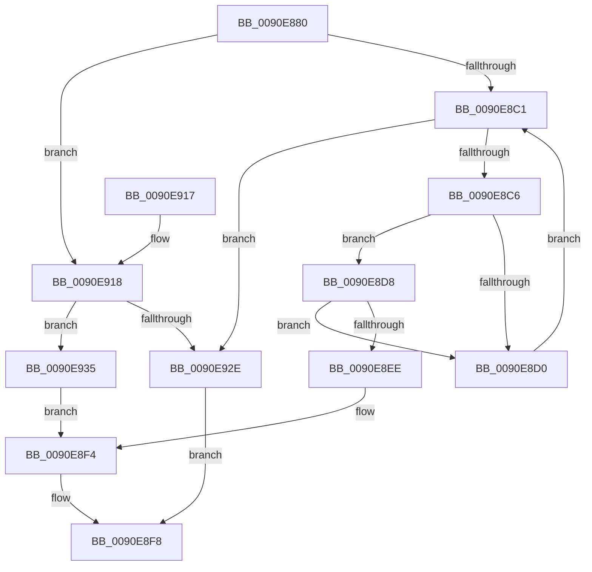

# RtlCompareString

- RVA: `0x0090E880`–`0x0090E93F` (길이 `191` bytes)
- VA: `0x000000014090E880`
- 실행 섹션: `PAGE`
- PDB 이름 있음: `예`; PDB Function 태그: `아니요`
- unwind 정보 RVA: `0x00069A88`
- 디코드: `62`개 명령, `191/191` bytes 표시
- 미해석 바이트: `0` (있으면 어셈블리에 `.byte`로 보존)

> 이 문서는 커널 이미지의 기계어와 PDB 기호를 분석해 생성했습니다. 4번과 5번은 함수 원형과 자료형을 바이너리 사용 방식에서 추정한 C 해석이며 원본 소스 복구 결과는 아닙니다.

## 1. Dependencies

- 직접 호출 지점: **3**; 고유 호출 대상: **2**
- 직접 호출자로 확인된 함수: **3**
- RIP 상대 이미지 참조: **0**

### Outgoing calls
- `0x0090E8D8` → [RtlUpperChar](RtlUpperChar_function_0090D730.md) (function, `0x0090D730`)
- `0x0090E8E4` → [RtlUpperChar](RtlUpperChar_function_0090D730.md) (function, `0x0090D730`)
- `0x0090E921` → [RtlCompareMemory](../../text/6B/RtlCompareMemory_function_006BA670.md) (function, `0x006BA670`)

### Direct callers
- [HalMatchAcpiOemId](../../text/3F/HalMatchAcpiOemId_function_003F6A90.md) at `0x003F6BB9`
- [RtlEqualString](../../text/48/RtlEqualString_function_0048BDE0.md) at `0x0048BDF4`
- [KsepGetModuleInfoByName](../74/KsepGetModuleInfoByName_function_0074AA04.md) at `0x0074AAA7`

### Static image references
- 디코드된 RIP-relative 메모리 참조가 없습니다.

## 2. Other-region calls and transfers

- 다른 실행 섹션으로 향하는 call: **1**
  - `0x0090E921` → [RtlCompareMemory](../../text/6B/RtlCompareMemory_function_006BA670.md) (`PAGE` → `.text`)
- 별도 외부 분기/꼬리 이동을 확인하지 못했습니다.

## 3. Assembly (complete function range)

```asm
0090E880  48 8B C4                        mov rax, rsp
0090E883  48 89 58 08                     mov qword ptr [rax + 8], rbx
0090E887  48 89 68 10                     mov qword ptr [rax + 0x10], rbp
0090E88B  48 89 70 18                     mov qword ptr [rax + 0x18], rsi
0090E88F  48 89 78 20                     mov qword ptr [rax + 0x20], rdi
0090E893  41 54                           push r12
0090E895  41 56                           push r14
0090E897  41 57                           push r15
0090E899  48 83 EC 20                     sub rsp, 0x20
0090E89D  0F B7 31                        movzx esi, word ptr [rcx]
0090E8A0  44 0F B7 3A                     movzx r15d, word ptr [rdx]
0090E8A4  8B C6                           mov eax, esi
0090E8A6  48 8B 59 08                     mov rbx, qword ptr [rcx + 8]
0090E8AA  41 3B F7                        cmp esi, r15d
0090E8AD  48 8B 7A 08                     mov rdi, qword ptr [rdx + 8]
0090E8B1  41 0F 47 C7                     cmova eax, r15d
0090E8B5  44 8B F0                        mov r14d, eax
0090E8B8  4C 8D 24 18                     lea r12, [rax + rbx]
0090E8BC  45 84 C0                        test r8b, r8b
0090E8BF  74 57                           je 0x14090e918
0090E8C1  49 3B DC                        cmp rbx, r12
0090E8C4  73 68                           jae 0x14090e92e
0090E8C6  8A 0B                           mov cl, byte ptr [rbx]
0090E8C8  40 8A 2F                        mov bpl, byte ptr [rdi]
0090E8CB  40 3A CD                        cmp cl, bpl
0090E8CE  75 08                           jne 0x14090e8d8
0090E8D0  48 FF C3                        inc rbx
0090E8D3  48 FF C7                        inc rdi
0090E8D6  EB E9                           jmp 0x14090e8c1
0090E8D8  E8 53 EE FF FF                  call 0x14090d730
0090E8DD  40 8A CD                        mov cl, bpl
0090E8E0  44 0F B6 F0                     movzx r14d, al
0090E8E4  E8 47 EE FF FF                  call 0x14090d730
0090E8E9  44 3A F0                        cmp r14b, al
0090E8EC  74 E2                           je 0x14090e8d0
0090E8EE  0F B6 C0                        movzx eax, al
0090E8F1  41 8B CE                        mov ecx, r14d
0090E8F4  2B C8                           sub ecx, eax
0090E8F6  8B C1                           mov eax, ecx
0090E8F8  48 8B 5C 24 40                  mov rbx, qword ptr [rsp + 0x40]
0090E8FD  48 8B 6C 24 48                  mov rbp, qword ptr [rsp + 0x48]
0090E902  48 8B 74 24 50                  mov rsi, qword ptr [rsp + 0x50]
0090E907  48 8B 7C 24 58                  mov rdi, qword ptr [rsp + 0x58]
0090E90C  48 83 C4 20                     add rsp, 0x20
0090E910  41 5F                           pop r15
0090E912  41 5E                           pop r14
0090E914  41 5C                           pop r12
0090E916  C3                              ret
0090E917  CC                              int3
0090E918  4D 8B C6                        mov r8, r14
0090E91B  48 8B D7                        mov rdx, rdi
0090E91E  48 8B CB                        mov rcx, rbx
0090E921  E8 4A BD DA FF                  call 0x1406ba670
0090E926  48 8B C8                        mov rcx, rax
0090E929  49 3B C6                        cmp rax, r14
0090E92C  72 07                           jb 0x14090e935
0090E92E  41 2B F7                        sub esi, r15d
0090E931  8B C6                           mov eax, esi
0090E933  EB C3                           jmp 0x14090e8f8
0090E935  0F B6 04 38                     movzx eax, byte ptr [rax + rdi]
0090E939  0F B6 0C 19                     movzx ecx, byte ptr [rcx + rbx]
0090E93D  EB B5                           jmp 0x14090e8f4
```

## 4. C-style interpretation (structured pseudocode)

```c
__int64 __fastcall RtlCompareString(__int64 a1, __int64 a2, unsigned __int8 a3)
{
    __int64 result;
    __int64 v_rbx;
    __int64 v_rdi;
    __int64 v_rsi;
    __int64 v_rsp;
    unsigned __int64 v_stack_p10;
    unsigned __int64 v_stack_p18;
    unsigned __int64 v_stack_p20;
    unsigned __int64 v_stack_p8;

    *(unsigned __int64 *)(v_rsp + 8) = v_rbx;
    *(unsigned __int64 *)(v_rsp + 16) = v_rbp;
    *(unsigned __int64 *)(v_rsp + 24) = v_rsi;
    *(unsigned __int64 *)(v_rsp + 32) = v_rdi;
    v_rsp = (v_rsp) - (32);
    result = (unsigned int)((unsigned int)(*(unsigned __int16 *)(a1)));
    if (((unsigned int)(*(unsigned __int16 *)(a1))) > ((unsigned int)(*(unsigned __int16 *)(a2)))) { result = (unsigned int)(*(unsigned __int16 *)(a2)); }
    if (a3 == 0) goto loc_0090E918;
loc_0090E8C1:
    if ((*(unsigned __int64 *)(a1 + 8)) >= (result + *(unsigned __int64 *)(a1 + 8) * 1)) goto loc_0090E92E;
    if (((unsigned __int8)(*(unsigned __int8 *)(*(unsigned __int64 *)(a1 + 8)))) != ((unsigned __int8)(*(unsigned __int8 *)(*(unsigned __int64 *)(a2 + 8))))) goto loc_0090E8D8;
loc_0090E8D0:
    v_rbx = (*(unsigned __int64 *)(a1 + 8)) + 1;
    v_rdi = (*(unsigned __int64 *)(a2 + 8)) + 1;
    goto loc_0090E8C1;
loc_0090E8D8:
    result = RtlUpperChar(*(unsigned __int8 *)(*(unsigned __int64 *)(a1 + 8)), a2, a3, a4);
    result = RtlUpperChar((unsigned __int8)(*(unsigned __int8 *)(*(unsigned __int64 *)(a2 + 8))), a2, a3, a4);
    if (((unsigned __int8)((unsigned __int8)(result))) == ((unsigned __int8)(result))) goto loc_0090E8D0;
loc_0090E8F4:
    a1 = (unsigned int)(((unsigned int)((unsigned int)((unsigned __int8)(result)))) - ((unsigned int)((unsigned __int8)(result))));
loc_0090E8F8:
    v_rsp = (v_rsp) + (32);
    return (unsigned int)((unsigned int)(a1));
loc_0090E918:
    result = RtlCompareMemory(v_stack_p8, v_stack_p20, (unsigned __int8)(result), a4);
    if (result < ((unsigned __int8)(result))) goto loc_0090E935;
loc_0090E92E:
    v_rsi = (unsigned int)((v_stack_p18) - ((unsigned int)(*(unsigned __int16 *)(a2))));
    goto loc_0090E8F8;
loc_0090E935:
    goto loc_0090E8F4;
}
```

## 5. (Beta) C Style

```c
int64_t RtlCompareString(void *Arg1, void *Arg2, uint8_t Arg3)
{
    uint8_t *arg1 = (uint8_t *)Arg1;
    uint8_t *arg2 = (uint8_t *)Arg2;

    int64_t result;
    int64_t local_rbx;
    int64_t local_rdi;
    int64_t local_rsi;
    int64_t local_rsp;
    uint64_t v_stack_p10;
    uint64_t v_stack_p18;
    uint64_t v_stack_p20;
    uint64_t v_stack_p8;

    *(uint64_t *)(local_rsp + 0x8) = local_rbx;
    *(uint64_t *)(local_rsp + 0x10) = local_rbp;
    *(uint64_t *)(local_rsp + 0x18) = local_rsi;
    *(uint64_t *)(local_rsp + 0x20) = local_rdi;
    local_rsp = (local_rsp) - (32);
    result = (uint32_t)((uint32_t)(*(uint16_t *)(arg1)));
    if (((uint32_t)(*(uint16_t *)(arg1))) > ((uint32_t)(*(uint16_t *)(arg2)))) { result = (uint32_t)(*(uint16_t *)(arg2)); }
    if (Arg3 == 0) goto loc_0090E918;
loc_0090E8C1:
    if ((*(uint64_t *)(arg1 + 0x8)) >= (result + *(uint64_t *)(arg1 + 0x8) * 1)) goto loc_0090E92E;
    if (((uint8_t)(*(uint8_t *)(*(uint64_t *)(arg1 + 0x8)))) != ((uint8_t)(*(uint8_t *)(*(uint64_t *)(arg2 + 0x8))))) goto loc_0090E8D8;
loc_0090E8D0:
    local_rbx = (*(uint64_t *)(arg1 + 0x8)) + 1;
    local_rdi = (*(uint64_t *)(arg2 + 0x8)) + 1;
    goto loc_0090E8C1;
loc_0090E8D8:
    result = RtlUpperChar(*(uint8_t *)(*(uint64_t *)(arg1 + 0x8)), Arg2, Arg3, a4);
    result = RtlUpperChar((uint8_t)(*(uint8_t *)(*(uint64_t *)(arg2 + 0x8))), Arg2, Arg3, a4);
    if (((uint8_t)((uint8_t)(result))) == ((uint8_t)(result))) goto loc_0090E8D0;
loc_0090E8F4:
    Arg1 = (uint32_t)(((uint32_t)((uint32_t)((uint8_t)(result)))) - ((uint32_t)((uint8_t)(result))));
loc_0090E8F8:
    local_rsp = (local_rsp) + (32);
    return (uint32_t)((uint32_t)(Arg1));
loc_0090E918:
    result = RtlCompareMemory(v_stack_p8, v_stack_p20, (uint8_t)(result), a4);
    if (result < ((uint8_t)(result))) goto loc_0090E935;
loc_0090E92E:
    local_rsi = (uint32_t)((v_stack_p18) - ((uint32_t)(*(uint16_t *)(arg2))));
    goto loc_0090E8F8;
loc_0090E935:
    goto loc_0090E8F4;
}
```

### 관측된 메모리 오프셋

구조체 형식이 확인되지 않은 접근은 인자 기준의 오프셋으로만 기록했습니다.

| 기준 인자 | 오프셋 표현 | 폭 (bit) | 접근 |
|---|---:|---:|---|
| `Arg1` | `+ 0x0` | `16` | `R` |
| `Arg1` | `+ 0x8` | `64` | `R` |
| `Arg2` | `+ 0x0` | `16` | `R` |
| `Arg2` | `+ 0x8` | `64` | `R` |

## 6. Execution-region graph

[열기: 2D/3D 그래프와 함수 탐색 컨트롤 패널](../../../control-panel.html?section=page&rva=0x0090E880&view=graph)

- 2D 그래프는 위에서 아래로 흐르고, 3D 그래프는 빈 공간을 드래그해 회전합니다. Shift+드래그는 이동, 휠은 확대·축소, 함수 노드 선택은 대상 보고서 이동입니다.

### Static fallback


