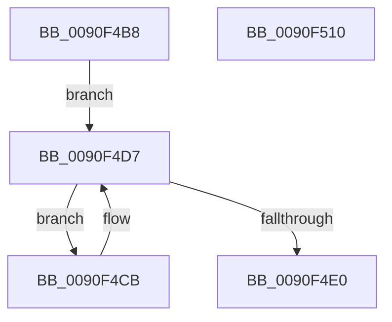

# RtlComputeLfnChecksum

- RVA: `0x0090F4B8`–`0x0090F511` (길이 `89` bytes)
- VA: `0x000000014090F4B8`
- 실행 섹션: `PAGE`
- PDB 이름 있음: `예`; PDB Function 태그: `아니요`
- unwind 정보 RVA: `0x000DB714`
- 디코드: `27`개 명령, `89/89` bytes 표시
- 미해석 바이트: `0` (있으면 어셈블리에 `.byte`로 보존)

> 이 문서는 커널 이미지의 기계어와 PDB 기호를 분석해 생성했습니다. 4번과 5번은 함수 원형과 자료형을 바이너리 사용 방식에서 추정한 C 해석이며 원본 소스 복구 결과는 아닙니다.

## 1. Dependencies

- 직접 호출 지점: **0**; 고유 호출 대상: **0**
- 직접 호출자로 확인된 함수: **1**
- RIP 상대 이미지 참조: **0**

### Outgoing calls
- 직접 디코드된 call 명령이 없습니다.

### Direct callers
- [RtlGenerate8dot3Name](RtlGenerate8dot3Name_function_0090E950.md) at `0x0090EE82`
- [RtlGenerate8dot3Name](RtlGenerate8dot3Name_function_0090E950.md) at `0x0090EF5A`

### Static image references
- 디코드된 RIP-relative 메모리 참조가 없습니다.

## 2. Other-region calls and transfers

- 다른 실행 섹션으로 향하는 call: **0**
- 별도 외부 분기/꼬리 이동을 확인하지 못했습니다.

## 3. Assembly (complete function range)

```asm
0090F4B8  0F B7 01                        movzx eax, word ptr [rcx]
0090F4BB  45 33 C0                        xor r8d, r8d
0090F4BE  48 8B 51 08                     mov rdx, qword ptr [rcx + 8]
0090F4C2  48 D1 E8                        shr rax, 1
0090F4C5  4C 8D 0C 42                     lea r9, [rdx + rax*2]
0090F4C9  EB 0C                           jmp 0x14090f4d7
0090F4CB  44 6B C0 25                     imul r8d, eax, 0x25
0090F4CF  66 44 03 02                     add r8w, word ptr [rdx]
0090F4D3  48 83 C2 02                     add rdx, 2
0090F4D7  41 0F B7 C0                     movzx eax, r8w
0090F4DB  49 3B D1                        cmp rdx, r9
0090F4DE  72 EB                           jb 0x14090f4cb
0090F4E0  69 C8 A5 B0 B9 12               imul ecx, eax, 0x12b9b0a5
0090F4E6  B8 99 2F B8 44                  mov eax, 0x44b82f99
0090F4EB  44 8B C1                        mov r8d, ecx
0090F4EE  41 F7 D8                        neg r8d
0090F4F1  44 0F 48 C1                     cmovs r8d, ecx
0090F4F5  41 F7 E8                        imul r8d
0090F4F8  C1 FA 1C                        sar edx, 0x1c
0090F4FB  8B CA                           mov ecx, edx
0090F4FD  C1 E9 1F                        shr ecx, 0x1f
0090F500  03 D1                           add edx, ecx
0090F502  69 CA 07 CA 9A 3B               imul ecx, edx, 0x3b9aca07
0090F508  44 2B C1                        sub r8d, ecx
0090F50B  41 0F B7 C0                     movzx eax, r8w
0090F50F  C3                              ret
0090F510  CC                              int3
```

## 4. C-style interpretation (structured pseudocode)

```c
__int64 __fastcall RtlComputeLfnChecksum(__int64 a1, __int64 a2, int a3)
{
    __int64 result;

    a3 = 0;
    result = (*(unsigned __int16 *)(a1)) >> (1);
    goto loc_0090F4D7;
loc_0090F4CB:
    a3 = (unsigned int)((a3) * ((unsigned int)(result)));
    a3 = (unsigned __int16)((a3) + (*(unsigned __int16 *)(*(unsigned __int64 *)(a1 + 8))));
    a2 = (*(unsigned __int64 *)(a1 + 8)) + (2);
loc_0090F4D7:
    if (a2 < (*(unsigned __int64 *)(a1 + 8) + result * 2)) goto loc_0090F4CB;
    a1 = (unsigned int)((a1) * ((unsigned int)((unsigned __int16)(a3))));
    a3 = (unsigned int)(-((unsigned int)((unsigned int)(a1))));
    if (sign_flag) { a3 = (unsigned int)(a1); }
    a2 = (unsigned int)((a2) >> (28));
    a1 = (unsigned int)(((unsigned int)((unsigned int)(a2))) >> (31));
    a2 = (unsigned int)((a2) + ((unsigned int)(a1)));
    a1 = (unsigned int)((a1) * ((unsigned int)(a2)));
    a3 = (unsigned int)((a3) - ((unsigned int)(a1)));
    return (unsigned __int16)(a3);
}
```

## 5. (Beta) C Style

```c
int64_t RtlComputeLfnChecksum(void *Arg1, int64_t Arg2, int32_t Arg3)
{
    uint8_t *arg1 = (uint8_t *)Arg1;

    int64_t result;

    Arg3 = 0;
    result = (*(uint16_t *)(arg1)) >> (1);
    goto loc_0090F4D7;
loc_0090F4CB:
    Arg3 = (uint32_t)((Arg3) * ((uint32_t)(result)));
    Arg3 = (uint16_t)((Arg3) + (*(uint16_t *)(*(uint64_t *)(arg1 + 0x8))));
    Arg2 = (*(uint64_t *)(arg1 + 0x8)) + (2);
loc_0090F4D7:
    if (Arg2 < (*(uint64_t *)(arg1 + 0x8) + result * 2)) goto loc_0090F4CB;
    Arg1 = (uint32_t)((Arg1) * ((uint32_t)((uint16_t)(Arg3))));
    Arg3 = (uint32_t)(-((uint32_t)((uint32_t)(Arg1))));
    if (sign_flag) { Arg3 = (uint32_t)(Arg1); }
    Arg2 = (uint32_t)((Arg2) >> (28));
    Arg1 = (uint32_t)(((uint32_t)((uint32_t)(Arg2))) >> (31));
    Arg2 = (uint32_t)((Arg2) + ((uint32_t)(Arg1)));
    Arg1 = (uint32_t)((Arg1) * ((uint32_t)(Arg2)));
    Arg3 = (uint32_t)((Arg3) - ((uint32_t)(Arg1)));
    return (uint16_t)(Arg3);
}
```

### 관측된 메모리 오프셋

구조체 형식이 확인되지 않은 접근은 인자 기준의 오프셋으로만 기록했습니다.

| 기준 인자 | 오프셋 표현 | 폭 (bit) | 접근 |
|---|---:|---:|---|
| `Arg1` | `+ 0x0` | `16` | `R` |
| `Arg1` | `+ 0x8` | `64` | `R` |

## 6. Execution-region graph

[열기: 2D/3D 그래프와 함수 탐색 컨트롤 패널](../../../control-panel.html?section=page&rva=0x0090F4B8&view=graph)

- 2D 그래프는 위에서 아래로 흐르고, 3D 그래프는 빈 공간을 드래그해 회전합니다. Shift+드래그는 이동, 휠은 확대·축소, 함수 노드 선택은 대상 보고서 이동입니다.

### Static fallback


