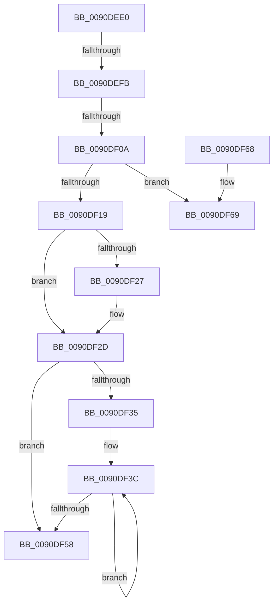

# RtlCustomCPToUnicodeN

- RVA: `0x0090DEE0`–`0x0090DF6E` (길이 `142` bytes)
- VA: `0x000000014090DEE0`
- 실행 섹션: `PAGE`
- PDB 이름 있음: `예`; PDB Function 태그: `아니요`
- unwind 정보 RVA: `0x000895CC`
- 디코드: `42`개 명령, `142/142` bytes 표시
- 미해석 바이트: `0` (있으면 어셈블리에 `.byte`로 보존)

> 이 문서는 커널 이미지의 기계어와 PDB 기호를 분석해 생성했습니다. 4번과 5번은 함수 원형과 자료형을 바이너리 사용 방식에서 추정한 C 해석이며 원본 소스 복구 결과는 아닙니다.

## 1. Dependencies

- 직접 호출 지점: **0**; 고유 호출 대상: **0**
- 직접 호출자로 확인된 함수: **1**
- RIP 상대 이미지 참조: **0**

### Outgoing calls
- 직접 디코드된 call 명령이 없습니다.

### Direct callers
- [RtlOemToUnicodeN](RtlOemToUnicodeN_function_0090F330.md) at `0x0090F3A0`

### Static image references
- 디코드된 RIP-relative 메모리 참조가 없습니다.

## 2. Other-region calls and transfers

- 다른 실행 섹션으로 향하는 call: **0**
- call이 아닌 외부 분기/꼬리 이동: **2**
  - `0x0090DEF5` → [sub_0090DFD3](Unknown_function_0090DFD3.md) (`tail-transfer`)
  - `0x0090DF04` → [sub_0090DFD3](Unknown_function_0090DFD3.md) (`tail-transfer`)

## 3. Assembly (complete function range)

```asm
0090DEE0  40 53                           push rbx
0090DEE2  48 83 EC 30                     sub rsp, 0x30
0090DEE6  41 8B C0                        mov eax, r8d
0090DEE9  4C 8B C1                        mov r8, rcx
0090DEEC  4D 8B D1                        mov r10, r9
0090DEEF  4C 8B DA                        mov r11, rdx
0090DEF2  48 85 C9                        test rcx, rcx
0090DEF5  0F 84 D8 00 00 00               je 0x14090dfd3
0090DEFB  B9 E9 FD 00 00                  mov ecx, 0xfde9
0090DF00  66 41 39 08                     cmp word ptr [r8], cx
0090DF04  0F 84 C9 00 00 00               je 0x14090dfd3
0090DF0A  44 8B 4C 24 68                  mov r9d, dword ptr [rsp + 0x68]
0090DF0F  D1 E8                           shr eax, 1
0090DF11  66 41 83 78 0C 00               cmp word ptr [r8 + 0xc], 0
0090DF17  75 50                           jne 0x14090df69
0090DF19  41 3B C1                        cmp eax, r9d
0090DF1C  41 8B D1                        mov edx, r9d
0090DF1F  0F 42 D0                        cmovb edx, eax
0090DF22  4D 85 D2                        test r10, r10
0090DF25  74 06                           je 0x14090df2d
0090DF27  8D 0C 12                        lea ecx, [rdx + rdx]
0090DF2A  41 89 0A                        mov dword ptr [r10], ecx
0090DF2D  4D 8B 50 20                     mov r10, qword ptr [r8 + 0x20]
0090DF31  85 D2                           test edx, edx
0090DF33  74 23                           je 0x14090df58
0090DF35  4C 8B 44 24 60                  mov r8, qword ptr [rsp + 0x60]
0090DF3A  8B DA                           mov ebx, edx
0090DF3C  41 0F B6 08                     movzx ecx, byte ptr [r8]
0090DF40  4D 8D 5B 02                     lea r11, [r11 + 2]
0090DF44  4D 8D 40 01                     lea r8, [r8 + 1]
0090DF48  41 0F B7 14 4A                  movzx edx, word ptr [r10 + rcx*2]
0090DF4D  66 41 89 53 FE                  mov word ptr [r11 - 2], dx
0090DF52  48 83 EB 01                     sub rbx, 1
0090DF56  75 E4                           jne 0x14090df3c
0090DF58  41 3B C1                        cmp eax, r9d
0090DF5B  1B C0                           sbb eax, eax
0090DF5D  25 05 00 00 80                  and eax, 0x80000005
0090DF62  48 83 C4 30                     add rsp, 0x30
0090DF66  5B                              pop rbx
0090DF67  C3                              ret
0090DF68  CC                              int3
0090DF69  48 8B 5C 24 60                  mov rbx, qword ptr [rsp + 0x60]
```

## 4. C-style interpretation (structured pseudocode)

```c
__int64 __fastcall RtlCustomCPToUnicodeN(__int64 a1, __int64 a2, int a3, __int64 a4, __int64 a5, unsigned int a6)
{
    __int64 result;
    __int64 v_rbx;
    __int64 v_rsp;

    v_rsp = (v_rsp) - (48);
    result = (unsigned int)(((unsigned int)(a3)) >> (1));
    if ((*(unsigned __int16 *)(a1 + 12)) != 0) goto loc_0090DF69;
    a2 = (unsigned int)((unsigned int)((unsigned int)(a6)));
    if (((unsigned int)(result)) < ((unsigned int)((unsigned int)(a6)))) { a2 = (unsigned int)(result); }
    if (a4 != 0) {
        a1 = a2 + a2 * 1;
        *(unsigned int *)(a4) = (unsigned int)(a1);
    }
    if ((unsigned int)(a2) == 0) goto loc_0090DF58;
loc_0090DF3C:
    *(unsigned __int16 *)(a2 + 2 - 2) = (unsigned __int16)(*(unsigned __int16 *)(*(unsigned __int64 *)(a1 + 32) + *(unsigned __int8 *)(a5) * 2));
    v_rbx = ((unsigned int)((unsigned int)(a2))) - (1);
    if (condition_is_not_equal) goto loc_0090DF3C;
loc_0090DF58:
    result = (unsigned int)((result) & (0x80000005ULL));
    v_rsp = (v_rsp) + (48);
    return result;
loc_0090DF69:
    return result;
}
```

## 5. (Beta) C Style

```c
int64_t RtlCustomCPToUnicodeN(void *Arg1, void *Arg2, int32_t Arg3, int64_t Arg4, void *Arg5, uint32_t Arg6)
{
    uint8_t *arg1 = (uint8_t *)Arg1;
    uint8_t *arg2 = (uint8_t *)Arg2;
    uint8_t *arg5 = (uint8_t *)Arg5;

    int64_t result;
    int64_t local_rbx;
    int64_t local_rsp;

    local_rsp = (local_rsp) - (48);
    result = (uint32_t)(((uint32_t)(Arg3)) >> (1));
    if ((*(uint16_t *)(arg1 + 0xC)) != 0) goto loc_0090DF69;
    Arg2 = (uint32_t)((uint32_t)((uint32_t)(Arg6)));
    if (((uint32_t)(result)) < ((uint32_t)((uint32_t)(Arg6)))) { Arg2 = (uint32_t)(result); }
    if (Arg4 != 0) {
        Arg1 = Arg2 + Arg2 * 1;
        *(uint32_t *)(Arg4) = (uint32_t)(Arg1);
    }
    if ((uint32_t)(Arg2) == 0) goto loc_0090DF58;
loc_0090DF3C:
    *(uint16_t *)(arg2 + 0x2 - 0x2) = (uint16_t)(*(uint16_t *)(*(uint64_t *)(arg1 + 0x20) + *(uint8_t *)(arg5) * 2));
    local_rbx = ((uint32_t)((uint32_t)(Arg2))) - (1);
    if (condition_is_not_equal) goto loc_0090DF3C;
loc_0090DF58:
    result = (uint32_t)((result) & (0x80000005ULL));
    local_rsp = (local_rsp) + (48);
    return result;
loc_0090DF69:
    return result;
}
```

### 관측된 메모리 오프셋

구조체 형식이 확인되지 않은 접근은 인자 기준의 오프셋으로만 기록했습니다.

| 기준 인자 | 오프셋 표현 | 폭 (bit) | 접근 |
|---|---:|---:|---|
| `Arg1` | `+ 0x0` | `16` | `R` |
| `Arg1` | `+ 0xC` | `16` | `R` |
| `Arg1` | `+ 0x20` | `64` | `R` |
| `Arg2` | `- 0x2` | `16` | `W` |
| `Arg2` | `+ 0x2` | `64` | `R` |
| `Arg5` | `+ 0x0` | `8` | `R` |
| `Arg5` | `+ 0x1` | `64` | `R` |

## 6. Execution-region graph

[열기: 2D/3D 그래프와 함수 탐색 컨트롤 패널](../../../control-panel.html?section=page&rva=0x0090DEE0&view=graph)

- 2D 그래프는 위에서 아래로 흐르고, 3D 그래프는 빈 공간을 드래그해 회전합니다. Shift+드래그는 이동, 휠은 확대·축소, 함수 노드 선택은 대상 보고서 이동입니다.

### Static fallback


