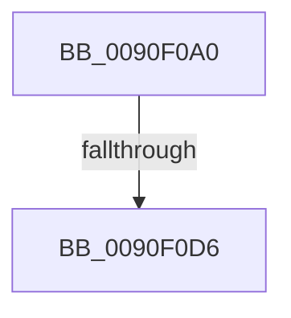

# RtlFindExportedRoutineByName

- RVA: `0x0090F0A0`–`0x0090F0DD` (길이 `61` bytes)
- VA: `0x000000014090F0A0`
- 실행 섹션: `PAGE`
- PDB 이름 있음: `예`; PDB Function 태그: `아니요`
- unwind 정보 RVA: `0x0008982C`
- 디코드: `18`개 명령, `61/61` bytes 표시
- 미해석 바이트: `0` (있으면 어셈블리에 `.byte`로 보존)

> 이 문서는 커널 이미지의 기계어와 PDB 기호를 분석해 생성했습니다. 4번과 5번은 함수 원형과 자료형을 바이너리 사용 방식에서 추정한 C 해석이며 원본 소스 복구 결과는 아닙니다.

## 1. Dependencies

- 직접 호출 지점: **1**; 고유 호출 대상: **1**
- 직접 호출자로 확인된 함수: **8**
- RIP 상대 이미지 참조: **0**

### Outgoing calls
- `0x0090F0C5` → [RtlImageDirectoryEntryToData](../../text/43/RtlImageDirectoryEntryToData_function_004328D0.md) (function, `0x004328D0`)

### Direct callers
- [PrExtControlOperations](../../text/66/PrExtControlOperations_function_00666A6C.md) at `0x00666ADB`
- [PrExtControlOperations](../../text/66/PrExtControlOperations_function_00666A6C.md) at `0x00666AFC`
- [KsepResolveShimHooks](../74/KsepResolveShimHooks_function_00749A9C.md) at `0x00749B51`
- [MiUnloadApproved](../7F/MiUnloadApproved_function_007F82A0.md) at `0x007F82E8`
- [MmCallDllInitialize](../7F/MmCallDllInitialize_function_007F836C.md) at `0x007F8380`
- [MiApplyDriverHotPatch](../80/MiApplyDriverHotPatch_function_008018EC.md) at `0x00801CA6`
- [MiCompactServiceTable](../80/MiCompactServiceTable_function_0080C63C.md) at `0x0080C666`
- [MiCompactServiceTable](../80/MiCompactServiceTable_function_0080C63C.md) at `0x0080C682`
- [MiCompactServiceTable](../80/MiCompactServiceTable_function_0080C63C.md) at `0x0080C69E`
- [MiCompactServiceTable](../80/MiCompactServiceTable_function_0080C63C.md) at `0x0080C6BA`
- [MiCompactServiceTable](../80/MiCompactServiceTable_function_0080C63C.md) at `0x0080C6D6`
- [MiCompactServiceTable](../80/MiCompactServiceTable_function_0080C63C.md) at `0x0080C6F2`
- [MmGetSystemRoutineAddress](MmGetSystemRoutineAddress_function_0090EFE0.md) at `0x0090F039`
- [MmGetSystemRoutineAddress](MmGetSystemRoutineAddress_function_0090EFE0.md) at `0x0090F085`
- [PspLookupEntryPoint](../../init/C4/PspLookupEntryPoint_function_00C45E8C.md) at `0x00C45EA7`

### Static image references
- 디코드된 RIP-relative 메모리 참조가 없습니다.

## 2. Other-region calls and transfers

- 다른 실행 섹션으로 향하는 call: **1**
  - `0x0090F0C5` → [RtlImageDirectoryEntryToData](../../text/43/RtlImageDirectoryEntryToData_function_004328D0.md) (`PAGE` → `.text`)
- call이 아닌 외부 분기/꼬리 이동: **1**
  - `0x0090F0D0` → [sub_0090F190](Unknown_function_0090F190.md) (`tail-transfer`)

## 3. Assembly (complete function range)

```asm
0090F0A0  48 89 5C 24 20                  mov qword ptr [rsp + 0x20], rbx
0090F0A5  55                              push rbp
0090F0A6  56                              push rsi
0090F0A7  41 57                           push r15
0090F0A9  48 83 EC 20                     sub rsp, 0x20
0090F0AD  48 8B F2                        mov rsi, rdx
0090F0B0  4C 8D 4C 24 40                  lea r9, [rsp + 0x40]
0090F0B5  45 33 FF                        xor r15d, r15d
0090F0B8  B2 01                           mov dl, 1
0090F0BA  45 33 C0                        xor r8d, r8d
0090F0BD  44 89 7C 24 40                  mov dword ptr [rsp + 0x40], r15d
0090F0C2  48 8B D9                        mov rbx, rcx
0090F0C5  E8 06 38 B2 FF                  call 0x1404328d0
0090F0CA  48 8B E8                        mov rbp, rax
0090F0CD  48 85 C0                        test rax, rax
0090F0D0  0F 84 BA 00 00 00               je 0x14090f190
0090F0D6  44 8B 48 18                     mov r9d, dword ptr [rax + 0x18]
0090F0DA  45 8B D7                        mov r10d, r15d
```

## 4. C-style interpretation (structured pseudocode)

```c
__int64 __fastcall RtlFindExportedRoutineByName(__int64 a1, __int64 a2, int a3)
{
    __int64 result;
    __int64 v_r15;
    __int64 v_rsp;
    unsigned __int64 v_stack_p20;
    unsigned __int64 v_stack_p8;

    v_stack_p20 = v_rbx;
    v_rsp = (v_rsp) - (32);
    v_r15 = 0;
    a3 = 0;
    v_stack_p8 = 0;
    result = RtlImageDirectoryEntryToData(a1, 1, a3, v_stack_p8);
    return result;
}
```

## 5. (Beta) C Style

```c
int64_t RtlFindExportedRoutineByName(int64_t Arg1, int64_t Arg2, int32_t Arg3)
{
    int64_t result;
    int64_t local_r15;
    int64_t local_rsp;
    uint64_t v_stack_p20;
    uint64_t v_stack_p8;

    v_stack_p20 = local_rbx;
    local_rsp = (local_rsp) - (32);
    local_r15 = 0;
    Arg3 = 0;
    v_stack_p8 = 0;
    result = RtlImageDirectoryEntryToData(Arg1, 1, Arg3, v_stack_p8);
    return result;
}
```

## 6. Execution-region graph

[열기: 2D/3D 그래프와 함수 탐색 컨트롤 패널](../../../control-panel.html?section=page&rva=0x0090F0A0&view=graph)

- 2D 그래프는 위에서 아래로 흐르고, 3D 그래프는 빈 공간을 드래그해 회전합니다. Shift+드래그는 이동, 휠은 확대·축소, 함수 노드 선택은 대상 보고서 이동입니다.

### Static fallback


