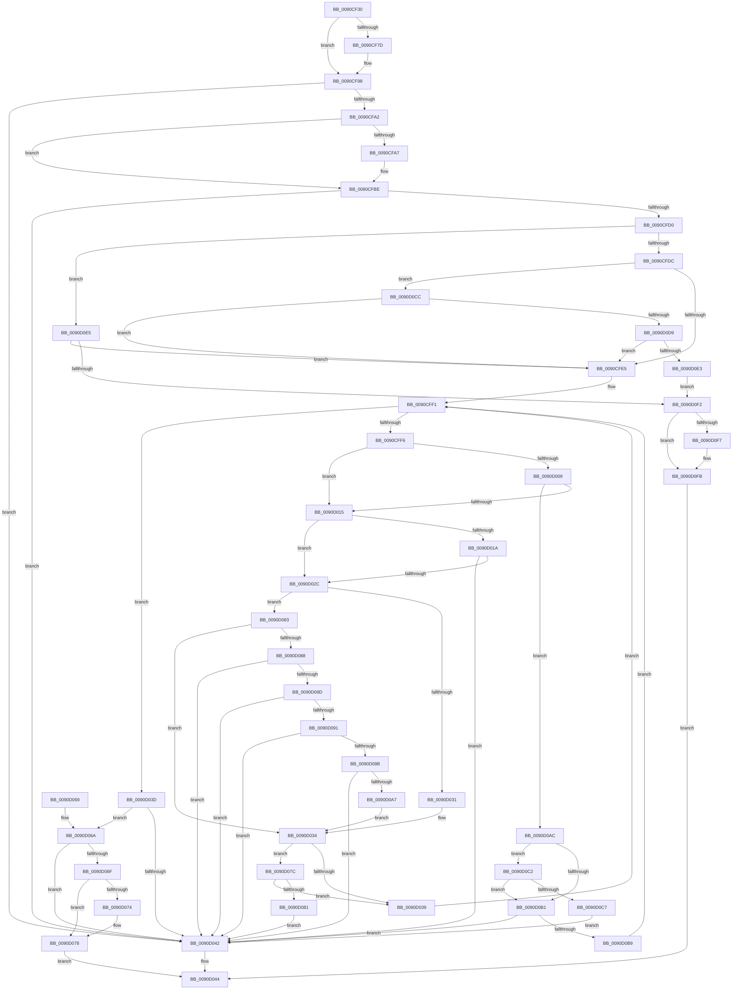

# RtlIsNameLegalDOS8Dot3

- RVA: `0x0090CF30`–`0x0090D102` (길이 `466` bytes)
- VA: `0x000000014090CF30`
- 실행 섹션: `PAGE`
- PDB 이름 있음: `예`; PDB Function 태그: `아니요`
- unwind 정보 RVA: `0x00089398`
- 디코드: `146`개 명령, `466/466` bytes 표시
- 미해석 바이트: `0` (있으면 어셈블리에 `.byte`로 보존)

> 이 문서는 커널 이미지의 기계어와 PDB 기호를 분석해 생성했습니다. 4번과 5번은 함수 원형과 자료형을 바이너리 사용 방식에서 추정한 C 해석이며 원본 소스 복구 결과는 아닙니다.

## 1. Dependencies

- 직접 호출 지점: **4**; 고유 호출 대상: **4**
- 직접 호출자로 확인된 함수: **0**
- RIP 상대 이미지 참조: **2**

### Outgoing calls
- `0x0090CF74` → [RtlpIsUtf8Process](RtlpIsUtf8Process_function_0090DB60.md) (function, `0x0090DB60`)
- `0x0090CF81` → [PsGetCurrentServerSiloGlobals](../../text/2F/PsGetCurrentServerSiloGlobals_function_002FE1F0.md) (function, `0x002FE1F0`)
- `0x0090CFC7` → [RtlUpcaseUnicodeStringToCountedOemString](RtlUpcaseUnicodeStringToCountedOemString_function_0090E4D0.md) (function, `0x0090E4D0`)
- `0x0090D04C` → [_security_check_cookie](../../text/6A/_security_check_cookie_function_006AC640.md) (function, `0x006AC640`)

### Direct callers
- 이 함수 시작 RVA로 연결되는 직접 call은 확인되지 않았습니다. 간접 호출은 완전히 역산할 수 없습니다.

### Static image references
- `0x0090CF44` → RVA `0x00E0A740` (`.data`; read)
- `0x0090CFE7` → RVA `0x00B4B560` (`RtlFatIllegalTable`; read)

## 2. Other-region calls and transfers

- 다른 실행 섹션으로 향하는 call: **2**
  - `0x0090CF81` → [PsGetCurrentServerSiloGlobals](../../text/2F/PsGetCurrentServerSiloGlobals_function_002FE1F0.md) (`PAGE` → `.text`)
  - `0x0090D04C` → [_security_check_cookie](../../text/6A/_security_check_cookie_function_006AC640.md) (`PAGE` → `.text`)
- 별도 외부 분기/꼬리 이동을 확인하지 못했습니다.

## 3. Assembly (complete function range)

```asm
0090CF30  48 89 5C 24 20                  mov qword ptr [rsp + 0x20], rbx
0090CF35  55                              push rbp
0090CF36  56                              push rsi
0090CF37  57                              push rdi
0090CF38  41 54                           push r12
0090CF3A  41 55                           push r13
0090CF3C  41 56                           push r14
0090CF3E  41 57                           push r15
0090CF40  48 83 EC 50                     sub rsp, 0x50
0090CF44  48 8B 05 F5 D7 4F 00            mov rax, qword ptr [rip + 0x4fd7f5]
0090CF4B  48 33 C4                        xor rax, rsp
0090CF4E  48 89 44 24 40                  mov qword ptr [rsp + 0x40], rax
0090CF53  48 8B F1                        mov rsi, rcx
0090CF56  0F 57 C0                        xorps xmm0, xmm0
0090CF59  33 DB                           xor ebx, ebx
0090CF5B  B1 01                           mov cl, 1
0090CF5D  0F 11 44 24 20                  movups xmmword ptr [rsp + 0x20], xmm0
0090CF62  44 8B FB                        mov r15d, ebx
0090CF65  4D 8B E0                        mov r12, r8
0090CF68  48 8B FA                        mov rdi, rdx
0090CF6B  45 32 ED                        xor r13b, r13b
0090CF6E  45 32 F6                        xor r14b, r14b
0090CF71  40 32 ED                        xor bpl, bpl
0090CF74  E8 E7 0B 00 00                  call 0x14090db60
0090CF79  84 C0                           test al, al
0090CF7B  75 1B                           jne 0x14090cf98
0090CF7D  F0 09 1C 24                     lock or dword ptr [rsp], ebx
0090CF81  E8 6A 12 9F FF                  call 0x1402fe1f0
0090CF86  66 39 98 54 04 00 00            cmp word ptr [rax + 0x454], bx
0090CF8D  4C 8B B8 A0 04 00 00            mov r15, qword ptr [rax + 0x4a0]
0090CF94  40 0F 95 C5                     setne bpl
0090CF98  66 83 3E 18                     cmp word ptr [rsi], 0x18
0090CF9C  0F 87 A0 00 00 00               ja 0x14090d042
0090CFA2  48 85 FF                        test rdi, rdi
0090CFA5  75 17                           jne 0x14090cfbe
0090CFA7  48 8D 44 24 30                  lea rax, [rsp + 0x30]
0090CFAC  C7 44 24 20 00 00 0C 00         mov dword ptr [rsp + 0x20], 0xc0000
0090CFB4  48 89 44 24 28                  mov qword ptr [rsp + 0x28], rax
0090CFB9  48 8D 7C 24 20                  lea rdi, [rsp + 0x20]
0090CFBE  45 33 C0                        xor r8d, r8d
0090CFC1  48 8B D6                        mov rdx, rsi
0090CFC4  48 8B CF                        mov rcx, rdi
0090CFC7  E8 04 15 00 00                  call 0x14090e4d0
0090CFCC  85 C0                           test eax, eax
0090CFCE  78 72                           js 0x14090d042
0090CFD0  0F B7 0F                        movzx ecx, word ptr [rdi]
0090CFD3  83 F9 01                        cmp ecx, 1
0090CFD6  0F 84 09 01 00 00               je 0x14090d0e5
0090CFDC  83 F9 02                        cmp ecx, 2
0090CFDF  0F 84 E7 00 00 00               je 0x14090d0cc
0090CFE5  32 D2                           xor dl, dl
0090CFE7  4C 8D 1D 72 E5 23 00            lea r11, [rip + 0x23e572]
0090CFEE  44 8B D1                        mov r10d, ecx
0090CFF1  41 3B DA                        cmp ebx, r10d
0090CFF4  73 47                           jae 0x14090d03d
0090CFF6  4C 8B 47 08                     mov r8, qword ptr [rdi + 8]
0090CFFA  8B C3                           mov eax, ebx
0090CFFC  42 0F B6 14 00                  movzx edx, byte ptr [rax + r8]
0090D001  44 8B CA                        mov r9d, edx
0090D004  40 84 ED                        test bpl, bpl
0090D007  74 0C                           je 0x14090d015
0090D009  66 41 83 3C 57 00               cmp word ptr [r15 + rdx*2], 0
0090D00F  0F 85 97 00 00 00               jne 0x14090d0ac
0090D015  80 FA 80                        cmp dl, 0x80
0090D018  73 12                           jae 0x14090d02c
0090D01A  49 C1 E9 05                     shr r9, 5
0090D01E  8B CA                           mov ecx, edx
0090D020  83 E1 1F                        and ecx, 0x1f
0090D023  43 8B 04 8B                     mov eax, dword ptr [r11 + r9*4]
0090D027  0F A3 C8                        bt eax, ecx
0090D02A  72 16                           jb 0x14090d042
0090D02C  80 FA 20                        cmp dl, 0x20
0090D02F  75 52                           jne 0x14090d083
0090D031  41 B6 01                        mov r14b, 1
0090D034  83 FB 08                        cmp ebx, 8
0090D037  73 43                           jae 0x14090d07c
0090D039  FF C3                           inc ebx
0090D03B  EB B4                           jmp 0x14090cff1
0090D03D  80 FA 20                        cmp dl, 0x20
0090D040  75 28                           jne 0x14090d06a
0090D042  32 C0                           xor al, al
0090D044  48 8B 4C 24 40                  mov rcx, qword ptr [rsp + 0x40]
0090D049  48 33 CC                        xor rcx, rsp
0090D04C  E8 EF F5 D9 FF                  call 0x1406ac640
0090D051  48 8B 9C 24 A8 00 00 00         mov rbx, qword ptr [rsp + 0xa8]
0090D059  48 83 C4 50                     add rsp, 0x50
0090D05D  41 5F                           pop r15
0090D05F  41 5E                           pop r14
0090D061  41 5D                           pop r13
0090D063  41 5C                           pop r12
0090D065  5F                              pop rdi
0090D066  5E                              pop rsi
0090D067  5D                              pop rbp
0090D068  C3                              ret
0090D069  CC                              int3
0090D06A  80 FA 2E                        cmp dl, 0x2e
0090D06D  74 D3                           je 0x14090d042
0090D06F  4D 85 E4                        test r12, r12
0090D072  74 04                           je 0x14090d078
0090D074  45 88 34 24                     mov byte ptr [r12], r14b
0090D078  B0 01                           mov al, 1
0090D07A  EB C8                           jmp 0x14090d044
0090D07C  45 84 ED                        test r13b, r13b
0090D07F  75 B8                           jne 0x14090d039
0090D081  EB BF                           jmp 0x14090d042
0090D083  80 FA 2E                        cmp dl, 0x2e
0090D086  75 AC                           jne 0x14090d034
0090D088  45 84 ED                        test r13b, r13b
0090D08B  75 B5                           jne 0x14090d042
0090D08D  85 DB                           test ebx, ebx
0090D08F  74 B1                           je 0x14090d042
0090D091  8D 43 FF                        lea eax, [rbx - 1]
0090D094  42 80 3C 00 20                  cmp byte ptr [rax + r8], 0x20
0090D099  74 A7                           je 0x14090d042
0090D09B  41 8B C2                        mov eax, r10d
0090D09E  2B C3                           sub eax, ebx
0090D0A0  FF C8                           dec eax
0090D0A2  83 F8 03                        cmp eax, 3
0090D0A5  77 9B                           ja 0x14090d042
0090D0A7  41 B5 01                        mov r13b, 1
0090D0AA  EB 88                           jmp 0x14090d034
0090D0AC  45 84 ED                        test r13b, r13b
0090D0AF  74 11                           je 0x14090d0c2
0090D0B1  41 8D 42 FF                     lea eax, [r10 - 1]
0090D0B5  3B D8                           cmp ebx, eax
0090D0B7  74 89                           je 0x14090d042
0090D0B9  FF C3                           inc ebx
0090D0BB  FF C3                           inc ebx
0090D0BD  E9 2F FF FF FF                  jmp 0x14090cff1
0090D0C2  83 FB 07                        cmp ebx, 7
0090D0C5  72 EA                           jb 0x14090d0b1
0090D0C7  E9 76 FF FF FF                  jmp 0x14090d042
0090D0CC  48 8B 47 08                     mov rax, qword ptr [rdi + 8]
0090D0D0  80 38 2E                        cmp byte ptr [rax], 0x2e
0090D0D3  0F 85 0C FF FF FF               jne 0x14090cfe5
0090D0D9  80 78 01 2E                     cmp byte ptr [rax + 1], 0x2e
0090D0DD  0F 85 02 FF FF FF               jne 0x14090cfe5
0090D0E3  EB 0D                           jmp 0x14090d0f2
0090D0E5  48 8B 47 08                     mov rax, qword ptr [rdi + 8]
0090D0E9  80 38 2E                        cmp byte ptr [rax], 0x2e
0090D0EC  0F 85 F3 FE FF FF               jne 0x14090cfe5
0090D0F2  4D 85 E4                        test r12, r12
0090D0F5  74 04                           je 0x14090d0fb
0090D0F7  41 88 1C 24                     mov byte ptr [r12], bl
0090D0FB  B0 01                           mov al, 1
0090D0FD  E9 42 FF FF FF                  jmp 0x14090d044
```

## 4. C-style interpretation (structured pseudocode)

```c
__int64 __fastcall RtlIsNameLegalDOS8Dot3(__int64 a1, __int64 a2, __int64 a3)
{
    __int64 result;
    __int64 v_r13;
    __int64 v_r14;
    __int64 v_r15;
    __int64 v_rbp;
    __int64 v_rbx;
    __int64 v_rdi;
    __int64 v_rsp;
    unsigned __int64 v_stack_m48;
    unsigned __int64 v_stack_m58;
    unsigned __int64 v_stack_m60;
    unsigned __int64 v_stack_m68;
    unsigned int v_stack_m88;
    unsigned __int64 v_stack_p20;

    v_stack_p20 = v_rbx;
    v_rsp = (v_rsp) - (80);
    result = (*(unsigned __int64 *)(v_rip + 5232629)) ^ (v_rsp);
    v_stack_m48 = result;
    v_rbx = 0;
    v_stack_m68 = v_xmm0;
    v_r13 = 0;
    v_r14 = 0;
    v_rbp = 0;
    result = RtlpIsUtf8Process(1, a2, a3, a4);
    v_r15 = 0;
    if ((unsigned __int8)(result) == 0) {
        result = PsGetCurrentServerSiloGlobals(1, a2, a3, a4);
        v_r15 = *(unsigned __int64 *)(result + 1184);
        v_rbp = ((*(unsigned __int16 *)(result + 1108)) != 0) ? 1 : 0;
    }
    if ((*(unsigned __int16 *)(a1)) > 24) goto loc_0090D042;
    v_rdi = a2;
    if (a2 == 0) {
        result = v_stack_m58;
        v_stack_m68 = 0xC0000ULL;
        v_stack_m60 = result;
        v_rdi = v_stack_m68;
    }
    a3 = 0;
    result = RtlUpcaseUnicodeStringToCountedOemString(v_rdi, a1, a3, a4);
    if (sign_flag) goto loc_0090D042;
    if (((unsigned int)(*(unsigned __int16 *)(v_rdi))) == 1) goto loc_0090D0E5;
    if (((unsigned int)(*(unsigned __int16 *)(v_rdi))) == 2) goto loc_0090D0CC;
loc_0090CFE5:
    a2 = 0;
loc_0090CFF1:
    if (0 >= ((unsigned int)((unsigned int)((unsigned int)(*(unsigned __int16 *)(v_rdi)))))) goto loc_0090D03D;
    if ((unsigned __int8)(v_rbp) == 0) goto loc_0090D015;
    if ((*(unsigned __int16 *)(v_r15 + *(unsigned __int8 *)(0 + *(unsigned __int64 *)(v_rdi + 8) * 1) * 2)) != 0) goto loc_0090D0AC;
loc_0090D015:
    if (((unsigned __int8)(*(unsigned __int8 *)(0 + *(unsigned __int64 *)(v_rdi + 8) * 1))) >= 128) goto loc_0090D02C;
    a4 = ((unsigned int)((unsigned int)(*(unsigned __int8 *)(0 + *(unsigned __int64 *)(v_rdi + 8) * 1)))) >> (5);
    a1 = (unsigned int)(((unsigned int)((unsigned int)(*(unsigned __int8 *)(0 + *(unsigned __int64 *)(v_rdi + 8) * 1)))) & (31));
    if (condition_is_below) goto loc_0090D042;
loc_0090D02C:
    if (((unsigned __int8)(*(unsigned __int8 *)(0 + *(unsigned __int64 *)(v_rdi + 8) * 1))) != 32) goto loc_0090D083;
loc_0090D034:
    if (0 >= 8) goto loc_0090D07C;
loc_0090D039:
    v_rbx = (unsigned int)((v_rbx) + 1);
    goto loc_0090CFF1;
loc_0090D03D:
    if (((unsigned __int8)(*(unsigned __int8 *)(0 + *(unsigned __int64 *)(v_rdi + 8) * 1))) != 32) goto loc_0090D06A;
loc_0090D042:
    result = 0;
loc_0090D044:
    a1 = (v_stack_m48) ^ (v_rsp);
    result = _security_check_cookie(a1, *(unsigned __int8 *)(0 + *(unsigned __int64 *)(v_rdi + 8) * 1), *(unsigned __int64 *)(v_rdi + 8), a4);
    v_rsp = (v_rsp) + (80);
    return result;
loc_0090D06A:
    if (((unsigned __int8)(*(unsigned __int8 *)(0 + *(unsigned __int64 *)(v_rdi + 8) * 1))) == 46) goto loc_0090D042;
    if (0 != 0) {
        *(unsigned __int8 *)(a3) = 1;
    }
    goto loc_0090D044;
loc_0090D07C:
    if (0 != 0) goto loc_0090D039;
    goto loc_0090D042;
loc_0090D083:
    if (((unsigned __int8)(*(unsigned __int8 *)(0 + *(unsigned __int64 *)(v_rdi + 8) * 1))) != 46) goto loc_0090D034;
    if (0 != 0) goto loc_0090D042;
    if ((unsigned int)(v_stack_p20) == 0) goto loc_0090D042;
    if ((*(unsigned __int8 *)(v_stack_p20 - 1 + *(unsigned __int64 *)(v_rdi + 8) * 1)) == 32) goto loc_0090D042;
    result = (unsigned int)(((unsigned int)((unsigned int)((unsigned int)((unsigned int)(*(unsigned __int16 *)(v_rdi)))))) - ((unsigned int)(v_stack_p20)));
    result = (unsigned int)((result) - 1);
    if (((unsigned int)(result)) > 3) goto loc_0090D042;
    goto loc_0090D034;
loc_0090D0AC:
    if (1 == 0) goto loc_0090D0C2;
loc_0090D0B1:
    if (((unsigned int)(v_stack_p20)) == ((unsigned int)((unsigned int)((unsigned int)(*(unsigned __int16 *)(v_rdi))) - 1))) goto loc_0090D042;
    v_rbx = (unsigned int)((v_stack_p20) + 1);
    v_rbx = (unsigned int)((v_rbx) + 1);
    goto loc_0090CFF1;
loc_0090D0C2:
    if (((unsigned int)(v_rbx)) < 7) goto loc_0090D0B1;
    goto loc_0090D042;
loc_0090D0CC:
    if ((*(unsigned __int8 *)(*(unsigned __int64 *)(v_rdi + 8))) != 46) goto loc_0090CFE5;
    if ((*(unsigned __int8 *)(*(unsigned __int64 *)(v_rdi + 8) + 1)) != 46) goto loc_0090CFE5;
    goto loc_0090D0F2;
loc_0090D0E5:
    if ((*(unsigned __int8 *)(*(unsigned __int64 *)(v_rdi + 8))) != 46) goto loc_0090CFE5;
loc_0090D0F2:
    if (0 != 0) {
        *(unsigned __int8 *)(a3) = (unsigned __int8)(v_rbx);
    }
    goto loc_0090D044;
}
```

## 5. (Beta) C Style

```c
int64_t RtlIsNameLegalDOS8Dot3(void *Arg1, int64_t Arg2, int64_t Arg3)
{
    uint8_t *arg1 = (uint8_t *)Arg1;

    int64_t result;
    int64_t local_r13;
    int64_t local_r14;
    int64_t local_r15;
    int64_t local_rbp;
    int64_t local_rbx;
    int64_t local_rdi;
    int64_t local_rsp;
    uint64_t v_stack_m48;
    uint64_t v_stack_m58;
    uint64_t v_stack_m60;
    uint64_t v_stack_m68;
    uint32_t v_stack_m88;
    uint64_t v_stack_p20;

    v_stack_p20 = local_rbx;
    local_rsp = (local_rsp) - (80);
    result = (*(uint64_t *)(v_rip + 0x4FD7F5)) ^ (local_rsp);
    v_stack_m48 = result;
    local_rbx = 0;
    v_stack_m68 = v_xmm0;
    local_r13 = 0;
    local_r14 = 0;
    local_rbp = 0;
    result = RtlpIsUtf8Process(1, Arg2, Arg3, a4);
    local_r15 = 0;
    if ((uint8_t)(result) == 0) {
        result = PsGetCurrentServerSiloGlobals(1, Arg2, Arg3, a4);
        local_r15 = *(uint64_t *)(result + 0x4A0);
        local_rbp = ((*(uint16_t *)(result + 0x454)) != 0) ? 1 : 0;
    }
    if ((*(uint16_t *)(arg1)) > 24) goto loc_0090D042;
    local_rdi = Arg2;
    if (Arg2 == 0) {
        result = v_stack_m58;
        v_stack_m68 = 0xC0000ULL;
        v_stack_m60 = result;
        local_rdi = v_stack_m68;
    }
    Arg3 = 0;
    result = RtlUpcaseUnicodeStringToCountedOemString(local_rdi, Arg1, Arg3, a4);
    if (sign_flag) goto loc_0090D042;
    if (((uint32_t)(*(uint16_t *)(local_rdi))) == 1) goto loc_0090D0E5;
    if (((uint32_t)(*(uint16_t *)(local_rdi))) == 2) goto loc_0090D0CC;
loc_0090CFE5:
    Arg2 = 0;
loc_0090CFF1:
    if (0 >= ((uint32_t)((uint32_t)((uint32_t)(*(uint16_t *)(local_rdi)))))) goto loc_0090D03D;
    if ((uint8_t)(local_rbp) == 0) goto loc_0090D015;
    if ((*(uint16_t *)(local_r15 + *(uint8_t *)(0 + *(uint64_t *)(local_rdi + 0x8) * 1) * 2)) != 0) goto loc_0090D0AC;
loc_0090D015:
    if (((uint8_t)(*(uint8_t *)(0 + *(uint64_t *)(local_rdi + 0x8) * 1))) >= 128) goto loc_0090D02C;
    a4 = ((uint32_t)((uint32_t)(*(uint8_t *)(0 + *(uint64_t *)(local_rdi + 0x8) * 1)))) >> (5);
    Arg1 = (uint32_t)(((uint32_t)((uint32_t)(*(uint8_t *)(0 + *(uint64_t *)(local_rdi + 0x8) * 1)))) & (31));
    if (condition_is_below) goto loc_0090D042;
loc_0090D02C:
    if (((uint8_t)(*(uint8_t *)(0 + *(uint64_t *)(local_rdi + 0x8) * 1))) != 32) goto loc_0090D083;
loc_0090D034:
    if (0 >= 8) goto loc_0090D07C;
loc_0090D039:
    local_rbx = (uint32_t)((local_rbx) + 1);
    goto loc_0090CFF1;
loc_0090D03D:
    if (((uint8_t)(*(uint8_t *)(0 + *(uint64_t *)(local_rdi + 0x8) * 1))) != 32) goto loc_0090D06A;
loc_0090D042:
    result = 0;
loc_0090D044:
    Arg1 = (v_stack_m48) ^ (local_rsp);
    result = _security_check_cookie(Arg1, *(uint8_t *)(0 + *(uint64_t *)(local_rdi + 0x8) * 1), *(uint64_t *)(local_rdi + 0x8), a4);
    local_rsp = (local_rsp) + (80);
    return result;
loc_0090D06A:
    if (((uint8_t)(*(uint8_t *)(0 + *(uint64_t *)(local_rdi + 0x8) * 1))) == 46) goto loc_0090D042;
    if (0 != 0) {
        *(uint8_t *)(Arg3) = 1;
    }
    goto loc_0090D044;
loc_0090D07C:
    if (0 != 0) goto loc_0090D039;
    goto loc_0090D042;
loc_0090D083:
    if (((uint8_t)(*(uint8_t *)(0 + *(uint64_t *)(local_rdi + 0x8) * 1))) != 46) goto loc_0090D034;
    if (0 != 0) goto loc_0090D042;
    if ((uint32_t)(v_stack_p20) == 0) goto loc_0090D042;
    if ((*(uint8_t *)(v_stack_p20 - 0x1 + *(uint64_t *)(local_rdi + 0x8) * 1)) == 32) goto loc_0090D042;
    result = (uint32_t)(((uint32_t)((uint32_t)((uint32_t)((uint32_t)(*(uint16_t *)(local_rdi)))))) - ((uint32_t)(v_stack_p20)));
    result = (uint32_t)((result) - 1);
    if (((uint32_t)(result)) > 3) goto loc_0090D042;
    goto loc_0090D034;
loc_0090D0AC:
    if (1 == 0) goto loc_0090D0C2;
loc_0090D0B1:
    if (((uint32_t)(v_stack_p20)) == ((uint32_t)((uint32_t)((uint32_t)(*(uint16_t *)(local_rdi))) - 1))) goto loc_0090D042;
    local_rbx = (uint32_t)((v_stack_p20) + 1);
    local_rbx = (uint32_t)((local_rbx) + 1);
    goto loc_0090CFF1;
loc_0090D0C2:
    if (((uint32_t)(local_rbx)) < 7) goto loc_0090D0B1;
    goto loc_0090D042;
loc_0090D0CC:
    if ((*(uint8_t *)(*(uint64_t *)(local_rdi + 0x8))) != 46) goto loc_0090CFE5;
    if ((*(uint8_t *)(*(uint64_t *)(local_rdi + 0x8) + 0x1)) != 46) goto loc_0090CFE5;
    goto loc_0090D0F2;
loc_0090D0E5:
    if ((*(uint8_t *)(*(uint64_t *)(local_rdi + 0x8))) != 46) goto loc_0090CFE5;
loc_0090D0F2:
    if (0 != 0) {
        *(uint8_t *)(Arg3) = (uint8_t)(local_rbx);
    }
    goto loc_0090D044;
}
```

### 관측된 메모리 오프셋

구조체 형식이 확인되지 않은 접근은 인자 기준의 오프셋으로만 기록했습니다.

| 기준 인자 | 오프셋 표현 | 폭 (bit) | 접근 |
|---|---:|---:|---|
| `Arg1` | `+ 0x0` | `16` | `R` |

## 6. Execution-region graph

[열기: 2D/3D 그래프와 함수 탐색 컨트롤 패널](../../../control-panel.html?section=page&rva=0x0090CF30&view=graph)

- 2D 그래프는 위에서 아래로 흐르고, 3D 그래프는 빈 공간을 드래그해 회전합니다. Shift+드래그는 이동, 휠은 확대·축소, 함수 노드 선택은 대상 보고서 이동입니다.

### Static fallback


