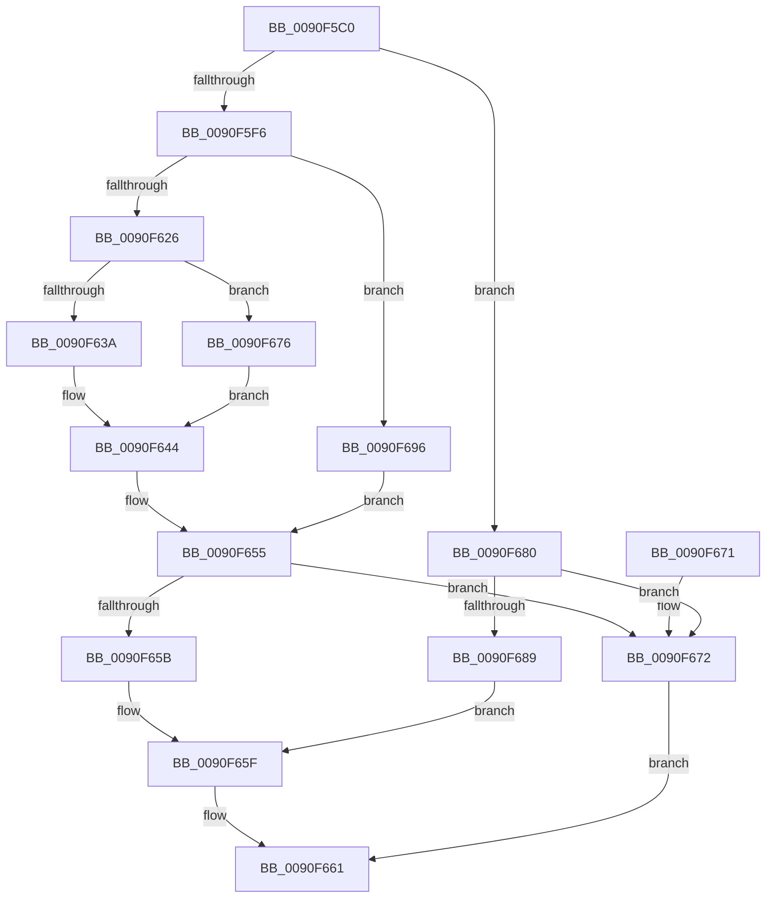

# RtlIsValidOemCharacter

- RVA: `0x0090F5C0`–`0x0090F6B3` (길이 `243` bytes)
- VA: `0x000000014090F5C0`
- 실행 섹션: `PAGE`
- PDB 이름 있음: `예`; PDB Function 태그: `아니요`
- unwind 정보 RVA: `0x00089944`
- 디코드: `64`개 명령, `243/243` bytes 표시
- 미해석 바이트: `0` (있으면 어셈블리에 `.byte`로 보존)

> 이 문서는 커널 이미지의 기계어와 PDB 기호를 분석해 생성했습니다. 4번과 5번은 함수 원형과 자료형을 바이너리 사용 방식에서 추정한 C 해석이며 원본 소스 복구 결과는 아닙니다.

## 1. Dependencies

- 직접 호출 지점: **5**; 고유 호출 대상: **3**
- 직접 호출자로 확인된 함수: **1**
- RIP 상대 이미지 참조: **0**

### Outgoing calls
- `0x0090F5D4` → [RtlpIsUtf8Process](RtlpIsUtf8Process_function_0090DB60.md) (function, `0x0090DB60`)
- `0x0090F5E1` → [PsGetCurrentServerSiloGlobals](../../text/2F/PsGetCurrentServerSiloGlobals_function_002FE1F0.md) (function, `0x002FE1F0`)
- `0x0090F647` → [NLS_UPCASE](../../text/3F/NLS_UPCASE_function_003FF700.md) (function, `0x003FF700`)
- `0x0090F68C` → [NLS_UPCASE](../../text/3F/NLS_UPCASE_function_003FF700.md) (function, `0x003FF700`)
- `0x0090F6A3` → [NLS_UPCASE](../../text/3F/NLS_UPCASE_function_003FF700.md) (function, `0x003FF700`)

### Direct callers
- [RtlGenerate8dot3Name](RtlGenerate8dot3Name_function_0090E950.md) at `0x0090ECFC`
- [RtlGenerate8dot3Name](RtlGenerate8dot3Name_function_0090E950.md) at `0x0090EDDE`
- [RtlGenerate8dot3Name](RtlGenerate8dot3Name_function_0090E950.md) at `0x0090EE50`

### Static image references
- 디코드된 RIP-relative 메모리 참조가 없습니다.

## 2. Other-region calls and transfers

- 다른 실행 섹션으로 향하는 call: **4**
  - `0x0090F5E1` → [PsGetCurrentServerSiloGlobals](../../text/2F/PsGetCurrentServerSiloGlobals_function_002FE1F0.md) (`PAGE` → `.text`)
  - `0x0090F647` → [NLS_UPCASE](../../text/3F/NLS_UPCASE_function_003FF700.md) (`PAGE` → `.text`)
  - `0x0090F68C` → [NLS_UPCASE](../../text/3F/NLS_UPCASE_function_003FF700.md) (`PAGE` → `.text`)
  - `0x0090F6A3` → [NLS_UPCASE](../../text/3F/NLS_UPCASE_function_003FF700.md) (`PAGE` → `.text`)
- 별도 외부 분기/꼬리 이동을 확인하지 못했습니다.

## 3. Assembly (complete function range)

```asm
0090F5C0  48 89 5C 24 08                  mov qword ptr [rsp + 8], rbx
0090F5C5  48 89 74 24 10                  mov qword ptr [rsp + 0x10], rsi
0090F5CA  57                              push rdi
0090F5CB  48 83 EC 20                     sub rsp, 0x20
0090F5CF  48 8B D9                        mov rbx, rcx
0090F5D2  B1 01                           mov cl, 1
0090F5D4  E8 87 E5 FF FF                  call 0x14090db60
0090F5D9  8A D0                           mov dl, al
0090F5DB  33 F6                           xor esi, esi
0090F5DD  F0 09 34 24                     lock or dword ptr [rsp], esi
0090F5E1  E8 0A EC 9E FF                  call 0x1402fe1f0
0090F5E6  4C 8B 80 B0 04 00 00            mov r8, qword ptr [rax + 0x4b0]
0090F5ED  80 FA 01                        cmp dl, 1
0090F5F0  0F 84 8A 00 00 00               je 0x14090f680
0090F5F6  48 8B B8 80 04 00 00            mov rdi, qword ptr [rax + 0x480]
0090F5FD  4C 8B 88 68 04 00 00            mov r9, qword ptr [rax + 0x468]
0090F604  4C 8B 90 70 04 00 00            mov r10, qword ptr [rax + 0x470]
0090F60B  48 8B 90 A0 04 00 00            mov rdx, qword ptr [rax + 0x4a0]
0090F612  44 0F B7 98 4C 04 00 00         movzx r11d, word ptr [rax + 0x44c]
0090F61A  0F B7 0B                        movzx ecx, word ptr [rbx]
0090F61D  66 39 B0 54 04 00 00            cmp word ptr [rax + 0x454], si
0090F624  74 70                           je 0x14090f696
0090F626  41 0F B7 0C 4A                  movzx ecx, word ptr [r10 + rcx*2]
0090F62B  8B C1                           mov eax, ecx
0090F62D  48 C1 E8 08                     shr rax, 8
0090F631  0F B7 14 42                     movzx edx, word ptr [rdx + rax*2]
0090F635  66 85 D2                        test dx, dx
0090F638  74 3C                           je 0x14090f676
0090F63A  0F B6 C9                        movzx ecx, cl
0090F63D  48 03 CA                        add rcx, rdx
0090F640  0F B7 14 4F                     movzx edx, word ptr [rdi + rcx*2]
0090F644  49 8B C8                        mov rcx, r8
0090F647  E8 B4 00 AF FF                  call 0x1403ff700
0090F64C  44 0F B7 C8                     movzx r9d, ax
0090F650  43 0F B7 04 4A                  movzx eax, word ptr [r10 + r9*2]
0090F655  66 41 3B C3                     cmp ax, r11w
0090F659  74 17                           je 0x14090f672
0090F65B  66 44 89 0B                     mov word ptr [rbx], r9w
0090F65F  B0 01                           mov al, 1
0090F661  48 8B 5C 24 30                  mov rbx, qword ptr [rsp + 0x30]
0090F666  48 8B 74 24 38                  mov rsi, qword ptr [rsp + 0x38]
0090F66B  48 83 C4 20                     add rsp, 0x20
0090F66F  5F                              pop rdi
0090F670  C3                              ret
0090F671  CC                              int3
0090F672  32 C0                           xor al, al
0090F674  EB EB                           jmp 0x14090f661
0090F676  0F B6 C1                        movzx eax, cl
0090F679  41 0F B7 14 41                  movzx edx, word ptr [r9 + rax*2]
0090F67E  EB C4                           jmp 0x14090f644
0090F680  0F B7 13                        movzx edx, word ptr [rbx]
0090F683  66 83 FA 7F                     cmp dx, 0x7f
0090F687  77 E9                           ja 0x14090f672
0090F689  49 8B C8                        mov rcx, r8
0090F68C  E8 6F 00 AF FF                  call 0x1403ff700
0090F691  66 89 03                        mov word ptr [rbx], ax
0090F694  EB C9                           jmp 0x14090f65f
0090F696  42 0F B6 14 11                  movzx edx, byte ptr [rcx + r10]
0090F69B  49 8B C8                        mov rcx, r8
0090F69E  41 0F B7 14 51                  movzx edx, word ptr [r9 + rdx*2]
0090F6A3  E8 58 00 AF FF                  call 0x1403ff700
0090F6A8  44 0F B7 C8                     movzx r9d, ax
0090F6AC  43 0F BE 04 11                  movsx eax, byte ptr [r9 + r10]
0090F6B1  EB A2                           jmp 0x14090f655
```

## 4. C-style interpretation (structured pseudocode)

```c
__int64 __fastcall RtlIsValidOemCharacter(__int64 a1)
{
    __int64 result;
    __int64 v_rsi;
    __int64 v_rsp;
    unsigned int v_stack_m28;
    unsigned __int64 v_stack_p10;
    unsigned __int64 v_stack_p8;

    v_stack_p8 = v_rbx;
    v_stack_p10 = v_rsi;
    v_rsp = (v_rsp) - (32);
    result = RtlpIsUtf8Process(1, a2, a3, a4);
    v_rsi = 0;
    result = PsGetCurrentServerSiloGlobals(1, (unsigned __int8)(result), a3, a4);
    if (((unsigned __int8)((unsigned __int8)(result))) == 1) goto loc_0090F680;
    if ((*(unsigned __int16 *)(result + 1108)) == 0) goto loc_0090F696;
    result = ((unsigned int)((unsigned int)(*(unsigned __int16 *)(*(unsigned __int64 *)(result + 1136) + *(unsigned __int16 *)(a1) * 2)))) >> (8);
    if ((unsigned __int16)(*(unsigned __int16 *)(*(unsigned __int64 *)(result + 1184) + result * 2)) == 0) goto loc_0090F676;
    a1 = ((unsigned __int8)(*(unsigned __int16 *)(*(unsigned __int64 *)(result + 1136) + *(unsigned __int16 *)(a1) * 2))) + (*(unsigned __int16 *)(*(unsigned __int64 *)(result + 1184) + result * 2));
loc_0090F644:
    result = NLS_UPCASE(*(unsigned __int64 *)(result + 1200), *(unsigned __int16 *)(*(unsigned __int64 *)(result + 1152) + a1 * 2), *(unsigned __int64 *)(result + 1200), *(unsigned __int64 *)(result + 1128));
loc_0090F655:
    if (((unsigned __int16)(*(unsigned __int16 *)(*(unsigned __int64 *)(result + 1136) + (unsigned __int16)(result) * 2))) == ((unsigned __int16)(*(unsigned __int16 *)(result + 1100)))) goto loc_0090F672;
    *(unsigned __int16 *)(a1) = (unsigned __int16)((unsigned __int16)(result));
loc_0090F65F:
loc_0090F661:
    v_rsp = (v_rsp) + (32);
    return 1;
loc_0090F672:
    result = 0;
    goto loc_0090F661;
loc_0090F676:
    goto loc_0090F644;
loc_0090F680:
    if (((unsigned __int16)(*(unsigned __int16 *)(v_stack_p8))) > 127) goto loc_0090F672;
    result = NLS_UPCASE(*(unsigned __int64 *)(result + 1200), *(unsigned __int16 *)(v_stack_p8), *(unsigned __int64 *)(result + 1200), (unsigned __int16)(result));
    *(unsigned __int16 *)(v_stack_p8) = (unsigned __int16)(result);
    goto loc_0090F65F;
loc_0090F696:
    result = NLS_UPCASE(*(unsigned __int64 *)(result + 1200), *(unsigned __int16 *)((unsigned __int16)(result) + *(unsigned __int8 *)(*(unsigned __int64 *)(result + 1200) + *(unsigned __int64 *)(result + 1136) * 1) * 2), *(unsigned __int64 *)(result + 1200), (unsigned __int16)(result));
    goto loc_0090F655;
}
```

## 5. (Beta) C Style

```c
int64_t RtlIsValidOemCharacter(void *Arg1)
{
    uint8_t *arg1 = (uint8_t *)Arg1;

    int64_t result;
    int64_t local_rsi;
    int64_t local_rsp;
    uint32_t v_stack_m28;
    uint64_t v_stack_p10;
    uint64_t v_stack_p8;

    v_stack_p8 = local_rbx;
    v_stack_p10 = local_rsi;
    local_rsp = (local_rsp) - (32);
    result = RtlpIsUtf8Process(1, a2, a3, a4);
    local_rsi = 0;
    result = PsGetCurrentServerSiloGlobals(1, (uint8_t)(result), a3, a4);
    if (((uint8_t)((uint8_t)(result))) == 1) goto loc_0090F680;
    if ((*(uint16_t *)(result + 0x454)) == 0) goto loc_0090F696;
    result = ((uint32_t)((uint32_t)(*(uint16_t *)(*(uint64_t *)(result + 0x470) + *(uint16_t *)(arg1) * 2)))) >> (8);
    if ((uint16_t)(*(uint16_t *)(*(uint64_t *)(result + 0x4A0) + result * 2)) == 0) goto loc_0090F676;
    Arg1 = ((uint8_t)(*(uint16_t *)(*(uint64_t *)(result + 0x470) + *(uint16_t *)(arg1) * 2))) + (*(uint16_t *)(*(uint64_t *)(result + 0x4A0) + result * 2));
loc_0090F644:
    result = NLS_UPCASE(*(uint64_t *)(result + 0x4B0), *(uint16_t *)(*(uint64_t *)(result + 0x480) + arg1 * 2), *(uint64_t *)(result + 0x4B0), *(uint64_t *)(result + 0x468));
loc_0090F655:
    if (((uint16_t)(*(uint16_t *)(*(uint64_t *)(result + 0x470) + (uint16_t)(result) * 2))) == ((uint16_t)(*(uint16_t *)(result + 0x44C)))) goto loc_0090F672;
    *(uint16_t *)(arg1) = (uint16_t)((uint16_t)(result));
loc_0090F65F:
loc_0090F661:
    local_rsp = (local_rsp) + (32);
    return 1;
loc_0090F672:
    result = 0;
    goto loc_0090F661;
loc_0090F676:
    goto loc_0090F644;
loc_0090F680:
    if (((uint16_t)(*(uint16_t *)(v_stack_p8))) > 127) goto loc_0090F672;
    result = NLS_UPCASE(*(uint64_t *)(result + 0x4B0), *(uint16_t *)(v_stack_p8), *(uint64_t *)(result + 0x4B0), (uint16_t)(result));
    *(uint16_t *)(v_stack_p8) = (uint16_t)(result);
    goto loc_0090F65F;
loc_0090F696:
    result = NLS_UPCASE(*(uint64_t *)(result + 0x4B0), *(uint16_t *)((uint16_t)(result) + *(uint8_t *)(*(uint64_t *)(result + 0x4B0) + *(uint64_t *)(result + 0x470) * 1) * 2), *(uint64_t *)(result + 0x4B0), (uint16_t)(result));
    goto loc_0090F655;
}
```

### 관측된 메모리 오프셋

구조체 형식이 확인되지 않은 접근은 인자 기준의 오프셋으로만 기록했습니다.

| 기준 인자 | 오프셋 표현 | 폭 (bit) | 접근 |
|---|---:|---:|---|
| `Arg1` | `+ 0x0` | `16` | `R` |
| `Arg1` | `+ 0x0` | `16` | `W` |

## 6. Execution-region graph

[열기: 2D/3D 그래프와 함수 탐색 컨트롤 패널](../../../control-panel.html?section=page&rva=0x0090F5C0&view=graph)

- 2D 그래프는 위에서 아래로 흐르고, 3D 그래프는 빈 공간을 드래그해 회전합니다. Shift+드래그는 이동, 휠은 확대·축소, 함수 노드 선택은 대상 보고서 이동입니다.

### Static fallback


