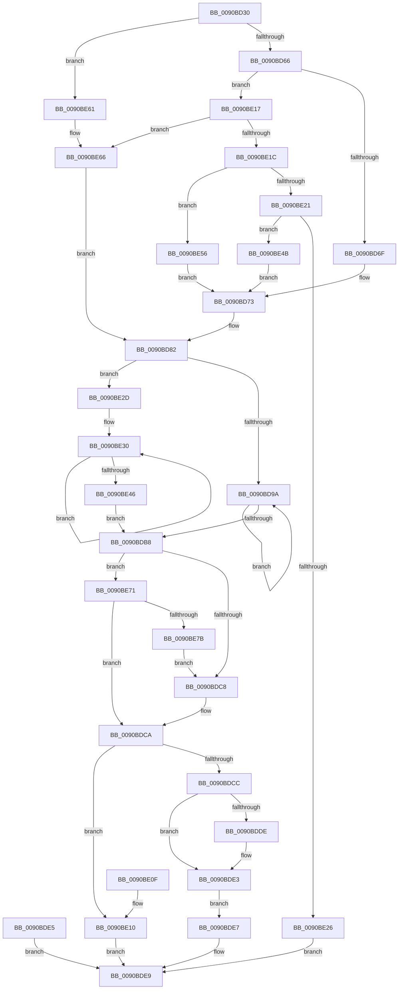

# RtlLargeIntegerToChar

- RVA: `0x0090BD30`–`0x0090BE96` (길이 `358` bytes)
- VA: `0x000000014090BD30`
- 실행 섹션: `PAGE`
- PDB 이름 있음: `예`; PDB Function 태그: `아니요`
- unwind 정보 RVA: `0x000891F8`
- 디코드: `104`개 명령, `358/358` bytes 표시
- 미해석 바이트: `0` (있으면 어셈블리에 `.byte`로 보존)

> 이 문서는 커널 이미지의 기계어와 PDB 기호를 분석해 생성했습니다. 4번과 5번은 함수 원형과 자료형을 바이너리 사용 방식에서 추정한 C 해석이며 원본 소스 복구 결과는 아닙니다.

## 1. Dependencies

- 직접 호출 지점: **3**; 고유 호출 대상: **3**
- 직접 호출자로 확인된 함수: **2**
- RIP 상대 이미지 참조: **2**

### Outgoing calls
- `0x0090BDD5` → [memcpy](../../text/6C/memcpy_function_006C6840.md) (function, `0x006C6840`)
- `0x0090BDF1` → [_security_check_cookie](../../text/6A/_security_check_cookie_function_006AC640.md) (function, `0x006AC640`)
- `0x0090BE87` → [memset](../../text/6C/memset_function_006C6C40.md) (function, `0x006C6C40`)

### Direct callers
- [RtlInt64ToUnicodeString](../8B/RtlInt64ToUnicodeString_function_008BDDE0.md) at `0x008BDE1D`
- [ExpWnfWriteStateData](ExpWnfWriteStateData_function_0090B7B0.md) at `0x0090B868`

### Static image references
- `0x0090BD46` → RVA `0x00E0A740` (`.data`; read)
- `0x0090BD8A` → RVA `0x00B4B0D0` (`RtlpIntegerChars`; read)

## 2. Other-region calls and transfers

- 다른 실행 섹션으로 향하는 call: **3**
  - `0x0090BDD5` → [memcpy](../../text/6C/memcpy_function_006C6840.md) (`PAGE` → `.text`)
  - `0x0090BDF1` → [_security_check_cookie](../../text/6A/_security_check_cookie_function_006AC640.md) (`PAGE` → `.text`)
  - `0x0090BE87` → [memset](../../text/6C/memset_function_006C6C40.md) (`PAGE` → `.text`)
- 별도 외부 분기/꼬리 이동을 확인하지 못했습니다.

## 3. Assembly (complete function range)

```asm
0090BD30  48 89 5C 24 10                  mov qword ptr [rsp + 0x10], rbx
0090BD35  48 89 74 24 18                  mov qword ptr [rsp + 0x18], rsi
0090BD3A  57                              push rdi
0090BD3B  41 56                           push r14
0090BD3D  41 57                           push r15
0090BD3F  48 81 EC 80 00 00 00            sub rsp, 0x80
0090BD46  48 8B 05 F3 E9 4F 00            mov rax, qword ptr [rip + 0x4fe9f3]
0090BD4D  48 33 C4                        xor rax, rsp
0090BD50  48 89 44 24 70                  mov qword ptr [rsp + 0x70], rax
0090BD55  4D 8B F9                        mov r15, r9
0090BD58  41 8B F8                        mov edi, r8d
0090BD5B  48 8B C1                        mov rax, rcx
0090BD5E  85 D2                           test edx, edx
0090BD60  0F 84 FB 00 00 00               je 0x14090be61
0090BD66  83 FA 10                        cmp edx, 0x10
0090BD69  0F 85 A8 00 00 00               jne 0x14090be17
0090BD6F  44 8D 4A F4                     lea r9d, [rdx - 0xc]
0090BD73  41 8B C9                        mov ecx, r9d
0090BD76  41 BA 01 00 00 00               mov r10d, 1
0090BD7C  41 D3 E2                        shl r10d, cl
0090BD7F  41 FF CA                        dec r10d
0090BD82  4C 8D 74 24 61                  lea r14, [rsp + 0x61]
0090BD87  48 8B 00                        mov rax, qword ptr [rax]
0090BD8A  4C 8D 1D 3F F3 23 00            lea r11, [rip + 0x23f33f]
0090BD91  45 85 C9                        test r9d, r9d
0090BD94  0F 84 93 00 00 00               je 0x14090be2d
0090BD9A  44 8B C0                        mov r8d, eax
0090BD9D  41 8B C9                        mov ecx, r9d
0090BDA0  48 D3 E8                        shr rax, cl
0090BDA3  49 FF CE                        dec r14
0090BDA6  41 8B CA                        mov ecx, r10d
0090BDA9  4C 23 C1                        and r8, rcx
0090BDAC  43 8A 0C 18                     mov cl, byte ptr [r8 + r11]
0090BDB0  41 88 0E                        mov byte ptr [r14], cl
0090BDB3  48 85 C0                        test rax, rax
0090BDB6  75 E2                           jne 0x14090bd9a
0090BDB8  48 8D 74 24 61                  lea rsi, [rsp + 0x61]
0090BDBD  41 2B F6                        sub esi, r14d
0090BDC0  85 FF                           test edi, edi
0090BDC2  0F 88 A9 00 00 00               js 0x14090be71
0090BDC8  3B F7                           cmp esi, edi
0090BDCA  7F 44                           jg 0x14090be10
0090BDCC  44 8B C6                        mov r8d, esi
0090BDCF  49 8B D6                        mov rdx, r14
0090BDD2  49 8B CF                        mov rcx, r15
0090BDD5  E8 66 AA DB FF                  call 0x1406c6840
0090BDDA  3B F7                           cmp esi, edi
0090BDDC  7D 05                           jge 0x14090bde3
0090BDDE  42 C6 04 3E 00                  mov byte ptr [rsi + r15], 0
0090BDE3  EB 02                           jmp 0x14090bde7
0090BDE5  EB 02                           jmp 0x14090bde9
0090BDE7  33 C0                           xor eax, eax
0090BDE9  48 8B 4C 24 70                  mov rcx, qword ptr [rsp + 0x70]
0090BDEE  48 33 CC                        xor rcx, rsp
0090BDF1  E8 4A 08 DA FF                  call 0x1406ac640
0090BDF6  4C 8D 9C 24 80 00 00 00         lea r11, [rsp + 0x80]
0090BDFE  49 8B 5B 28                     mov rbx, qword ptr [r11 + 0x28]
0090BE02  49 8B 73 30                     mov rsi, qword ptr [r11 + 0x30]
0090BE06  49 8B E3                        mov rsp, r11
0090BE09  41 5F                           pop r15
0090BE0B  41 5E                           pop r14
0090BE0D  5F                              pop rdi
0090BE0E  C3                              ret
0090BE0F  CC                              int3
0090BE10  B8 05 00 00 80                  mov eax, 0x80000005
0090BE15  EB D2                           jmp 0x14090bde9
0090BE17  83 FA 0A                        cmp edx, 0xa
0090BE1A  74 4A                           je 0x14090be66
0090BE1C  83 FA 02                        cmp edx, 2
0090BE1F  74 35                           je 0x14090be56
0090BE21  83 FA 08                        cmp edx, 8
0090BE24  74 25                           je 0x14090be4b
0090BE26  B8 0D 00 00 C0                  mov eax, 0xc000000d
0090BE2B  EB BC                           jmp 0x14090bde9
0090BE2D  44 8B C2                        mov r8d, edx
0090BE30  33 D2                           xor edx, edx
0090BE32  49 F7 F0                        div r8
0090BE35  49 FF CE                        dec r14
0090BE38  8B CA                           mov ecx, edx
0090BE3A  42 8A 0C 19                     mov cl, byte ptr [rcx + r11]
0090BE3E  41 88 0E                        mov byte ptr [r14], cl
0090BE41  48 85 C0                        test rax, rax
0090BE44  75 EA                           jne 0x14090be30
0090BE46  E9 6D FF FF FF                  jmp 0x14090bdb8
0090BE4B  41 B9 03 00 00 00               mov r9d, 3
0090BE51  E9 1D FF FF FF                  jmp 0x14090bd73
0090BE56  41 B9 01 00 00 00               mov r9d, 1
0090BE5C  E9 12 FF FF FF                  jmp 0x14090bd73
0090BE61  BA 0A 00 00 00                  mov edx, 0xa
0090BE66  45 33 C9                        xor r9d, r9d
0090BE69  45 33 D2                        xor r10d, r10d
0090BE6C  E9 11 FF FF FF                  jmp 0x14090bd82
0090BE71  F7 DF                           neg edi
0090BE73  3B F7                           cmp esi, edi
0090BE75  0F 8D 4F FF FF FF               jge 0x14090bdca
0090BE7B  2B FE                           sub edi, esi
0090BE7D  8B DF                           mov ebx, edi
0090BE7F  44 8B C7                        mov r8d, edi
0090BE82  B2 30                           mov dl, 0x30
0090BE84  49 8B CF                        mov rcx, r15
0090BE87  E8 B4 AD DB FF                  call 0x1406c6c40
0090BE8C  8B FE                           mov edi, esi
0090BE8E  4C 03 FB                        add r15, rbx
0090BE91  E9 32 FF FF FF                  jmp 0x14090bdc8
```

## 4. C-style interpretation (structured pseudocode)

```c
__int64 __fastcall RtlLargeIntegerToChar(__int64 a1, __int64 a2, int a3, __int64 a4)
{
    __int64 result;
    __int64 v_r10;
    __int64 v_r14;
    __int64 v_r15;
    __int64 v_rdi;
    __int64 v_rsi;
    __int64 v_rsp;
    unsigned __int64 v_stack_m18;
    unsigned __int64 v_stack_m28;
    unsigned __int64 v_stack_m37;
    unsigned __int64 v_stack_p10;
    unsigned __int64 v_stack_p18;

    v_stack_p10 = v_rbx;
    v_stack_p18 = v_rsi;
    v_rsp = (v_rsp) - (128);
    result = (*(unsigned __int64 *)(v_rip + 5237235)) ^ (v_rsp);
    v_stack_m28 = result;
    if ((unsigned int)(a2) == 0) goto loc_0090BE61;
    if (((unsigned int)(a2)) != 16) goto loc_0090BE17;
loc_0090BD73:
    v_r10 = (unsigned int)((1) << ((unsigned __int8)((unsigned int)((unsigned int)(a2 - 12)))));
    v_r10 = (unsigned int)((v_r10) - 1);
loc_0090BD82:
    if ((unsigned int)(a2 - 12) == 0) goto loc_0090BE2D;
loc_0090BD9A:
    result = (*(unsigned __int64 *)(a1)) >> ((unsigned __int8)((unsigned int)((unsigned int)(a2 - 12))));
    v_r14 = (v_stack_m37) - 1;
    a3 = ((unsigned int)((unsigned int)(*(unsigned __int64 *)(a1)))) & ((unsigned int)((unsigned int)(v_r10)));
    *(unsigned __int8 *)(v_r14) = (unsigned __int8)(*(unsigned __int8 *)(a3 + v_rip + 2356031 * 1));
    if (result != 0) goto loc_0090BD9A;
loc_0090BDB8:
    v_rsi = (unsigned int)((v_stack_m37) - ((unsigned int)(v_r14)));
    if (sign_flag) goto loc_0090BE71;
loc_0090BDC8:
loc_0090BDCA:
    if (((unsigned int)(v_rsi)) > ((unsigned int)((unsigned int)(a3)))) goto loc_0090BE10;
    result = memcpy(a4, v_r14, (unsigned int)((unsigned int)(v_rsi)), a2 - 12);
    if (((unsigned int)(v_rsi)) < ((unsigned int)((unsigned int)(a3)))) {
        *(unsigned __int8 *)(v_rsi + a4 * 1) = 0;
    }
    goto loc_0090BDE7;
loc_0090BDE7:
    result = 0;
loc_0090BDE9:
    a1 = (v_stack_m28) ^ (v_rsp);
    result = _security_check_cookie(a1, v_r14, (unsigned int)((unsigned int)(v_rsi)), a2 - 12);
    return result;
loc_0090BE10:
    goto loc_0090BDE9;
loc_0090BE17:
    if (((unsigned int)(v_r14)) == 10) goto loc_0090BE66;
    if (((unsigned int)(v_r14)) == 2) goto loc_0090BE56;
    if (((unsigned int)(v_r14)) == 8) goto loc_0090BE4B;
    goto loc_0090BDE9;
loc_0090BE2D:
loc_0090BE30:
    a2 = 0;
    v_r14 = (v_r14) - 1;
    *(unsigned __int8 *)(v_r14) = (unsigned __int8)(*(unsigned __int8 *)(0 + v_stack_m18 * 1));
    if ((unsigned int)(0xC000000DULL) != 0) goto loc_0090BE30;
    goto loc_0090BDB8;
loc_0090BE4B:
    goto loc_0090BD73;
loc_0090BE56:
    goto loc_0090BD73;
loc_0090BE61:
loc_0090BE66:
    a4 = 0;
    v_r10 = 0;
    goto loc_0090BD82;
loc_0090BE71:
    v_rdi = (unsigned int)(-((unsigned int)(a3)));
    if (((unsigned int)(*(unsigned __int64 *)(v_stack_m18 + 48))) >= ((unsigned int)(v_rdi))) goto loc_0090BDCA;
    v_rdi = (unsigned int)((v_rdi) - ((unsigned int)(*(unsigned __int64 *)(v_stack_m18 + 48))));
    result = memset(0, 48, (unsigned int)((unsigned int)(v_rdi)), a4);
    v_r15 = (a4) + ((unsigned int)((unsigned int)(v_rdi)));
    goto loc_0090BDC8;
}
```

## 5. (Beta) C Style

```c
int64_t RtlLargeIntegerToChar(void *Arg1, int64_t Arg2, int32_t Arg3, int64_t Arg4)
{
    uint8_t *arg1 = (uint8_t *)Arg1;

    int64_t result;
    int64_t local_r10;
    int64_t local_r14;
    int64_t local_r15;
    int64_t local_rdi;
    int64_t local_rsi;
    int64_t local_rsp;
    uint64_t v_stack_m18;
    uint64_t v_stack_m28;
    uint64_t v_stack_m37;
    uint64_t v_stack_p10;
    uint64_t v_stack_p18;

    v_stack_p10 = local_rbx;
    v_stack_p18 = local_rsi;
    local_rsp = (local_rsp) - (128);
    result = (*(uint64_t *)(v_rip + 0x4FE9F3)) ^ (local_rsp);
    v_stack_m28 = result;
    if ((uint32_t)(Arg2) == 0) goto loc_0090BE61;
    if (((uint32_t)(Arg2)) != 16) goto loc_0090BE17;
loc_0090BD73:
    local_r10 = (uint32_t)((1) << ((uint8_t)((uint32_t)((uint32_t)(Arg2 - 12)))));
    local_r10 = (uint32_t)((local_r10) - 1);
loc_0090BD82:
    if ((uint32_t)(Arg2 - 12) == 0) goto loc_0090BE2D;
loc_0090BD9A:
    result = (*(uint64_t *)(arg1)) >> ((uint8_t)((uint32_t)((uint32_t)(Arg2 - 12))));
    local_r14 = (v_stack_m37) - 1;
    Arg3 = ((uint32_t)((uint32_t)(*(uint64_t *)(arg1)))) & ((uint32_t)((uint32_t)(local_r10)));
    *(uint8_t *)(local_r14) = (uint8_t)(*(uint8_t *)(Arg3 + v_rip + 0x23F33F * 1));
    if (result != 0) goto loc_0090BD9A;
loc_0090BDB8:
    local_rsi = (uint32_t)((v_stack_m37) - ((uint32_t)(local_r14)));
    if (sign_flag) goto loc_0090BE71;
loc_0090BDC8:
loc_0090BDCA:
    if (((uint32_t)(local_rsi)) > ((uint32_t)((uint32_t)(Arg3)))) goto loc_0090BE10;
    result = memcpy(Arg4, local_r14, (uint32_t)((uint32_t)(local_rsi)), Arg2 - 12);
    if (((uint32_t)(local_rsi)) < ((uint32_t)((uint32_t)(Arg3)))) {
        *(uint8_t *)(local_rsi + Arg4 * 1) = 0;
    }
    goto loc_0090BDE7;
loc_0090BDE7:
    result = 0;
loc_0090BDE9:
    Arg1 = (v_stack_m28) ^ (local_rsp);
    result = _security_check_cookie(Arg1, local_r14, (uint32_t)((uint32_t)(local_rsi)), Arg2 - 12);
    return result;
loc_0090BE10:
    goto loc_0090BDE9;
loc_0090BE17:
    if (((uint32_t)(local_r14)) == 10) goto loc_0090BE66;
    if (((uint32_t)(local_r14)) == 2) goto loc_0090BE56;
    if (((uint32_t)(local_r14)) == 8) goto loc_0090BE4B;
    goto loc_0090BDE9;
loc_0090BE2D:
loc_0090BE30:
    Arg2 = 0;
    local_r14 = (local_r14) - 1;
    *(uint8_t *)(local_r14) = (uint8_t)(*(uint8_t *)(0 + v_stack_m18 * 1));
    if ((uint32_t)(0xC000000DULL) != 0) goto loc_0090BE30;
    goto loc_0090BDB8;
loc_0090BE4B:
    goto loc_0090BD73;
loc_0090BE56:
    goto loc_0090BD73;
loc_0090BE61:
loc_0090BE66:
    Arg4 = 0;
    local_r10 = 0;
    goto loc_0090BD82;
loc_0090BE71:
    local_rdi = (uint32_t)(-((uint32_t)(Arg3)));
    if (((uint32_t)(*(uint64_t *)(v_stack_m18 + 0x30))) >= ((uint32_t)(local_rdi))) goto loc_0090BDCA;
    local_rdi = (uint32_t)((local_rdi) - ((uint32_t)(*(uint64_t *)(v_stack_m18 + 0x30))));
    result = memset(0, 48, (uint32_t)((uint32_t)(local_rdi)), Arg4);
    local_r15 = (Arg4) + ((uint32_t)((uint32_t)(local_rdi)));
    goto loc_0090BDC8;
}
```

### 관측된 메모리 오프셋

구조체 형식이 확인되지 않은 접근은 인자 기준의 오프셋으로만 기록했습니다.

| 기준 인자 | 오프셋 표현 | 폭 (bit) | 접근 |
|---|---:|---:|---|
| `Arg1` | `+ 0x0` | `64` | `R` |

## 6. Execution-region graph

[열기: 2D/3D 그래프와 함수 탐색 컨트롤 패널](../../../control-panel.html?section=page&rva=0x0090BD30&view=graph)

- 2D 그래프는 위에서 아래로 흐르고, 3D 그래프는 빈 공간을 드래그해 회전합니다. Shift+드래그는 이동, 휠은 확대·축소, 함수 노드 선택은 대상 보고서 이동입니다.

### Static fallback


