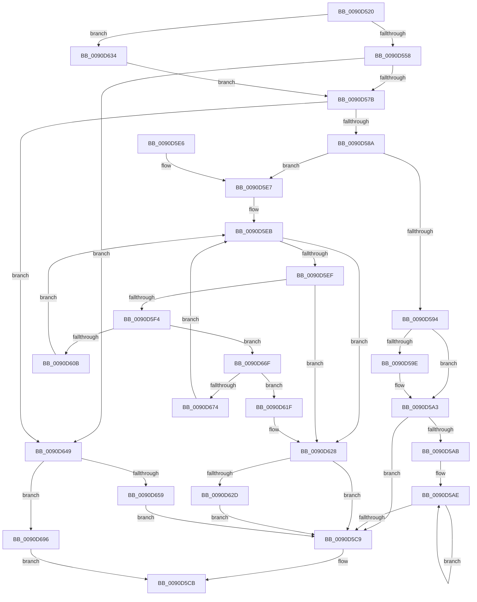

# RtlMultiByteToUnicodeN

- RVA: `0x0090D520`–`0x0090D6A0` (길이 `384` bytes)
- VA: `0x000000014090D520`
- 실행 섹션: `PAGE`
- PDB 이름 있음: `예`; PDB Function 태그: `아니요`
- unwind 정보 RVA: `0x0008941C`
- 디코드: `111`개 명령, `384/384` bytes 표시
- 미해석 바이트: `0` (있으면 어셈블리에 `.byte`로 보존)

> 이 문서는 커널 이미지의 기계어와 PDB 기호를 분석해 생성했습니다. 4번과 5번은 함수 원형과 자료형을 바이너리 사용 방식에서 추정한 C 해석이며 원본 소스 복구 결과는 아닙니다.

## 1. Dependencies

- 직접 호출 지점: **3**; 고유 호출 대상: **3**
- 직접 호출자로 확인된 함수: **1**
- RIP 상대 이미지 참조: **1**

### Outgoing calls
- `0x0090D54B` → [RtlpIsUtf8Process](RtlpIsUtf8Process_function_0090DB60.md) (function, `0x0090DB60`)
- `0x0090D55D` → [PsGetCurrentServerSiloGlobals](../../text/2F/PsGetCurrentServerSiloGlobals_function_002FE1F0.md) (function, `0x002FE1F0`)
- `0x0090D665` → [RtlUTF8ToUnicodeN](RtlUTF8ToUnicodeN_function_0090E060.md) (function, `0x0090E060`)

### Direct callers
- [mbstowcs](../../text/50/mbstowcs_function_00500820.md) at `0x00500881`

### Static image references
- `0x0090D634` → RVA `0x00FD8720` (`PAGEDATA`; read)

## 2. Other-region calls and transfers

- 다른 실행 섹션으로 향하는 call: **1**
  - `0x0090D55D` → [PsGetCurrentServerSiloGlobals](../../text/2F/PsGetCurrentServerSiloGlobals_function_002FE1F0.md) (`PAGE` → `.text`)
- 별도 외부 분기/꼬리 이동을 확인하지 못했습니다.

## 3. Assembly (complete function range)

```asm
0090D520  48 89 5C 24 08                  mov qword ptr [rsp + 8], rbx
0090D525  48 89 6C 24 10                  mov qword ptr [rsp + 0x10], rbp
0090D52A  48 89 74 24 18                  mov qword ptr [rsp + 0x18], rsi
0090D52F  48 89 7C 24 20                  mov qword ptr [rsp + 0x20], rdi
0090D534  41 56                           push r14
0090D536  48 83 EC 30                     sub rsp, 0x30
0090D53A  8B 5C 24 60                     mov ebx, dword ptr [rsp + 0x60]
0090D53E  4C 8B F1                        mov r14, rcx
0090D541  33 C9                           xor ecx, ecx
0090D543  49 8B E9                        mov rbp, r9
0090D546  49 8B F0                        mov rsi, r8
0090D549  8B FA                           mov edi, edx
0090D54B  E8 10 06 00 00                  call 0x14090db60
0090D550  84 C0                           test al, al
0090D552  0F 85 DC 00 00 00               jne 0x14090d634
0090D558  F0 83 0C 24 00                  lock or dword ptr [rsp], 0
0090D55D  E8 8E 0C 9F FF                  call 0x1402fe1f0
0090D562  4C 8B C0                        mov r8, rax
0090D565  44 8B D3                        mov r10d, ebx
0090D568  4C 8B CD                        mov r9, rbp
0090D56B  49 8B D6                        mov rdx, r14
0090D56E  49 81 C0 08 04 00 00            add r8, 0x408
0090D575  0F 84 CE 00 00 00               je 0x14090d649
0090D57B  B8 E9 FD 00 00                  mov eax, 0xfde9
0090D580  66 41 39 00                     cmp word ptr [r8], ax
0090D584  0F 84 BF 00 00 00               je 0x14090d649
0090D58A  D1 EF                           shr edi, 1
0090D58C  66 41 83 78 0C 00               cmp word ptr [r8 + 0xc], 0
0090D592  75 53                           jne 0x14090d5e7
0090D594  3B FB                           cmp edi, ebx
0090D596  0F 42 DF                        cmovb ebx, edi
0090D599  48 85 F6                        test rsi, rsi
0090D59C  74 05                           je 0x14090d5a3
0090D59E  8D 04 1B                        lea eax, [rbx + rbx]
0090D5A1  89 06                           mov dword ptr [rsi], eax
0090D5A3  49 8B 50 20                     mov rdx, qword ptr [r8 + 0x20]
0090D5A7  85 DB                           test ebx, ebx
0090D5A9  74 1E                           je 0x14090d5c9
0090D5AB  44 8B C3                        mov r8d, ebx
0090D5AE  0F B6 45 00                     movzx eax, byte ptr [rbp]
0090D5B2  4D 8D 76 02                     lea r14, [r14 + 2]
0090D5B6  48 8D 6D 01                     lea rbp, [rbp + 1]
0090D5BA  0F B7 0C 42                     movzx ecx, word ptr [rdx + rax*2]
0090D5BE  66 41 89 4E FE                  mov word ptr [r14 - 2], cx
0090D5C3  49 83 E8 01                     sub r8, 1
0090D5C7  75 E5                           jne 0x14090d5ae
0090D5C9  33 C0                           xor eax, eax
0090D5CB  48 8B 5C 24 40                  mov rbx, qword ptr [rsp + 0x40]
0090D5D0  48 8B 6C 24 48                  mov rbp, qword ptr [rsp + 0x48]
0090D5D5  48 8B 74 24 50                  mov rsi, qword ptr [rsp + 0x50]
0090D5DA  48 8B 7C 24 58                  mov rdi, qword ptr [rsp + 0x58]
0090D5DF  48 83 C4 30                     add rsp, 0x30
0090D5E3  41 5E                           pop r14
0090D5E5  C3                              ret
0090D5E6  CC                              int3
0090D5E7  4D 8B 58 38                     mov r11, qword ptr [r8 + 0x38]
0090D5EB  85 FF                           test edi, edi
0090D5ED  74 39                           je 0x14090d628
0090D5EF  45 85 D2                        test r10d, r10d
0090D5F2  74 34                           je 0x14090d628
0090D5F4  41 0F B6 01                     movzx eax, byte ptr [r9]
0090D5F8  FF CF                           dec edi
0090D5FA  41 FF CA                        dec r10d
0090D5FD  48 8D 0C 00                     lea rcx, [rax + rax]
0090D601  42 0F B7 04 19                  movzx eax, word ptr [rcx + r11]
0090D606  66 85 C0                        test ax, ax
0090D609  75 64                           jne 0x14090d66f
0090D60B  49 8B 40 20                     mov rax, qword ptr [r8 + 0x20]
0090D60F  0F B7 0C 01                     movzx ecx, word ptr [rcx + rax]
0090D613  66 89 0A                        mov word ptr [rdx], cx
0090D616  48 83 C2 02                     add rdx, 2
0090D61A  49 FF C1                        inc r9
0090D61D  EB CC                           jmp 0x14090d5eb
0090D61F  33 C0                           xor eax, eax
0090D621  66 89 02                        mov word ptr [rdx], ax
0090D624  48 83 C2 02                     add rdx, 2
0090D628  48 85 F6                        test rsi, rsi
0090D62B  74 9C                           je 0x14090d5c9
0090D62D  41 2B D6                        sub edx, r14d
0090D630  89 16                           mov dword ptr [rsi], edx
0090D632  EB 95                           jmp 0x14090d5c9
0090D634  4C 8D 05 E5 B0 6C 00            lea r8, [rip + 0x6cb0e5]
0090D63B  49 8B D6                        mov rdx, r14
0090D63E  44 8B D3                        mov r10d, ebx
0090D641  4C 8B CD                        mov r9, rbp
0090D644  E9 32 FF FF FF                  jmp 0x14090d57b
0090D649  48 85 F6                        test rsi, rsi
0090D64C  4C 8D 44 24 60                  lea r8, [rsp + 0x60]
0090D651  4C 0F 45 C6                     cmovne r8, rsi
0090D655  85 DB                           test ebx, ebx
0090D657  74 3D                           je 0x14090d696
0090D659  4C 8B CD                        mov r9, rbp
0090D65C  89 5C 24 20                     mov dword ptr [rsp + 0x20], ebx
0090D660  8B D7                           mov edx, edi
0090D662  49 8B CE                        mov rcx, r14
0090D665  E8 F6 09 00 00                  call 0x14090e060
0090D66A  E9 5A FF FF FF                  jmp 0x14090d5c9
0090D66F  45 85 D2                        test r10d, r10d
0090D672  74 AB                           je 0x14090d61f
0090D674  41 0F B6 49 01                  movzx ecx, byte ptr [r9 + 1]
0090D679  49 FF C1                        inc r9
0090D67C  48 03 C8                        add rcx, rax
0090D67F  41 FF CA                        dec r10d
0090D682  41 0F B7 04 4B                  movzx eax, word ptr [r11 + rcx*2]
0090D687  66 89 02                        mov word ptr [rdx], ax
0090D68A  48 83 C2 02                     add rdx, 2
0090D68E  49 FF C1                        inc r9
0090D691  E9 55 FF FF FF                  jmp 0x14090d5eb
0090D696  33 C0                           xor eax, eax
0090D698  41 89 00                        mov dword ptr [r8], eax
0090D69B  E9 2B FF FF FF                  jmp 0x14090d5cb
```

## 4. C-style interpretation (structured pseudocode)

```c
__int64 __fastcall RtlMultiByteToUnicodeN(__int64 a1, int a2, __int64 a3, __int64 a4, unsigned int a5)
{
    __int64 result;
    __int64 v_r10;
    __int64 v_rbx;
    __int64 v_rdi;
    __int64 v_rsp;
    unsigned int v_stack_m38;
    unsigned __int64 v_stack_p10;
    unsigned __int64 v_stack_p18;
    unsigned __int64 v_stack_p20;
    unsigned __int64 v_stack_p8;

    v_stack_p8 = v_rbx;
    v_stack_p10 = v_rbp;
    v_stack_p18 = v_rsi;
    v_stack_p20 = v_rdi;
    v_rsp = (v_rsp) - (48);
    a1 = 0;
    result = RtlpIsUtf8Process(a1, a2, a3, a4);
    if ((unsigned __int8)(result) != 0) goto loc_0090D634;
    result = PsGetCurrentServerSiloGlobals(a1, a2, a3, a4);
    a3 = (result) + (0x408ULL);
    if (condition_is_equal) goto loc_0090D649;
loc_0090D57B:
    if ((*(unsigned __int16 *)(a3)) == ((unsigned __int16)((unsigned int)(0xFDE9ULL)))) goto loc_0090D649;
    v_rdi = (unsigned int)(((unsigned int)(a2)) >> (1));
    if ((*(unsigned __int16 *)(a3 + 12)) != 0) goto loc_0090D5E7;
    v_rbx = (unsigned int)(a5);
    if (((unsigned int)(v_rdi)) < ((unsigned int)((unsigned int)(a5)))) { v_rbx = (unsigned int)(v_rdi); }
    result = (unsigned int)(0xFDE9ULL);
    if (a3 != 0) {
        result = v_rbx + v_rbx * 1;
        *(unsigned int *)(a3) = (unsigned int)(result);
    }
    if ((unsigned int)(v_rbx) == 0) goto loc_0090D5C9;
loc_0090D5AE:
    *(unsigned __int16 *)(a1 + 2 - 2) = (unsigned __int16)(*(unsigned __int16 *)(*(unsigned __int64 *)(a3 + 32) + *(unsigned __int8 *)(a4) * 2));
    a3 = ((unsigned int)((unsigned int)(v_rbx))) - (1);
    if (condition_is_not_equal) goto loc_0090D5AE;
loc_0090D5C9:
    result = 0;
loc_0090D5CB:
    v_rsp = (v_rsp) + (48);
    return result;
loc_0090D5E7:
loc_0090D5EB:
    if ((unsigned int)(v_stack_p20) == 0) goto loc_0090D628;
    if ((unsigned int)((unsigned int)((unsigned int)((unsigned int)(a5)))) == 0) goto loc_0090D628;
    v_rdi = (unsigned int)((v_stack_p20) - 1);
    v_r10 = (unsigned int)(((unsigned int)((unsigned int)((unsigned int)(a5)))) - 1);
    if ((unsigned __int16)(*(unsigned __int16 *)(*(unsigned __int8 *)(a4) + *(unsigned __int8 *)(a4) * 1 + *(unsigned __int64 *)(a3 + 56) * 1)) != 0) goto loc_0090D66F;
    *(unsigned __int16 *)(*(unsigned __int64 *)(a3 + 32)) = (unsigned __int16)(*(unsigned __int16 *)(*(unsigned __int8 *)(a4) + *(unsigned __int8 *)(a4) * 1 + *(unsigned __int64 *)(a3 + 32) * 1));
    a2 = (*(unsigned __int64 *)(a3 + 32)) + (2);
    a4 = (a4) + 1;
    goto loc_0090D5EB;
loc_0090D61F:
    result = 0;
    *(unsigned __int16 *)(a2) = 0;
    a2 = (a2) + (2);
loc_0090D628:
    if (v_stack_p18 == 0) goto loc_0090D5C9;
    a2 = (unsigned int)((a2) - ((unsigned int)(a1 + 2)));
    *(unsigned int *)(v_stack_p18) = a2;
    goto loc_0090D5C9;
loc_0090D634:
    goto loc_0090D57B;
loc_0090D649:
    if (v_stack_p18 != 0) { a5 = v_stack_p18; }
    if ((unsigned int)(v_stack_p8) == 0) goto loc_0090D696;
    v_stack_p20 = (unsigned int)(v_stack_p8);
    result = RtlUTF8ToUnicodeN(a1 + 2, (unsigned int)((unsigned int)(v_rdi)), a5, v_stack_p10);
    goto loc_0090D5C9;
loc_0090D66F:
    if ((unsigned int)((unsigned int)((unsigned int)(v_stack_p8))) == 0) goto loc_0090D61F;
    a4 = (v_stack_p10) + 1;
    a1 = (*(unsigned __int8 *)(v_stack_p10 + 1)) + (result);
    v_r10 = (unsigned int)(((unsigned int)((unsigned int)(v_stack_p8))) - 1);
    *(unsigned __int16 *)((unsigned int)((unsigned int)(v_rdi))) = (unsigned __int16)(*(unsigned __int16 *)(*(unsigned __int64 *)(a3 + 56) + a1 * 2));
    a2 = ((unsigned int)((unsigned int)(v_rdi))) + (2);
    a4 = (a4) + 1;
    goto loc_0090D5EB;
loc_0090D696:
    result = 0;
    *(unsigned int *)(a5) = 0;
    goto loc_0090D5CB;
}
```

## 5. (Beta) C Style

```c
int64_t RtlMultiByteToUnicodeN(void *Arg1, int32_t Arg2, int64_t Arg3, void *Arg4, uint32_t Arg5)
{
    uint8_t *arg1 = (uint8_t *)Arg1;
    uint8_t *arg4 = (uint8_t *)Arg4;

    int64_t result;
    int64_t local_r10;
    int64_t local_rbx;
    int64_t local_rdi;
    int64_t local_rsp;
    uint32_t v_stack_m38;
    uint64_t v_stack_p10;
    uint64_t v_stack_p18;
    uint64_t v_stack_p20;
    uint64_t v_stack_p8;

    v_stack_p8 = local_rbx;
    v_stack_p10 = local_rbp;
    v_stack_p18 = local_rsi;
    v_stack_p20 = local_rdi;
    local_rsp = (local_rsp) - (48);
    Arg1 = 0;
    result = RtlpIsUtf8Process(Arg1, Arg2, Arg3, Arg4);
    if ((uint8_t)(result) != 0) goto loc_0090D634;
    result = PsGetCurrentServerSiloGlobals(Arg1, Arg2, Arg3, Arg4);
    Arg3 = (result) + (0x408ULL);
    if (condition_is_equal) goto loc_0090D649;
loc_0090D57B:
    if ((*(uint16_t *)(Arg3)) == ((uint16_t)((uint32_t)(0xFDE9ULL)))) goto loc_0090D649;
    local_rdi = (uint32_t)(((uint32_t)(Arg2)) >> (1));
    if ((*(uint16_t *)(Arg3 + 0xC)) != 0) goto loc_0090D5E7;
    local_rbx = (uint32_t)(Arg5);
    if (((uint32_t)(local_rdi)) < ((uint32_t)((uint32_t)(Arg5)))) { local_rbx = (uint32_t)(local_rdi); }
    result = (uint32_t)(0xFDE9ULL);
    if (Arg3 != 0) {
        result = local_rbx + local_rbx * 1;
        *(uint32_t *)(Arg3) = (uint32_t)(result);
    }
    if ((uint32_t)(local_rbx) == 0) goto loc_0090D5C9;
loc_0090D5AE:
    *(uint16_t *)(arg1 + 0x2 - 0x2) = (uint16_t)(*(uint16_t *)(*(uint64_t *)(Arg3 + 0x20) + *(uint8_t *)(arg4) * 2));
    Arg3 = ((uint32_t)((uint32_t)(local_rbx))) - (1);
    if (condition_is_not_equal) goto loc_0090D5AE;
loc_0090D5C9:
    result = 0;
loc_0090D5CB:
    local_rsp = (local_rsp) + (48);
    return result;
loc_0090D5E7:
loc_0090D5EB:
    if ((uint32_t)(v_stack_p20) == 0) goto loc_0090D628;
    if ((uint32_t)((uint32_t)((uint32_t)((uint32_t)(Arg5)))) == 0) goto loc_0090D628;
    local_rdi = (uint32_t)((v_stack_p20) - 1);
    local_r10 = (uint32_t)(((uint32_t)((uint32_t)((uint32_t)(Arg5)))) - 1);
    if ((uint16_t)(*(uint16_t *)(*(uint8_t *)(arg4) + *(uint8_t *)(arg4) * 1 + *(uint64_t *)(Arg3 + 0x38) * 1)) != 0) goto loc_0090D66F;
    *(uint16_t *)(*(uint64_t *)(Arg3 + 0x20)) = (uint16_t)(*(uint16_t *)(*(uint8_t *)(arg4) + *(uint8_t *)(arg4) * 1 + *(uint64_t *)(Arg3 + 0x20) * 1));
    Arg2 = (*(uint64_t *)(Arg3 + 0x20)) + (2);
    Arg4 = (Arg4) + 1;
    goto loc_0090D5EB;
loc_0090D61F:
    result = 0;
    *(uint16_t *)(Arg2) = 0;
    Arg2 = (Arg2) + (2);
loc_0090D628:
    if (v_stack_p18 == 0) goto loc_0090D5C9;
    Arg2 = (uint32_t)((Arg2) - ((uint32_t)(Arg1 + 2)));
    *(uint32_t *)(v_stack_p18) = Arg2;
    goto loc_0090D5C9;
loc_0090D634:
    goto loc_0090D57B;
loc_0090D649:
    if (v_stack_p18 != 0) { Arg5 = v_stack_p18; }
    if ((uint32_t)(v_stack_p8) == 0) goto loc_0090D696;
    v_stack_p20 = (uint32_t)(v_stack_p8);
    result = RtlUTF8ToUnicodeN(Arg1 + 2, (uint32_t)((uint32_t)(local_rdi)), Arg5, v_stack_p10);
    goto loc_0090D5C9;
loc_0090D66F:
    if ((uint32_t)((uint32_t)((uint32_t)(v_stack_p8))) == 0) goto loc_0090D61F;
    Arg4 = (v_stack_p10) + 1;
    Arg1 = (*(uint8_t *)(v_stack_p10 + 0x1)) + (result);
    local_r10 = (uint32_t)(((uint32_t)((uint32_t)(v_stack_p8))) - 1);
    *(uint16_t *)((uint32_t)((uint32_t)(local_rdi))) = (uint16_t)(*(uint16_t *)(*(uint64_t *)(Arg3 + 0x38) + arg1 * 2));
    Arg2 = ((uint32_t)((uint32_t)(local_rdi))) + (2);
    Arg4 = (Arg4) + 1;
    goto loc_0090D5EB;
loc_0090D696:
    result = 0;
    *(uint32_t *)(Arg5) = 0;
    goto loc_0090D5CB;
}
```

### 관측된 메모리 오프셋

구조체 형식이 확인되지 않은 접근은 인자 기준의 오프셋으로만 기록했습니다.

| 기준 인자 | 오프셋 표현 | 폭 (bit) | 접근 |
|---|---:|---:|---|
| `Arg1` | `- 0x2` | `16` | `W` |
| `Arg1` | `+ 0x0` | `16` | `W` |
| `Arg1` | `+ 0x2` | `64` | `R` |
| `Arg4` | `+ 0x0` | `8` | `R` |
| `Arg4` | `+ 0x1` | `64` | `R` |

## 6. Execution-region graph

[열기: 2D/3D 그래프와 함수 탐색 컨트롤 패널](../../../control-panel.html?section=page&rva=0x0090D520&view=graph)

- 2D 그래프는 위에서 아래로 흐르고, 3D 그래프는 빈 공간을 드래그해 회전합니다. Shift+드래그는 이동, 휠은 확대·축소, 함수 노드 선택은 대상 보고서 이동입니다.

### Static fallback


