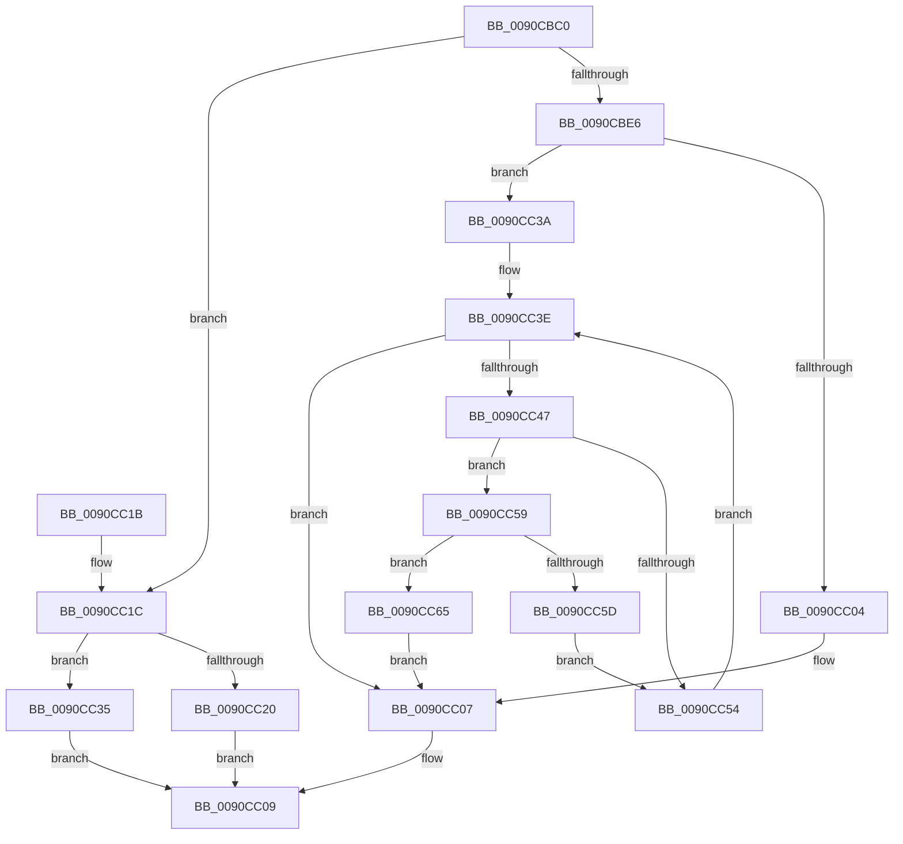

# RtlMultiByteToUnicodeSize

- RVA: `0x0090CBC0`–`0x0090CC6A` (길이 `170` bytes)
- VA: `0x000000014090CBC0`
- 실행 섹션: `PAGE`
- PDB 이름 있음: `예`; PDB Function 태그: `아니요`
- unwind 정보 RVA: `0x000892E8`
- 디코드: `56`개 명령, `170/170` bytes 표시
- 미해석 바이트: `0` (있으면 어셈블리에 `.byte`로 보존)

> 이 문서는 커널 이미지의 기계어와 PDB 기호를 분석해 생성했습니다. 4번과 5번은 함수 원형과 자료형을 바이너리 사용 방식에서 추정한 C 해석이며 원본 소스 복구 결과는 아닙니다.

## 1. Dependencies

- 직접 호출 지점: **3**; 고유 호출 대상: **3**
- 직접 호출자로 확인된 함수: **6**
- RIP 상대 이미지 참조: **0**

### Outgoing calls
- `0x0090CBDA` → [RtlpIsUtf8Process](RtlpIsUtf8Process_function_0090DB60.md) (function, `0x0090DB60`)
- `0x0090CBEE` → [PsGetCurrentServerSiloGlobals](../../text/2F/PsGetCurrentServerSiloGlobals_function_002FE1F0.md) (function, `0x002FE1F0`)
- `0x0090CC2E` → [RtlUTF8ToUnicodeN](RtlUTF8ToUnicodeN_function_0090E060.md) (function, `0x0090E060`)

### Direct callers
- [AslStringAnsiToUnicode](../81/AslStringAnsiToUnicode_function_00819824.md) at `0x00819866`
- [RtlxAnsiStringToUnicodeSize](RtlxAnsiStringToUnicodeSize_function_0090E850.md) at `0x0090E866`
- [RtlOemStringToCountedUnicodeString](RtlOemStringToCountedUnicodeString_function_0090F3D0.md) at `0x0090F407`
- [RtlOemStringToUnicodeString](RtlOemStringToUnicodeString_function_0090F6C0.md) at `0x0090F6F7`
- [FsRtlNotifyFilterReportChange](../A1/FsRtlNotifyFilterReportChange_function_00A1E880.md) at `0x00A1EAA2`
- [FsRtlNotifyFilterReportChange](../A1/FsRtlNotifyFilterReportChange_function_00A1E880.md) at `0x00A1F085`
- [FsRtlNotifyFilterReportChange](../A1/FsRtlNotifyFilterReportChange_function_00A1E880.md) at `0x00A1F109`
- [PopAnsiStringToUnicodeString](../A7/PopAnsiStringToUnicodeString_function_00A7AB48.md) at `0x00A7AB81`

### Static image references
- 디코드된 RIP-relative 메모리 참조가 없습니다.

## 2. Other-region calls and transfers

- 다른 실행 섹션으로 향하는 call: **1**
  - `0x0090CBEE` → [PsGetCurrentServerSiloGlobals](../../text/2F/PsGetCurrentServerSiloGlobals_function_002FE1F0.md) (`PAGE` → `.text`)
- 별도 외부 분기/꼬리 이동을 확인하지 못했습니다.

## 3. Assembly (complete function range)

```asm
0090CBC0  48 89 5C 24 08                  mov qword ptr [rsp + 8], rbx
0090CBC5  48 89 74 24 10                  mov qword ptr [rsp + 0x10], rsi
0090CBCA  57                              push rdi
0090CBCB  48 83 EC 30                     sub rsp, 0x30
0090CBCF  48 8B F1                        mov rsi, rcx
0090CBD2  41 8B D8                        mov ebx, r8d
0090CBD5  33 C9                           xor ecx, ecx
0090CBD7  48 8B FA                        mov rdi, rdx
0090CBDA  E8 81 0F 00 00                  call 0x14090db60
0090CBDF  45 33 C9                        xor r9d, r9d
0090CBE2  84 C0                           test al, al
0090CBE4  75 36                           jne 0x14090cc1c
0090CBE6  F0 44 09 0C 24                  lock or dword ptr [rsp], r9d
0090CBEB  41 8B D1                        mov edx, r9d
0090CBEE  E8 FD 15 9F FF                  call 0x1402fe1f0
0090CBF3  4C 8B 80 98 04 00 00            mov r8, qword ptr [rax + 0x498]
0090CBFA  66 44 39 88 14 04 00 00         cmp word ptr [rax + 0x414], r9w
0090CC02  75 36                           jne 0x14090cc3a
0090CC04  8D 14 1B                        lea edx, [rbx + rbx]
0090CC07  89 16                           mov dword ptr [rsi], edx
0090CC09  48 8B 5C 24 40                  mov rbx, qword ptr [rsp + 0x40]
0090CC0E  33 C0                           xor eax, eax
0090CC10  48 8B 74 24 48                  mov rsi, qword ptr [rsp + 0x48]
0090CC15  48 83 C4 30                     add rsp, 0x30
0090CC19  5F                              pop rdi
0090CC1A  C3                              ret
0090CC1B  CC                              int3
0090CC1C  85 DB                           test ebx, ebx
0090CC1E  74 15                           je 0x14090cc35
0090CC20  4C 8B CF                        mov r9, rdi
0090CC23  89 5C 24 20                     mov dword ptr [rsp + 0x20], ebx
0090CC27  4C 8B C6                        mov r8, rsi
0090CC2A  33 D2                           xor edx, edx
0090CC2C  33 C9                           xor ecx, ecx
0090CC2E  E8 2D 14 00 00                  call 0x14090e060
0090CC33  EB D4                           jmp 0x14090cc09
0090CC35  44 89 0E                        mov dword ptr [rsi], r9d
0090CC38  EB CF                           jmp 0x14090cc09
0090CC3A  41 83 CA FF                     or r10d, 0xffffffff
0090CC3E  8B C3                           mov eax, ebx
0090CC40  41 03 DA                        add ebx, r10d
0090CC43  85 C0                           test eax, eax
0090CC45  74 C0                           je 0x14090cc07
0090CC47  0F B6 07                        movzx eax, byte ptr [rdi]
0090CC4A  48 FF C7                        inc rdi
0090CC4D  66 45 39 0C 40                  cmp word ptr [r8 + rax*2], r9w
0090CC52  75 05                           jne 0x14090cc59
0090CC54  83 C2 02                        add edx, 2
0090CC57  EB E5                           jmp 0x14090cc3e
0090CC59  85 DB                           test ebx, ebx
0090CC5B  74 08                           je 0x14090cc65
0090CC5D  41 03 DA                        add ebx, r10d
0090CC60  48 FF C7                        inc rdi
0090CC63  EB EF                           jmp 0x14090cc54
0090CC65  83 C2 02                        add edx, 2
0090CC68  EB 9D                           jmp 0x14090cc07
```

## 4. C-style interpretation (structured pseudocode)

```c
__int64 __fastcall RtlMultiByteToUnicodeSize(__int64 a1, __int64 a2, int a3, int a4)
{
    __int64 result;
    __int64 v_r10;
    __int64 v_rbx;
    __int64 v_rdi;
    __int64 v_rsp;
    unsigned int v_stack_m38;
    unsigned __int64 v_stack_p10;
    unsigned int v_stack_p20;
    unsigned __int64 v_stack_p8;

    v_stack_p8 = v_rbx;
    v_stack_p10 = v_rsi;
    v_rsp = (v_rsp) - (48);
    a1 = 0;
    result = RtlpIsUtf8Process(a1, a2, a3, a4);
    a4 = 0;
    if ((unsigned __int8)(result) != 0) goto loc_0090CC1C;
    result = PsGetCurrentServerSiloGlobals(a1, 0, a3, a4);
    if ((*(unsigned __int16 *)(result + 1044)) != 0) goto loc_0090CC3A;
loc_0090CC07:
    *(unsigned int *)(a1) = (unsigned int)((unsigned int)(a3) + (unsigned int)(a3) * 1);
loc_0090CC09:
    result = 0;
    v_rsp = (v_rsp) + (48);
    return result;
loc_0090CC1C:
    if ((unsigned int)(v_stack_p8) == 0) goto loc_0090CC35;
    v_stack_p20 = (unsigned int)(v_stack_p8);
    a2 = 0;
    a1 = 0;
    result = RtlUTF8ToUnicodeN(a1, a2, v_stack_p10, a2);
    goto loc_0090CC09;
loc_0090CC35:
    *(unsigned int *)(v_stack_p10) = 0;
    goto loc_0090CC09;
loc_0090CC3A:
    v_r10 = (unsigned int)((v_r10) | (0xFFFFFFFFULL));
loc_0090CC3E:
    v_rbx = (unsigned int)((v_stack_p8) + ((unsigned int)(v_r10)));
    if ((unsigned int)((unsigned int)((unsigned int)(v_stack_p8))) == 0) goto loc_0090CC07;
    v_rdi = (a2) + 1;
    if ((*(unsigned __int16 *)(v_stack_p10 + *(unsigned __int8 *)(a2) * 2)) != 0) goto loc_0090CC59;
loc_0090CC54:
    a2 = (unsigned int)((a2) + (2));
    goto loc_0090CC3E;
loc_0090CC59:
    if ((unsigned int)(v_rbx) == 0) goto loc_0090CC65;
    v_rbx = (unsigned int)((v_rbx) + ((unsigned int)(v_r10)));
    v_rdi = (v_rdi) + 1;
    goto loc_0090CC54;
loc_0090CC65:
    a2 = (unsigned int)((a2) + (2));
    goto loc_0090CC07;
}
```

## 5. (Beta) C Style

```c
int64_t RtlMultiByteToUnicodeSize(void *Arg1, int64_t Arg2, void *Arg3, int32_t Arg4)
{
    uint8_t *arg1 = (uint8_t *)Arg1;
    uint8_t *arg3 = (uint8_t *)Arg3;

    int64_t result;
    int64_t local_r10;
    int64_t local_rbx;
    int64_t local_rdi;
    int64_t local_rsp;
    uint32_t v_stack_m38;
    uint64_t v_stack_p10;
    uint32_t v_stack_p20;
    uint64_t v_stack_p8;

    v_stack_p8 = local_rbx;
    v_stack_p10 = local_rsi;
    local_rsp = (local_rsp) - (48);
    Arg1 = 0;
    result = RtlpIsUtf8Process(Arg1, Arg2, Arg3, Arg4);
    Arg4 = 0;
    if ((uint8_t)(result) != 0) goto loc_0090CC1C;
    result = PsGetCurrentServerSiloGlobals(Arg1, 0, Arg3, Arg4);
    if ((*(uint16_t *)(result + 0x414)) != 0) goto loc_0090CC3A;
loc_0090CC07:
    *(uint32_t *)(arg1) = (uint32_t)((uint32_t)(Arg3) + (uint32_t)(Arg3) * 1);
loc_0090CC09:
    result = 0;
    local_rsp = (local_rsp) + (48);
    return result;
loc_0090CC1C:
    if ((uint32_t)(v_stack_p8) == 0) goto loc_0090CC35;
    v_stack_p20 = (uint32_t)(v_stack_p8);
    Arg2 = 0;
    Arg1 = 0;
    result = RtlUTF8ToUnicodeN(Arg1, Arg2, v_stack_p10, Arg2);
    goto loc_0090CC09;
loc_0090CC35:
    *(uint32_t *)(v_stack_p10) = 0;
    goto loc_0090CC09;
loc_0090CC3A:
    local_r10 = (uint32_t)((local_r10) | (0xFFFFFFFFULL));
loc_0090CC3E:
    local_rbx = (uint32_t)((v_stack_p8) + ((uint32_t)(local_r10)));
    if ((uint32_t)((uint32_t)((uint32_t)(v_stack_p8))) == 0) goto loc_0090CC07;
    local_rdi = (Arg2) + 1;
    if ((*(uint16_t *)(v_stack_p10 + *(uint8_t *)(Arg2) * 2)) != 0) goto loc_0090CC59;
loc_0090CC54:
    Arg2 = (uint32_t)((Arg2) + (2));
    goto loc_0090CC3E;
loc_0090CC59:
    if ((uint32_t)(local_rbx) == 0) goto loc_0090CC65;
    local_rbx = (uint32_t)((local_rbx) + ((uint32_t)(local_r10)));
    local_rdi = (local_rdi) + 1;
    goto loc_0090CC54;
loc_0090CC65:
    Arg2 = (uint32_t)((Arg2) + (2));
    goto loc_0090CC07;
}
```

### 관측된 메모리 오프셋

구조체 형식이 확인되지 않은 접근은 인자 기준의 오프셋으로만 기록했습니다.

| 기준 인자 | 오프셋 표현 | 폭 (bit) | 접근 |
|---|---:|---:|---|
| `Arg1` | `+ 0x0` | `32` | `W` |
| `Arg3` | `+ 0x0 + rbx*1` | `32` | `R` |

## 6. Execution-region graph

[열기: 2D/3D 그래프와 함수 탐색 컨트롤 패널](../../../control-panel.html?section=page&rva=0x0090CBC0&view=graph)

- 2D 그래프는 위에서 아래로 흐르고, 3D 그래프는 빈 공간을 드래그해 회전합니다. Shift+드래그는 이동, 휠은 확대·축소, 함수 노드 선택은 대상 보고서 이동입니다.

### Static fallback


