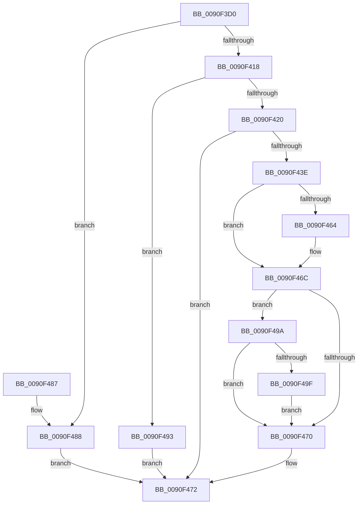

# RtlOemStringToCountedUnicodeString

- RVA: `0x0090F3D0`–`0x0090F4B0` (길이 `224` bytes)
- VA: `0x000000014090F3D0`
- 실행 섹션: `PAGE`
- PDB 이름 있음: `예`; PDB Function 태그: `아니요`
- unwind 정보 RVA: `0x000898E8`
- 디코드: `72`개 명령, `224/224` bytes 표시
- 미해석 바이트: `0` (있으면 어셈블리에 `.byte`로 보존)

> 이 문서는 커널 이미지의 기계어와 PDB 기호를 분석해 생성했습니다. 4번과 5번은 함수 원형과 자료형을 바이너리 사용 방식에서 추정한 C 해석이며 원본 소스 복구 결과는 아닙니다.

## 1. Dependencies

- 직접 호출 지점: **4**; 고유 호출 대상: **4**
- 직접 호출자로 확인된 함수: **1**
- RIP 상대 이미지 참조: **0**

### Outgoing calls
- `0x0090F407` → [RtlMultiByteToUnicodeSize](RtlMultiByteToUnicodeSize_function_0090CBC0.md) (function, `0x0090CBC0`)
- `0x0090F431` → [AllocateOrValidateUnicodeStringBuffer](../../text/43/AllocateOrValidateUnicodeStringBuffer_function_00437A60.md) (function, `0x00437A60`)
- `0x0090F455` → [RtlOemToUnicodeN](RtlOemToUnicodeN_function_0090F330.md) (function, `0x0090F330`)
- `0x0090F4A2` → [ExFreePool](../../poolcode/B8/ExFreePool_function_00B82850.md) (function, `0x00B82850`)

### Direct callers
- [DifRtlOemStringToCountedUnicodeStringWrapper](../../text/63/DifRtlOemStringToCountedUnicodeStringWrapper_function_0063BDC0.md) at `0x0063BEA5`

### Static image references
- 디코드된 RIP-relative 메모리 참조가 없습니다.

## 2. Other-region calls and transfers

- 다른 실행 섹션으로 향하는 call: **2**
  - `0x0090F431` → [AllocateOrValidateUnicodeStringBuffer](../../text/43/AllocateOrValidateUnicodeStringBuffer_function_00437A60.md) (`PAGE` → `.text`)
  - `0x0090F4A2` → [ExFreePool](../../poolcode/B8/ExFreePool_function_00B82850.md) (`PAGE` → `POOLCODE`)
- 별도 외부 분기/꼬리 이동을 확인하지 못했습니다.

## 3. Assembly (complete function range)

```asm
0090F3D0  48 8B C4                        mov rax, rsp
0090F3D3  48 89 58 20                     mov qword ptr [rax + 0x20], rbx
0090F3D7  44 88 40 18                     mov byte ptr [rax + 0x18], r8b
0090F3DB  48 89 48 08                     mov qword ptr [rax + 8], rcx
0090F3DF  56                              push rsi
0090F3E0  57                              push rdi
0090F3E1  41 54                           push r12
0090F3E3  41 56                           push r14
0090F3E5  41 57                           push r15
0090F3E7  48 83 EC 40                     sub rsp, 0x40
0090F3EB  45 8A F8                        mov r15b, r8b
0090F3EE  48 8B FA                        mov rdi, rdx
0090F3F1  48 8B D9                        mov rbx, rcx
0090F3F4  45 33 E4                        xor r12d, r12d
0090F3F7  44 89 60 10                     mov dword ptr [rax + 0x10], r12d
0090F3FB  44 0F B7 02                     movzx r8d, word ptr [rdx]
0090F3FF  48 8B 52 08                     mov rdx, qword ptr [rdx + 8]
0090F403  48 8D 48 10                     lea rcx, [rax + 0x10]
0090F407  E8 B4 D7 FF FF                  call 0x14090cbc0
0090F40C  8B 54 24 78                     mov edx, dword ptr [rsp + 0x78]
0090F410  89 54 24 78                     mov dword ptr [rsp + 0x78], edx
0090F414  85 D2                           test edx, edx
0090F416  74 70                           je 0x14090f488
0090F418  81 FA FE FF 00 00               cmp edx, 0xfffe
0090F41E  77 73                           ja 0x14090f493
0090F420  4C 8D 73 02                     lea r14, [rbx + 2]
0090F424  48 8D 73 08                     lea rsi, [rbx + 8]
0090F428  4D 8B CE                        mov r9, r14
0090F42B  4C 8B C6                        mov r8, rsi
0090F42E  41 8A CF                        mov cl, r15b
0090F431  E8 2A 86 B2 FF                  call 0x140437a60
0090F436  89 44 24 30                     mov dword ptr [rsp + 0x30], eax
0090F43A  85 C0                           test eax, eax
0090F43C  78 34                           js 0x14090f472
0090F43E  0F B7 07                        movzx eax, word ptr [rdi]
0090F441  41 0F B7 16                     movzx edx, word ptr [r14]
0090F445  89 44 24 20                     mov dword ptr [rsp + 0x20], eax
0090F449  4C 8B 4F 08                     mov r9, qword ptr [rdi + 8]
0090F44D  4C 8D 44 24 78                  lea r8, [rsp + 0x78]
0090F452  48 8B 0E                        mov rcx, qword ptr [rsi]
0090F455  E8 D6 FE FF FF                  call 0x14090f330
0090F45A  8B F8                           mov edi, eax
0090F45C  89 44 24 30                     mov dword ptr [rsp + 0x30], eax
0090F460  85 C0                           test eax, eax
0090F462  78 08                           js 0x14090f46c
0090F464  0F B7 4C 24 78                  movzx ecx, word ptr [rsp + 0x78]
0090F469  66 89 0B                        mov word ptr [rbx], cx
0090F46C  85 FF                           test edi, edi
0090F46E  78 2A                           js 0x14090f49a
0090F470  8B C7                           mov eax, edi
0090F472  48 8B 9C 24 88 00 00 00         mov rbx, qword ptr [rsp + 0x88]
0090F47A  48 83 C4 40                     add rsp, 0x40
0090F47E  41 5F                           pop r15
0090F480  41 5E                           pop r14
0090F482  41 5C                           pop r12
0090F484  5F                              pop rdi
0090F485  5E                              pop rsi
0090F486  C3                              ret
0090F487  CC                              int3
0090F488  44 89 23                        mov dword ptr [rbx], r12d
0090F48B  4C 89 63 08                     mov qword ptr [rbx + 8], r12
0090F48F  33 C0                           xor eax, eax
0090F491  EB DF                           jmp 0x14090f472
0090F493  B8 F0 00 00 C0                  mov eax, 0xc00000f0
0090F498  EB D8                           jmp 0x14090f472
0090F49A  45 84 FF                        test r15b, r15b
0090F49D  74 D1                           je 0x14090f470
0090F49F  48 8B 0E                        mov rcx, qword ptr [rsi]
0090F4A2  E8 A9 33 27 00                  call 0x140b82850
0090F4A7  4C 89 26                        mov qword ptr [rsi], r12
0090F4AA  66 45 89 26                     mov word ptr [r14], r12w
0090F4AE  EB C0                           jmp 0x14090f470
```

## 4. C-style interpretation (structured pseudocode)

```c
__int64 __fastcall RtlOemStringToCountedUnicodeString(__int64 a1, __int64 a2, unsigned __int8 a3)
{
    __int64 result;
    __int64 v_r12;
    __int64 v_rsp;
    unsigned int v_stack_m38;
    unsigned int v_stack_m48;
    unsigned int v_stack_p10;
    unsigned __int64 v_stack_p20;

    *(unsigned __int64 *)(v_rsp + 32) = v_rbx;
    *(unsigned __int8 *)(v_rsp + 24) = a3;
    *(unsigned __int64 *)(v_rsp + 8) = a1;
    v_rsp = (v_rsp) - (64);
    v_r12 = 0;
    *(unsigned int *)(v_rsp + 16) = 0;
    result = RtlMultiByteToUnicodeSize(v_rsp + 16, *(unsigned __int64 *)(a2 + 8), *(unsigned __int16 *)(a2), a4);
    v_stack_p10 = (unsigned int)((unsigned int)(v_stack_p10));
    if ((unsigned int)((unsigned int)(v_stack_p10)) == 0) goto loc_0090F488;
    if (((unsigned int)((unsigned int)(v_stack_p10))) > 0xFFFEULL) goto loc_0090F493;
    result = AllocateOrValidateUnicodeStringBuffer(a3, (unsigned int)(v_stack_p10), a1 + 8, a1 + 2);
    v_stack_m38 = (unsigned int)(result);
    if (sign_flag) goto loc_0090F472;
    v_stack_m48 = (unsigned int)(*(unsigned __int16 *)(a2));
    result = RtlOemToUnicodeN(*(unsigned __int64 *)(a1 + 8), *(unsigned __int16 *)(a1 + 2), v_stack_p10, *(unsigned __int64 *)(a2 + 8));
    v_stack_m38 = (unsigned int)(result);
    if (!(sign_flag)) {
        a1 = v_stack_p10;
        *(unsigned __int16 *)(a1) = (unsigned __int16)(a1);
    }
    if (sign_flag) goto loc_0090F49A;
loc_0090F470:
loc_0090F472:
    v_rsp = (v_rsp) + (64);
    return (unsigned int)((unsigned int)((unsigned int)((unsigned int)(result))));
loc_0090F488:
    *(unsigned int *)(v_stack_p20) = 0;
    *(unsigned __int64 *)(v_stack_p20 + 8) = 0;
    result = 0;
    goto loc_0090F472;
loc_0090F493:
    goto loc_0090F472;
loc_0090F49A:
    if (a3 == 0) goto loc_0090F470;
    result = ExFreePool(*(unsigned __int64 *)(a1 + 8), *(unsigned __int16 *)(a1 + 2), v_stack_p10, *(unsigned __int64 *)(a2 + 8));
    *(unsigned __int64 *)(a1 + 8) = 0;
    *(unsigned __int16 *)(a1 + 2) = 0;
    goto loc_0090F470;
}
```

## 5. (Beta) C Style

```c
int64_t RtlOemStringToCountedUnicodeString(void *Arg1, void *Arg2, uint8_t Arg3)
{
    uint8_t *arg1 = (uint8_t *)Arg1;
    uint8_t *arg2 = (uint8_t *)Arg2;

    int64_t result;
    int64_t local_r12;
    int64_t local_rsp;
    uint32_t v_stack_m38;
    uint32_t v_stack_m48;
    uint32_t v_stack_p10;
    uint64_t v_stack_p20;

    *(uint64_t *)(local_rsp + 0x20) = local_rbx;
    *(uint8_t *)(local_rsp + 0x18) = Arg3;
    *(void **)(local_rsp + 0x8) = Arg1;
    local_rsp = (local_rsp) - (64);
    local_r12 = 0;
    *(uint32_t *)(local_rsp + 0x10) = 0;
    result = RtlMultiByteToUnicodeSize(local_rsp + 16, *(uint64_t *)(arg2 + 0x8), *(uint16_t *)(arg2), a4);
    v_stack_p10 = (uint32_t)((uint32_t)(v_stack_p10));
    if ((uint32_t)((uint32_t)(v_stack_p10)) == 0) goto loc_0090F488;
    if (((uint32_t)((uint32_t)(v_stack_p10))) > 0xFFFEULL) goto loc_0090F493;
    result = AllocateOrValidateUnicodeStringBuffer(Arg3, (uint32_t)(v_stack_p10), Arg1 + 8, Arg1 + 2);
    v_stack_m38 = (uint32_t)(result);
    if (sign_flag) goto loc_0090F472;
    v_stack_m48 = (uint32_t)(*(uint16_t *)(arg2));
    result = RtlOemToUnicodeN(*(uint64_t *)(arg1 + 0x8), *(uint16_t *)(arg1 + 0x2), v_stack_p10, *(uint64_t *)(arg2 + 0x8));
    v_stack_m38 = (uint32_t)(result);
    if (!(sign_flag)) {
        Arg1 = v_stack_p10;
        *(uint16_t *)(arg1) = (uint16_t)(Arg1);
    }
    if (sign_flag) goto loc_0090F49A;
loc_0090F470:
loc_0090F472:
    local_rsp = (local_rsp) + (64);
    return (uint32_t)((uint32_t)((uint32_t)((uint32_t)(result))));
loc_0090F488:
    *(uint32_t *)(v_stack_p20) = 0;
    *(uint64_t *)(v_stack_p20 + 0x8) = 0;
    result = 0;
    goto loc_0090F472;
loc_0090F493:
    goto loc_0090F472;
loc_0090F49A:
    if (Arg3 == 0) goto loc_0090F470;
    result = ExFreePool(*(uint64_t *)(arg1 + 0x8), *(uint16_t *)(arg1 + 0x2), v_stack_p10, *(uint64_t *)(arg2 + 0x8));
    *(uint64_t *)(arg1 + 0x8) = 0;
    *(uint16_t *)(arg1 + 0x2) = 0;
    goto loc_0090F470;
}
```

### 관측된 메모리 오프셋

구조체 형식이 확인되지 않은 접근은 인자 기준의 오프셋으로만 기록했습니다.

| 기준 인자 | 오프셋 표현 | 폭 (bit) | 접근 |
|---|---:|---:|---|
| `Arg1` | `+ 0x0` | `16` | `R` |
| `Arg1` | `+ 0x0` | `16` | `W` |
| `Arg1` | `+ 0x0` | `32` | `W` |
| `Arg1` | `+ 0x0` | `64` | `R` |
| `Arg1` | `+ 0x0` | `64` | `W` |
| `Arg1` | `+ 0x2` | `64` | `R` |
| `Arg1` | `+ 0x8` | `64` | `R` |
| `Arg1` | `+ 0x8` | `64` | `W` |
| `Arg2` | `+ 0x0` | `16` | `R` |
| `Arg2` | `+ 0x8` | `64` | `R` |

## 6. Execution-region graph

[열기: 2D/3D 그래프와 함수 탐색 컨트롤 패널](../../../control-panel.html?section=page&rva=0x0090F3D0&view=graph)

- 2D 그래프는 위에서 아래로 흐르고, 3D 그래프는 빈 공간을 드래그해 회전합니다. Shift+드래그는 이동, 휠은 확대·축소, 함수 노드 선택은 대상 보고서 이동입니다.

### Static fallback


