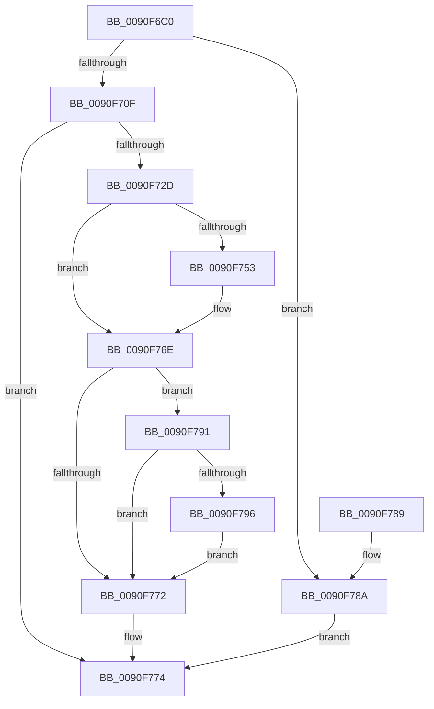

# RtlOemStringToUnicodeString

- RVA: `0x0090F6C0`–`0x0090F7A7` (길이 `231` bytes)
- VA: `0x000000014090F6C0`
- 실행 섹션: `PAGE`
- PDB 이름 있음: `예`; PDB Function 태그: `아니요`
- unwind 정보 RVA: `0x00089958`
- 디코드: `73`개 명령, `231/231` bytes 표시
- 미해석 바이트: `0` (있으면 어셈블리에 `.byte`로 보존)

> 이 문서는 커널 이미지의 기계어와 PDB 기호를 분석해 생성했습니다. 4번과 5번은 함수 원형과 자료형을 바이너리 사용 방식에서 추정한 C 해석이며 원본 소스 복구 결과는 아닙니다.

## 1. Dependencies

- 직접 호출 지점: **4**; 고유 호출 대상: **4**
- 직접 호출자로 확인된 함수: **1**
- RIP 상대 이미지 참조: **0**

### Outgoing calls
- `0x0090F6F7` → [RtlMultiByteToUnicodeSize](RtlMultiByteToUnicodeSize_function_0090CBC0.md) (function, `0x0090CBC0`)
- `0x0090F720` → [AllocateOrValidateUnicodeStringBuffer](../../text/43/AllocateOrValidateUnicodeStringBuffer_function_00437A60.md) (function, `0x00437A60`)
- `0x0090F744` → [RtlOemToUnicodeN](RtlOemToUnicodeN_function_0090F330.md) (function, `0x0090F330`)
- `0x0090F799` → [ExFreePool](../../poolcode/B8/ExFreePool_function_00B82850.md) (function, `0x00B82850`)

### Direct callers
- [DifRtlOemStringToUnicodeStringWrapper](../../text/63/DifRtlOemStringToUnicodeStringWrapper_function_0063BF40.md) at `0x0063C025`

### Static image references
- 디코드된 RIP-relative 메모리 참조가 없습니다.

## 2. Other-region calls and transfers

- 다른 실행 섹션으로 향하는 call: **2**
  - `0x0090F720` → [AllocateOrValidateUnicodeStringBuffer](../../text/43/AllocateOrValidateUnicodeStringBuffer_function_00437A60.md) (`PAGE` → `.text`)
  - `0x0090F799` → [ExFreePool](../../poolcode/B8/ExFreePool_function_00B82850.md) (`PAGE` → `POOLCODE`)
- 별도 외부 분기/꼬리 이동을 확인하지 못했습니다.

## 3. Assembly (complete function range)

```asm
0090F6C0  48 8B C4                        mov rax, rsp
0090F6C3  48 89 58 20                     mov qword ptr [rax + 0x20], rbx
0090F6C7  44 88 40 18                     mov byte ptr [rax + 0x18], r8b
0090F6CB  48 89 48 08                     mov qword ptr [rax + 8], rcx
0090F6CF  56                              push rsi
0090F6D0  57                              push rdi
0090F6D1  41 54                           push r12
0090F6D3  41 56                           push r14
0090F6D5  41 57                           push r15
0090F6D7  48 83 EC 40                     sub rsp, 0x40
0090F6DB  45 8A F0                        mov r14b, r8b
0090F6DE  48 8B DA                        mov rbx, rdx
0090F6E1  48 8B F1                        mov rsi, rcx
0090F6E4  45 33 E4                        xor r12d, r12d
0090F6E7  44 89 60 10                     mov dword ptr [rax + 0x10], r12d
0090F6EB  44 0F B7 02                     movzx r8d, word ptr [rdx]
0090F6EF  48 8B 52 08                     mov rdx, qword ptr [rdx + 8]
0090F6F3  48 8D 48 10                     lea rcx, [rax + 0x10]
0090F6F7  E8 C4 D4 FF FF                  call 0x14090cbc0
0090F6FC  8B 54 24 78                     mov edx, dword ptr [rsp + 0x78]
0090F700  83 C2 02                        add edx, 2
0090F703  89 54 24 78                     mov dword ptr [rsp + 0x78], edx
0090F707  81 FA FE FF 00 00               cmp edx, 0xfffe
0090F70D  77 7B                           ja 0x14090f78a
0090F70F  4C 8D 7E 02                     lea r15, [rsi + 2]
0090F713  48 8D 7E 08                     lea rdi, [rsi + 8]
0090F717  4D 8B CF                        mov r9, r15
0090F71A  4C 8B C7                        mov r8, rdi
0090F71D  41 8A CE                        mov cl, r14b
0090F720  E8 3B 83 B2 FF                  call 0x140437a60
0090F725  89 44 24 30                     mov dword ptr [rsp + 0x30], eax
0090F729  85 C0                           test eax, eax
0090F72B  78 47                           js 0x14090f774
0090F72D  0F B7 03                        movzx eax, word ptr [rbx]
0090F730  41 0F B7 17                     movzx edx, word ptr [r15]
0090F734  89 44 24 20                     mov dword ptr [rsp + 0x20], eax
0090F738  4C 8B 4B 08                     mov r9, qword ptr [rbx + 8]
0090F73C  4C 8D 44 24 78                  lea r8, [rsp + 0x78]
0090F741  48 8B 0F                        mov rcx, qword ptr [rdi]
0090F744  E8 E7 FB FF FF                  call 0x14090f330
0090F749  8B D8                           mov ebx, eax
0090F74B  89 44 24 30                     mov dword ptr [rsp + 0x30], eax
0090F74F  85 C0                           test eax, eax
0090F751  78 1B                           js 0x14090f76e
0090F753  8B 54 24 78                     mov edx, dword ptr [rsp + 0x78]
0090F757  8B CA                           mov ecx, edx
0090F759  48 D1 E9                        shr rcx, 1
0090F75C  48 8B 07                        mov rax, qword ptr [rdi]
0090F75F  66 44 89 24 48                  mov word ptr [rax + rcx*2], r12w
0090F764  66 89 16                        mov word ptr [rsi], dx
0090F767  41 8B DC                        mov ebx, r12d
0090F76A  89 5C 24 30                     mov dword ptr [rsp + 0x30], ebx
0090F76E  85 DB                           test ebx, ebx
0090F770  78 1F                           js 0x14090f791
0090F772  8B C3                           mov eax, ebx
0090F774  48 8B 9C 24 88 00 00 00         mov rbx, qword ptr [rsp + 0x88]
0090F77C  48 83 C4 40                     add rsp, 0x40
0090F780  41 5F                           pop r15
0090F782  41 5E                           pop r14
0090F784  41 5C                           pop r12
0090F786  5F                              pop rdi
0090F787  5E                              pop rsi
0090F788  C3                              ret
0090F789  CC                              int3
0090F78A  B8 F0 00 00 C0                  mov eax, 0xc00000f0
0090F78F  EB E3                           jmp 0x14090f774
0090F791  45 84 F6                        test r14b, r14b
0090F794  74 DC                           je 0x14090f772
0090F796  48 8B 0F                        mov rcx, qword ptr [rdi]
0090F799  E8 B2 30 27 00                  call 0x140b82850
0090F79E  4C 89 27                        mov qword ptr [rdi], r12
0090F7A1  66 45 89 27                     mov word ptr [r15], r12w
0090F7A5  EB CB                           jmp 0x14090f772
```

## 4. C-style interpretation (structured pseudocode)

```c
__int64 __fastcall RtlOemStringToUnicodeString(__int64 a1, __int64 a2, unsigned __int8 a3)
{
    __int64 result;
    __int64 v_r12;
    __int64 v_rbx;
    __int64 v_rsp;
    unsigned int v_stack_m38;
    unsigned int v_stack_m48;
    unsigned int v_stack_p10;
    unsigned __int64 v_stack_p20;

    *(unsigned __int64 *)(v_rsp + 32) = v_rbx;
    *(unsigned __int8 *)(v_rsp + 24) = a3;
    *(unsigned __int64 *)(v_rsp + 8) = a1;
    v_rsp = (v_rsp) - (64);
    v_r12 = 0;
    *(unsigned int *)(v_rsp + 16) = 0;
    result = RtlMultiByteToUnicodeSize(v_rsp + 16, *(unsigned __int64 *)(a2 + 8), *(unsigned __int16 *)(a2), a4);
    a2 = (unsigned int)(((unsigned int)(v_stack_p10)) + (2));
    v_stack_p10 = (unsigned int)(a2);
    if (((unsigned int)(a2)) > 0xFFFEULL) goto loc_0090F78A;
    result = AllocateOrValidateUnicodeStringBuffer(a3, a2, a1 + 8, a1 + 2);
    v_stack_m38 = (unsigned int)(result);
    if (sign_flag) goto loc_0090F774;
    v_stack_m48 = (unsigned int)(*(unsigned __int16 *)(a2));
    result = RtlOemToUnicodeN(*(unsigned __int64 *)(a1 + 8), *(unsigned __int16 *)(a1 + 2), v_stack_p10, *(unsigned __int64 *)(a2 + 8));
    v_stack_m38 = (unsigned int)(result);
    v_rbx = (unsigned int)((unsigned int)(result));
    if (!(sign_flag)) {
        a2 = v_stack_p10;
        a1 = (unsigned int)(a2);
        a1 = (a1) >> (1);
        result = *(unsigned __int64 *)(a1 + 8);
        *(unsigned __int16 *)(result + a1 * 2) = 0;
        *(unsigned __int16 *)(a1) = (unsigned __int16)(a2);
        v_rbx = 0;
        v_stack_m38 = (unsigned int)(v_rbx);
    }
    if (sign_flag) goto loc_0090F791;
loc_0090F772:
loc_0090F774:
    v_rsp = (v_rsp) + (64);
    return (unsigned int)((unsigned int)(v_rbx));
loc_0090F78A:
    goto loc_0090F774;
loc_0090F791:
    if (a3 == 0) goto loc_0090F772;
    result = ExFreePool(*(unsigned __int64 *)(a1 + 8), a2, v_stack_p10, *(unsigned __int64 *)(a2 + 8));
    *(unsigned __int64 *)(a1 + 8) = 0;
    *(unsigned __int16 *)(a1 + 2) = 0;
    goto loc_0090F772;
}
```

## 5. (Beta) C Style

```c
int64_t RtlOemStringToUnicodeString(void *Arg1, void *Arg2, uint8_t Arg3)
{
    uint8_t *arg1 = (uint8_t *)Arg1;
    uint8_t *arg2 = (uint8_t *)Arg2;

    int64_t result;
    int64_t local_r12;
    int64_t local_rbx;
    int64_t local_rsp;
    uint32_t v_stack_m38;
    uint32_t v_stack_m48;
    uint32_t v_stack_p10;
    uint64_t v_stack_p20;

    *(uint64_t *)(local_rsp + 0x20) = local_rbx;
    *(uint8_t *)(local_rsp + 0x18) = Arg3;
    *(void **)(local_rsp + 0x8) = Arg1;
    local_rsp = (local_rsp) - (64);
    local_r12 = 0;
    *(uint32_t *)(local_rsp + 0x10) = 0;
    result = RtlMultiByteToUnicodeSize(local_rsp + 16, *(uint64_t *)(arg2 + 0x8), *(uint16_t *)(arg2), a4);
    Arg2 = (uint32_t)(((uint32_t)(v_stack_p10)) + (2));
    v_stack_p10 = (uint32_t)(Arg2);
    if (((uint32_t)(Arg2)) > 0xFFFEULL) goto loc_0090F78A;
    result = AllocateOrValidateUnicodeStringBuffer(Arg3, Arg2, Arg1 + 8, Arg1 + 2);
    v_stack_m38 = (uint32_t)(result);
    if (sign_flag) goto loc_0090F774;
    v_stack_m48 = (uint32_t)(*(uint16_t *)(arg2));
    result = RtlOemToUnicodeN(*(uint64_t *)(arg1 + 0x8), *(uint16_t *)(arg1 + 0x2), v_stack_p10, *(uint64_t *)(arg2 + 0x8));
    v_stack_m38 = (uint32_t)(result);
    local_rbx = (uint32_t)((uint32_t)(result));
    if (!(sign_flag)) {
        Arg2 = v_stack_p10;
        Arg1 = (uint32_t)(Arg2);
        Arg1 = (Arg1) >> (1);
        result = *(uint64_t *)(arg1 + 0x8);
        *(uint16_t *)(result + arg1 * 2) = 0;
        *(uint16_t *)(arg1) = (uint16_t)(Arg2);
        local_rbx = 0;
        v_stack_m38 = (uint32_t)(local_rbx);
    }
    if (sign_flag) goto loc_0090F791;
loc_0090F772:
loc_0090F774:
    local_rsp = (local_rsp) + (64);
    return (uint32_t)((uint32_t)(local_rbx));
loc_0090F78A:
    goto loc_0090F774;
loc_0090F791:
    if (Arg3 == 0) goto loc_0090F772;
    result = ExFreePool(*(uint64_t *)(arg1 + 0x8), Arg2, v_stack_p10, *(uint64_t *)(arg2 + 0x8));
    *(uint64_t *)(arg1 + 0x8) = 0;
    *(uint16_t *)(arg1 + 0x2) = 0;
    goto loc_0090F772;
}
```

### 관측된 메모리 오프셋

구조체 형식이 확인되지 않은 접근은 인자 기준의 오프셋으로만 기록했습니다.

| 기준 인자 | 오프셋 표현 | 폭 (bit) | 접근 |
|---|---:|---:|---|
| `Arg1` | `+ 0x0` | `16` | `R` |
| `Arg1` | `+ 0x0` | `16` | `W` |
| `Arg1` | `+ 0x0` | `64` | `R` |
| `Arg1` | `+ 0x0` | `64` | `W` |
| `Arg1` | `+ 0x2` | `64` | `R` |
| `Arg1` | `+ 0x8` | `64` | `R` |
| `Arg2` | `+ 0x0` | `16` | `R` |
| `Arg2` | `+ 0x8` | `64` | `R` |

## 6. Execution-region graph

[열기: 2D/3D 그래프와 함수 탐색 컨트롤 패널](../../../control-panel.html?section=page&rva=0x0090F6C0&view=graph)

- 2D 그래프는 위에서 아래로 흐르고, 3D 그래프는 빈 공간을 드래그해 회전합니다. Shift+드래그는 이동, 휠은 확대·축소, 함수 노드 선택은 대상 보고서 이동입니다.

### Static fallback


