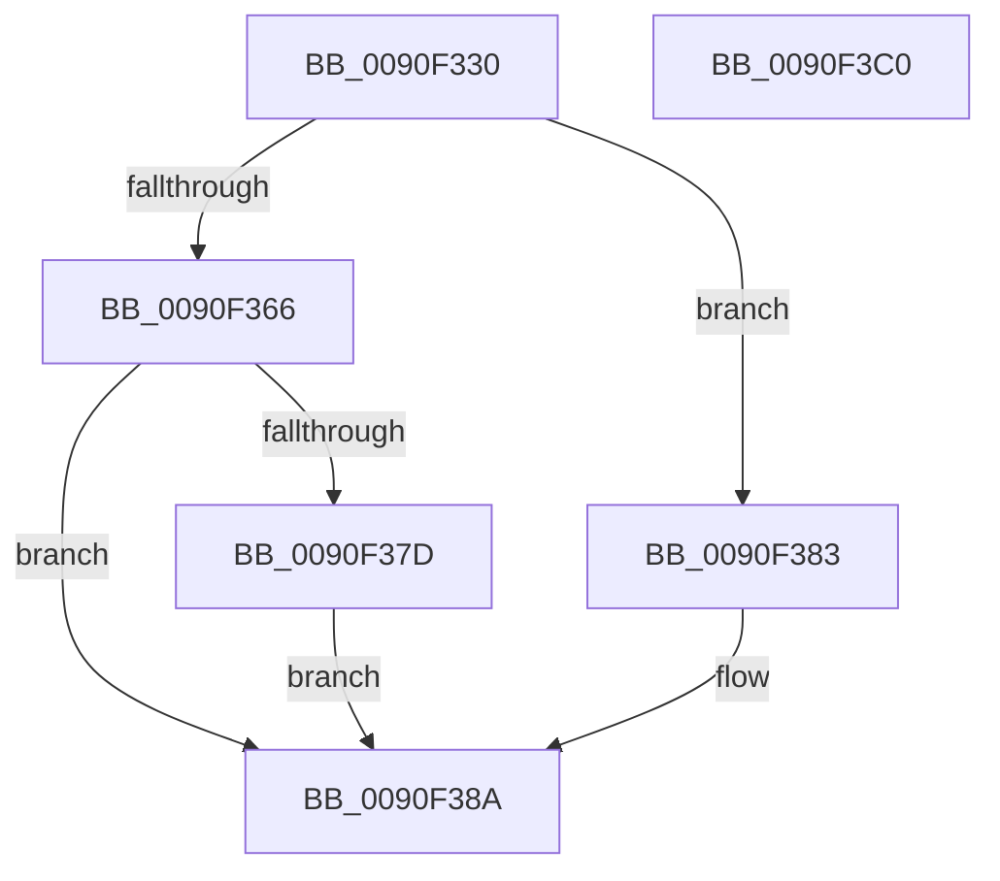

# RtlOemToUnicodeN

- RVA: `0x0090F330`–`0x0090F3C1` (길이 `145` bytes)
- VA: `0x000000014090F330`
- 실행 섹션: `PAGE`
- PDB 이름 있음: `예`; PDB Function 태그: `아니요`
- unwind 정보 RVA: `0x0005D7BC`
- 디코드: `39`개 명령, `145/145` bytes 표시
- 미해석 바이트: `0` (있으면 어셈블리에 `.byte`로 보존)

> 이 문서는 커널 이미지의 기계어와 PDB 기호를 분석해 생성했습니다. 4번과 5번은 함수 원형과 자료형을 바이너리 사용 방식에서 추정한 C 해석이며 원본 소스 복구 결과는 아닙니다.

## 1. Dependencies

- 직접 호출 지점: **3**; 고유 호출 대상: **3**
- 직접 호출자로 확인된 함수: **3**
- RIP 상대 이미지 참조: **1**

### Outgoing calls
- `0x0090F35D` → [RtlpIsUtf8Process](RtlpIsUtf8Process_function_0090DB60.md) (function, `0x0090DB60`)
- `0x0090F36B` → [PsGetCurrentServerSiloGlobals](../../text/2F/PsGetCurrentServerSiloGlobals_function_002FE1F0.md) (function, `0x002FE1F0`)
- `0x0090F3A0` → [RtlCustomCPToUnicodeN](RtlCustomCPToUnicodeN_function_0090DEE0.md) (function, `0x0090DEE0`)

### Direct callers
- [RtlOemStringToCountedUnicodeString](RtlOemStringToCountedUnicodeString_function_0090F3D0.md) at `0x0090F455`
- [RtlOemStringToUnicodeString](RtlOemStringToUnicodeString_function_0090F6C0.md) at `0x0090F744`
- [FsRtlNotifyUpdateBuffer](../A8/FsRtlNotifyUpdateBuffer_function_00A892A4.md) at `0x00A893B6`
- [FsRtlNotifyUpdateBuffer](../A8/FsRtlNotifyUpdateBuffer_function_00A892A4.md) at `0x00A893E2`
- [FsRtlNotifyUpdateBuffer](../A8/FsRtlNotifyUpdateBuffer_function_00A892A4.md) at `0x00A8941E`

### Static image references
- `0x0090F383` → RVA `0x00FD8720` (`PAGEDATA`; read)

## 2. Other-region calls and transfers

- 다른 실행 섹션으로 향하는 call: **1**
  - `0x0090F36B` → [PsGetCurrentServerSiloGlobals](../../text/2F/PsGetCurrentServerSiloGlobals_function_002FE1F0.md) (`PAGE` → `.text`)
- 별도 외부 분기/꼬리 이동을 확인하지 못했습니다.

## 3. Assembly (complete function range)

```asm
0090F330  48 8B C4                        mov rax, rsp
0090F333  48 89 58 08                     mov qword ptr [rax + 8], rbx
0090F337  48 89 68 10                     mov qword ptr [rax + 0x10], rbp
0090F33B  48 89 70 18                     mov qword ptr [rax + 0x18], rsi
0090F33F  48 89 78 20                     mov qword ptr [rax + 0x20], rdi
0090F343  41 56                           push r14
0090F345  48 83 EC 30                     sub rsp, 0x30
0090F349  48 8B E9                        mov rbp, rcx
0090F34C  41 BE 01 00 00 00               mov r14d, 1
0090F352  41 8A CE                        mov cl, r14b
0090F355  49 8B D9                        mov rbx, r9
0090F358  49 8B F8                        mov rdi, r8
0090F35B  8B F2                           mov esi, edx
0090F35D  E8 FE E7 FF FF                  call 0x14090db60
0090F362  84 C0                           test al, al
0090F364  75 1D                           jne 0x14090f383
0090F366  F0 83 0C 24 00                  lock or dword ptr [rsp], 0
0090F36B  E8 80 EE 9E FF                  call 0x1402fe1f0
0090F370  48 8D 88 08 04 00 00            lea rcx, [rax + 0x408]
0090F377  66 44 3B 31                     cmp r14w, word ptr [rcx]
0090F37B  74 0D                           je 0x14090f38a
0090F37D  48 83 C1 40                     add rcx, 0x40
0090F381  EB 07                           jmp 0x14090f38a
0090F383  48 8D 0D 96 93 6C 00            lea rcx, [rip + 0x6c9396]
0090F38A  8B 44 24 60                     mov eax, dword ptr [rsp + 0x60]
0090F38E  4C 8B CF                        mov r9, rdi
0090F391  89 44 24 28                     mov dword ptr [rsp + 0x28], eax
0090F395  44 8B C6                        mov r8d, esi
0090F398  48 8B D5                        mov rdx, rbp
0090F39B  48 89 5C 24 20                  mov qword ptr [rsp + 0x20], rbx
0090F3A0  E8 3B EB FF FF                  call 0x14090dee0
0090F3A5  48 8B 5C 24 40                  mov rbx, qword ptr [rsp + 0x40]
0090F3AA  48 8B 6C 24 48                  mov rbp, qword ptr [rsp + 0x48]
0090F3AF  48 8B 74 24 50                  mov rsi, qword ptr [rsp + 0x50]
0090F3B4  48 8B 7C 24 58                  mov rdi, qword ptr [rsp + 0x58]
0090F3B9  48 83 C4 30                     add rsp, 0x30
0090F3BD  41 5E                           pop r14
0090F3BF  C3                              ret
0090F3C0  CC                              int3
```

## 4. C-style interpretation (structured pseudocode)

```c
__int64 __fastcall RtlOemToUnicodeN(__int64 a1, int a2, __int64 a3, __int64 a4, unsigned int a5)
{
    __int64 result;
    __int64 v_rsp;
    unsigned int v_stack_m10;
    unsigned __int64 v_stack_m18;
    unsigned int v_stack_m38;
    unsigned __int64 v_stack_p10;
    unsigned __int64 v_stack_p18;
    unsigned __int64 v_stack_p20;
    unsigned __int64 v_stack_p8;

    *(unsigned __int64 *)(v_rsp + 8) = v_rbx;
    *(unsigned __int64 *)(v_rsp + 16) = v_rbp;
    *(unsigned __int64 *)(v_rsp + 24) = v_rsi;
    *(unsigned __int64 *)(v_rsp + 32) = v_rdi;
    v_rsp = (v_rsp) - (48);
    result = RtlpIsUtf8Process(1, a2, a3, a4);
    if ((unsigned __int8)(result) != 0) goto loc_0090F383;
    result = PsGetCurrentServerSiloGlobals(1, a2, a3, a4);
    if (1 == (*(unsigned __int16 *)(result + 1032))) goto loc_0090F38A;
    a1 = (result + 1032) + (64);
    goto loc_0090F38A;
loc_0090F383:
loc_0090F38A:
    v_stack_m10 = (unsigned int)((unsigned int)(a5));
    v_stack_m18 = a4;
    result = RtlCustomCPToUnicodeN(v_rip + 7115670, a1, (unsigned int)((unsigned int)((unsigned int)(a2))), a3);
    v_rsp = (v_rsp) + (48);
    return result;
}
```

## 5. (Beta) C Style

```c
int64_t RtlOemToUnicodeN(int64_t Arg1, int32_t Arg2, int64_t Arg3, int64_t Arg4, uint32_t Arg5)
{
    int64_t result;
    int64_t local_rsp;
    uint32_t v_stack_m10;
    uint64_t v_stack_m18;
    uint32_t v_stack_m38;
    uint64_t v_stack_p10;
    uint64_t v_stack_p18;
    uint64_t v_stack_p20;
    uint64_t v_stack_p8;

    *(uint64_t *)(local_rsp + 0x8) = local_rbx;
    *(uint64_t *)(local_rsp + 0x10) = local_rbp;
    *(uint64_t *)(local_rsp + 0x18) = local_rsi;
    *(uint64_t *)(local_rsp + 0x20) = local_rdi;
    local_rsp = (local_rsp) - (48);
    result = RtlpIsUtf8Process(1, Arg2, Arg3, Arg4);
    if ((uint8_t)(result) != 0) goto loc_0090F383;
    result = PsGetCurrentServerSiloGlobals(1, Arg2, Arg3, Arg4);
    if (1 == (*(uint16_t *)(result + 0x408))) goto loc_0090F38A;
    Arg1 = (result + 1032) + (64);
    goto loc_0090F38A;
loc_0090F383:
loc_0090F38A:
    v_stack_m10 = (uint32_t)((uint32_t)(Arg5));
    v_stack_m18 = Arg4;
    result = RtlCustomCPToUnicodeN(v_rip + 7115670, Arg1, (uint32_t)((uint32_t)((uint32_t)(Arg2))), Arg3);
    local_rsp = (local_rsp) + (48);
    return result;
}
```

## 6. Execution-region graph

[열기: 2D/3D 그래프와 함수 탐색 컨트롤 패널](../../../control-panel.html?section=page&rva=0x0090F330&view=graph)

- 2D 그래프는 위에서 아래로 흐르고, 3D 그래프는 빈 공간을 드래그해 회전합니다. Shift+드래그는 이동, 휠은 확대·축소, 함수 노드 선택은 대상 보고서 이동입니다.

### Static fallback


