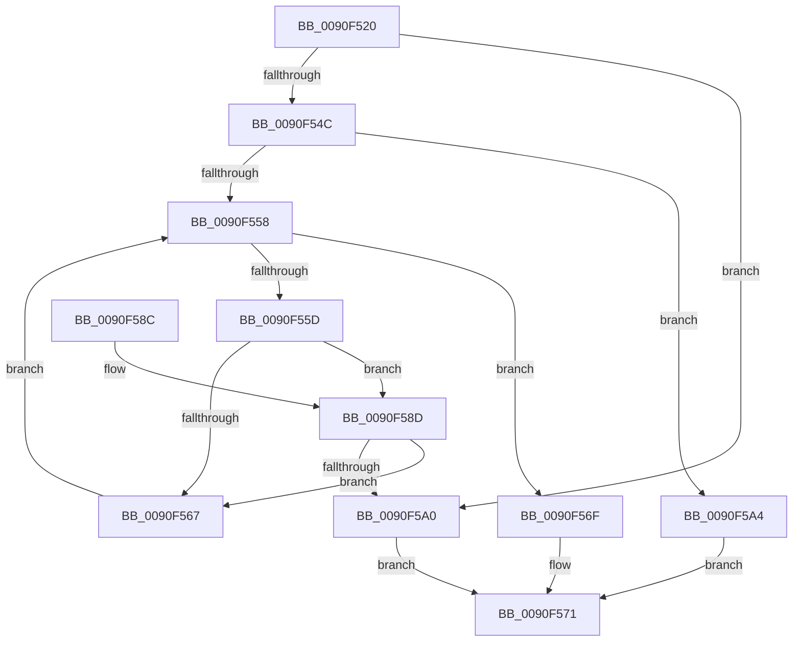

# RtlPrefixString

- RVA: `0x0090F520`–`0x0090F5B6` (길이 `150` bytes)
- VA: `0x000000014090F520`
- 실행 섹션: `PAGE`
- PDB 이름 있음: `예`; PDB Function 태그: `아니요`
- unwind 정보 RVA: `0x00089928`
- 디코드: `49`개 명령, `150/150` bytes 표시
- 미해석 바이트: `0` (있으면 어셈블리에 `.byte`로 보존)

> 이 문서는 커널 이미지의 기계어와 PDB 기호를 분석해 생성했습니다. 4번과 5번은 함수 원형과 자료형을 바이너리 사용 방식에서 추정한 C 해석이며 원본 소스 복구 결과는 아닙니다.

## 1. Dependencies

- 직접 호출 지점: **3**; 고유 호출 대상: **2**
- 직접 호출자로 확인된 함수: **1**
- RIP 상대 이미지 참조: **0**

### Outgoing calls
- `0x0090F58D` → [RtlUpperChar](RtlUpperChar_function_0090D730.md) (function, `0x0090D730`)
- `0x0090F597` → [RtlUpperChar](RtlUpperChar_function_0090D730.md) (function, `0x0090D730`)
- `0x0090F5AA` → [memcmp](../../text/6C/memcmp_function_006C6B10.md) (function, `0x006C6B10`)

### Direct callers
- [IopCheckDiskName](../../text/59/IopCheckDiskName_function_00597EB8.md) at `0x00597EE6`
- [IopCheckDiskName](../../text/59/IopCheckDiskName_function_00597EB8.md) at `0x00597F1D`

### Static image references
- 디코드된 RIP-relative 메모리 참조가 없습니다.

## 2. Other-region calls and transfers

- 다른 실행 섹션으로 향하는 call: **1**
  - `0x0090F5AA` → [memcmp](../../text/6C/memcmp_function_006C6B10.md) (`PAGE` → `.text`)
- 별도 외부 분기/꼬리 이동을 확인하지 못했습니다.

## 3. Assembly (complete function range)

```asm
0090F520  48 8B C4                        mov rax, rsp
0090F523  48 89 58 08                     mov qword ptr [rax + 8], rbx
0090F527  48 89 68 10                     mov qword ptr [rax + 0x10], rbp
0090F52B  48 89 70 18                     mov qword ptr [rax + 0x18], rsi
0090F52F  48 89 78 20                     mov qword ptr [rax + 0x20], rdi
0090F533  41 56                           push r14
0090F535  48 83 EC 20                     sub rsp, 0x20
0090F539  0F B7 01                        movzx eax, word ptr [rcx]
0090F53C  45 8A C8                        mov r9b, r8b
0090F53F  48 8B 79 08                     mov rdi, qword ptr [rcx + 8]
0090F543  48 8B 72 08                     mov rsi, qword ptr [rdx + 8]
0090F547  66 39 02                        cmp word ptr [rdx], ax
0090F54A  72 54                           jb 0x14090f5a0
0090F54C  4C 8D 34 38                     lea r14, [rax + rdi]
0090F550  44 8B C0                        mov r8d, eax
0090F553  45 84 C9                        test r9b, r9b
0090F556  74 4C                           je 0x14090f5a4
0090F558  49 3B FE                        cmp rdi, r14
0090F55B  73 12                           jae 0x14090f56f
0090F55D  40 8A 2F                        mov bpl, byte ptr [rdi]
0090F560  8A 0E                           mov cl, byte ptr [rsi]
0090F562  40 3A E9                        cmp bpl, cl
0090F565  75 26                           jne 0x14090f58d
0090F567  48 FF C7                        inc rdi
0090F56A  48 FF C6                        inc rsi
0090F56D  EB E9                           jmp 0x14090f558
0090F56F  B0 01                           mov al, 1
0090F571  48 8B 5C 24 30                  mov rbx, qword ptr [rsp + 0x30]
0090F576  48 8B 6C 24 38                  mov rbp, qword ptr [rsp + 0x38]
0090F57B  48 8B 74 24 40                  mov rsi, qword ptr [rsp + 0x40]
0090F580  48 8B 7C 24 48                  mov rdi, qword ptr [rsp + 0x48]
0090F585  48 83 C4 20                     add rsp, 0x20
0090F589  41 5E                           pop r14
0090F58B  C3                              ret
0090F58C  CC                              int3
0090F58D  E8 9E E1 FF FF                  call 0x14090d730
0090F592  40 8A CD                        mov cl, bpl
0090F595  8A D8                           mov bl, al
0090F597  E8 94 E1 FF FF                  call 0x14090d730
0090F59C  3A C3                           cmp al, bl
0090F59E  74 C7                           je 0x14090f567
0090F5A0  32 C0                           xor al, al
0090F5A2  EB CD                           jmp 0x14090f571
0090F5A4  48 8B D6                        mov rdx, rsi
0090F5A7  48 8B CF                        mov rcx, rdi
0090F5AA  E8 61 75 DB FF                  call 0x1406c6b10
0090F5AF  85 C0                           test eax, eax
0090F5B1  0F 94 C0                        sete al
0090F5B4  EB BB                           jmp 0x14090f571
```

## 4. C-style interpretation (structured pseudocode)

```c
__int64 __fastcall RtlPrefixString(__int64 a1, __int64 a2, unsigned __int8 a3)
{
    __int64 result;
    __int64 v_rdi;
    __int64 v_rsi;
    __int64 v_rsp;
    unsigned __int64 v_stack_p10;
    unsigned __int64 v_stack_p18;
    unsigned __int64 v_stack_p20;
    unsigned __int64 v_stack_p8;

    *(unsigned __int64 *)(v_rsp + 8) = v_rbx;
    *(unsigned __int64 *)(v_rsp + 16) = v_rbp;
    *(unsigned __int64 *)(v_rsp + 24) = v_rsi;
    *(unsigned __int64 *)(v_rsp + 32) = v_rdi;
    v_rsp = (v_rsp) - (32);
    if ((*(unsigned __int16 *)(a2)) < ((unsigned __int16)(*(unsigned __int16 *)(a1)))) goto loc_0090F5A0;
    if (a3 == 0) goto loc_0090F5A4;
loc_0090F558:
    if ((*(unsigned __int64 *)(a1 + 8)) >= (*(unsigned __int16 *)(a1) + *(unsigned __int64 *)(a1 + 8) * 1)) goto loc_0090F56F;
    if (((unsigned __int8)(*(unsigned __int8 *)(*(unsigned __int64 *)(a1 + 8)))) != ((unsigned __int8)(*(unsigned __int8 *)(*(unsigned __int64 *)(a2 + 8))))) goto loc_0090F58D;
loc_0090F567:
    v_rdi = (*(unsigned __int64 *)(a1 + 8)) + 1;
    v_rsi = (*(unsigned __int64 *)(a2 + 8)) + 1;
    goto loc_0090F558;
loc_0090F56F:
loc_0090F571:
    v_rsp = (v_rsp) + (32);
    return 1;
loc_0090F58D:
    result = RtlUpperChar(*(unsigned __int8 *)(*(unsigned __int64 *)(a2 + 8)), a2, (unsigned int)((unsigned int)(*(unsigned __int16 *)(a1))), a3);
    result = RtlUpperChar((unsigned __int8)(v_stack_p10), a2, (unsigned int)((unsigned int)(*(unsigned __int16 *)(a1))), a3);
    if (((unsigned __int8)(result)) == ((unsigned __int8)((unsigned __int8)(result)))) goto loc_0090F567;
loc_0090F5A0:
    result = 0;
    goto loc_0090F571;
loc_0090F5A4:
    result = memcmp(v_stack_p20, v_stack_p18, (unsigned int)((unsigned int)(*(unsigned __int16 *)(a1))), a3);
    result = ((unsigned int)(result) == 0) ? 1 : 0;
    goto loc_0090F571;
}
```

## 5. (Beta) C Style

```c
int64_t RtlPrefixString(void *Arg1, void *Arg2, uint8_t Arg3)
{
    uint8_t *arg1 = (uint8_t *)Arg1;
    uint8_t *arg2 = (uint8_t *)Arg2;

    int64_t result;
    int64_t local_rdi;
    int64_t local_rsi;
    int64_t local_rsp;
    uint64_t v_stack_p10;
    uint64_t v_stack_p18;
    uint64_t v_stack_p20;
    uint64_t v_stack_p8;

    *(uint64_t *)(local_rsp + 0x8) = local_rbx;
    *(uint64_t *)(local_rsp + 0x10) = local_rbp;
    *(uint64_t *)(local_rsp + 0x18) = local_rsi;
    *(uint64_t *)(local_rsp + 0x20) = local_rdi;
    local_rsp = (local_rsp) - (32);
    if ((*(uint16_t *)(arg2)) < ((uint16_t)(*(uint16_t *)(arg1)))) goto loc_0090F5A0;
    if (Arg3 == 0) goto loc_0090F5A4;
loc_0090F558:
    if ((*(uint64_t *)(arg1 + 0x8)) >= (*(uint16_t *)(arg1) + *(uint64_t *)(arg1 + 0x8) * 1)) goto loc_0090F56F;
    if (((uint8_t)(*(uint8_t *)(*(uint64_t *)(arg1 + 0x8)))) != ((uint8_t)(*(uint8_t *)(*(uint64_t *)(arg2 + 0x8))))) goto loc_0090F58D;
loc_0090F567:
    local_rdi = (*(uint64_t *)(arg1 + 0x8)) + 1;
    local_rsi = (*(uint64_t *)(arg2 + 0x8)) + 1;
    goto loc_0090F558;
loc_0090F56F:
loc_0090F571:
    local_rsp = (local_rsp) + (32);
    return 1;
loc_0090F58D:
    result = RtlUpperChar(*(uint8_t *)(*(uint64_t *)(arg2 + 0x8)), Arg2, (uint32_t)((uint32_t)(*(uint16_t *)(arg1))), Arg3);
    result = RtlUpperChar((uint8_t)(v_stack_p10), Arg2, (uint32_t)((uint32_t)(*(uint16_t *)(arg1))), Arg3);
    if (((uint8_t)(result)) == ((uint8_t)((uint8_t)(result)))) goto loc_0090F567;
loc_0090F5A0:
    result = 0;
    goto loc_0090F571;
loc_0090F5A4:
    result = memcmp(v_stack_p20, v_stack_p18, (uint32_t)((uint32_t)(*(uint16_t *)(arg1))), Arg3);
    result = ((uint32_t)(result) == 0) ? 1 : 0;
    goto loc_0090F571;
}
```

### 관측된 메모리 오프셋

구조체 형식이 확인되지 않은 접근은 인자 기준의 오프셋으로만 기록했습니다.

| 기준 인자 | 오프셋 표현 | 폭 (bit) | 접근 |
|---|---:|---:|---|
| `Arg1` | `+ 0x0` | `16` | `R` |
| `Arg1` | `+ 0x8` | `64` | `R` |
| `Arg2` | `+ 0x0` | `16` | `R` |
| `Arg2` | `+ 0x8` | `64` | `R` |

## 6. Execution-region graph

[열기: 2D/3D 그래프와 함수 탐색 컨트롤 패널](../../../control-panel.html?section=page&rva=0x0090F520&view=graph)

- 2D 그래프는 위에서 아래로 흐르고, 3D 그래프는 빈 공간을 드래그해 회전합니다. Shift+드래그는 이동, 휠은 확대·축소, 함수 노드 선택은 대상 보고서 이동입니다.

### Static fallback


