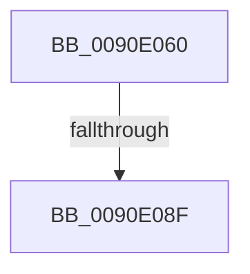

# RtlUTF8ToUnicodeN

- RVA: `0x0090E060`–`0x0090E098` (길이 `56` bytes)
- VA: `0x000000014090E060`
- 실행 섹션: `PAGE`
- PDB 이름 있음: `예`; PDB Function 태그: `예`
- unwind 정보 RVA: `0x0008963C`
- 디코드: `17`개 명령, `56/56` bytes 표시
- 미해석 바이트: `0` (있으면 어셈블리에 `.byte`로 보존)

> 이 문서는 커널 이미지의 기계어와 PDB 기호를 분석해 생성했습니다. 4번과 5번은 함수 원형과 자료형을 바이너리 사용 방식에서 추정한 C 해석이며 원본 소스 복구 결과는 아닙니다.

## 1. Dependencies

- 직접 호출 지점: **0**; 고유 호출 대상: **0**
- 직접 호출자로 확인된 함수: **7**
- RIP 상대 이미지 참조: **0**

### Outgoing calls
- 직접 디코드된 call 명령이 없습니다.

### Direct callers
- [RtlUTF8StringToUnicodeString](../79/RtlUTF8StringToUnicodeString_function_00794B80.md) at `0x00794C28`
- [RtlAnsiStringToUnicodeString](RtlAnsiStringToUnicodeString_function_0090BEA0.md) at `0x0090C07C`
- [RtlAnsiStringToUnicodeString](RtlAnsiStringToUnicodeString_function_0090BEA0.md) at `0x0090C10C`
- [RtlMultiByteToUnicodeSize](RtlMultiByteToUnicodeSize_function_0090CBC0.md) at `0x0090CC2E`
- [RtlMultiByteToUnicodeN](RtlMultiByteToUnicodeN_function_0090D520.md) at `0x0090D665`
- [RtlAnsiCharToUnicodeChar](RtlAnsiCharToUnicodeChar_function_0090D980.md) at `0x0090DAC9`
- [sub_0090DFD3](Unknown_function_0090DFD3.md) at `0x0090DFF7`
- [EtwpApplyContainerFilter](../A9/EtwpApplyContainerFilter_function_00A95454.md) at `0x00A9552C`

### Static image references
- 디코드된 RIP-relative 메모리 참조가 없습니다.

## 2. Other-region calls and transfers

- 다른 실행 섹션으로 향하는 call: **0**
- call이 아닌 외부 분기/꼬리 이동: **2**
  - `0x0090E089` → [sub_0090E17B + 0x1](Unknown_function_0090E17B.md) (`tail-transfer`)
  - `0x0090E092` → [sub_0090E28C](Unknown_function_0090E28C.md) (`tail-transfer`)

## 3. Assembly (complete function range)

```asm
0090E060  40 53                           push rbx
0090E062  57                              push rdi
0090E063  48 83 EC 38                     sub rsp, 0x38
0090E067  8B D2                           mov edx, edx
0090E069  48 8B C1                        mov rax, rcx
0090E06C  48 D1 EA                        shr rdx, 1
0090E06F  4C 8B D1                        mov r10, rcx
0090E072  8B 4C 24 70                     mov ecx, dword ptr [rsp + 0x70]
0090E076  49 8B D8                        mov rbx, r8
0090E079  45 33 C0                        xor r8d, r8d
0090E07C  48 8D 3C 50                     lea rdi, [rax + rdx*2]
0090E080  33 D2                           xor edx, edx
0090E082  4D 8D 1C 09                     lea r11, [r9 + rcx]
0090E086  4D 85 C9                        test r9, r9
0090E089  0F 84 ED 00 00 00               je 0x14090e17c
0090E08F  48 85 C0                        test rax, rax
0090E092  0F 84 F4 01 00 00               je 0x14090e28c
```

## 4. C-style interpretation (structured pseudocode)

```c
__int64 __fastcall RtlUTF8ToUnicodeN(__int64 a1, int a2, __int64 a3, __int64 a4, unsigned int a5)
{
    __int64 v_rsp;

    v_rsp = (v_rsp) - (56);
    a2 = ((unsigned int)(a2)) >> (1);
    a3 = 0;
    a2 = 0;
}
```

## 5. (Beta) C Style

```c
int64_t RtlUTF8ToUnicodeN(void *Arg1, int32_t Arg2, int64_t Arg3, void *Arg4, uint32_t Arg5)
{
    uint8_t *arg1 = (uint8_t *)Arg1;
    uint8_t *arg4 = (uint8_t *)Arg4;

    int64_t local_rsp;

    local_rsp = (local_rsp) - (56);
    Arg2 = ((uint32_t)(Arg2)) >> (1);
    Arg3 = 0;
    Arg2 = 0;
}
```

### 관측된 메모리 오프셋

구조체 형식이 확인되지 않은 접근은 인자 기준의 오프셋으로만 기록했습니다.

| 기준 인자 | 오프셋 표현 | 폭 (bit) | 접근 |
|---|---:|---:|---|
| `Arg1` | `+ 0x0 + rdx*2` | `64` | `R` |
| `Arg4` | `+ 0x0 + rcx*1` | `64` | `R` |

## 6. Execution-region graph

[열기: 2D/3D 그래프와 함수 탐색 컨트롤 패널](../../../control-panel.html?section=page&rva=0x0090E060&view=graph)

- 2D 그래프는 위에서 아래로 흐르고, 3D 그래프는 빈 공간을 드래그해 회전합니다. Shift+드래그는 이동, 휠은 확대·축소, 함수 노드 선택은 대상 보고서 이동입니다.

### Static fallback


