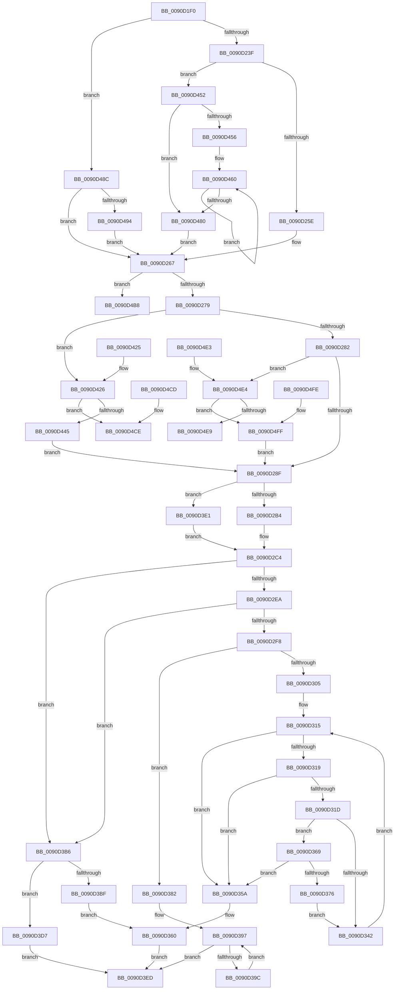

# RtlUnicodeStringToAnsiString

- RVA: `0x0090D1F0`–`0x0090D50C` (길이 `796` bytes)
- VA: `0x000000014090D1F0`
- 실행 섹션: `PAGE`
- PDB 이름 있음: `예`; PDB Function 태그: `아니요`
- unwind 정보 RVA: `0x000893D4`
- 디코드: `227`개 명령, `796/796` bytes 표시
- 미해석 바이트: `0` (있으면 어셈블리에 `.byte`로 보존)

> 이 문서는 커널 이미지의 기계어와 PDB 기호를 분석해 생성했습니다. 4번과 5번은 함수 원형과 자료형을 바이너리 사용 방식에서 추정한 C 해석이며 원본 소스 복구 결과는 아닙니다.

## 1. Dependencies

- 직접 호출 지점: **7**; 고유 호출 대상: **4**
- 직접 호출자로 확인된 함수: **16**
- RIP 상대 이미지 참조: **1**

### Outgoing calls
- `0x0090D232` → [RtlpIsUtf8Process](RtlpIsUtf8Process_function_0090DB60.md) (function, `0x0090DB60`)
- `0x0090D243` → [PsGetCurrentServerSiloGlobals](../../text/2F/PsGetCurrentServerSiloGlobals_function_002FE1F0.md) (function, `0x002FE1F0`)
- `0x0090D2A7` → [RtlpIsUtf8Process](RtlpIsUtf8Process_function_0090DB60.md) (function, `0x0090DB60`)
- `0x0090D2B9` → [PsGetCurrentServerSiloGlobals](../../text/2F/PsGetCurrentServerSiloGlobals_function_002FE1F0.md) (function, `0x002FE1F0`)
- `0x0090D3D0` → [RtlUnicodeToUTF8N](RtlUnicodeToUTF8N_function_0090DBF0.md) (function, `0x0090DBF0`)
- `0x0090D433` → [ExAllocatePool2](../../poolcode/B8/ExAllocatePool2_function_00B820F0.md) (function, `0x00B820F0`)
- `0x0090D4A7` → [RtlUnicodeToUTF8N](RtlUnicodeToUTF8N_function_0090DBF0.md) (function, `0x0090DBF0`)

### Direct callers
- [DbgUnicodeStringToAnsiString](../../text/4A/DbgUnicodeStringToAnsiString_function_004AE190.md) at `0x004AE1EB`
- [DifRtlUnicodeStringToAnsiStringWrapper](../../text/63/DifRtlUnicodeStringToAnsiStringWrapper_function_0063C5D0.md) at `0x0063C6B5`
- [KsepGetModuleInfoByName](../74/KsepGetModuleInfoByName_function_0074AA04.md) at `0x0074AA64`
- [NtQuerySystemEnvironmentValue](../7C/NtQuerySystemEnvironmentValue_function_007CDFB0.md) at `0x007CE157`
- [NtSetSystemEnvironmentValue](../7C/NtSetSystemEnvironmentValue_function_007CE650.md) at `0x007CE830`
- [NtSetSystemEnvironmentValue](../7C/NtSetSystemEnvironmentValue_function_007CE650.md) at `0x007CE8B6`
- [CmpLoadLayerVersion](../7E/CmpLoadLayerVersion_function_007E6A74.md) at `0x007E6DFE`
- [EtwpBuildProcessEvent](../8A/EtwpBuildProcessEvent_function_008A552C.md) at `0x008A57B0`
- [MmGetSystemRoutineAddress](MmGetSystemRoutineAddress_function_0090EFE0.md) at `0x0090F000`
- [MmGetSystemRoutineAddress](MmGetSystemRoutineAddress_function_0090EFE0.md) at `0x0090F026`
- [ExpQueryModuleInformationImage](../A2/ExpQueryModuleInformationImage_function_00A2EB60.md) at `0x00A2EBF3`
- [CmpQueryDowncastString](../A5/CmpQueryDowncastString_function_00A5E9F8.md) at `0x00A5EA34`
- [ExpConvertLdrEntryToModuleInfo](../AA/ExpConvertLdrEntryToModuleInfo_function_00AAA174.md) at `0x00AAA1E4`
- [ObCreateObjectTypeEx](../AB/ObCreateObjectTypeEx_function_00AB46D0.md) at `0x00AB4A78`
- [ExpSystemErrorHandler2](../../pagelk/B7/ExpSystemErrorHandler2_function_00B72C30.md) at `0x00B72D4C`
- [ExpSystemErrorHandler2](../../pagelk/B7/ExpSystemErrorHandler2_function_00B72C30.md) at `0x00B72EE2`
- [ViThunkHookExportAddress](../../pagevrfy/BA/ViThunkHookExportAddress_function_00BA78E8.md) at `0x00BA7957`
- [HdlspProcessDumpCommand](../../pagehdls/BB/HdlspProcessDumpCommand_function_00BBDFDC.md) at `0x00BBE10B`
- [IopReassignSystemRoot](../../init/C2/IopReassignSystemRoot_function_00C2D1D0.md) at `0x00C2D2F6`

### Static image references
- `0x0090D3E1` → RVA `0x00FD8720` (`PAGEDATA`; read)

## 2. Other-region calls and transfers

- 다른 실행 섹션으로 향하는 call: **3**
  - `0x0090D243` → [PsGetCurrentServerSiloGlobals](../../text/2F/PsGetCurrentServerSiloGlobals_function_002FE1F0.md) (`PAGE` → `.text`)
  - `0x0090D2B9` → [PsGetCurrentServerSiloGlobals](../../text/2F/PsGetCurrentServerSiloGlobals_function_002FE1F0.md) (`PAGE` → `.text`)
  - `0x0090D433` → [ExAllocatePool2](../../poolcode/B8/ExAllocatePool2_function_00B820F0.md) (`PAGE` → `POOLCODE`)
- 별도 외부 분기/꼬리 이동을 확인하지 못했습니다.

## 3. Assembly (complete function range)

```asm
0090D1F0  44 88 44 24 18                  mov byte ptr [rsp + 0x18], r8b
0090D1F5  48 89 4C 24 08                  mov qword ptr [rsp + 8], rcx
0090D1FA  53                              push rbx
0090D1FB  56                              push rsi
0090D1FC  57                              push rdi
0090D1FD  41 54                           push r12
0090D1FF  41 55                           push r13
0090D201  41 56                           push r14
0090D203  41 57                           push r15
0090D205  48 83 EC 60                     sub rsp, 0x60
0090D209  45 0F B6 F0                     movzx r14d, r8b
0090D20D  4C 8B FA                        mov r15, rdx
0090D210  4C 8B E9                        mov r13, rcx
0090D213  C6 84 24 A8 00 00 00 00         mov byte ptr [rsp + 0xa8], 0
0090D21B  45 33 E4                        xor r12d, r12d
0090D21E  41 8B F4                        mov esi, r12d
0090D221  44 89 A4 24 B8 00 00 00         mov dword ptr [rsp + 0xb8], r12d
0090D229  0F B7 1A                        movzx ebx, word ptr [rdx]
0090D22C  48 8B 7A 08                     mov rdi, qword ptr [rdx + 8]
0090D230  33 C9                           xor ecx, ecx
0090D232  E8 29 09 00 00                  call 0x14090db60
0090D237  84 C0                           test al, al
0090D239  0F 85 4D 02 00 00               jne 0x14090d48c
0090D23F  F0 09 34 24                     lock or dword ptr [rsp], esi
0090D243  E8 A8 0F 9F FF                  call 0x1402fe1f0
0090D248  48 8B 90 30 04 00 00            mov rdx, qword ptr [rax + 0x430]
0090D24F  D1 EB                           shr ebx, 1
0090D251  66 39 B0 14 04 00 00            cmp word ptr [rax + 0x414], si
0090D258  0F 85 F4 01 00 00               jne 0x14090d452
0090D25E  8B F3                           mov esi, ebx
0090D260  89 9C 24 B8 00 00 00            mov dword ptr [rsp + 0xb8], ebx
0090D267  FF C6                           inc esi
0090D269  89 74 24 30                     mov dword ptr [rsp + 0x30], esi
0090D26D  81 FE FF FF 00 00               cmp esi, 0xffff
0090D273  0F 87 3F 02 00 00               ja 0x14090d4b8
0090D279  45 84 F6                        test r14b, r14b
0090D27C  0F 85 A4 01 00 00               jne 0x14090d426
0090D282  41 0F B7 45 02                  movzx eax, word ptr [r13 + 2]
0090D287  3B F0                           cmp esi, eax
0090D289  0F 87 55 02 00 00               ja 0x14090d4e4
0090D28F  44 89 64 24 44                  mov dword ptr [rsp + 0x44], r12d
0090D294  41 0F B7 37                     movzx esi, word ptr [r15]
0090D298  4D 8B 77 08                     mov r14, qword ptr [r15 + 8]
0090D29C  0F B7 F8                        movzx edi, ax
0090D29F  FF CF                           dec edi
0090D2A1  49 8B 5D 08                     mov rbx, qword ptr [r13 + 8]
0090D2A5  33 C9                           xor ecx, ecx
0090D2A7  E8 B4 08 00 00                  call 0x14090db60
0090D2AC  84 C0                           test al, al
0090D2AE  0F 85 2D 01 00 00               jne 0x14090d3e1
0090D2B4  F0 83 0C 24 00                  lock or dword ptr [rsp], 0
0090D2B9  E8 32 0F 9F FF                  call 0x1402fe1f0
0090D2BE  48 05 08 04 00 00               add rax, 0x408
0090D2C4  4C 89 74 24 58                  mov qword ptr [rsp + 0x58], r14
0090D2C9  4C 8D 54 24 30                  lea r10, [rsp + 0x30]
0090D2CE  89 7C 24 38                     mov dword ptr [rsp + 0x38], edi
0090D2D2  48 89 5C 24 50                  mov qword ptr [rsp + 0x50], rbx
0090D2D7  44 89 64 24 34                  mov dword ptr [rsp + 0x34], r12d
0090D2DC  44 89 64 24 40                  mov dword ptr [rsp + 0x40], r12d
0090D2E1  48 85 C0                        test rax, rax
0090D2E4  0F 84 CC 00 00 00               je 0x14090d3b6
0090D2EA  B9 E9 FD 00 00                  mov ecx, 0xfde9
0090D2EF  66 39 08                        cmp word ptr [rax], cx
0090D2F2  0F 84 BE 00 00 00               je 0x14090d3b6
0090D2F8  D1 EE                           shr esi, 1
0090D2FA  89 74 24 40                     mov dword ptr [rsp + 0x40], esi
0090D2FE  66 83 78 0C 00                  cmp word ptr [rax + 0xc], 0
0090D303  74 7D                           je 0x14090d382
0090D305  66 44 89 A4 24 B8 00 00 00      mov word ptr [rsp + 0xb8], r12w
0090D30E  4C 8B CB                        mov r9, rbx
0090D311  4C 8B 40 28                     mov r8, qword ptr [rax + 0x28]
0090D315  85 F6                           test esi, esi
0090D317  74 41                           je 0x14090d35a
0090D319  85 FF                           test edi, edi
0090D31B  74 3D                           je 0x14090d35a
0090D31D  41 0F B7 06                     movzx eax, word ptr [r14]
0090D321  41 0F B7 0C 40                  movzx ecx, word ptr [r8 + rax*2]
0090D326  66 89 8C 24 B8 00 00 00         mov word ptr [rsp + 0xb8], cx
0090D32E  49 83 C6 02                     add r14, 2
0090D332  4C 89 74 24 58                  mov qword ptr [rsp + 0x58], r14
0090D337  0F B7 D1                        movzx edx, cx
0090D33A  66 C1 EA 08                     shr dx, 8
0090D33E  84 D2                           test dl, dl
0090D340  75 27                           jne 0x14090d369
0090D342  88 0B                           mov byte ptr [rbx], cl
0090D344  48 FF C3                        inc rbx
0090D347  48 89 5C 24 50                  mov qword ptr [rsp + 0x50], rbx
0090D34C  FF CF                           dec edi
0090D34E  89 7C 24 38                     mov dword ptr [rsp + 0x38], edi
0090D352  FF CE                           dec esi
0090D354  89 74 24 40                     mov dword ptr [rsp + 0x40], esi
0090D358  EB BB                           jmp 0x14090d315
0090D35A  41 2B D9                        sub ebx, r9d
0090D35D  41 89 1A                        mov dword ptr [r10], ebx
0090D360  8B 7C 24 30                     mov edi, dword ptr [rsp + 0x30]
0090D364  E9 84 00 00 00                  jmp 0x14090d3ed
0090D369  8B C7                           mov eax, edi
0090D36B  FF CF                           dec edi
0090D36D  89 7C 24 38                     mov dword ptr [rsp + 0x38], edi
0090D371  83 F8 02                        cmp eax, 2
0090D374  72 E4                           jb 0x14090d35a
0090D376  88 13                           mov byte ptr [rbx], dl
0090D378  48 FF C3                        inc rbx
0090D37B  48 89 5C 24 50                  mov qword ptr [rsp + 0x50], rbx
0090D380  EB C0                           jmp 0x14090d342
0090D382  3B F7                           cmp esi, edi
0090D384  0F 42 FE                        cmovb edi, esi
0090D387  89 7C 24 30                     mov dword ptr [rsp + 0x30], edi
0090D38B  4C 8B 48 28                     mov r9, qword ptr [rax + 0x28]
0090D38F  45 8B C4                        mov r8d, r12d
0090D392  44 89 64 24 34                  mov dword ptr [rsp + 0x34], r12d
0090D397  44 3B C7                        cmp r8d, edi
0090D39A  73 51                           jae 0x14090d3ed
0090D39C  41 8B D0                        mov edx, r8d
0090D39F  41 0F B7 04 56                  movzx eax, word ptr [r14 + rdx*2]
0090D3A4  42 0F B6 0C 08                  movzx ecx, byte ptr [rax + r9]
0090D3A9  88 0C 1A                        mov byte ptr [rdx + rbx], cl
0090D3AC  41 FF C0                        inc r8d
0090D3AF  44 89 44 24 34                  mov dword ptr [rsp + 0x34], r8d
0090D3B4  EB E1                           jmp 0x14090d397
0090D3B6  44 89 64 24 48                  mov dword ptr [rsp + 0x48], r12d
0090D3BB  85 F6                           test esi, esi
0090D3BD  74 18                           je 0x14090d3d7
0090D3BF  89 74 24 20                     mov dword ptr [rsp + 0x20], esi
0090D3C3  4D 8B CE                        mov r9, r14
0090D3C6  4C 8D 44 24 30                  lea r8, [rsp + 0x30]
0090D3CB  8B D7                           mov edx, edi
0090D3CD  48 8B CB                        mov rcx, rbx
0090D3D0  E8 1B 08 00 00                  call 0x14090dbf0
0090D3D5  EB 89                           jmp 0x14090d360
0090D3D7  41 8B FC                        mov edi, r12d
0090D3DA  44 89 64 24 30                  mov dword ptr [rsp + 0x30], r12d
0090D3DF  EB 0C                           jmp 0x14090d3ed
0090D3E1  48 8D 05 38 B3 6C 00            lea rax, [rip + 0x6cb338]
0090D3E8  E9 D7 FE FF FF                  jmp 0x14090d2c4
0090D3ED  44 89 64 24 44                  mov dword ptr [rsp + 0x44], r12d
0090D3F2  8B CF                           mov ecx, edi
0090D3F4  49 8B 45 08                     mov rax, qword ptr [r13 + 8]
0090D3F8  C6 04 01 00                     mov byte ptr [rcx + rax], 0
0090D3FC  66 41 89 7D 00                  mov word ptr [r13], di
0090D401  B8 05 00 00 80                  mov eax, 0x80000005
0090D406  80 BC 24 A8 00 00 00 00         cmp byte ptr [rsp + 0xa8], 0
0090D40E  44 0F 45 E0                     cmovne r12d, eax
0090D412  41 8B C4                        mov eax, r12d
0090D415  48 83 C4 60                     add rsp, 0x60
0090D419  41 5F                           pop r15
0090D41B  41 5E                           pop r14
0090D41D  41 5D                           pop r13
0090D41F  41 5C                           pop r12
0090D421  5F                              pop rdi
0090D422  5E                              pop rsi
0090D423  5B                              pop rbx
0090D424  C3                              ret
0090D425  CC                              int3
0090D426  8B D6                           mov edx, esi
0090D428  B9 00 01 00 00                  mov ecx, 0x100
0090D42D  41 B8 53 74 72 67               mov r8d, 0x67727453
0090D433  E8 B8 4C 27 00                  call 0x140b820f0
0090D438  49 89 45 08                     mov qword ptr [r13 + 8], rax
0090D43C  48 85 C0                        test rax, rax
0090D43F  0F 84 89 00 00 00               je 0x14090d4ce
0090D445  66 41 89 75 02                  mov word ptr [r13 + 2], si
0090D44A  0F B7 C6                        movzx eax, si
0090D44D  E9 3D FE FF FF                  jmp 0x14090d28f
0090D452  85 DB                           test ebx, ebx
0090D454  74 2A                           je 0x14090d480
0090D456  66 66 0F 1F 84 00 00 00 00 00   nop word ptr [rax + rax]
0090D460  0F B7 07                        movzx eax, word ptr [rdi]
0090D463  0F B7 0C 42                     movzx ecx, word ptr [rdx + rax*2]
0090D467  48 8D 7F 02                     lea rdi, [rdi + 2]
0090D46B  66 C1 E9 08                     shr cx, 8
0090D46F  41 8B C4                        mov eax, r12d
0090D472  84 C9                           test cl, cl
0090D474  0F 95 C0                        setne al
0090D477  FF C0                           inc eax
0090D479  03 F0                           add esi, eax
0090D47B  83 C3 FF                        add ebx, -1
0090D47E  75 E0                           jne 0x14090d460
0090D480  89 B4 24 B8 00 00 00            mov dword ptr [rsp + 0xb8], esi
0090D487  E9 DB FD FF FF                  jmp 0x14090d267
0090D48C  85 DB                           test ebx, ebx
0090D48E  0F 84 D3 FD FF FF               je 0x14090d267
0090D494  89 5C 24 20                     mov dword ptr [rsp + 0x20], ebx
0090D498  4C 8B CF                        mov r9, rdi
0090D49B  4C 8D 84 24 B8 00 00 00         lea r8, [rsp + 0xb8]
0090D4A3  33 D2                           xor edx, edx
0090D4A5  33 C9                           xor ecx, ecx
0090D4A7  E8 44 07 00 00                  call 0x14090dbf0
0090D4AC  8B B4 24 B8 00 00 00            mov esi, dword ptr [rsp + 0xb8]
0090D4B3  E9 AF FD FF FF                  jmp 0x14090d267
0090D4B8  B8 F0 00 00 C0                  mov eax, 0xc00000f0
0090D4BD  48 83 C4 60                     add rsp, 0x60
0090D4C1  41 5F                           pop r15
0090D4C3  41 5E                           pop r14
0090D4C5  41 5D                           pop r13
0090D4C7  41 5C                           pop r12
0090D4C9  5F                              pop rdi
0090D4CA  5E                              pop rsi
0090D4CB  5B                              pop rbx
0090D4CC  C3                              ret
0090D4CD  CC                              int3
0090D4CE  B8 17 00 00 C0                  mov eax, 0xc0000017
0090D4D3  48 83 C4 60                     add rsp, 0x60
0090D4D7  41 5F                           pop r15
0090D4D9  41 5E                           pop r14
0090D4DB  41 5D                           pop r13
0090D4DD  41 5C                           pop r12
0090D4DF  5F                              pop rdi
0090D4E0  5E                              pop rsi
0090D4E1  5B                              pop rbx
0090D4E2  C3                              ret
0090D4E3  CC                              int3
0090D4E4  66 85 C0                        test ax, ax
0090D4E7  75 16                           jne 0x14090d4ff
0090D4E9  B8 05 00 00 80                  mov eax, 0x80000005
0090D4EE  48 83 C4 60                     add rsp, 0x60
0090D4F2  41 5F                           pop r15
0090D4F4  41 5E                           pop r14
0090D4F6  41 5D                           pop r13
0090D4F8  41 5C                           pop r12
0090D4FA  5F                              pop rdi
0090D4FB  5E                              pop rsi
0090D4FC  5B                              pop rbx
0090D4FD  C3                              ret
0090D4FE  CC                              int3
0090D4FF  C6 84 24 A8 00 00 00 01         mov byte ptr [rsp + 0xa8], 1
0090D507  E9 83 FD FF FF                  jmp 0x14090d28f
```

## 4. C-style interpretation (structured pseudocode)

```c
__int64 __fastcall RtlUnicodeStringToAnsiString(__int64 a1, __int64 a2, unsigned __int8 a3)
{
    __int64 result;
    __int64 v_r12;
    __int64 v_r14;
    __int64 v_rbx;
    __int64 v_rdi;
    __int64 v_rsi;
    __int64 v_rsp;
    unsigned __int64 v_stack_m40;
    unsigned __int64 v_stack_m48;
    unsigned int v_stack_m50;
    unsigned int v_stack_m54;
    unsigned int v_stack_m58;
    unsigned int v_stack_m60;
    unsigned int v_stack_m64;
    unsigned int v_stack_m68;
    unsigned int v_stack_m78;
    unsigned int v_stack_m98;
    unsigned __int8 v_stack_p10;
    unsigned __int8 v_stack_p18;
    unsigned int v_stack_p20;
    unsigned __int8 v_stack_p270;
    unsigned __int64 v_stack_p8;
    unsigned int v_stack_pB8;

    v_stack_p18 = a3;
    v_stack_p8 = a1;
    v_rsp = (v_rsp) - (96);
    v_stack_p10 = 0;
    v_r12 = 0;
    v_stack_p20 = 0;
    a1 = 0;
    result = RtlpIsUtf8Process(a1, a2, a3, a4);
    if ((unsigned __int8)(result) != 0) goto loc_0090D48C;
    result = PsGetCurrentServerSiloGlobals(a1, a2, a3, a4);
    v_rbx = (unsigned int)((*(unsigned __int16 *)(a2)) >> (1));
    if ((*(unsigned __int16 *)(result + 1044)) != 0) goto loc_0090D452;
    v_stack_p20 = (unsigned int)(v_rbx);
loc_0090D267:
    v_rsi = (unsigned int)(((unsigned int)((unsigned int)(v_rbx))) + 1);
    v_stack_m68 = (unsigned int)(v_rsi);
    if (((unsigned int)(v_rsi)) > 0xFFFFULL) goto loc_0090D4B8;
    if (a3 != 0) goto loc_0090D426;
    if (((unsigned int)(v_rsi)) > ((unsigned int)(*(unsigned __int16 *)(a1 + 2)))) goto loc_0090D4E4;
loc_0090D28F:
    v_stack_m54 = 0;
    v_rdi = (unsigned int)(((unsigned __int16)(*(unsigned __int16 *)(a1 + 2))) - 1);
    a1 = 0;
    result = RtlpIsUtf8Process(a1, *(unsigned __int64 *)(result + 1072), a3, a4);
    if ((unsigned __int8)(result) != 0) goto loc_0090D3E1;
    result = PsGetCurrentServerSiloGlobals(a1, *(unsigned __int64 *)(result + 1072), a3, a4);
    result = (result) + (0x408ULL);
loc_0090D2C4:
    v_stack_m40 = *(unsigned __int64 *)(a2 + 8);
    v_stack_m60 = (unsigned int)(v_rdi);
    v_stack_m48 = *(unsigned __int64 *)(a1 + 8);
    v_stack_m64 = 0;
    v_stack_m58 = 0;
    if (result == 0) goto loc_0090D3B6;
    if ((*(unsigned __int16 *)(result)) == ((unsigned __int16)((unsigned int)(0xFDE9ULL)))) goto loc_0090D3B6;
    v_rsi = (unsigned int)((*(unsigned __int16 *)(a2)) >> (1));
    v_stack_m58 = (unsigned int)(v_rsi);
    if ((*(unsigned __int16 *)(result + 12)) == 0) goto loc_0090D382;
    v_stack_p20 = 0;
loc_0090D315:
    if ((unsigned int)(v_rsi) == 0) goto loc_0090D35A;
    if ((unsigned int)(v_rdi) == 0) goto loc_0090D35A;
    v_stack_p20 = (unsigned __int16)(*(unsigned __int16 *)(*(unsigned __int64 *)(result + 40) + *(unsigned __int16 *)(*(unsigned __int64 *)(a2 + 8)) * 2));
    v_r14 = (*(unsigned __int64 *)(a2 + 8)) + (2);
    v_stack_m40 = v_r14;
    a2 = (unsigned __int16)(((unsigned __int16)(*(unsigned __int16 *)(*(unsigned __int64 *)(result + 40) + *(unsigned __int16 *)(*(unsigned __int64 *)(a2 + 8)) * 2))) >> (8));
    if ((unsigned __int8)(a2) != 0) goto loc_0090D369;
loc_0090D342:
    *(unsigned __int8 *)(*(unsigned __int64 *)(a1 + 8)) = (unsigned __int8)(*(unsigned __int16 *)(*(unsigned __int64 *)(result + 40) + *(unsigned __int16 *)(*(unsigned __int64 *)(a2 + 8)) * 2));
    v_rbx = (*(unsigned __int64 *)(a1 + 8)) + 1;
    v_stack_m48 = v_rbx;
    v_rdi = (unsigned int)((v_rdi) - 1);
    v_stack_m60 = (unsigned int)(v_rdi);
    v_rsi = (unsigned int)((v_rsi) - 1);
    v_stack_m58 = (unsigned int)(v_rsi);
    goto loc_0090D315;
loc_0090D35A:
    v_rbx = (unsigned int)((v_rbx) - ((unsigned int)(*(unsigned __int64 *)(a1 + 8))));
    *(unsigned int *)(v_stack_m68) = (unsigned int)(v_rbx);
loc_0090D360:
    goto loc_0090D3ED;
loc_0090D369:
    v_rdi = (unsigned int)(((unsigned int)(v_stack_m68)) - 1);
    v_stack_m60 = (unsigned int)(v_rdi);
    if (((unsigned int)((unsigned int)((unsigned int)((unsigned int)(v_stack_m68))))) < 2) goto loc_0090D35A;
    *(unsigned __int8 *)(v_rbx) = (unsigned __int8)(a2);
    v_rbx = (v_rbx) + 1;
    v_stack_m48 = v_rbx;
    goto loc_0090D342;
loc_0090D382:
    if (((unsigned int)(v_rsi)) < ((unsigned int)(v_rdi))) { v_rdi = (unsigned int)(v_rsi); }
    v_stack_m68 = (unsigned int)(v_rdi);
    v_stack_m64 = 0;
loc_0090D397:
    if (0 >= ((unsigned int)(v_rdi))) goto loc_0090D3ED;
    *(unsigned __int8 *)(0 + v_rbx * 1) = (unsigned __int8)(*(unsigned __int8 *)(*(unsigned __int16 *)(v_r14 + 0 * 2) + *(unsigned __int64 *)((unsigned int)((unsigned int)((unsigned int)(v_stack_m68))) + 40) * 1));
    a3 = (unsigned int)((0) + 1);
    v_stack_m64 = a3;
    goto loc_0090D397;
loc_0090D3B6:
    v_stack_m50 = 0;
    if ((unsigned int)(v_rsi) == 0) goto loc_0090D3D7;
    v_stack_m78 = (unsigned int)(v_rsi);
    result = RtlUnicodeToUTF8N(v_rbx, (unsigned int)((unsigned int)(v_rdi)), v_stack_m68, v_r14);
    goto loc_0090D360;
loc_0090D3D7:
    v_stack_m68 = 0;
    goto loc_0090D3ED;
loc_0090D3E1:
    goto loc_0090D2C4;
loc_0090D3ED:
    v_stack_m54 = 0;
    *(unsigned __int8 *)(0 + *(unsigned __int64 *)(a1 + 8) * 1) = 0;
    *(unsigned __int16 *)(a1) = 0;
    if (v_stack_p10 != 0) { v_r12 = (unsigned int)((unsigned int)(0x80000005ULL)); }
    v_rsp = (v_rsp) + (96);
    return (unsigned int)((unsigned int)(v_r12));
loc_0090D426:
    result = ExAllocatePool2(256, (unsigned int)((unsigned int)(v_rsi)), (unsigned int)(0x67727453ULL), v_r14);
    *(unsigned __int64 *)(a1 + 8) = result;
    if (result == 0) goto loc_0090D4CE;
    *(unsigned __int16 *)(a1 + 2) = (unsigned __int16)(v_rsi);
    goto loc_0090D28F;
loc_0090D452:
    if ((unsigned int)(v_rbx) == 0) goto loc_0090D480;
loc_0090D460:
    a1 = (unsigned __int16)((*(unsigned __int16 *)((unsigned int)((unsigned int)(v_rsi)) + *(unsigned __int16 *)(0) * 2)) >> (8));
    result = ((unsigned __int8)(a1) != 0) ? 1 : 0;
    result = (unsigned int)((result) + 1);
    v_rsi = (unsigned int)((v_rsi) + ((unsigned int)(result)));
    v_rbx = (unsigned int)((v_rbx) + (-1));
    if (condition_is_not_equal) goto loc_0090D460;
loc_0090D480:
    v_stack_pB8 = (unsigned int)(v_rsi);
    goto loc_0090D267;
loc_0090D48C:
    if ((unsigned int)(v_rbx) == 0) goto loc_0090D267;
    v_stack_p20 = (unsigned int)(v_rbx);
    a2 = 0;
    a1 = 0;
    result = RtlUnicodeToUTF8N(a1, a2, v_stack_pB8, 0 + 2);
    goto loc_0090D267;
loc_0090D4B8:
    v_rsp = (v_rsp) + (96);
    return (unsigned int)(0xC00000F0ULL);
loc_0090D4CE:
    v_rsp = (v_rsp) + (96);
    return (unsigned int)(0xC0000017ULL);
loc_0090D4E4:
    if ((unsigned __int16)((unsigned int)(0xC0000017ULL)) != 0) goto loc_0090D4FF;
    v_rsp = (v_rsp) + (96);
    return (unsigned int)(0x80000005ULL);
loc_0090D4FF:
    v_stack_p270 = 1;
    goto loc_0090D28F;
}
```

## 5. (Beta) C Style

```c
int64_t RtlUnicodeStringToAnsiString(void *Arg1, void *Arg2, uint8_t Arg3)
{
    uint8_t *arg1 = (uint8_t *)Arg1;
    uint8_t *arg2 = (uint8_t *)Arg2;

    int64_t result;
    int64_t local_r12;
    int64_t local_r14;
    int64_t local_rbx;
    int64_t local_rdi;
    int64_t local_rsi;
    int64_t local_rsp;
    uint64_t v_stack_m40;
    uint64_t v_stack_m48;
    uint32_t v_stack_m50;
    uint32_t v_stack_m54;
    uint32_t v_stack_m58;
    uint32_t v_stack_m60;
    uint32_t v_stack_m64;
    uint32_t v_stack_m68;
    uint32_t v_stack_m78;
    uint32_t v_stack_m98;
    uint8_t v_stack_p10;
    uint8_t v_stack_p18;
    uint32_t v_stack_p20;
    uint8_t v_stack_p270;
    uint64_t v_stack_p8;
    uint32_t v_stack_pB8;

    v_stack_p18 = Arg3;
    v_stack_p8 = Arg1;
    local_rsp = (local_rsp) - (96);
    v_stack_p10 = 0;
    local_r12 = 0;
    v_stack_p20 = 0;
    Arg1 = 0;
    result = RtlpIsUtf8Process(Arg1, Arg2, Arg3, a4);
    if ((uint8_t)(result) != 0) goto loc_0090D48C;
    result = PsGetCurrentServerSiloGlobals(Arg1, Arg2, Arg3, a4);
    local_rbx = (uint32_t)((*(uint16_t *)(arg2)) >> (1));
    if ((*(uint16_t *)(result + 0x414)) != 0) goto loc_0090D452;
    v_stack_p20 = (uint32_t)(local_rbx);
loc_0090D267:
    local_rsi = (uint32_t)(((uint32_t)((uint32_t)(local_rbx))) + 1);
    v_stack_m68 = (uint32_t)(local_rsi);
    if (((uint32_t)(local_rsi)) > 0xFFFFULL) goto loc_0090D4B8;
    if (Arg3 != 0) goto loc_0090D426;
    if (((uint32_t)(local_rsi)) > ((uint32_t)(*(uint16_t *)(arg1 + 0x2)))) goto loc_0090D4E4;
loc_0090D28F:
    v_stack_m54 = 0;
    local_rdi = (uint32_t)(((uint16_t)(*(uint16_t *)(arg1 + 0x2))) - 1);
    Arg1 = 0;
    result = RtlpIsUtf8Process(Arg1, *(uint64_t *)(result + 0x430), Arg3, a4);
    if ((uint8_t)(result) != 0) goto loc_0090D3E1;
    result = PsGetCurrentServerSiloGlobals(Arg1, *(uint64_t *)(result + 0x430), Arg3, a4);
    result = (result) + (0x408ULL);
loc_0090D2C4:
    v_stack_m40 = *(uint64_t *)(arg2 + 0x8);
    v_stack_m60 = (uint32_t)(local_rdi);
    v_stack_m48 = *(uint64_t *)(arg1 + 0x8);
    v_stack_m64 = 0;
    v_stack_m58 = 0;
    if (result == 0) goto loc_0090D3B6;
    if ((*(uint16_t *)(result)) == ((uint16_t)((uint32_t)(0xFDE9ULL)))) goto loc_0090D3B6;
    local_rsi = (uint32_t)((*(uint16_t *)(arg2)) >> (1));
    v_stack_m58 = (uint32_t)(local_rsi);
    if ((*(uint16_t *)(result + 0xC)) == 0) goto loc_0090D382;
    v_stack_p20 = 0;
loc_0090D315:
    if ((uint32_t)(local_rsi) == 0) goto loc_0090D35A;
    if ((uint32_t)(local_rdi) == 0) goto loc_0090D35A;
    v_stack_p20 = (uint16_t)(*(uint16_t *)(*(uint64_t *)(result + 0x28) + *(uint16_t *)(*(uint64_t *)(arg2 + 0x8)) * 2));
    local_r14 = (*(uint64_t *)(arg2 + 0x8)) + (2);
    v_stack_m40 = local_r14;
    Arg2 = (uint16_t)(((uint16_t)(*(uint16_t *)(*(uint64_t *)(result + 0x28) + *(uint16_t *)(*(uint64_t *)(arg2 + 0x8)) * 2))) >> (8));
    if ((uint8_t)(Arg2) != 0) goto loc_0090D369;
loc_0090D342:
    *(uint8_t *)(*(uint64_t *)(arg1 + 0x8)) = (uint8_t)(*(uint16_t *)(*(uint64_t *)(result + 0x28) + *(uint16_t *)(*(uint64_t *)(arg2 + 0x8)) * 2));
    local_rbx = (*(uint64_t *)(arg1 + 0x8)) + 1;
    v_stack_m48 = local_rbx;
    local_rdi = (uint32_t)((local_rdi) - 1);
    v_stack_m60 = (uint32_t)(local_rdi);
    local_rsi = (uint32_t)((local_rsi) - 1);
    v_stack_m58 = (uint32_t)(local_rsi);
    goto loc_0090D315;
loc_0090D35A:
    local_rbx = (uint32_t)((local_rbx) - ((uint32_t)(*(uint64_t *)(arg1 + 0x8))));
    *(uint32_t *)(v_stack_m68) = (uint32_t)(local_rbx);
loc_0090D360:
    goto loc_0090D3ED;
loc_0090D369:
    local_rdi = (uint32_t)(((uint32_t)(v_stack_m68)) - 1);
    v_stack_m60 = (uint32_t)(local_rdi);
    if (((uint32_t)((uint32_t)((uint32_t)((uint32_t)(v_stack_m68))))) < 2) goto loc_0090D35A;
    *(uint8_t *)(local_rbx) = (uint8_t)(Arg2);
    local_rbx = (local_rbx) + 1;
    v_stack_m48 = local_rbx;
    goto loc_0090D342;
loc_0090D382:
    if (((uint32_t)(local_rsi)) < ((uint32_t)(local_rdi))) { local_rdi = (uint32_t)(local_rsi); }
    v_stack_m68 = (uint32_t)(local_rdi);
    v_stack_m64 = 0;
loc_0090D397:
    if (0 >= ((uint32_t)(local_rdi))) goto loc_0090D3ED;
    *(uint8_t *)(0 + local_rbx * 1) = (uint8_t)(*(uint8_t *)(*(uint16_t *)(local_r14 + 0x0 * 2) + *(uint64_t *)((uint32_t)((uint32_t)((uint32_t)(v_stack_m68))) + 0x28) * 1));
    Arg3 = (uint32_t)((0) + 1);
    v_stack_m64 = Arg3;
    goto loc_0090D397;
loc_0090D3B6:
    v_stack_m50 = 0;
    if ((uint32_t)(local_rsi) == 0) goto loc_0090D3D7;
    v_stack_m78 = (uint32_t)(local_rsi);
    result = RtlUnicodeToUTF8N(local_rbx, (uint32_t)((uint32_t)(local_rdi)), v_stack_m68, local_r14);
    goto loc_0090D360;
loc_0090D3D7:
    v_stack_m68 = 0;
    goto loc_0090D3ED;
loc_0090D3E1:
    goto loc_0090D2C4;
loc_0090D3ED:
    v_stack_m54 = 0;
    *(uint8_t *)(0 + *(uint64_t *)(arg1 + 0x8) * 1) = 0;
    *(uint16_t *)(arg1) = 0;
    if (v_stack_p10 != 0) { local_r12 = (uint32_t)((uint32_t)(0x80000005ULL)); }
    local_rsp = (local_rsp) + (96);
    return (uint32_t)((uint32_t)(local_r12));
loc_0090D426:
    result = ExAllocatePool2(256, (uint32_t)((uint32_t)(local_rsi)), (uint32_t)(0x67727453ULL), local_r14);
    *(uint64_t *)(arg1 + 0x8) = result;
    if (result == 0) goto loc_0090D4CE;
    *(uint16_t *)(arg1 + 0x2) = (uint16_t)(local_rsi);
    goto loc_0090D28F;
loc_0090D452:
    if ((uint32_t)(local_rbx) == 0) goto loc_0090D480;
loc_0090D460:
    Arg1 = (uint16_t)((*(uint16_t *)((uint32_t)((uint32_t)(local_rsi)) + *(uint16_t *)(0) * 2)) >> (8));
    result = ((uint8_t)(Arg1) != 0) ? 1 : 0;
    result = (uint32_t)((result) + 1);
    local_rsi = (uint32_t)((local_rsi) + ((uint32_t)(result)));
    local_rbx = (uint32_t)((local_rbx) + (-1));
    if (condition_is_not_equal) goto loc_0090D460;
loc_0090D480:
    v_stack_pB8 = (uint32_t)(local_rsi);
    goto loc_0090D267;
loc_0090D48C:
    if ((uint32_t)(local_rbx) == 0) goto loc_0090D267;
    v_stack_p20 = (uint32_t)(local_rbx);
    Arg2 = 0;
    Arg1 = 0;
    result = RtlUnicodeToUTF8N(Arg1, Arg2, v_stack_pB8, 0 + 2);
    goto loc_0090D267;
loc_0090D4B8:
    local_rsp = (local_rsp) + (96);
    return (uint32_t)(0xC00000F0ULL);
loc_0090D4CE:
    local_rsp = (local_rsp) + (96);
    return (uint32_t)(0xC0000017ULL);
loc_0090D4E4:
    if ((uint16_t)((uint32_t)(0xC0000017ULL)) != 0) goto loc_0090D4FF;
    local_rsp = (local_rsp) + (96);
    return (uint32_t)(0x80000005ULL);
loc_0090D4FF:
    v_stack_p270 = 1;
    goto loc_0090D28F;
}
```

### 관측된 메모리 오프셋

구조체 형식이 확인되지 않은 접근은 인자 기준의 오프셋으로만 기록했습니다.

| 기준 인자 | 오프셋 표현 | 폭 (bit) | 접근 |
|---|---:|---:|---|
| `Arg1` | `+ 0x0` | `16` | `W` |
| `Arg1` | `+ 0x2` | `16` | `R` |
| `Arg1` | `+ 0x2` | `16` | `W` |
| `Arg1` | `+ 0x8` | `64` | `R` |
| `Arg1` | `+ 0x8` | `64` | `W` |
| `Arg2` | `+ 0x0` | `16` | `R` |
| `Arg2` | `+ 0x8` | `64` | `R` |

## 6. Execution-region graph

[열기: 2D/3D 그래프와 함수 탐색 컨트롤 패널](../../../control-panel.html?section=page&rva=0x0090D1F0&view=graph)

- 2D 그래프는 위에서 아래로 흐르고, 3D 그래프는 빈 공간을 드래그해 회전합니다. Shift+드래그는 이동, 휠은 확대·축소, 함수 노드 선택은 대상 보고서 이동입니다.

### Static fallback


