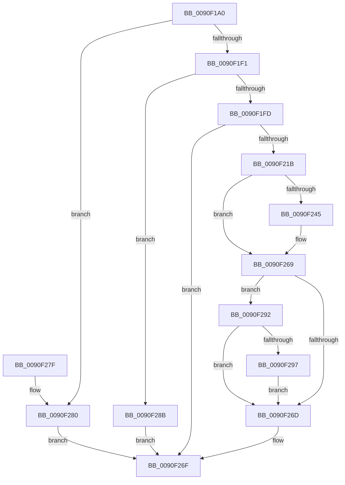

# RtlUnicodeStringToCountedOemString

- RVA: `0x0090F1A0`–`0x0090F2A8` (길이 `264` bytes)
- VA: `0x000000014090F1A0`
- 실행 섹션: `PAGE`
- PDB 이름 있음: `예`; PDB Function 태그: `아니요`
- unwind 정보 RVA: `0x00089890`
- 디코드: `81`개 명령, `264/264` bytes 표시
- 미해석 바이트: `0` (있으면 어셈블리에 `.byte`로 보존)

> 이 문서는 커널 이미지의 기계어와 PDB 기호를 분석해 생성했습니다. 4번과 5번은 함수 원형과 자료형을 바이너리 사용 방식에서 추정한 C 해석이며 원본 소스 복구 결과는 아닙니다.

## 1. Dependencies

- 직접 호출 지점: **5**; 고유 호출 대상: **5**
- 직접 호출자로 확인된 함수: **1**
- RIP 상대 이미지 참조: **0**

### Outgoing calls
- `0x0090F1D6` → [RtlUnicodeToMultiByteSize](RtlUnicodeToMultiByteSize_function_0090D110.md) (function, `0x0090D110`)
- `0x0090F20E` → [AllocateOrValidateCharStringBuffer](../../text/44/AllocateOrValidateCharStringBuffer_function_00447F60.md) (function, `0x00447F60`)
- `0x0090F236` → [RtlUnicodeToOemN](RtlUnicodeToOemN_function_0090F2B0.md) (function, `0x0090F2B0`)
- `0x0090F256` → [RtlpDidUnicodeToOemWork](RtlpDidUnicodeToOemWork_function_0090CD30.md) (function, `0x0090CD30`)
- `0x0090F29A` → [ExFreePool](../../poolcode/B8/ExFreePool_function_00B82850.md) (function, `0x00B82850`)

### Direct callers
- [DifRtlUnicodeStringToCountedOemStringWrapper](../../text/63/DifRtlUnicodeStringToCountedOemStringWrapper_function_0063C750.md) at `0x0063C835`

### Static image references
- 디코드된 RIP-relative 메모리 참조가 없습니다.

## 2. Other-region calls and transfers

- 다른 실행 섹션으로 향하는 call: **2**
  - `0x0090F20E` → [AllocateOrValidateCharStringBuffer](../../text/44/AllocateOrValidateCharStringBuffer_function_00447F60.md) (`PAGE` → `.text`)
  - `0x0090F29A` → [ExFreePool](../../poolcode/B8/ExFreePool_function_00B82850.md) (`PAGE` → `POOLCODE`)
- 별도 외부 분기/꼬리 이동을 확인하지 못했습니다.

## 3. Assembly (complete function range)

```asm
0090F1A0  48 8B C4                        mov rax, rsp
0090F1A3  44 88 40 18                     mov byte ptr [rax + 0x18], r8b
0090F1A7  48 89 48 08                     mov qword ptr [rax + 8], rcx
0090F1AB  53                              push rbx
0090F1AC  56                              push rsi
0090F1AD  57                              push rdi
0090F1AE  41 54                           push r12
0090F1B0  41 55                           push r13
0090F1B2  41 56                           push r14
0090F1B4  41 57                           push r15
0090F1B6  48 83 EC 40                     sub rsp, 0x40
0090F1BA  45 8A E0                        mov r12b, r8b
0090F1BD  4C 8B F2                        mov r14, rdx
0090F1C0  48 8B F9                        mov rdi, rcx
0090F1C3  45 33 ED                        xor r13d, r13d
0090F1C6  44 89 68 10                     mov dword ptr [rax + 0x10], r13d
0090F1CA  44 0F B7 02                     movzx r8d, word ptr [rdx]
0090F1CE  48 8B 52 08                     mov rdx, qword ptr [rdx + 8]
0090F1D2  48 8D 48 10                     lea rcx, [rax + 0x10]
0090F1D6  E8 35 DF FF FF                  call 0x14090d110
0090F1DB  8B 94 24 88 00 00 00            mov edx, dword ptr [rsp + 0x88]
0090F1E2  89 94 24 88 00 00 00            mov dword ptr [rsp + 0x88], edx
0090F1E9  85 D2                           test edx, edx
0090F1EB  0F 84 8F 00 00 00               je 0x14090f280
0090F1F1  81 FA FF FF 00 00               cmp edx, 0xffff
0090F1F7  0F 87 8E 00 00 00               ja 0x14090f28b
0090F1FD  4C 8D 7F 02                     lea r15, [rdi + 2]
0090F201  48 8D 77 08                     lea rsi, [rdi + 8]
0090F205  4D 8B CF                        mov r9, r15
0090F208  4C 8B C6                        mov r8, rsi
0090F20B  41 8A CC                        mov cl, r12b
0090F20E  E8 4D 8D B3 FF                  call 0x140447f60
0090F213  89 44 24 30                     mov dword ptr [rsp + 0x30], eax
0090F217  85 C0                           test eax, eax
0090F219  78 54                           js 0x14090f26f
0090F21B  41 0F B7 06                     movzx eax, word ptr [r14]
0090F21F  41 0F B7 17                     movzx edx, word ptr [r15]
0090F223  89 44 24 20                     mov dword ptr [rsp + 0x20], eax
0090F227  4D 8B 4E 08                     mov r9, qword ptr [r14 + 8]
0090F22B  4C 8D 84 24 88 00 00 00         lea r8, [rsp + 0x88]
0090F233  48 8B 0E                        mov rcx, qword ptr [rsi]
0090F236  E8 75 00 00 00                  call 0x14090f2b0
0090F23B  8B D8                           mov ebx, eax
0090F23D  89 44 24 30                     mov dword ptr [rsp + 0x30], eax
0090F241  85 C0                           test eax, eax
0090F243  78 24                           js 0x14090f269
0090F245  0F B7 8C 24 88 00 00 00         movzx ecx, word ptr [rsp + 0x88]
0090F24D  66 89 0F                        mov word ptr [rdi], cx
0090F250  49 8B D6                        mov rdx, r14
0090F253  48 8B CF                        mov rcx, rdi
0090F256  E8 D5 DA FF FF                  call 0x14090cd30
0090F25B  B9 62 01 00 C0                  mov ecx, 0xc0000162
0090F260  84 C0                           test al, al
0090F262  0F 44 D9                        cmove ebx, ecx
0090F265  89 5C 24 30                     mov dword ptr [rsp + 0x30], ebx
0090F269  85 DB                           test ebx, ebx
0090F26B  78 25                           js 0x14090f292
0090F26D  8B C3                           mov eax, ebx
0090F26F  48 83 C4 40                     add rsp, 0x40
0090F273  41 5F                           pop r15
0090F275  41 5E                           pop r14
0090F277  41 5D                           pop r13
0090F279  41 5C                           pop r12
0090F27B  5F                              pop rdi
0090F27C  5E                              pop rsi
0090F27D  5B                              pop rbx
0090F27E  C3                              ret
0090F27F  CC                              int3
0090F280  44 89 2F                        mov dword ptr [rdi], r13d
0090F283  4C 89 6F 08                     mov qword ptr [rdi + 8], r13
0090F287  33 C0                           xor eax, eax
0090F289  EB E4                           jmp 0x14090f26f
0090F28B  B8 F0 00 00 C0                  mov eax, 0xc00000f0
0090F290  EB DD                           jmp 0x14090f26f
0090F292  45 84 E4                        test r12b, r12b
0090F295  74 D6                           je 0x14090f26d
0090F297  48 8B 0E                        mov rcx, qword ptr [rsi]
0090F29A  E8 B1 35 27 00                  call 0x140b82850
0090F29F  4C 89 2E                        mov qword ptr [rsi], r13
0090F2A2  66 45 89 2F                     mov word ptr [r15], r13w
0090F2A6  EB C5                           jmp 0x14090f26d
```

## 4. C-style interpretation (structured pseudocode)

```c
__int64 __fastcall RtlUnicodeStringToCountedOemString(__int64 a1, __int64 a2, unsigned __int8 a3)
{
    __int64 result;
    __int64 v_r13;
    __int64 v_rbx;
    __int64 v_rsp;
    unsigned int v_stack_m48;
    unsigned int v_stack_m58;
    unsigned int v_stack_p10;

    *(unsigned __int8 *)(v_rsp + 24) = a3;
    *(unsigned __int64 *)(v_rsp + 8) = a1;
    v_rsp = (v_rsp) - (64);
    v_r13 = 0;
    *(unsigned int *)(v_rsp + 16) = 0;
    result = RtlUnicodeToMultiByteSize(v_rsp + 16, *(unsigned __int64 *)(a2 + 8), *(unsigned __int16 *)(a2), a4);
    v_stack_p10 = (unsigned int)((unsigned int)(v_stack_p10));
    if ((unsigned int)((unsigned int)(v_stack_p10)) == 0) goto loc_0090F280;
    if (((unsigned int)((unsigned int)(v_stack_p10))) > 0xFFFFULL) goto loc_0090F28B;
    result = AllocateOrValidateCharStringBuffer(a3, (unsigned int)(v_stack_p10), a1 + 8, a1 + 2);
    v_stack_m48 = (unsigned int)(result);
    if (sign_flag) goto loc_0090F26F;
    v_stack_m58 = (unsigned int)(*(unsigned __int16 *)(a2));
    result = RtlUnicodeToOemN(*(unsigned __int64 *)(a1 + 8), *(unsigned __int16 *)(a1 + 2), v_stack_p10, *(unsigned __int64 *)(a2 + 8));
    v_stack_m48 = (unsigned int)(result);
    v_rbx = (unsigned int)((unsigned int)(result));
    if (!(sign_flag)) {
        a1 = v_stack_p10;
        *(unsigned __int16 *)(a1) = (unsigned __int16)(a1);
        a2 = a2;
        a1 = a1;
        result = RtlpDidUnicodeToOemWork(a1, a2, v_stack_p10, *(unsigned __int64 *)(a2 + 8));
        a1 = 0xC0000162ULL;
        v_rbx = (unsigned int)((unsigned int)(result));
        if ((unsigned __int8)(result) == 0) { v_rbx = (unsigned int)(a1); }
        v_stack_m48 = (unsigned int)(v_rbx);
    }
    if (sign_flag) goto loc_0090F292;
loc_0090F26D:
loc_0090F26F:
    v_rsp = (v_rsp) + (64);
    return (unsigned int)((unsigned int)(v_rbx));
loc_0090F280:
    *(unsigned int *)(a1) = 0;
    *(unsigned __int64 *)(a1 + 8) = 0;
    result = 0;
    goto loc_0090F26F;
loc_0090F28B:
    goto loc_0090F26F;
loc_0090F292:
    if (a3 == 0) goto loc_0090F26D;
    result = ExFreePool(*(unsigned __int64 *)(a1 + 8), a2, v_stack_p10, *(unsigned __int64 *)(a2 + 8));
    *(unsigned __int64 *)(a1 + 8) = 0;
    *(unsigned __int16 *)(a1 + 2) = 0;
    goto loc_0090F26D;
}
```

## 5. (Beta) C Style

```c
int64_t RtlUnicodeStringToCountedOemString(void *Arg1, void *Arg2, uint8_t Arg3)
{
    uint8_t *arg1 = (uint8_t *)Arg1;
    uint8_t *arg2 = (uint8_t *)Arg2;

    int64_t result;
    int64_t local_r13;
    int64_t local_rbx;
    int64_t local_rsp;
    uint32_t v_stack_m48;
    uint32_t v_stack_m58;
    uint32_t v_stack_p10;

    *(uint8_t *)(local_rsp + 0x18) = Arg3;
    *(void **)(local_rsp + 0x8) = Arg1;
    local_rsp = (local_rsp) - (64);
    local_r13 = 0;
    *(uint32_t *)(local_rsp + 0x10) = 0;
    result = RtlUnicodeToMultiByteSize(local_rsp + 16, *(uint64_t *)(arg2 + 0x8), *(uint16_t *)(arg2), a4);
    v_stack_p10 = (uint32_t)((uint32_t)(v_stack_p10));
    if ((uint32_t)((uint32_t)(v_stack_p10)) == 0) goto loc_0090F280;
    if (((uint32_t)((uint32_t)(v_stack_p10))) > 0xFFFFULL) goto loc_0090F28B;
    result = AllocateOrValidateCharStringBuffer(Arg3, (uint32_t)(v_stack_p10), Arg1 + 8, Arg1 + 2);
    v_stack_m48 = (uint32_t)(result);
    if (sign_flag) goto loc_0090F26F;
    v_stack_m58 = (uint32_t)(*(uint16_t *)(arg2));
    result = RtlUnicodeToOemN(*(uint64_t *)(arg1 + 0x8), *(uint16_t *)(arg1 + 0x2), v_stack_p10, *(uint64_t *)(arg2 + 0x8));
    v_stack_m48 = (uint32_t)(result);
    local_rbx = (uint32_t)((uint32_t)(result));
    if (!(sign_flag)) {
        Arg1 = v_stack_p10;
        *(uint16_t *)(arg1) = (uint16_t)(Arg1);
        Arg2 = Arg2;
        Arg1 = Arg1;
        result = RtlpDidUnicodeToOemWork(Arg1, Arg2, v_stack_p10, *(uint64_t *)(arg2 + 0x8));
        Arg1 = 0xC0000162ULL;
        local_rbx = (uint32_t)((uint32_t)(result));
        if ((uint8_t)(result) == 0) { local_rbx = (uint32_t)(Arg1); }
        v_stack_m48 = (uint32_t)(local_rbx);
    }
    if (sign_flag) goto loc_0090F292;
loc_0090F26D:
loc_0090F26F:
    local_rsp = (local_rsp) + (64);
    return (uint32_t)((uint32_t)(local_rbx));
loc_0090F280:
    *(uint32_t *)(arg1) = 0;
    *(uint64_t *)(arg1 + 0x8) = 0;
    result = 0;
    goto loc_0090F26F;
loc_0090F28B:
    goto loc_0090F26F;
loc_0090F292:
    if (Arg3 == 0) goto loc_0090F26D;
    result = ExFreePool(*(uint64_t *)(arg1 + 0x8), Arg2, v_stack_p10, *(uint64_t *)(arg2 + 0x8));
    *(uint64_t *)(arg1 + 0x8) = 0;
    *(uint16_t *)(arg1 + 0x2) = 0;
    goto loc_0090F26D;
}
```

### 관측된 메모리 오프셋

구조체 형식이 확인되지 않은 접근은 인자 기준의 오프셋으로만 기록했습니다.

| 기준 인자 | 오프셋 표현 | 폭 (bit) | 접근 |
|---|---:|---:|---|
| `Arg1` | `+ 0x0` | `16` | `R` |
| `Arg1` | `+ 0x0` | `16` | `W` |
| `Arg1` | `+ 0x0` | `32` | `W` |
| `Arg1` | `+ 0x0` | `64` | `R` |
| `Arg1` | `+ 0x0` | `64` | `W` |
| `Arg1` | `+ 0x2` | `64` | `R` |
| `Arg1` | `+ 0x8` | `64` | `R` |
| `Arg1` | `+ 0x8` | `64` | `W` |
| `Arg2` | `+ 0x0` | `16` | `R` |
| `Arg2` | `+ 0x8` | `64` | `R` |

## 6. Execution-region graph

[열기: 2D/3D 그래프와 함수 탐색 컨트롤 패널](../../../control-panel.html?section=page&rva=0x0090F1A0&view=graph)

- 2D 그래프는 위에서 아래로 흐르고, 3D 그래프는 빈 공간을 드래그해 회전합니다. Shift+드래그는 이동, 휠은 확대·축소, 함수 노드 선택은 대상 보고서 이동입니다.

### Static fallback


