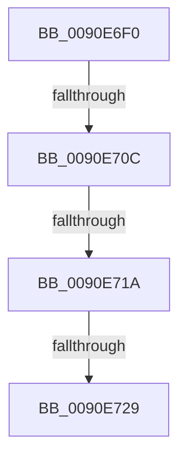

# RtlUnicodeToCustomCPN

- RVA: `0x0090E6F0`–`0x0090E72D` (길이 `61` bytes)
- VA: `0x000000014090E6F0`
- 실행 섹션: `PAGE`
- PDB 이름 있음: `예`; PDB Function 태그: `아니요`
- unwind 정보 RVA: `0x00089790`
- 디코드: `16`개 명령, `61/61` bytes 표시
- 미해석 바이트: `0` (있으면 어셈블리에 `.byte`로 보존)

> 이 문서는 커널 이미지의 기계어와 PDB 기호를 분석해 생성했습니다. 4번과 5번은 함수 원형과 자료형을 바이너리 사용 방식에서 추정한 C 해석이며 원본 소스 복구 결과는 아닙니다.

## 1. Dependencies

- 직접 호출 지점: **0**; 고유 호출 대상: **0**
- 직접 호출자로 확인된 함수: **1**
- RIP 상대 이미지 참조: **0**

### Outgoing calls
- 직접 디코드된 call 명령이 없습니다.

### Direct callers
- [RtlUnicodeToOemN](RtlUnicodeToOemN_function_0090F2B0.md) at `0x0090F301`

### Static image references
- 디코드된 RIP-relative 메모리 참조가 없습니다.

## 2. Other-region calls and transfers

- 다른 실행 섹션으로 향하는 call: **0**
- call이 아닌 외부 분기/꼬리 이동: **3**
  - `0x0090E706` → [sub_0090E7A3 + 0x48](Unknown_function_0090E7A3.md) (`tail-transfer`)
  - `0x0090E714` → [sub_0090E7A3 + 0x48](Unknown_function_0090E7A3.md) (`tail-transfer`)
  - `0x0090E727` → [sub_0090E7A3](Unknown_function_0090E7A3.md) (`tail-transfer`)

## 3. Assembly (complete function range)

```asm
0090E6F0  48 89 5C 24 18                  mov qword ptr [rsp + 0x18], rbx
0090E6F5  57                              push rdi
0090E6F6  48 83 EC 30                     sub rsp, 0x30
0090E6FA  49 8B F9                        mov rdi, r9
0090E6FD  45 8B D0                        mov r10d, r8d
0090E700  48 8B C2                        mov rax, rdx
0090E703  48 85 C9                        test rcx, rcx
0090E706  0F 84 DF 00 00 00               je 0x14090e7eb
0090E70C  BA E9 FD 00 00                  mov edx, 0xfde9
0090E711  66 39 11                        cmp word ptr [rcx], dx
0090E714  0F 84 D1 00 00 00               je 0x14090e7eb
0090E71A  44 8B 5C 24 68                  mov r11d, dword ptr [rsp + 0x68]
0090E71F  41 D1 EB                        shr r11d, 1
0090E722  66 83 79 0C 00                  cmp word ptr [rcx + 0xc], 0
0090E727  74 7A                           je 0x14090e7a3
0090E729  48 8B 59 28                     mov rbx, qword ptr [rcx + 0x28]
```

## 4. C-style interpretation (structured pseudocode)

```c
__int64 __fastcall RtlUnicodeToCustomCPN(__int64 a1, __int64 a2, int a3, __int64 a4, __int64 a5, unsigned int a6)
{
    __int64 v_r11;
    __int64 v_rsp;
    unsigned __int64 v_stack_p18;

    v_stack_p18 = v_rbx;
    v_rsp = (v_rsp) - (48);
    v_r11 = (unsigned int)(((unsigned int)(a6)) >> (1));
    return a2;
}
```

## 5. (Beta) C Style

```c
int64_t RtlUnicodeToCustomCPN(int64_t Arg1, int64_t Arg2, int32_t Arg3, int64_t Arg4, uint64_t Arg5, uint32_t Arg6)
{
    int64_t local_r11;
    int64_t local_rsp;
    uint64_t v_stack_p18;

    v_stack_p18 = local_rbx;
    local_rsp = (local_rsp) - (48);
    local_r11 = (uint32_t)(((uint32_t)(Arg6)) >> (1));
    return Arg2;
}
```

## 6. Execution-region graph

[열기: 2D/3D 그래프와 함수 탐색 컨트롤 패널](../../../control-panel.html?section=page&rva=0x0090E6F0&view=graph)

- 2D 그래프는 위에서 아래로 흐르고, 3D 그래프는 빈 공간을 드래그해 회전합니다. Shift+드래그는 이동, 휠은 확대·축소, 함수 노드 선택은 대상 보고서 이동입니다.

### Static fallback


