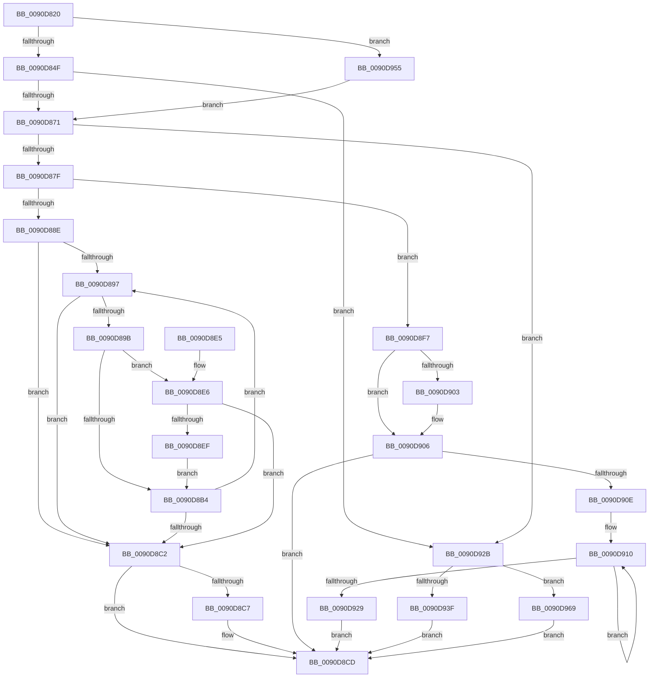

# RtlUnicodeToMultiByteN

- RVA: `0x0090D820`–`0x0090D975` (길이 `341` bytes)
- VA: `0x000000014090D820`
- 실행 섹션: `PAGE`
- PDB 이름 있음: `예`; PDB Function 태그: `아니요`
- unwind 정보 RVA: `0x0008948C`
- 디코드: `100`개 명령, `341/341` bytes 표시
- 미해석 바이트: `0` (있으면 어셈블리에 `.byte`로 보존)

> 이 문서는 커널 이미지의 기계어와 PDB 기호를 분석해 생성했습니다. 4번과 5번은 함수 원형과 자료형을 바이너리 사용 방식에서 추정한 C 해석이며 원본 소스 복구 결과는 아닙니다.

## 1. Dependencies

- 직접 호출 지점: **3**; 고유 호출 대상: **3**
- 직접 호출자로 확인된 함수: **3**
- RIP 상대 이미지 참조: **1**

### Outgoing calls
- `0x0090D842` → [RtlpIsUtf8Process](RtlpIsUtf8Process_function_0090DB60.md) (function, `0x0090DB60`)
- `0x0090D854` → [PsGetCurrentServerSiloGlobals](../../text/2F/PsGetCurrentServerSiloGlobals_function_002FE1F0.md) (function, `0x002FE1F0`)
- `0x0090D94B` → [RtlUnicodeToUTF8N](RtlUnicodeToUTF8N_function_0090DBF0.md) (function, `0x0090DBF0`)

### Direct callers
- [wcstombs](../../text/50/wcstombs_function_005021A0.md) at `0x005021DA`
- [wctomb_s_l](../../text/50/wctomb_s_l_function_005024D4.md) at `0x00502557`
- [safecrt_wctomb_s](../../text/50/safecrt_wctomb_s_function_005070A8.md) at `0x0050713D`

### Static image references
- `0x0090D955` → RVA `0x00FD8720` (`PAGEDATA`; read)

## 2. Other-region calls and transfers

- 다른 실행 섹션으로 향하는 call: **1**
  - `0x0090D854` → [PsGetCurrentServerSiloGlobals](../../text/2F/PsGetCurrentServerSiloGlobals_function_002FE1F0.md) (`PAGE` → `.text`)
- 별도 외부 분기/꼬리 이동을 확인하지 못했습니다.

## 3. Assembly (complete function range)

```asm
0090D820  48 89 5C 24 08                  mov qword ptr [rsp + 8], rbx
0090D825  48 89 74 24 18                  mov qword ptr [rsp + 0x18], rsi
0090D82A  48 89 7C 24 20                  mov qword ptr [rsp + 0x20], rdi
0090D82F  41 56                           push r14
0090D831  48 83 EC 30                     sub rsp, 0x30
0090D835  48 8B F9                        mov rdi, rcx
0090D838  49 8B D9                        mov rbx, r9
0090D83B  33 C9                           xor ecx, ecx
0090D83D  4D 8B F0                        mov r14, r8
0090D840  8B F2                           mov esi, edx
0090D842  E8 19 03 00 00                  call 0x14090db60
0090D847  84 C0                           test al, al
0090D849  0F 85 06 01 00 00               jne 0x14090d955
0090D84F  F0 83 0C 24 00                  lock or dword ptr [rsp], 0
0090D854  E8 97 09 9F FF                  call 0x1402fe1f0
0090D859  48 8B C8                        mov rcx, rax
0090D85C  4C 8B D3                        mov r10, rbx
0090D85F  8B C6                           mov eax, esi
0090D861  4C 8B C7                        mov r8, rdi
0090D864  48 81 C1 08 04 00 00            add rcx, 0x408
0090D86B  0F 84 BA 00 00 00               je 0x14090d92b
0090D871  BA E9 FD 00 00                  mov edx, 0xfde9
0090D876  66 39 11                        cmp word ptr [rcx], dx
0090D879  0F 84 AC 00 00 00               je 0x14090d92b
0090D87F  44 8B 5C 24 60                  mov r11d, dword ptr [rsp + 0x60]
0090D884  41 D1 EB                        shr r11d, 1
0090D887  66 83 79 0C 00                  cmp word ptr [rcx + 0xc], 0
0090D88C  74 69                           je 0x14090d8f7
0090D88E  48 8B 59 28                     mov rbx, qword ptr [rcx + 0x28]
0090D892  45 85 DB                        test r11d, r11d
0090D895  74 2B                           je 0x14090d8c2
0090D897  85 C0                           test eax, eax
0090D899  74 27                           je 0x14090d8c2
0090D89B  41 0F B7 0A                     movzx ecx, word ptr [r10]
0090D89F  49 83 C2 02                     add r10, 2
0090D8A3  44 0F B7 0C 4B                  movzx r9d, word ptr [rbx + rcx*2]
0090D8A8  41 0F B7 D1                     movzx edx, r9w
0090D8AC  66 C1 EA 08                     shr dx, 8
0090D8B0  84 D2                           test dl, dl
0090D8B2  75 32                           jne 0x14090d8e6
0090D8B4  45 88 08                        mov byte ptr [r8], r9b
0090D8B7  FF C8                           dec eax
0090D8B9  49 FF C0                        inc r8
0090D8BC  41 83 C3 FF                     add r11d, -1
0090D8C0  75 D5                           jne 0x14090d897
0090D8C2  4D 85 F6                        test r14, r14
0090D8C5  74 06                           je 0x14090d8cd
0090D8C7  44 2B C7                        sub r8d, edi
0090D8CA  45 89 06                        mov dword ptr [r14], r8d
0090D8CD  48 8B 5C 24 40                  mov rbx, qword ptr [rsp + 0x40]
0090D8D2  33 C0                           xor eax, eax
0090D8D4  48 8B 74 24 50                  mov rsi, qword ptr [rsp + 0x50]
0090D8D9  48 8B 7C 24 58                  mov rdi, qword ptr [rsp + 0x58]
0090D8DE  48 83 C4 30                     add rsp, 0x30
0090D8E2  41 5E                           pop r14
0090D8E4  C3                              ret
0090D8E5  CC                              int3
0090D8E6  8B C8                           mov ecx, eax
0090D8E8  FF C8                           dec eax
0090D8EA  83 F9 02                        cmp ecx, 2
0090D8ED  72 D3                           jb 0x14090d8c2
0090D8EF  41 88 10                        mov byte ptr [r8], dl
0090D8F2  49 FF C0                        inc r8
0090D8F5  EB BD                           jmp 0x14090d8b4
0090D8F7  44 3B DE                        cmp r11d, esi
0090D8FA  41 0F 42 F3                     cmovb esi, r11d
0090D8FE  4D 85 F6                        test r14, r14
0090D901  74 03                           je 0x14090d906
0090D903  41 89 36                        mov dword ptr [r14], esi
0090D906  4C 8B 41 28                     mov r8, qword ptr [rcx + 0x28]
0090D90A  85 F6                           test esi, esi
0090D90C  74 BF                           je 0x14090d8cd
0090D90E  8B D6                           mov edx, esi
0090D910  0F B7 03                        movzx eax, word ptr [rbx]
0090D913  48 8D 7F 01                     lea rdi, [rdi + 1]
0090D917  48 8D 5B 02                     lea rbx, [rbx + 2]
0090D91B  42 0F B6 0C 00                  movzx ecx, byte ptr [rax + r8]
0090D920  88 4F FF                        mov byte ptr [rdi - 1], cl
0090D923  48 83 EA 01                     sub rdx, 1
0090D927  75 E7                           jne 0x14090d910
0090D929  EB A2                           jmp 0x14090d8cd
0090D92B  8B 44 24 60                     mov eax, dword ptr [rsp + 0x60]
0090D92F  4C 8D 44 24 48                  lea r8, [rsp + 0x48]
0090D934  4D 85 F6                        test r14, r14
0090D937  4D 0F 45 C6                     cmovne r8, r14
0090D93B  85 C0                           test eax, eax
0090D93D  74 2A                           je 0x14090d969
0090D93F  4C 8B CB                        mov r9, rbx
0090D942  89 44 24 20                     mov dword ptr [rsp + 0x20], eax
0090D946  8B D6                           mov edx, esi
0090D948  48 8B CF                        mov rcx, rdi
0090D94B  E8 A0 02 00 00                  call 0x14090dbf0
0090D950  E9 78 FF FF FF                  jmp 0x14090d8cd
0090D955  48 8D 0D C4 AD 6C 00            lea rcx, [rip + 0x6cadc4]
0090D95C  4C 8B C7                        mov r8, rdi
0090D95F  4C 8B D3                        mov r10, rbx
0090D962  8B C6                           mov eax, esi
0090D964  E9 08 FF FF FF                  jmp 0x14090d871
0090D969  41 C7 00 00 00 00 00            mov dword ptr [r8], 0
0090D970  E9 58 FF FF FF                  jmp 0x14090d8cd
```

## 4. C-style interpretation (structured pseudocode)

```c
__int64 __fastcall RtlUnicodeToMultiByteN(__int64 a1, int a2, __int64 a3, __int64 a4, unsigned int a5)
{
    __int64 result;
    __int64 v_r10;
    __int64 v_r11;
    __int64 v_rsi;
    __int64 v_rsp;
    unsigned int v_stack_m38;
    unsigned __int64 v_stack_p18;
    unsigned __int64 v_stack_p20;
    unsigned __int64 v_stack_p48;
    unsigned __int64 v_stack_p8;

    v_stack_p8 = v_rbx;
    v_stack_p18 = v_rsi;
    v_stack_p20 = v_rdi;
    v_rsp = (v_rsp) - (48);
    a1 = 0;
    result = RtlpIsUtf8Process(a1, a2, a3, a4);
    if ((unsigned __int8)(result) != 0) goto loc_0090D955;
    result = PsGetCurrentServerSiloGlobals(a1, a2, a3, a4);
    a1 = (result) + (0x408ULL);
    if (condition_is_equal) goto loc_0090D92B;
loc_0090D871:
    if ((*(unsigned __int16 *)(a1)) == ((unsigned __int16)((unsigned int)(0xFDE9ULL)))) goto loc_0090D92B;
    v_r11 = (unsigned int)(((unsigned int)(a5)) >> (1));
    if ((*(unsigned __int16 *)(a1 + 12)) == 0) goto loc_0090D8F7;
    if ((unsigned int)(v_r11) == 0) goto loc_0090D8C2;
loc_0090D897:
    if ((unsigned int)((unsigned int)((unsigned int)((unsigned int)(a2)))) == 0) goto loc_0090D8C2;
    v_r10 = (a4) + (2);
    a2 = (unsigned __int16)(((unsigned __int16)(*(unsigned __int16 *)(*(unsigned __int64 *)(a1 + 40) + *(unsigned __int16 *)(a4) * 2))) >> (8));
    if ((unsigned __int8)(a2) != 0) goto loc_0090D8E6;
loc_0090D8B4:
    *(unsigned __int8 *)(0) = (unsigned __int8)(*(unsigned __int16 *)(*(unsigned __int64 *)(a1 + 40) + *(unsigned __int16 *)(a4) * 2));
    result = (unsigned int)(((unsigned int)((unsigned int)((unsigned int)(a2)))) - 1);
    a3 = (0) + 1;
    v_r11 = (unsigned int)((v_r11) + (-1));
    if (condition_is_not_equal) goto loc_0090D897;
loc_0090D8C2:
    if (a3 != 0) {
        a3 = (unsigned int)((a3) - ((unsigned int)(a1)));
        *(unsigned int *)(a3) = (unsigned int)(a3);
    }
    result = 0;
    v_rsp = (v_rsp) + (48);
    return result;
loc_0090D8E6:
    result = (unsigned int)((result) - 1);
    if (0 < 2) goto loc_0090D8C2;
    *(unsigned __int8 *)(a3) = (unsigned __int8)(a2);
    a3 = (a3) + 1;
    goto loc_0090D8B4;
loc_0090D8F7:
    v_rsi = v_stack_p18;
    if (((unsigned int)(v_r11)) < ((unsigned int)(v_stack_p18))) { v_rsi = (unsigned int)(v_r11); }
    if (a3 != 0) {
        *(unsigned int *)(a3) = (unsigned int)(v_rsi);
    }
    if ((unsigned int)(v_rsi) == 0) goto loc_0090D8CD;
loc_0090D910:
    *(unsigned __int8 *)(v_stack_p20 + 1 - 1) = (unsigned __int8)(*(unsigned __int8 *)(*(unsigned __int16 *)(v_stack_p8) + *(unsigned __int64 *)(0 + 40) * 1));
    a2 = ((unsigned int)((unsigned int)(v_rsi))) - (1);
    if (condition_is_not_equal) goto loc_0090D910;
    goto loc_0090D8CD;
loc_0090D92B:
    a3 = v_stack_p48;
    if (a3 != 0) { a3 = a3; }
    if ((unsigned int)((unsigned int)(a5)) == 0) goto loc_0090D969;
    v_stack_p20 = (unsigned int)((unsigned int)(a5));
    result = RtlUnicodeToUTF8N(v_stack_p20 + 1, (unsigned int)((unsigned int)(v_rsi)), a3, v_stack_p8 + 2);
    goto loc_0090D8CD;
loc_0090D955:
    goto loc_0090D871;
loc_0090D969:
    *(unsigned int *)(v_stack_p20 + 1) = 0;
    goto loc_0090D8CD;
}
```

## 5. (Beta) C Style

```c
int64_t RtlUnicodeToMultiByteN(void *Arg1, int32_t Arg2, int64_t Arg3, void *Arg4, uint32_t Arg5)
{
    uint8_t *arg1 = (uint8_t *)Arg1;
    uint8_t *arg4 = (uint8_t *)Arg4;

    int64_t result;
    int64_t local_r10;
    int64_t local_r11;
    int64_t local_rsi;
    int64_t local_rsp;
    uint32_t v_stack_m38;
    uint64_t v_stack_p18;
    uint64_t v_stack_p20;
    uint64_t v_stack_p48;
    uint64_t v_stack_p8;

    v_stack_p8 = local_rbx;
    v_stack_p18 = local_rsi;
    v_stack_p20 = local_rdi;
    local_rsp = (local_rsp) - (48);
    Arg1 = 0;
    result = RtlpIsUtf8Process(Arg1, Arg2, Arg3, Arg4);
    if ((uint8_t)(result) != 0) goto loc_0090D955;
    result = PsGetCurrentServerSiloGlobals(Arg1, Arg2, Arg3, Arg4);
    Arg1 = (result) + (0x408ULL);
    if (condition_is_equal) goto loc_0090D92B;
loc_0090D871:
    if ((*(uint16_t *)(arg1)) == ((uint16_t)((uint32_t)(0xFDE9ULL)))) goto loc_0090D92B;
    local_r11 = (uint32_t)(((uint32_t)(Arg5)) >> (1));
    if ((*(uint16_t *)(arg1 + 0xC)) == 0) goto loc_0090D8F7;
    if ((uint32_t)(local_r11) == 0) goto loc_0090D8C2;
loc_0090D897:
    if ((uint32_t)((uint32_t)((uint32_t)((uint32_t)(Arg2)))) == 0) goto loc_0090D8C2;
    local_r10 = (Arg4) + (2);
    Arg2 = (uint16_t)(((uint16_t)(*(uint16_t *)(*(uint64_t *)(arg1 + 0x28) + *(uint16_t *)(arg4) * 2))) >> (8));
    if ((uint8_t)(Arg2) != 0) goto loc_0090D8E6;
loc_0090D8B4:
    *(uint8_t *)(0) = (uint8_t)(*(uint16_t *)(*(uint64_t *)(arg1 + 0x28) + *(uint16_t *)(arg4) * 2));
    result = (uint32_t)(((uint32_t)((uint32_t)((uint32_t)(Arg2)))) - 1);
    Arg3 = (0) + 1;
    local_r11 = (uint32_t)((local_r11) + (-1));
    if (condition_is_not_equal) goto loc_0090D897;
loc_0090D8C2:
    if (Arg3 != 0) {
        Arg3 = (uint32_t)((Arg3) - ((uint32_t)(Arg1)));
        *(uint32_t *)(Arg3) = (uint32_t)(Arg3);
    }
    result = 0;
    local_rsp = (local_rsp) + (48);
    return result;
loc_0090D8E6:
    result = (uint32_t)((result) - 1);
    if (0 < 2) goto loc_0090D8C2;
    *(uint8_t *)(Arg3) = (uint8_t)(Arg2);
    Arg3 = (Arg3) + 1;
    goto loc_0090D8B4;
loc_0090D8F7:
    local_rsi = v_stack_p18;
    if (((uint32_t)(local_r11)) < ((uint32_t)(v_stack_p18))) { local_rsi = (uint32_t)(local_r11); }
    if (Arg3 != 0) {
        *(uint32_t *)(Arg3) = (uint32_t)(local_rsi);
    }
    if ((uint32_t)(local_rsi) == 0) goto loc_0090D8CD;
loc_0090D910:
    *(uint8_t *)(v_stack_p20 + 0x1 - 0x1) = (uint8_t)(*(uint8_t *)(*(uint16_t *)(v_stack_p8) + *(uint64_t *)(0 + 0x28) * 1));
    Arg2 = ((uint32_t)((uint32_t)(local_rsi))) - (1);
    if (condition_is_not_equal) goto loc_0090D910;
    goto loc_0090D8CD;
loc_0090D92B:
    Arg3 = v_stack_p48;
    if (Arg3 != 0) { Arg3 = Arg3; }
    if ((uint32_t)((uint32_t)(Arg5)) == 0) goto loc_0090D969;
    v_stack_p20 = (uint32_t)((uint32_t)(Arg5));
    result = RtlUnicodeToUTF8N(v_stack_p20 + 1, (uint32_t)((uint32_t)(local_rsi)), Arg3, v_stack_p8 + 2);
    goto loc_0090D8CD;
loc_0090D955:
    goto loc_0090D871;
loc_0090D969:
    *(uint32_t *)(v_stack_p20 + 0x1) = 0;
    goto loc_0090D8CD;
}
```

### 관측된 메모리 오프셋

구조체 형식이 확인되지 않은 접근은 인자 기준의 오프셋으로만 기록했습니다.

| 기준 인자 | 오프셋 표현 | 폭 (bit) | 접근 |
|---|---:|---:|---|
| `Arg1` | `- 0x1` | `8` | `W` |
| `Arg1` | `+ 0x1` | `64` | `R` |
| `Arg4` | `+ 0x0` | `16` | `R` |
| `Arg4` | `+ 0x2` | `64` | `R` |

## 6. Execution-region graph

[열기: 2D/3D 그래프와 함수 탐색 컨트롤 패널](../../../control-panel.html?section=page&rva=0x0090D820&view=graph)

- 2D 그래프는 위에서 아래로 흐르고, 3D 그래프는 빈 공간을 드래그해 회전합니다. Shift+드래그는 이동, 휠은 확대·축소, 함수 노드 선택은 대상 보고서 이동입니다.

### Static fallback


