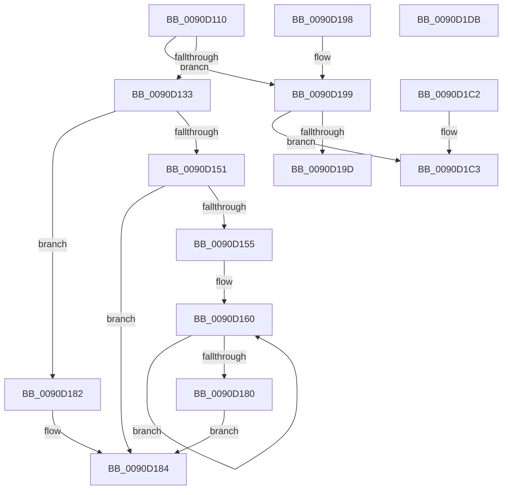

# RtlUnicodeToMultiByteSize

- RVA: `0x0090D110`–`0x0090D1DC` (길이 `204` bytes)
- VA: `0x000000014090D110`
- 실행 섹션: `PAGE`
- PDB 이름 있음: `예`; PDB Function 태그: `아니요`
- unwind 정보 RVA: `0x000893BC`
- 디코드: `65`개 명령, `204/204` bytes 표시
- 미해석 바이트: `0` (있으면 어셈블리에 `.byte`로 보존)

> 이 문서는 커널 이미지의 기계어와 PDB 기호를 분석해 생성했습니다. 4번과 5번은 함수 원형과 자료형을 바이너리 사용 방식에서 추정한 C 해석이며 원본 소스 복구 결과는 아닙니다.

## 1. Dependencies

- 직접 호출 지점: **3**; 고유 호출 대상: **3**
- 직접 호출자로 확인된 함수: **8**
- RIP 상대 이미지 참조: **0**

### Outgoing calls
- `0x0090D12A` → [RtlpIsUtf8Process](RtlpIsUtf8Process_function_0090DB60.md) (function, `0x0090DB60`)
- `0x0090D13A` → [PsGetCurrentServerSiloGlobals](../../text/2F/PsGetCurrentServerSiloGlobals_function_002FE1F0.md) (function, `0x002FE1F0`)
- `0x0090D1AB` → [RtlUnicodeToUTF8N](RtlUnicodeToUTF8N_function_0090DBF0.md) (function, `0x0090DBF0`)

### Direct callers
- [wcstombs](../../text/50/wcstombs_function_005021A0.md) at `0x005021FA`
- [RtlUpcaseUnicodeStringToAnsiString](../78/RtlUpcaseUnicodeStringToAnsiString_function_0078A830.md) at `0x0078A867`
- [NtQuerySystemEnvironmentValue](../7C/NtQuerySystemEnvironmentValue_function_007CDFB0.md) at `0x007CE10C`
- [NtSetSystemEnvironmentValue](../7C/NtSetSystemEnvironmentValue_function_007CE650.md) at `0x007CE7E9`
- [NtSetSystemEnvironmentValue](../7C/NtSetSystemEnvironmentValue_function_007CE650.md) at `0x007CE863`
- [RtlUnicodeStringToCountedOemString](RtlUnicodeStringToCountedOemString_function_0090F1A0.md) at `0x0090F1D6`
- [RtlUpcaseUnicodeStringToOemString](../A8/RtlUpcaseUnicodeStringToOemString_function_00A84220.md) at `0x00A84256`
- [ObCreateObjectTypeEx](../AB/ObCreateObjectTypeEx_function_00AB46D0.md) at `0x00AB4A0F`
- [RtlUnicodeStringToOemString](../AC/RtlUnicodeStringToOemString_function_00AC1C10.md) at `0x00AC1C47`

### Static image references
- 디코드된 RIP-relative 메모리 참조가 없습니다.

## 2. Other-region calls and transfers

- 다른 실행 섹션으로 향하는 call: **1**
  - `0x0090D13A` → [PsGetCurrentServerSiloGlobals](../../text/2F/PsGetCurrentServerSiloGlobals_function_002FE1F0.md) (`PAGE` → `.text`)
- 별도 외부 분기/꼬리 이동을 확인하지 못했습니다.

## 3. Assembly (complete function range)

```asm
0090D110  48 89 5C 24 08                  mov qword ptr [rsp + 8], rbx
0090D115  48 89 74 24 10                  mov qword ptr [rsp + 0x10], rsi
0090D11A  57                              push rdi
0090D11B  48 83 EC 30                     sub rsp, 0x30
0090D11F  48 8B F1                        mov rsi, rcx
0090D122  41 8B D8                        mov ebx, r8d
0090D125  33 C9                           xor ecx, ecx
0090D127  48 8B FA                        mov rdi, rdx
0090D12A  E8 31 0A 00 00                  call 0x14090db60
0090D12F  84 C0                           test al, al
0090D131  75 66                           jne 0x14090d199
0090D133  F0 83 0C 24 00                  lock or dword ptr [rsp], 0
0090D138  33 D2                           xor edx, edx
0090D13A  E8 B1 10 9F FF                  call 0x1402fe1f0
0090D13F  D1 EB                           shr ebx, 1
0090D141  4C 8B 80 30 04 00 00            mov r8, qword ptr [rax + 0x430]
0090D148  66 39 90 14 04 00 00            cmp word ptr [rax + 0x414], dx
0090D14F  74 31                           je 0x14090d182
0090D151  85 DB                           test ebx, ebx
0090D153  74 2F                           je 0x14090d184
0090D155  66 66 66 0F 1F 84 00 00 00 00 00  nop word ptr [rax + rax]
0090D160  0F B7 07                        movzx eax, word ptr [rdi]
0090D163  48 8D 7F 02                     lea rdi, [rdi + 2]
0090D167  41 0F B7 0C 40                  movzx ecx, word ptr [r8 + rax*2]
0090D16C  33 C0                           xor eax, eax
0090D16E  66 C1 E9 08                     shr cx, 8
0090D172  84 C9                           test cl, cl
0090D174  0F 95 C0                        setne al
0090D177  FF C0                           inc eax
0090D179  03 D0                           add edx, eax
0090D17B  83 C3 FF                        add ebx, -1
0090D17E  75 E0                           jne 0x14090d160
0090D180  EB 02                           jmp 0x14090d184
0090D182  8B D3                           mov edx, ebx
0090D184  89 16                           mov dword ptr [rsi], edx
0090D186  33 C0                           xor eax, eax
0090D188  48 8B 5C 24 40                  mov rbx, qword ptr [rsp + 0x40]
0090D18D  48 8B 74 24 48                  mov rsi, qword ptr [rsp + 0x48]
0090D192  48 83 C4 30                     add rsp, 0x30
0090D196  5F                              pop rdi
0090D197  C3                              ret
0090D198  CC                              int3
0090D199  85 DB                           test ebx, ebx
0090D19B  74 26                           je 0x14090d1c3
0090D19D  4C 8B CF                        mov r9, rdi
0090D1A0  89 5C 24 20                     mov dword ptr [rsp + 0x20], ebx
0090D1A4  4C 8B C6                        mov r8, rsi
0090D1A7  33 D2                           xor edx, edx
0090D1A9  33 C9                           xor ecx, ecx
0090D1AB  E8 40 0A 00 00                  call 0x14090dbf0
0090D1B0  33 C0                           xor eax, eax
0090D1B2  48 8B 5C 24 40                  mov rbx, qword ptr [rsp + 0x40]
0090D1B7  48 8B 74 24 48                  mov rsi, qword ptr [rsp + 0x48]
0090D1BC  48 83 C4 30                     add rsp, 0x30
0090D1C0  5F                              pop rdi
0090D1C1  C3                              ret
0090D1C2  CC                              int3
0090D1C3  48 8B 5C 24 40                  mov rbx, qword ptr [rsp + 0x40]
0090D1C8  33 C0                           xor eax, eax
0090D1CA  C7 06 00 00 00 00               mov dword ptr [rsi], 0
0090D1D0  48 8B 74 24 48                  mov rsi, qword ptr [rsp + 0x48]
0090D1D5  48 83 C4 30                     add rsp, 0x30
0090D1D9  5F                              pop rdi
0090D1DA  C3                              ret
0090D1DB  CC                              int3
```

## 4. C-style interpretation (structured pseudocode)

```c
__int64 __fastcall RtlUnicodeToMultiByteSize(__int64 a1, __int64 a2, int a3)
{
    __int64 result;
    __int64 v_rbx;
    __int64 v_rsp;
    unsigned int v_stack_m38;
    unsigned __int64 v_stack_p10;
    unsigned int v_stack_p20;
    unsigned __int64 v_stack_p40;
    unsigned __int64 v_stack_p48;
    unsigned __int64 v_stack_p78;
    unsigned __int64 v_stack_p8;
    unsigned __int64 v_stack_p80;

    v_stack_p8 = v_rbx;
    v_stack_p10 = v_rsi;
    v_rsp = (v_rsp) - (48);
    a1 = 0;
    result = RtlpIsUtf8Process(a1, a2, a3, a4);
    if ((unsigned __int8)(result) != 0) goto loc_0090D199;
    a2 = 0;
    result = PsGetCurrentServerSiloGlobals(a1, a2, a3, a4);
    v_rbx = (unsigned int)(((unsigned int)(a3)) >> (1));
    if ((*(unsigned __int16 *)(result + 1044)) == 0) goto loc_0090D182;
    if ((unsigned int)(v_rbx) == 0) goto loc_0090D184;
loc_0090D160:
    result = 0;
    a1 = (unsigned __int16)((*(unsigned __int16 *)(*(unsigned __int64 *)(result + 1072) + *(unsigned __int16 *)(a2) * 2)) >> (8));
    result = ((unsigned __int8)(a1) != 0) ? 1 : 0;
    result = (unsigned int)((result) + 1);
    a2 = (unsigned int)((a2) + ((unsigned int)(result)));
    v_rbx = (unsigned int)((v_rbx) + (-1));
    if (condition_is_not_equal) goto loc_0090D160;
    goto loc_0090D184;
loc_0090D182:
loc_0090D184:
    *(unsigned int *)(a1) = (unsigned int)((unsigned int)((unsigned int)(v_rbx)));
    result = 0;
    v_rsp = (v_rsp) + (48);
    return result;
loc_0090D199:
    if ((unsigned int)(v_stack_p8) == 0) goto loc_0090D1C3;
    v_stack_p20 = (unsigned int)(v_stack_p8);
    a2 = 0;
    a1 = 0;
    result = RtlUnicodeToUTF8N(a1, a2, v_stack_p10, a2 + 2);
    result = 0;
    v_rsp = (v_rsp) + (48);
    return result;
loc_0090D1C3:
    result = 0;
    *(unsigned int *)(v_stack_p48) = 0;
    v_rsp = (v_rsp) + (48);
    return result;
}
```

## 5. (Beta) C Style

```c
int64_t RtlUnicodeToMultiByteSize(void *Arg1, void *Arg2, int32_t Arg3)
{
    uint8_t *arg1 = (uint8_t *)Arg1;
    uint8_t *arg2 = (uint8_t *)Arg2;

    int64_t result;
    int64_t local_rbx;
    int64_t local_rsp;
    uint32_t v_stack_m38;
    uint64_t v_stack_p10;
    uint32_t v_stack_p20;
    uint64_t v_stack_p40;
    uint64_t v_stack_p48;
    uint64_t v_stack_p78;
    uint64_t v_stack_p8;
    uint64_t v_stack_p80;

    v_stack_p8 = local_rbx;
    v_stack_p10 = local_rsi;
    local_rsp = (local_rsp) - (48);
    Arg1 = 0;
    result = RtlpIsUtf8Process(Arg1, Arg2, Arg3, a4);
    if ((uint8_t)(result) != 0) goto loc_0090D199;
    Arg2 = 0;
    result = PsGetCurrentServerSiloGlobals(Arg1, Arg2, Arg3, a4);
    local_rbx = (uint32_t)(((uint32_t)(Arg3)) >> (1));
    if ((*(uint16_t *)(result + 0x414)) == 0) goto loc_0090D182;
    if ((uint32_t)(local_rbx) == 0) goto loc_0090D184;
loc_0090D160:
    result = 0;
    Arg1 = (uint16_t)((*(uint16_t *)(*(uint64_t *)(result + 0x430) + *(uint16_t *)(arg2) * 2)) >> (8));
    result = ((uint8_t)(Arg1) != 0) ? 1 : 0;
    result = (uint32_t)((result) + 1);
    Arg2 = (uint32_t)((Arg2) + ((uint32_t)(result)));
    local_rbx = (uint32_t)((local_rbx) + (-1));
    if (condition_is_not_equal) goto loc_0090D160;
    goto loc_0090D184;
loc_0090D182:
loc_0090D184:
    *(uint32_t *)(arg1) = (uint32_t)((uint32_t)((uint32_t)(local_rbx)));
    result = 0;
    local_rsp = (local_rsp) + (48);
    return result;
loc_0090D199:
    if ((uint32_t)(v_stack_p8) == 0) goto loc_0090D1C3;
    v_stack_p20 = (uint32_t)(v_stack_p8);
    Arg2 = 0;
    Arg1 = 0;
    result = RtlUnicodeToUTF8N(Arg1, Arg2, v_stack_p10, Arg2 + 2);
    result = 0;
    local_rsp = (local_rsp) + (48);
    return result;
loc_0090D1C3:
    result = 0;
    *(uint32_t *)(v_stack_p48) = 0;
    local_rsp = (local_rsp) + (48);
    return result;
}
```

### 관측된 메모리 오프셋

구조체 형식이 확인되지 않은 접근은 인자 기준의 오프셋으로만 기록했습니다.

| 기준 인자 | 오프셋 표현 | 폭 (bit) | 접근 |
|---|---:|---:|---|
| `Arg1` | `+ 0x0` | `32` | `W` |
| `Arg2` | `+ 0x0` | `16` | `R` |
| `Arg2` | `+ 0x2` | `64` | `R` |

## 6. Execution-region graph

[열기: 2D/3D 그래프와 함수 탐색 컨트롤 패널](../../../control-panel.html?section=page&rva=0x0090D110&view=graph)

- 2D 그래프는 위에서 아래로 흐르고, 3D 그래프는 빈 공간을 드래그해 회전합니다. Shift+드래그는 이동, 휠은 확대·축소, 함수 노드 선택은 대상 보고서 이동입니다.

### Static fallback


