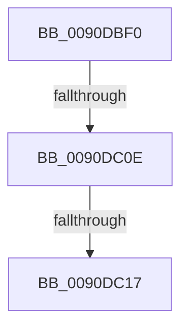

# RtlUnicodeToUTF8N

- RVA: `0x0090DBF0`–`0x0090DC23` (길이 `51` bytes)
- VA: `0x000000014090DBF0`
- 실행 섹션: `PAGE`
- PDB 이름 있음: `예`; PDB Function 태그: `예`
- unwind 정보 RVA: `0x000894DC`
- 디코드: `14`개 명령, `51/51` bytes 표시
- 미해석 바이트: `0` (있으면 어셈블리에 `.byte`로 보존)

> 이 문서는 커널 이미지의 기계어와 PDB 기호를 분석해 생성했습니다. 4번과 5번은 함수 원형과 자료형을 바이너리 사용 방식에서 추정한 C 해석이며 원본 소스 복구 결과는 아닙니다.

## 1. Dependencies

- 직접 호출 지점: **0**; 고유 호출 대상: **0**
- 직접 호출자로 확인된 함수: **10**
- RIP 상대 이미지 참조: **0**

### Outgoing calls
- 직접 디코드된 call 명령이 없습니다.

### Direct callers
- [UpcaseUnicodeToUTF8NHelper](../../text/2F/UpcaseUnicodeToUTF8NHelper_function_002FD8C4.md) at `0x002FD995`
- [EtwpQueryPartitionRegistryInformation](../../text/64/EtwpQueryPartitionRegistryInformation_function_0064ECCC.md) at `0x0064EE95`
- [EtwpQueryPartitionRegistryInformation](../../text/64/EtwpQueryPartitionRegistryInformation_function_0064ECCC.md) at `0x0064EEDC`
- [RtlUnicodeStringToUTF8String](../79/RtlUnicodeStringToUTF8String_function_00794C90.md) at `0x00794D58`
- [RtlxUnicodeStringToAnsiSize](RtlxUnicodeStringToAnsiSize_function_0090CE80.md) at `0x0090CF15`
- [RtlUnicodeToMultiByteSize](RtlUnicodeToMultiByteSize_function_0090D110.md) at `0x0090D1AB`
- [RtlUnicodeStringToAnsiString](RtlUnicodeStringToAnsiString_function_0090D1F0.md) at `0x0090D3D0`
- [RtlUnicodeStringToAnsiString](RtlUnicodeStringToAnsiString_function_0090D1F0.md) at `0x0090D4A7`
- [RtlUnicodeToMultiByteN](RtlUnicodeToMultiByteN_function_0090D820.md) at `0x0090D94B`
- [RtlUpcaseUnicodeStringToCountedOemString](RtlUpcaseUnicodeStringToCountedOemString_function_0090E4D0.md) at `0x0090E69F`
- [sub_0090E7A3](Unknown_function_0090E7A3.md) at `0x0090E810`
- [EtwpGetAutoLoggerEventNameFilter](../A9/EtwpGetAutoLoggerEventNameFilter_function_00A93E78.md) at `0x00A94315`

### Static image references
- 디코드된 RIP-relative 메모리 참조가 없습니다.

## 2. Other-region calls and transfers

- 다른 실행 섹션으로 향하는 call: **0**
- call이 아닌 외부 분기/꼬리 이동: **3**
  - `0x0090DC08` → [sub_0090DD01](Unknown_function_0090DD01.md) (`tail-transfer`)
  - `0x0090DC11` → [sub_0090DD01 + 0x11](Unknown_function_0090DD01.md) (`tail-transfer`)
  - `0x0090DC1D` → [sub_0090DDD5](Unknown_function_0090DDD5.md) (`tail-transfer`)

## 3. Assembly (complete function range)

```asm
0090DBF0  48 89 5C 24 18                  mov qword ptr [rsp + 0x18], rbx
0090DBF5  57                              push rdi
0090DBF6  48 83 EC 20                     sub rsp, 0x20
0090DBFA  33 DB                           xor ebx, ebx
0090DBFC  45 33 D2                        xor r10d, r10d
0090DBFF  49 8B F8                        mov rdi, r8
0090DC02  4C 8B D9                        mov r11, rcx
0090DC05  4D 85 C9                        test r9, r9
0090DC08  0F 84 F3 00 00 00               je 0x14090dd01
0090DC0E  48 85 C9                        test rcx, rcx
0090DC11  0F 84 FB 00 00 00               je 0x14090dd12
0090DC17  8B 44 24 50                     mov eax, dword ptr [rsp + 0x50]
0090DC1B  A8 01                           test al, 1
0090DC1D  0F 85 B2 01 00 00               jne 0x14090ddd5
```

## 4. C-style interpretation (structured pseudocode)

```c
__int64 __fastcall RtlUnicodeToUTF8N(__int64 a1, __int64 a2, __int64 a3, __int64 a4, unsigned int a5)
{
    __int64 v_r10;
    __int64 v_rbx;
    __int64 v_rsp;
    unsigned __int64 v_stack_p18;

    v_stack_p18 = v_rbx;
    v_rsp = (v_rsp) - (32);
    v_rbx = 0;
    v_r10 = 0;
}
```

## 5. (Beta) C Style

```c
int64_t RtlUnicodeToUTF8N(int64_t Arg1, int64_t Arg2, int64_t Arg3, int64_t Arg4, uint32_t Arg5)
{
    int64_t local_r10;
    int64_t local_rbx;
    int64_t local_rsp;
    uint64_t v_stack_p18;

    v_stack_p18 = local_rbx;
    local_rsp = (local_rsp) - (32);
    local_rbx = 0;
    local_r10 = 0;
}
```

## 6. Execution-region graph

[열기: 2D/3D 그래프와 함수 탐색 컨트롤 패널](../../../control-panel.html?section=page&rva=0x0090DBF0&view=graph)

- 2D 그래프는 위에서 아래로 흐르고, 3D 그래프는 빈 공간을 드래그해 회전합니다. Shift+드래그는 이동, 휠은 확대·축소, 함수 노드 선택은 대상 보고서 이동입니다.

### Static fallback


