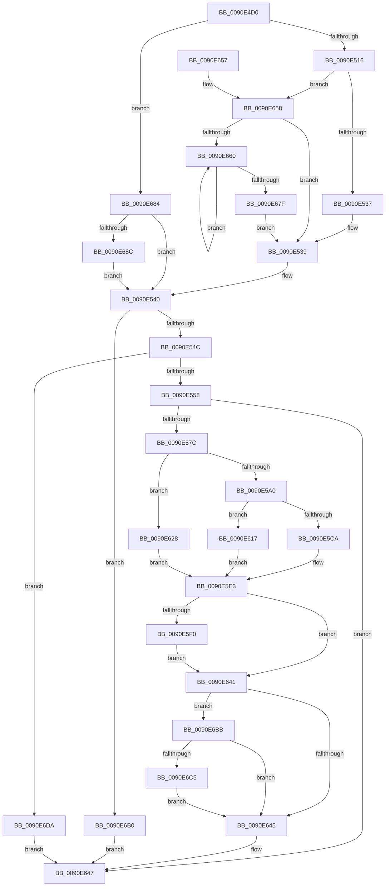

# RtlUpcaseUnicodeStringToCountedOemString

- RVA: `0x0090E4D0`–`0x0090E6E4` (길이 `532` bytes)
- VA: `0x000000014090E4D0`
- 실행 섹션: `PAGE`
- PDB 이름 있음: `예`; PDB Function 태그: `아니요`
- unwind 정보 RVA: `0x00089750`
- 디코드: `148`개 명령, `532/532` bytes 표시
- 미해석 바이트: `0` (있으면 어셈블리에 `.byte`로 보존)

> 이 문서는 커널 이미지의 기계어와 PDB 기호를 분석해 생성했습니다. 4번과 5번은 함수 원형과 자료형을 바이너리 사용 방식에서 추정한 C 해석이며 원본 소스 복구 결과는 아닙니다.

## 1. Dependencies

- 직접 호출 지점: **11**; 고유 호출 대상: **9**
- 직접 호출자로 확인된 함수: **2**
- RIP 상대 이미지 참조: **0**

### Outgoing calls
- `0x0090E509` → [RtlpIsUtf8Process](RtlpIsUtf8Process_function_0090DB60.md) (function, `0x0090DB60`)
- `0x0090E51B` → [PsGetCurrentServerSiloGlobals](../../text/2F/PsGetCurrentServerSiloGlobals_function_002FE1F0.md) (function, `0x002FE1F0`)
- `0x0090E56B` → [AllocateOrValidateCharStringBuffer](../../text/44/AllocateOrValidateCharStringBuffer_function_00447F60.md) (function, `0x00447F60`)
- `0x0090E590` → [RtlpIsUtf8Process](RtlpIsUtf8Process_function_0090DB60.md) (function, `0x0090DB60`)
- `0x0090E5A5` → [PsGetCurrentServerSiloGlobals](../../text/2F/PsGetCurrentServerSiloGlobals_function_002FE1F0.md) (function, `0x002FE1F0`)
- `0x0090E5DE` → [UpcaseUnicodeToSingleByteNHelper](../../text/22/UpcaseUnicodeToSingleByteNHelper_function_00224040.md) (function, `0x00224040`)
- `0x0090E602` → [RtlpDidUnicodeToOemWork](RtlpDidUnicodeToOemWork_function_0090CD30.md) (function, `0x0090CD30`)
- `0x0090E621` → [UpcaseUnicodeToMultiByteNHelper](../../text/41/UpcaseUnicodeToMultiByteNHelper_function_00419990.md) (function, `0x00419990`)
- `0x0090E63A` → [UpcaseUnicodeToUTF8NHelper](../../text/2F/UpcaseUnicodeToUTF8NHelper_function_002FD8C4.md) (function, `0x002FD8C4`)
- `0x0090E69F` → [RtlUnicodeToUTF8N](RtlUnicodeToUTF8N_function_0090DBF0.md) (function, `0x0090DBF0`)
- `0x0090E6C8` → [ExFreePool](../../poolcode/B8/ExFreePool_function_00B82850.md) (function, `0x00B82850`)

### Direct callers
- [DifRtlUpcaseUnicodeStringToCountedOemStringWrapper](../../text/63/DifRtlUpcaseUnicodeStringToCountedOemStringWrapper_function_0063CBD0.md) at `0x0063CCB5`
- [RtlIsNameLegalDOS8Dot3](RtlIsNameLegalDOS8Dot3_function_0090CF30.md) at `0x0090CFC7`

### Static image references
- 디코드된 RIP-relative 메모리 참조가 없습니다.

## 2. Other-region calls and transfers

- 다른 실행 섹션으로 향하는 call: **7**
  - `0x0090E51B` → [PsGetCurrentServerSiloGlobals](../../text/2F/PsGetCurrentServerSiloGlobals_function_002FE1F0.md) (`PAGE` → `.text`)
  - `0x0090E56B` → [AllocateOrValidateCharStringBuffer](../../text/44/AllocateOrValidateCharStringBuffer_function_00447F60.md) (`PAGE` → `.text`)
  - `0x0090E5A5` → [PsGetCurrentServerSiloGlobals](../../text/2F/PsGetCurrentServerSiloGlobals_function_002FE1F0.md) (`PAGE` → `.text`)
  - `0x0090E5DE` → [UpcaseUnicodeToSingleByteNHelper](../../text/22/UpcaseUnicodeToSingleByteNHelper_function_00224040.md) (`PAGE` → `.text`)
  - `0x0090E621` → [UpcaseUnicodeToMultiByteNHelper](../../text/41/UpcaseUnicodeToMultiByteNHelper_function_00419990.md) (`PAGE` → `.text`)
  - `0x0090E63A` → [UpcaseUnicodeToUTF8NHelper](../../text/2F/UpcaseUnicodeToUTF8NHelper_function_002FD8C4.md) (`PAGE` → `.text`)
  - `0x0090E6C8` → [ExFreePool](../../poolcode/B8/ExFreePool_function_00B82850.md) (`PAGE` → `POOLCODE`)
- 별도 외부 분기/꼬리 이동을 확인하지 못했습니다.

## 3. Assembly (complete function range)

```asm
0090E4D0  48 8B C4                        mov rax, rsp
0090E4D3  44 88 40 18                     mov byte ptr [rax + 0x18], r8b
0090E4D7  48 89 50 10                     mov qword ptr [rax + 0x10], rdx
0090E4DB  48 89 48 08                     mov qword ptr [rax + 8], rcx
0090E4DF  53                              push rbx
0090E4E0  56                              push rsi
0090E4E1  57                              push rdi
0090E4E2  41 54                           push r12
0090E4E4  41 55                           push r13
0090E4E6  41 56                           push r14
0090E4E8  41 57                           push r15
0090E4EA  48 83 EC 50                     sub rsp, 0x50
0090E4EE  45 8A E0                        mov r12b, r8b
0090E4F1  4C 8B FA                        mov r15, rdx
0090E4F4  48 8B F1                        mov rsi, rcx
0090E4F7  45 33 ED                        xor r13d, r13d
0090E4FA  41 8B DD                        mov ebx, r13d
0090E4FD  89 58 20                        mov dword ptr [rax + 0x20], ebx
0090E500  0F B7 3A                        movzx edi, word ptr [rdx]
0090E503  4C 8B 72 08                     mov r14, qword ptr [rdx + 8]
0090E507  33 C9                           xor ecx, ecx
0090E509  E8 52 F6 FF FF                  call 0x14090db60
0090E50E  84 C0                           test al, al
0090E510  0F 85 6E 01 00 00               jne 0x14090e684
0090E516  F0 44 09 2C 24                  lock or dword ptr [rsp], r13d
0090E51B  E8 D0 FC 9E FF                  call 0x1402fe1f0
0090E520  48 8B 90 30 04 00 00            mov rdx, qword ptr [rax + 0x430]
0090E527  D1 EF                           shr edi, 1
0090E529  66 44 39 A8 14 04 00 00         cmp word ptr [rax + 0x414], r13w
0090E531  0F 85 21 01 00 00               jne 0x14090e658
0090E537  8B DF                           mov ebx, edi
0090E539  89 9C 24 A8 00 00 00            mov dword ptr [rsp + 0xa8], ebx
0090E540  89 5C 24 44                     mov dword ptr [rsp + 0x44], ebx
0090E544  85 DB                           test ebx, ebx
0090E546  0F 84 64 01 00 00               je 0x14090e6b0
0090E54C  81 FB FF FF 00 00               cmp ebx, 0xffff
0090E552  0F 87 82 01 00 00               ja 0x14090e6da
0090E558  4C 8D 6E 02                     lea r13, [rsi + 2]
0090E55C  48 8D 7E 08                     lea rdi, [rsi + 8]
0090E560  4D 8B CD                        mov r9, r13
0090E563  4C 8B C7                        mov r8, rdi
0090E566  8B D3                           mov edx, ebx
0090E568  41 8A CC                        mov cl, r12b
0090E56B  E8 F0 99 B3 FF                  call 0x140447f60
0090E570  89 44 24 40                     mov dword ptr [rsp + 0x40], eax
0090E574  85 C0                           test eax, eax
0090E576  0F 88 CB 00 00 00               js 0x14090e647
0090E57C  41 0F B7 1F                     movzx ebx, word ptr [r15]
0090E580  4D 8B 77 08                     mov r14, qword ptr [r15 + 8]
0090E584  45 0F B7 7D 00                  movzx r15d, word ptr [r13]
0090E589  4C 8B 27                        mov r12, qword ptr [rdi]
0090E58C  D1 EB                           shr ebx, 1
0090E58E  B1 01                           mov cl, 1
0090E590  E8 CB F5 FF FF                  call 0x14090db60
0090E595  45 33 C0                        xor r8d, r8d
0090E598  84 C0                           test al, al
0090E59A  0F 85 88 00 00 00               jne 0x14090e628
0090E5A0  F0 44 09 04 24                  lock or dword ptr [rsp], r8d
0090E5A5  E8 46 FC 9E FF                  call 0x1402fe1f0
0090E5AA  48 8B 88 68 04 00 00            mov rcx, qword ptr [rax + 0x468]
0090E5B1  48 8B 90 70 04 00 00            mov rdx, qword ptr [rax + 0x470]
0090E5B8  4D 8B CE                        mov r9, r14
0090E5BB  66 44 39 80 54 04 00 00         cmp word ptr [rax + 0x454], r8w
0090E5C3  4C 8D 44 24 44                  lea r8, [rsp + 0x44]
0090E5C8  75 4D                           jne 0x14090e617
0090E5CA  48 89 4C 24 30                  mov qword ptr [rsp + 0x30], rcx
0090E5CF  48 89 54 24 28                  mov qword ptr [rsp + 0x28], rdx
0090E5D4  89 5C 24 20                     mov dword ptr [rsp + 0x20], ebx
0090E5D8  41 8B D7                        mov edx, r15d
0090E5DB  49 8B CC                        mov rcx, r12
0090E5DE  E8 5D 5A 91 FF                  call 0x140224040
0090E5E3  8B D8                           mov ebx, eax
0090E5E5  89 44 24 40                     mov dword ptr [rsp + 0x40], eax
0090E5E9  45 33 F6                        xor r14d, r14d
0090E5EC  85 C0                           test eax, eax
0090E5EE  78 51                           js 0x14090e641
0090E5F0  8B 44 24 44                     mov eax, dword ptr [rsp + 0x44]
0090E5F4  66 89 06                        mov word ptr [rsi], ax
0090E5F7  48 8B 94 24 98 00 00 00         mov rdx, qword ptr [rsp + 0x98]
0090E5FF  48 8B CE                        mov rcx, rsi
0090E602  E8 29 E7 FF FF                  call 0x14090cd30
0090E607  B9 62 01 00 C0                  mov ecx, 0xc0000162
0090E60C  84 C0                           test al, al
0090E60E  0F 44 D9                        cmove ebx, ecx
0090E611  89 5C 24 40                     mov dword ptr [rsp + 0x40], ebx
0090E615  EB 2A                           jmp 0x14090e641
0090E617  89 5C 24 20                     mov dword ptr [rsp + 0x20], ebx
0090E61B  41 8B D7                        mov edx, r15d
0090E61E  49 8B CC                        mov rcx, r12
0090E621  E8 6A B3 B0 FF                  call 0x140419990
0090E626  EB BB                           jmp 0x14090e5e3
0090E628  89 5C 24 20                     mov dword ptr [rsp + 0x20], ebx
0090E62C  4D 8B CE                        mov r9, r14
0090E62F  4C 8D 44 24 44                  lea r8, [rsp + 0x44]
0090E634  41 8B D7                        mov edx, r15d
0090E637  49 8B CC                        mov rcx, r12
0090E63A  E8 85 F2 9E FF                  call 0x1402fd8c4
0090E63F  EB A2                           jmp 0x14090e5e3
0090E641  85 DB                           test ebx, ebx
0090E643  78 76                           js 0x14090e6bb
0090E645  8B C3                           mov eax, ebx
0090E647  48 83 C4 50                     add rsp, 0x50
0090E64B  41 5F                           pop r15
0090E64D  41 5E                           pop r14
0090E64F  41 5D                           pop r13
0090E651  41 5C                           pop r12
0090E653  5F                              pop rdi
0090E654  5E                              pop rsi
0090E655  5B                              pop rbx
0090E656  C3                              ret
0090E657  CC                              int3
0090E658  85 FF                           test edi, edi
0090E65A  0F 84 D9 FE FF FF               je 0x14090e539
0090E660  41 0F B7 06                     movzx eax, word ptr [r14]
0090E664  0F B7 0C 42                     movzx ecx, word ptr [rdx + rax*2]
0090E668  4D 8D 76 02                     lea r14, [r14 + 2]
0090E66C  66 C1 E9 08                     shr cx, 8
0090E670  F6 D9                           neg cl
0090E672  1B C0                           sbb eax, eax
0090E674  F7 D8                           neg eax
0090E676  FF C0                           inc eax
0090E678  03 D8                           add ebx, eax
0090E67A  83 C7 FF                        add edi, -1
0090E67D  75 E1                           jne 0x14090e660
0090E67F  E9 B5 FE FF FF                  jmp 0x14090e539
0090E684  85 FF                           test edi, edi
0090E686  0F 84 B4 FE FF FF               je 0x14090e540
0090E68C  89 7C 24 20                     mov dword ptr [rsp + 0x20], edi
0090E690  4D 8B CE                        mov r9, r14
0090E693  4C 8D 84 24 A8 00 00 00         lea r8, [rsp + 0xa8]
0090E69B  33 D2                           xor edx, edx
0090E69D  33 C9                           xor ecx, ecx
0090E69F  E8 4C F5 FF FF                  call 0x14090dbf0
0090E6A4  8B 9C 24 A8 00 00 00            mov ebx, dword ptr [rsp + 0xa8]
0090E6AB  E9 90 FE FF FF                  jmp 0x14090e540
0090E6B0  44 89 2E                        mov dword ptr [rsi], r13d
0090E6B3  4C 89 6E 08                     mov qword ptr [rsi + 8], r13
0090E6B7  33 C0                           xor eax, eax
0090E6B9  EB 8C                           jmp 0x14090e647
0090E6BB  44 38 B4 24 A0 00 00 00         cmp byte ptr [rsp + 0xa0], r14b
0090E6C3  74 80                           je 0x14090e645
0090E6C5  48 8B 0F                        mov rcx, qword ptr [rdi]
0090E6C8  E8 83 41 27 00                  call 0x140b82850
0090E6CD  4C 89 37                        mov qword ptr [rdi], r14
0090E6D0  66 45 89 75 00                  mov word ptr [r13], r14w
0090E6D5  E9 6B FF FF FF                  jmp 0x14090e645
0090E6DA  B8 F0 00 00 C0                  mov eax, 0xc00000f0
0090E6DF  E9 63 FF FF FF                  jmp 0x14090e647
```

## 4. C-style interpretation (structured pseudocode)

```c
__int64 __fastcall RtlUpcaseUnicodeStringToCountedOemString(__int64 a1, __int64 a2, unsigned __int8 a3)
{
    __int64 result;
    __int64 v_r13;
    __int64 v_r14;
    __int64 v_rbx;
    __int64 v_rdi;
    __int64 v_rsp;
    unsigned int v_stack_m44;
    unsigned int v_stack_m48;
    unsigned __int64 v_stack_m58;
    unsigned __int64 v_stack_m60;
    unsigned int v_stack_m68;
    unsigned int v_stack_m88;
    unsigned __int64 v_stack_p10;
    unsigned int v_stack_p20;
    unsigned __int8 v_stack_pA0;
    unsigned __int64 v_stack_pA8;

    *(unsigned __int8 *)(v_rsp + 24) = a3;
    *(unsigned __int64 *)(v_rsp + 16) = a2;
    *(unsigned __int64 *)(v_rsp + 8) = a1;
    v_rsp = (v_rsp) - (80);
    v_r13 = 0;
    *(unsigned int *)(v_rsp + 32) = 0;
    a1 = 0;
    result = RtlpIsUtf8Process(a1, a2, a3, a4);
    if ((unsigned __int8)(result) != 0) goto loc_0090E684;
    result = PsGetCurrentServerSiloGlobals(a1, a2, a3, a4);
    v_rdi = (unsigned int)((*(unsigned __int16 *)(a2)) >> (1));
    if ((*(unsigned __int16 *)(result + 1044)) != 0) goto loc_0090E658;
loc_0090E539:
    v_stack_p20 = (unsigned int)((unsigned int)((unsigned int)(v_rdi)));
loc_0090E540:
    v_stack_m44 = (unsigned int)((unsigned int)((unsigned int)(v_rdi)));
    if ((unsigned int)((unsigned int)((unsigned int)(v_rdi))) == 0) goto loc_0090E6B0;
    if (((unsigned int)((unsigned int)((unsigned int)(v_rdi)))) > 0xFFFFULL) goto loc_0090E6DA;
    result = AllocateOrValidateCharStringBuffer(a3, (unsigned int)((unsigned int)((unsigned int)((unsigned int)(v_rdi)))), a1 + 8, a1 + 2);
    v_stack_m48 = (unsigned int)(result);
    if (sign_flag) goto loc_0090E647;
    v_rbx = (unsigned int)((*(unsigned __int16 *)(a2)) >> (1));
    result = RtlpIsUtf8Process(1, (unsigned int)((unsigned int)((unsigned int)((unsigned int)(v_rdi)))), a1 + 8, a1 + 2);
    a3 = 0;
    if ((unsigned __int8)(result) != 0) goto loc_0090E628;
    result = PsGetCurrentServerSiloGlobals(1, (unsigned int)((unsigned int)((unsigned int)((unsigned int)(v_rdi)))), a3, a1 + 2);
    if ((*(unsigned __int16 *)(result + 1108)) != 0) goto loc_0090E617;
    v_stack_m58 = *(unsigned __int64 *)(result + 1128);
    v_stack_m60 = *(unsigned __int64 *)(result + 1136);
    v_stack_m68 = (unsigned int)(v_rbx);
    result = UpcaseUnicodeToSingleByteNHelper(*(unsigned __int64 *)(a1 + 8), (unsigned int)((unsigned int)(*(unsigned __int16 *)(a1 + 2))), v_stack_m44, *(unsigned __int64 *)(a2 + 8));
loc_0090E5E3:
    v_stack_m48 = (unsigned int)(result);
    v_r14 = 0;
    if (sign_flag) goto loc_0090E641;
    *(unsigned __int16 *)(a1) = (unsigned __int16)((unsigned int)(v_stack_m44));
    result = RtlpDidUnicodeToOemWork(0, v_stack_p10, v_stack_m44, *(unsigned __int64 *)(a2 + 8));
    v_rbx = (unsigned int)((unsigned int)(result));
    if ((unsigned __int8)(result) == 0) { v_rbx = (unsigned int)((unsigned int)(0xC0000162ULL)); }
    v_stack_m48 = (unsigned int)(v_rbx);
    goto loc_0090E641;
loc_0090E617:
    v_stack_m68 = (unsigned int)(v_rbx);
    result = UpcaseUnicodeToMultiByteNHelper(*(unsigned __int64 *)(a1 + 8), (unsigned int)((unsigned int)(*(unsigned __int16 *)(a1 + 2))), v_stack_m44, *(unsigned __int64 *)(a2 + 8));
    goto loc_0090E5E3;
loc_0090E628:
    v_stack_m68 = (unsigned int)(v_rbx);
    result = UpcaseUnicodeToUTF8NHelper(*(unsigned __int64 *)(a1 + 8), (unsigned int)((unsigned int)(*(unsigned __int16 *)(a1 + 2))), v_stack_m44, 0);
    goto loc_0090E5E3;
loc_0090E641:
    if (sign_flag) goto loc_0090E6BB;
loc_0090E645:
loc_0090E647:
    v_rsp = (v_rsp) + (80);
    return (unsigned int)((unsigned int)(v_rbx));
loc_0090E658:
    if ((unsigned int)(a1 + 8) == 0) goto loc_0090E539;
loc_0090E660:
    a1 = (unsigned __int16)((*(unsigned __int16 *)((unsigned int)((unsigned int)(*(unsigned __int16 *)(a1 + 2))) + *(unsigned __int16 *)(v_r14) * 2)) >> (8));
    a1 = (unsigned __int8)(-(a1));
    result = (unsigned int)(-(*(unsigned __int16 *)(v_r14)));
    result = (unsigned int)((result) + 1);
    v_rbx = (unsigned int)((v_rbx) + ((unsigned int)(result)));
    v_rdi = (unsigned int)((a1 + 8) + (-1));
    if (condition_is_not_equal) goto loc_0090E660;
    goto loc_0090E539;
loc_0090E684:
    if ((unsigned int)(v_rdi) == 0) goto loc_0090E540;
    v_stack_p20 = (unsigned int)(v_rdi);
    a2 = 0;
    a1 = 0;
    result = RtlUnicodeToUTF8N(a1, a2, v_stack_pA8, v_r14 + 2);
    goto loc_0090E540;
loc_0090E6B0:
    *(unsigned int *)(a1) = (unsigned int)(a1 + 2);
    *(unsigned __int64 *)(a1 + 8) = a1 + 2;
    result = 0;
    goto loc_0090E647;
loc_0090E6BB:
    if (v_stack_pA0 == ((unsigned __int8)(v_r14 + 2))) goto loc_0090E645;
    result = ExFreePool(*(unsigned __int64 *)(v_rdi), a2, v_stack_pA8, v_r14 + 2);
    *(unsigned __int64 *)(v_rdi) = v_r14 + 2;
    *(unsigned __int16 *)(a1 + 2) = (unsigned __int16)(v_r14 + 2);
    goto loc_0090E645;
loc_0090E6DA:
    goto loc_0090E647;
}
```

## 5. (Beta) C Style

```c
int64_t RtlUpcaseUnicodeStringToCountedOemString(void *Arg1, void *Arg2, uint8_t Arg3)
{
    uint8_t *arg1 = (uint8_t *)Arg1;
    uint8_t *arg2 = (uint8_t *)Arg2;

    int64_t result;
    int64_t local_r13;
    int64_t local_r14;
    int64_t local_rbx;
    int64_t local_rdi;
    int64_t local_rsp;
    uint32_t v_stack_m44;
    uint32_t v_stack_m48;
    uint64_t v_stack_m58;
    uint64_t v_stack_m60;
    uint32_t v_stack_m68;
    uint32_t v_stack_m88;
    uint64_t v_stack_p10;
    uint32_t v_stack_p20;
    uint8_t v_stack_pA0;
    uint64_t v_stack_pA8;

    *(uint8_t *)(local_rsp + 0x18) = Arg3;
    *(void **)(local_rsp + 0x10) = Arg2;
    *(void **)(local_rsp + 0x8) = Arg1;
    local_rsp = (local_rsp) - (80);
    local_r13 = 0;
    *(uint32_t *)(local_rsp + 0x20) = 0;
    Arg1 = 0;
    result = RtlpIsUtf8Process(Arg1, Arg2, Arg3, a4);
    if ((uint8_t)(result) != 0) goto loc_0090E684;
    result = PsGetCurrentServerSiloGlobals(Arg1, Arg2, Arg3, a4);
    local_rdi = (uint32_t)((*(uint16_t *)(arg2)) >> (1));
    if ((*(uint16_t *)(result + 0x414)) != 0) goto loc_0090E658;
loc_0090E539:
    v_stack_p20 = (uint32_t)((uint32_t)((uint32_t)(local_rdi)));
loc_0090E540:
    v_stack_m44 = (uint32_t)((uint32_t)((uint32_t)(local_rdi)));
    if ((uint32_t)((uint32_t)((uint32_t)(local_rdi))) == 0) goto loc_0090E6B0;
    if (((uint32_t)((uint32_t)((uint32_t)(local_rdi)))) > 0xFFFFULL) goto loc_0090E6DA;
    result = AllocateOrValidateCharStringBuffer(Arg3, (uint32_t)((uint32_t)((uint32_t)((uint32_t)(local_rdi)))), Arg1 + 8, Arg1 + 2);
    v_stack_m48 = (uint32_t)(result);
    if (sign_flag) goto loc_0090E647;
    local_rbx = (uint32_t)((*(uint16_t *)(arg2)) >> (1));
    result = RtlpIsUtf8Process(1, (uint32_t)((uint32_t)((uint32_t)((uint32_t)(local_rdi)))), Arg1 + 8, Arg1 + 2);
    Arg3 = 0;
    if ((uint8_t)(result) != 0) goto loc_0090E628;
    result = PsGetCurrentServerSiloGlobals(1, (uint32_t)((uint32_t)((uint32_t)((uint32_t)(local_rdi)))), Arg3, Arg1 + 2);
    if ((*(uint16_t *)(result + 0x454)) != 0) goto loc_0090E617;
    v_stack_m58 = *(uint64_t *)(result + 0x468);
    v_stack_m60 = *(uint64_t *)(result + 0x470);
    v_stack_m68 = (uint32_t)(local_rbx);
    result = UpcaseUnicodeToSingleByteNHelper(*(uint64_t *)(arg1 + 0x8), (uint32_t)((uint32_t)(*(uint16_t *)(arg1 + 0x2))), v_stack_m44, *(uint64_t *)(arg2 + 0x8));
loc_0090E5E3:
    v_stack_m48 = (uint32_t)(result);
    local_r14 = 0;
    if (sign_flag) goto loc_0090E641;
    *(uint16_t *)(arg1) = (uint16_t)((uint32_t)(v_stack_m44));
    result = RtlpDidUnicodeToOemWork(0, v_stack_p10, v_stack_m44, *(uint64_t *)(arg2 + 0x8));
    local_rbx = (uint32_t)((uint32_t)(result));
    if ((uint8_t)(result) == 0) { local_rbx = (uint32_t)((uint32_t)(0xC0000162ULL)); }
    v_stack_m48 = (uint32_t)(local_rbx);
    goto loc_0090E641;
loc_0090E617:
    v_stack_m68 = (uint32_t)(local_rbx);
    result = UpcaseUnicodeToMultiByteNHelper(*(uint64_t *)(arg1 + 0x8), (uint32_t)((uint32_t)(*(uint16_t *)(arg1 + 0x2))), v_stack_m44, *(uint64_t *)(arg2 + 0x8));
    goto loc_0090E5E3;
loc_0090E628:
    v_stack_m68 = (uint32_t)(local_rbx);
    result = UpcaseUnicodeToUTF8NHelper(*(uint64_t *)(arg1 + 0x8), (uint32_t)((uint32_t)(*(uint16_t *)(arg1 + 0x2))), v_stack_m44, 0);
    goto loc_0090E5E3;
loc_0090E641:
    if (sign_flag) goto loc_0090E6BB;
loc_0090E645:
loc_0090E647:
    local_rsp = (local_rsp) + (80);
    return (uint32_t)((uint32_t)(local_rbx));
loc_0090E658:
    if ((uint32_t)(Arg1 + 8) == 0) goto loc_0090E539;
loc_0090E660:
    Arg1 = (uint16_t)((*(uint16_t *)((uint32_t)((uint32_t)(*(uint16_t *)(arg1 + 0x2))) + *(uint16_t *)(local_r14) * 2)) >> (8));
    Arg1 = (uint8_t)(-(Arg1));
    result = (uint32_t)(-(*(uint16_t *)(local_r14)));
    result = (uint32_t)((result) + 1);
    local_rbx = (uint32_t)((local_rbx) + ((uint32_t)(result)));
    local_rdi = (uint32_t)((Arg1 + 8) + (-1));
    if (condition_is_not_equal) goto loc_0090E660;
    goto loc_0090E539;
loc_0090E684:
    if ((uint32_t)(local_rdi) == 0) goto loc_0090E540;
    v_stack_p20 = (uint32_t)(local_rdi);
    Arg2 = 0;
    Arg1 = 0;
    result = RtlUnicodeToUTF8N(Arg1, Arg2, v_stack_pA8, local_r14 + 2);
    goto loc_0090E540;
loc_0090E6B0:
    *(uint32_t *)(arg1) = (uint32_t)(Arg1 + 2);
    *(void **)(arg1 + 0x8) = Arg1 + 2;
    result = 0;
    goto loc_0090E647;
loc_0090E6BB:
    if (v_stack_pA0 == ((uint8_t)(local_r14 + 2))) goto loc_0090E645;
    result = ExFreePool(*(uint64_t *)(local_rdi), Arg2, v_stack_pA8, local_r14 + 2);
    *(uint64_t *)(local_rdi) = local_r14 + 2;
    *(uint16_t *)(arg1 + 0x2) = (uint16_t)(local_r14 + 2);
    goto loc_0090E645;
loc_0090E6DA:
    goto loc_0090E647;
}
```

### 관측된 메모리 오프셋

구조체 형식이 확인되지 않은 접근은 인자 기준의 오프셋으로만 기록했습니다.

| 기준 인자 | 오프셋 표현 | 폭 (bit) | 접근 |
|---|---:|---:|---|
| `Arg1` | `+ 0x0` | `16` | `R` |
| `Arg1` | `+ 0x0` | `16` | `W` |
| `Arg1` | `+ 0x0` | `32` | `W` |
| `Arg1` | `+ 0x0` | `64` | `R` |
| `Arg1` | `+ 0x0` | `64` | `W` |
| `Arg1` | `+ 0x2` | `64` | `R` |
| `Arg1` | `+ 0x8` | `64` | `R` |
| `Arg1` | `+ 0x8` | `64` | `W` |
| `Arg2` | `+ 0x0` | `16` | `R` |
| `Arg2` | `+ 0x8` | `64` | `R` |

## 6. Execution-region graph

[열기: 2D/3D 그래프와 함수 탐색 컨트롤 패널](../../../control-panel.html?section=page&rva=0x0090E4D0&view=graph)

- 2D 그래프는 위에서 아래로 흐르고, 3D 그래프는 빈 공간을 드래그해 회전합니다. Shift+드래그는 이동, 휠은 확대·축소, 함수 노드 선택은 대상 보고서 이동입니다.

### Static fallback


