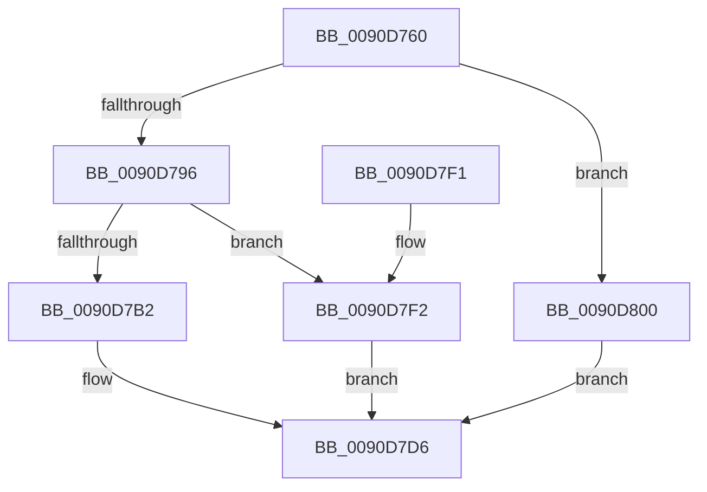

# RtlUpcaseUnicodeToMultiByteN

- RVA: `0x0090D760`–`0x0090D816` (길이 `182` bytes)
- VA: `0x000000014090D760`
- 실행 섹션: `PAGE`
- PDB 이름 있음: `예`; PDB Function 태그: `아니요`
- unwind 정보 RVA: `0x00089470`
- 디코드: `49`개 명령, `182/182` bytes 표시
- 미해석 바이트: `0` (있으면 어셈블리에 `.byte`로 보존)

> 이 문서는 커널 이미지의 기계어와 PDB 기호를 분석해 생성했습니다. 4번과 5번은 함수 원형과 자료형을 바이너리 사용 방식에서 추정한 C 해석이며 원본 소스 복구 결과는 아닙니다.

## 1. Dependencies

- 직접 호출 지점: **5**; 고유 호출 대상: **5**
- 직접 호출자로 확인된 함수: **2**
- RIP 상대 이미지 참조: **0**

### Outgoing calls
- `0x0090D78D` → [RtlpIsUtf8Process](RtlpIsUtf8Process_function_0090DB60.md) (function, `0x0090DB60`)
- `0x0090D79B` → [PsGetCurrentServerSiloGlobals](../../text/2F/PsGetCurrentServerSiloGlobals_function_002FE1F0.md) (function, `0x002FE1F0`)
- `0x0090D7D1` → [UpcaseUnicodeToSingleByteNHelper](../../text/22/UpcaseUnicodeToSingleByteNHelper_function_00224040.md) (function, `0x00224040`)
- `0x0090D7F9` → [UpcaseUnicodeToMultiByteNHelper](../../text/41/UpcaseUnicodeToMultiByteNHelper_function_00419990.md) (function, `0x00419990`)
- `0x0090D80F` → [UpcaseUnicodeToUTF8NHelper](../../text/2F/UpcaseUnicodeToUTF8NHelper_function_002FD8C4.md) (function, `0x002FD8C4`)

### Direct callers
- [toupper](../../text/50/toupper_function_00501870.md) at `0x005018AA`
- [RtlUpcaseUnicodeStringToAnsiString](../78/RtlUpcaseUnicodeStringToAnsiString_function_0078A830.md) at `0x0078A8CE`

### Static image references
- 디코드된 RIP-relative 메모리 참조가 없습니다.

## 2. Other-region calls and transfers

- 다른 실행 섹션으로 향하는 call: **4**
  - `0x0090D79B` → [PsGetCurrentServerSiloGlobals](../../text/2F/PsGetCurrentServerSiloGlobals_function_002FE1F0.md) (`PAGE` → `.text`)
  - `0x0090D7D1` → [UpcaseUnicodeToSingleByteNHelper](../../text/22/UpcaseUnicodeToSingleByteNHelper_function_00224040.md) (`PAGE` → `.text`)
  - `0x0090D7F9` → [UpcaseUnicodeToMultiByteNHelper](../../text/41/UpcaseUnicodeToMultiByteNHelper_function_00419990.md) (`PAGE` → `.text`)
  - `0x0090D80F` → [UpcaseUnicodeToUTF8NHelper](../../text/2F/UpcaseUnicodeToUTF8NHelper_function_002FD8C4.md) (`PAGE` → `.text`)
- 별도 외부 분기/꼬리 이동을 확인하지 못했습니다.

## 3. Assembly (complete function range)

```asm
0090D760  48 89 5C 24 08                  mov qword ptr [rsp + 8], rbx
0090D765  48 89 6C 24 10                  mov qword ptr [rsp + 0x10], rbp
0090D76A  48 89 74 24 18                  mov qword ptr [rsp + 0x18], rsi
0090D76F  48 89 7C 24 20                  mov qword ptr [rsp + 0x20], rdi
0090D774  41 56                           push r14
0090D776  48 83 EC 40                     sub rsp, 0x40
0090D77A  8B 5C 24 70                     mov ebx, dword ptr [rsp + 0x70]
0090D77E  4C 8B F1                        mov r14, rcx
0090D781  33 C9                           xor ecx, ecx
0090D783  D1 EB                           shr ebx, 1
0090D785  49 8B F9                        mov rdi, r9
0090D788  49 8B F0                        mov rsi, r8
0090D78B  8B EA                           mov ebp, edx
0090D78D  E8 CE 03 00 00                  call 0x14090db60
0090D792  84 C0                           test al, al
0090D794  75 6A                           jne 0x14090d800
0090D796  F0 83 0C 24 00                  lock or dword ptr [rsp], 0
0090D79B  E8 50 0A 9F FF                  call 0x1402fe1f0
0090D7A0  4C 8B CF                        mov r9, rdi
0090D7A3  4C 8B C6                        mov r8, rsi
0090D7A6  8B D5                           mov edx, ebp
0090D7A8  66 83 B8 14 04 00 00 00         cmp word ptr [rax + 0x414], 0
0090D7B0  75 40                           jne 0x14090d7f2
0090D7B2  48 8B 88 28 04 00 00            mov rcx, qword ptr [rax + 0x428]
0090D7B9  48 89 4C 24 30                  mov qword ptr [rsp + 0x30], rcx
0090D7BE  48 8B 88 30 04 00 00            mov rcx, qword ptr [rax + 0x430]
0090D7C5  48 89 4C 24 28                  mov qword ptr [rsp + 0x28], rcx
0090D7CA  49 8B CE                        mov rcx, r14
0090D7CD  89 5C 24 20                     mov dword ptr [rsp + 0x20], ebx
0090D7D1  E8 6A 68 91 FF                  call 0x140224040
0090D7D6  48 8B 5C 24 50                  mov rbx, qword ptr [rsp + 0x50]
0090D7DB  48 8B 6C 24 58                  mov rbp, qword ptr [rsp + 0x58]
0090D7E0  48 8B 74 24 60                  mov rsi, qword ptr [rsp + 0x60]
0090D7E5  48 8B 7C 24 68                  mov rdi, qword ptr [rsp + 0x68]
0090D7EA  48 83 C4 40                     add rsp, 0x40
0090D7EE  41 5E                           pop r14
0090D7F0  C3                              ret
0090D7F1  CC                              int3
0090D7F2  49 8B CE                        mov rcx, r14
0090D7F5  89 5C 24 20                     mov dword ptr [rsp + 0x20], ebx
0090D7F9  E8 92 C1 B0 FF                  call 0x140419990
0090D7FE  EB D6                           jmp 0x14090d7d6
0090D800  4C 8B CF                        mov r9, rdi
0090D803  89 5C 24 20                     mov dword ptr [rsp + 0x20], ebx
0090D807  4C 8B C6                        mov r8, rsi
0090D80A  8B D5                           mov edx, ebp
0090D80C  49 8B CE                        mov rcx, r14
0090D80F  E8 B0 00 9F FF                  call 0x1402fd8c4
0090D814  EB C0                           jmp 0x14090d7d6
```

## 4. C-style interpretation (structured pseudocode)

```c
__int64 __fastcall RtlUpcaseUnicodeToMultiByteN(__int64 a1, int a2, __int64 a3, __int64 a4, unsigned int a5)
{
    __int64 result;
    __int64 v_rbx;
    __int64 v_rsp;
    unsigned __int64 v_stack_m18;
    unsigned __int64 v_stack_m20;
    unsigned int v_stack_m28;
    unsigned int v_stack_m48;
    unsigned __int64 v_stack_p10;
    unsigned __int64 v_stack_p18;
    unsigned __int64 v_stack_p20;
    unsigned __int64 v_stack_p8;

    v_stack_p8 = v_rbx;
    v_stack_p10 = v_rbp;
    v_stack_p18 = v_rsi;
    v_stack_p20 = v_rdi;
    v_rsp = (v_rsp) - (64);
    a1 = 0;
    v_rbx = (unsigned int)(((unsigned int)(a5)) >> (1));
    result = RtlpIsUtf8Process(a1, a2, a3, a4);
    if ((unsigned __int8)(result) != 0) goto loc_0090D800;
    result = PsGetCurrentServerSiloGlobals(a1, a2, a3, a4);
    if ((*(unsigned __int16 *)(result + 1044)) != 0) goto loc_0090D7F2;
    v_stack_m18 = *(unsigned __int64 *)(result + 1064);
    v_stack_m20 = *(unsigned __int64 *)(result + 1072);
    v_stack_m28 = (unsigned int)(v_rbx);
    result = UpcaseUnicodeToSingleByteNHelper(0, (unsigned int)((unsigned int)((unsigned int)(a2))), a3, a4);
loc_0090D7D6:
    v_rsp = (v_rsp) + (64);
    return result;
loc_0090D7F2:
    v_stack_p20 = (unsigned int)(v_stack_p8);
    result = UpcaseUnicodeToMultiByteNHelper(0, (unsigned int)((unsigned int)((unsigned int)(a2))), a3, a4);
    goto loc_0090D7D6;
loc_0090D800:
    v_stack_p20 = (unsigned int)(v_stack_p8);
    result = UpcaseUnicodeToUTF8NHelper(0, (unsigned int)((unsigned int)(v_stack_p10)), v_stack_p18, v_stack_p20);
    goto loc_0090D7D6;
}
```

## 5. (Beta) C Style

```c
int64_t RtlUpcaseUnicodeToMultiByteN(int64_t Arg1, int32_t Arg2, int64_t Arg3, int64_t Arg4, uint32_t Arg5)
{
    int64_t result;
    int64_t local_rbx;
    int64_t local_rsp;
    uint64_t v_stack_m18;
    uint64_t v_stack_m20;
    uint32_t v_stack_m28;
    uint32_t v_stack_m48;
    uint64_t v_stack_p10;
    uint64_t v_stack_p18;
    uint64_t v_stack_p20;
    uint64_t v_stack_p8;

    v_stack_p8 = local_rbx;
    v_stack_p10 = local_rbp;
    v_stack_p18 = local_rsi;
    v_stack_p20 = local_rdi;
    local_rsp = (local_rsp) - (64);
    Arg1 = 0;
    local_rbx = (uint32_t)(((uint32_t)(Arg5)) >> (1));
    result = RtlpIsUtf8Process(Arg1, Arg2, Arg3, Arg4);
    if ((uint8_t)(result) != 0) goto loc_0090D800;
    result = PsGetCurrentServerSiloGlobals(Arg1, Arg2, Arg3, Arg4);
    if ((*(uint16_t *)(result + 0x414)) != 0) goto loc_0090D7F2;
    v_stack_m18 = *(uint64_t *)(result + 0x428);
    v_stack_m20 = *(uint64_t *)(result + 0x430);
    v_stack_m28 = (uint32_t)(local_rbx);
    result = UpcaseUnicodeToSingleByteNHelper(0, (uint32_t)((uint32_t)((uint32_t)(Arg2))), Arg3, Arg4);
loc_0090D7D6:
    local_rsp = (local_rsp) + (64);
    return result;
loc_0090D7F2:
    v_stack_p20 = (uint32_t)(v_stack_p8);
    result = UpcaseUnicodeToMultiByteNHelper(0, (uint32_t)((uint32_t)((uint32_t)(Arg2))), Arg3, Arg4);
    goto loc_0090D7D6;
loc_0090D800:
    v_stack_p20 = (uint32_t)(v_stack_p8);
    result = UpcaseUnicodeToUTF8NHelper(0, (uint32_t)((uint32_t)(v_stack_p10)), v_stack_p18, v_stack_p20);
    goto loc_0090D7D6;
}
```

## 6. Execution-region graph

[열기: 2D/3D 그래프와 함수 탐색 컨트롤 패널](../../../control-panel.html?section=page&rva=0x0090D760&view=graph)

- 2D 그래프는 위에서 아래로 흐르고, 3D 그래프는 빈 공간을 드래그해 회전합니다. Shift+드래그는 이동, 휠은 확대·축소, 함수 노드 선택은 대상 보고서 이동입니다.

### Static fallback


