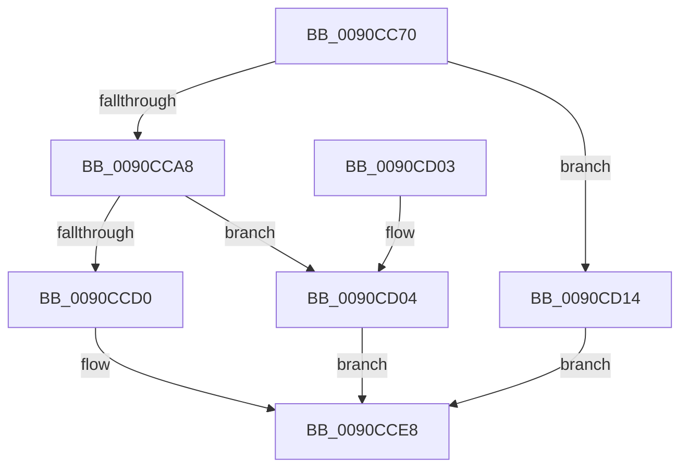

# RtlUpcaseUnicodeToOemN

- RVA: `0x0090CC70`–`0x0090CD2A` (길이 `186` bytes)
- VA: `0x000000014090CC70`
- 실행 섹션: `PAGE`
- PDB 이름 있음: `예`; PDB Function 태그: `아니요`
- unwind 정보 RVA: `0x000892FC`
- 디코드: `52`개 명령, `186/186` bytes 표시
- 미해석 바이트: `0` (있으면 어셈블리에 `.byte`로 보존)

> 이 문서는 커널 이미지의 기계어와 PDB 기호를 분석해 생성했습니다. 4번과 5번은 함수 원형과 자료형을 바이너리 사용 방식에서 추정한 C 해석이며 원본 소스 복구 결과는 아닙니다.

## 1. Dependencies

- 직접 호출 지점: **5**; 고유 호출 대상: **5**
- 직접 호출자로 확인된 함수: **1**
- RIP 상대 이미지 참조: **0**

### Outgoing calls
- `0x0090CC9C` → [RtlpIsUtf8Process](RtlpIsUtf8Process_function_0090DB60.md) (function, `0x0090DB60`)
- `0x0090CCAD` → [PsGetCurrentServerSiloGlobals](../../text/2F/PsGetCurrentServerSiloGlobals_function_002FE1F0.md) (function, `0x002FE1F0`)
- `0x0090CCE3` → [UpcaseUnicodeToSingleByteNHelper](../../text/22/UpcaseUnicodeToSingleByteNHelper_function_00224040.md) (function, `0x00224040`)
- `0x0090CD0D` → [UpcaseUnicodeToMultiByteNHelper](../../text/41/UpcaseUnicodeToMultiByteNHelper_function_00419990.md) (function, `0x00419990`)
- `0x0090CD23` → [UpcaseUnicodeToUTF8NHelper](../../text/2F/UpcaseUnicodeToUTF8NHelper_function_002FD8C4.md) (function, `0x002FD8C4`)

### Direct callers
- [RtlUpcaseUnicodeStringToOemString](../A8/RtlUpcaseUnicodeStringToOemString_function_00A84220.md) at `0x00A842B0`

### Static image references
- 디코드된 RIP-relative 메모리 참조가 없습니다.

## 2. Other-region calls and transfers

- 다른 실행 섹션으로 향하는 call: **4**
  - `0x0090CCAD` → [PsGetCurrentServerSiloGlobals](../../text/2F/PsGetCurrentServerSiloGlobals_function_002FE1F0.md) (`PAGE` → `.text`)
  - `0x0090CCE3` → [UpcaseUnicodeToSingleByteNHelper](../../text/22/UpcaseUnicodeToSingleByteNHelper_function_00224040.md) (`PAGE` → `.text`)
  - `0x0090CD0D` → [UpcaseUnicodeToMultiByteNHelper](../../text/41/UpcaseUnicodeToMultiByteNHelper_function_00419990.md) (`PAGE` → `.text`)
  - `0x0090CD23` → [UpcaseUnicodeToUTF8NHelper](../../text/2F/UpcaseUnicodeToUTF8NHelper_function_002FD8C4.md) (`PAGE` → `.text`)
- 별도 외부 분기/꼬리 이동을 확인하지 못했습니다.

## 3. Assembly (complete function range)

```asm
0090CC70  48 8B C4                        mov rax, rsp
0090CC73  48 89 58 08                     mov qword ptr [rax + 8], rbx
0090CC77  48 89 68 10                     mov qword ptr [rax + 0x10], rbp
0090CC7B  48 89 70 18                     mov qword ptr [rax + 0x18], rsi
0090CC7F  48 89 78 20                     mov qword ptr [rax + 0x20], rdi
0090CC83  41 56                           push r14
0090CC85  48 83 EC 40                     sub rsp, 0x40
0090CC89  8B 5C 24 70                     mov ebx, dword ptr [rsp + 0x70]
0090CC8D  4C 8B F1                        mov r14, rcx
0090CC90  B1 01                           mov cl, 1
0090CC92  D1 EB                           shr ebx, 1
0090CC94  49 8B F9                        mov rdi, r9
0090CC97  49 8B F0                        mov rsi, r8
0090CC9A  8B EA                           mov ebp, edx
0090CC9C  E8 BF 0E 00 00                  call 0x14090db60
0090CCA1  45 33 C0                        xor r8d, r8d
0090CCA4  84 C0                           test al, al
0090CCA6  75 6C                           jne 0x14090cd14
0090CCA8  F0 44 09 04 24                  lock or dword ptr [rsp], r8d
0090CCAD  E8 3E 15 9F FF                  call 0x1402fe1f0
0090CCB2  4C 8B CF                        mov r9, rdi
0090CCB5  66 44 39 80 54 04 00 00         cmp word ptr [rax + 0x454], r8w
0090CCBD  4C 8B C6                        mov r8, rsi
0090CCC0  48 8B 88 68 04 00 00            mov rcx, qword ptr [rax + 0x468]
0090CCC7  48 8B 90 70 04 00 00            mov rdx, qword ptr [rax + 0x470]
0090CCCE  75 34                           jne 0x14090cd04
0090CCD0  48 89 4C 24 30                  mov qword ptr [rsp + 0x30], rcx
0090CCD5  49 8B CE                        mov rcx, r14
0090CCD8  48 89 54 24 28                  mov qword ptr [rsp + 0x28], rdx
0090CCDD  8B D5                           mov edx, ebp
0090CCDF  89 5C 24 20                     mov dword ptr [rsp + 0x20], ebx
0090CCE3  E8 58 73 91 FF                  call 0x140224040
0090CCE8  48 8B 5C 24 50                  mov rbx, qword ptr [rsp + 0x50]
0090CCED  48 8B 6C 24 58                  mov rbp, qword ptr [rsp + 0x58]
0090CCF2  48 8B 74 24 60                  mov rsi, qword ptr [rsp + 0x60]
0090CCF7  48 8B 7C 24 68                  mov rdi, qword ptr [rsp + 0x68]
0090CCFC  48 83 C4 40                     add rsp, 0x40
0090CD00  41 5E                           pop r14
0090CD02  C3                              ret
0090CD03  CC                              int3
0090CD04  8B D5                           mov edx, ebp
0090CD06  89 5C 24 20                     mov dword ptr [rsp + 0x20], ebx
0090CD0A  49 8B CE                        mov rcx, r14
0090CD0D  E8 7E CC B0 FF                  call 0x140419990
0090CD12  EB D4                           jmp 0x14090cce8
0090CD14  4C 8B CF                        mov r9, rdi
0090CD17  89 5C 24 20                     mov dword ptr [rsp + 0x20], ebx
0090CD1B  4C 8B C6                        mov r8, rsi
0090CD1E  8B D5                           mov edx, ebp
0090CD20  49 8B CE                        mov rcx, r14
0090CD23  E8 9C 0B 9F FF                  call 0x1402fd8c4
0090CD28  EB BE                           jmp 0x14090cce8
```

## 4. C-style interpretation (structured pseudocode)

```c
__int64 __fastcall RtlUpcaseUnicodeToOemN(__int64 a1, int a2, __int64 a3, __int64 a4, unsigned int a5)
{
    __int64 result;
    __int64 v_rbx;
    __int64 v_rsp;
    unsigned __int64 v_stack_m18;
    unsigned __int64 v_stack_m20;
    unsigned int v_stack_m28;
    unsigned int v_stack_m48;
    unsigned __int64 v_stack_p10;
    unsigned __int64 v_stack_p18;
    unsigned __int64 v_stack_p20;
    unsigned __int64 v_stack_p8;

    *(unsigned __int64 *)(v_rsp + 8) = v_rbx;
    *(unsigned __int64 *)(v_rsp + 16) = v_rbp;
    *(unsigned __int64 *)(v_rsp + 24) = v_rsi;
    *(unsigned __int64 *)(v_rsp + 32) = v_rdi;
    v_rsp = (v_rsp) - (64);
    v_rbx = (unsigned int)(((unsigned int)(a5)) >> (1));
    result = RtlpIsUtf8Process(1, a2, a3, a4);
    a3 = 0;
    if ((unsigned __int8)(result) != 0) goto loc_0090CD14;
    result = PsGetCurrentServerSiloGlobals(1, a2, a3, a4);
    if ((*(unsigned __int16 *)(result + 1108)) != 0) goto loc_0090CD04;
    v_stack_m18 = *(unsigned __int64 *)(result + 1128);
    v_stack_m20 = *(unsigned __int64 *)(result + 1136);
    v_stack_m28 = (unsigned int)(v_rbx);
    result = UpcaseUnicodeToSingleByteNHelper(a1, (unsigned int)((unsigned int)((unsigned int)(a2))), 0, a4);
loc_0090CCE8:
    v_rsp = (v_rsp) + (64);
    return result;
loc_0090CD04:
    v_stack_p20 = (unsigned int)(v_stack_p8);
    result = UpcaseUnicodeToMultiByteNHelper(a1, (unsigned int)((unsigned int)(v_stack_p10)), 0, a4);
    goto loc_0090CCE8;
loc_0090CD14:
    v_stack_p20 = (unsigned int)(v_stack_p8);
    result = UpcaseUnicodeToUTF8NHelper(a1, (unsigned int)((unsigned int)(v_stack_p10)), v_stack_p18, v_stack_p20);
    goto loc_0090CCE8;
}
```

## 5. (Beta) C Style

```c
int64_t RtlUpcaseUnicodeToOemN(int64_t Arg1, int32_t Arg2, int64_t Arg3, int64_t Arg4, uint32_t Arg5)
{
    int64_t result;
    int64_t local_rbx;
    int64_t local_rsp;
    uint64_t v_stack_m18;
    uint64_t v_stack_m20;
    uint32_t v_stack_m28;
    uint32_t v_stack_m48;
    uint64_t v_stack_p10;
    uint64_t v_stack_p18;
    uint64_t v_stack_p20;
    uint64_t v_stack_p8;

    *(uint64_t *)(local_rsp + 0x8) = local_rbx;
    *(uint64_t *)(local_rsp + 0x10) = local_rbp;
    *(uint64_t *)(local_rsp + 0x18) = local_rsi;
    *(uint64_t *)(local_rsp + 0x20) = local_rdi;
    local_rsp = (local_rsp) - (64);
    local_rbx = (uint32_t)(((uint32_t)(Arg5)) >> (1));
    result = RtlpIsUtf8Process(1, Arg2, Arg3, Arg4);
    Arg3 = 0;
    if ((uint8_t)(result) != 0) goto loc_0090CD14;
    result = PsGetCurrentServerSiloGlobals(1, Arg2, Arg3, Arg4);
    if ((*(uint16_t *)(result + 0x454)) != 0) goto loc_0090CD04;
    v_stack_m18 = *(uint64_t *)(result + 0x468);
    v_stack_m20 = *(uint64_t *)(result + 0x470);
    v_stack_m28 = (uint32_t)(local_rbx);
    result = UpcaseUnicodeToSingleByteNHelper(Arg1, (uint32_t)((uint32_t)((uint32_t)(Arg2))), 0, Arg4);
loc_0090CCE8:
    local_rsp = (local_rsp) + (64);
    return result;
loc_0090CD04:
    v_stack_p20 = (uint32_t)(v_stack_p8);
    result = UpcaseUnicodeToMultiByteNHelper(Arg1, (uint32_t)((uint32_t)(v_stack_p10)), 0, Arg4);
    goto loc_0090CCE8;
loc_0090CD14:
    v_stack_p20 = (uint32_t)(v_stack_p8);
    result = UpcaseUnicodeToUTF8NHelper(Arg1, (uint32_t)((uint32_t)(v_stack_p10)), v_stack_p18, v_stack_p20);
    goto loc_0090CCE8;
}
```

## 6. Execution-region graph

[열기: 2D/3D 그래프와 함수 탐색 컨트롤 패널](../../../control-panel.html?section=page&rva=0x0090CC70&view=graph)

- 2D 그래프는 위에서 아래로 흐르고, 3D 그래프는 빈 공간을 드래그해 회전합니다. Shift+드래그는 이동, 휠은 확대·축소, 함수 노드 선택은 대상 보고서 이동입니다.

### Static fallback


