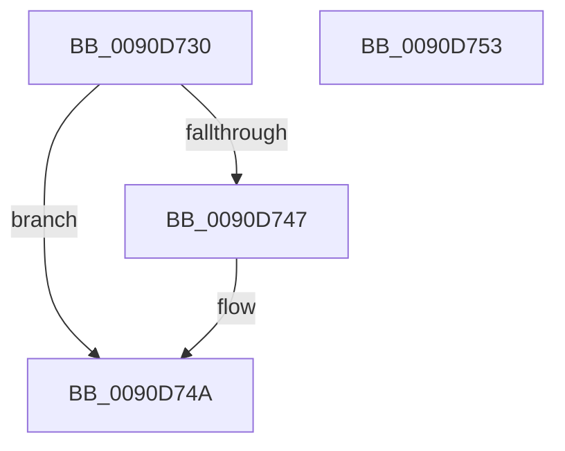

# RtlUpperChar

- RVA: `0x0090D730`–`0x0090D754` (길이 `36` bytes)
- VA: `0x000000014090D730`
- 실행 섹션: `PAGE`
- PDB 이름 있음: `예`; PDB Function 태그: `아니요`
- unwind 정보 RVA: `0x0005CF00`
- 디코드: `14`개 명령, `36/36` bytes 표시
- 미해석 바이트: `0` (있으면 어셈블리에 `.byte`로 보존)

> 이 문서는 커널 이미지의 기계어와 PDB 기호를 분석해 생성했습니다. 4번과 5번은 함수 원형과 자료형을 바이너리 사용 방식에서 추정한 C 해석이며 원본 소스 복구 결과는 아닙니다.

## 1. Dependencies

- 직접 호출 지점: **1**; 고유 호출 대상: **1**
- 직접 호출자로 확인된 함수: **3**
- RIP 상대 이미지 참조: **0**

### Outgoing calls
- `0x0090D73B` → [RtlpIsUtf8Process](RtlpIsUtf8Process_function_0090DB60.md) (function, `0x0090DB60`)

### Direct callers
- [RtlCompareString](RtlCompareString_function_0090E880.md) at `0x0090E8D8`
- [RtlCompareString](RtlCompareString_function_0090E880.md) at `0x0090E8E4`
- [RtlPrefixString](RtlPrefixString_function_0090F520.md) at `0x0090F58D`
- [RtlPrefixString](RtlPrefixString_function_0090F520.md) at `0x0090F597`
- [MiSnapThunk](../A2/MiSnapThunk_function_00A24004.md) at `0x00A2425F`
- [MiSnapThunk](../A2/MiSnapThunk_function_00A24004.md) at `0x00A24269`

### Static image references
- 디코드된 RIP-relative 메모리 참조가 없습니다.

## 2. Other-region calls and transfers

- 다른 실행 섹션으로 향하는 call: **0**
- 별도 외부 분기/꼬리 이동을 확인하지 못했습니다.

## 3. Assembly (complete function range)

```asm
0090D730  40 53                           push rbx
0090D732  48 83 EC 20                     sub rsp, 0x20
0090D736  0F B6 D9                        movzx ebx, cl
0090D739  33 C9                           xor ecx, ecx
0090D73B  E8 20 04 00 00                  call 0x14090db60
0090D740  8D 43 9F                        lea eax, [rbx - 0x61]
0090D743  3C 19                           cmp al, 0x19
0090D745  77 03                           ja 0x14090d74a
0090D747  80 F3 20                        xor bl, 0x20
0090D74A  0F B6 C3                        movzx eax, bl
0090D74D  48 83 C4 20                     add rsp, 0x20
0090D751  5B                              pop rbx
0090D752  C3                              ret
0090D753  CC                              int3
```

## 4. C-style interpretation (structured pseudocode)

```c
__int64 __fastcall RtlUpperChar(int a1)
{
    __int64 result;
    __int64 v_rbx;
    __int64 v_rsp;

    v_rsp = (v_rsp) - (32);
    a1 = 0;
    result = RtlpIsUtf8Process(a1, a2, a3, a4);
    v_rbx = (unsigned __int8)(a1);
    if (((unsigned __int8)((unsigned __int8)(a1) - 97)) <= 25) {
        v_rbx = (unsigned __int8)(((unsigned __int8)(a1)) ^ (32));
    }
    v_rsp = (v_rsp) + (32);
    return (unsigned __int8)(v_rbx);
}
```

## 5. (Beta) C Style

```c
int64_t RtlUpperChar(void *Arg1)
{
    uint8_t *arg1 = (uint8_t *)Arg1;

    int64_t result;
    int64_t local_rbx;
    int64_t local_rsp;

    local_rsp = (local_rsp) - (32);
    Arg1 = 0;
    result = RtlpIsUtf8Process(Arg1, a2, a3, a4);
    local_rbx = (uint8_t)(Arg1);
    if (((uint8_t)((uint8_t)(Arg1) - 97)) <= 25) {
        local_rbx = (uint8_t)(((uint8_t)(Arg1)) ^ (32));
    }
    local_rsp = (local_rsp) + (32);
    return (uint8_t)(local_rbx);
}
```

### 관측된 메모리 오프셋

구조체 형식이 확인되지 않은 접근은 인자 기준의 오프셋으로만 기록했습니다.

| 기준 인자 | 오프셋 표현 | 폭 (bit) | 접근 |
|---|---:|---:|---|
| `Arg1` | `- 0x61` | `32` | `R` |

## 6. Execution-region graph

[열기: 2D/3D 그래프와 함수 탐색 컨트롤 패널](../../../control-panel.html?section=page&rva=0x0090D730&view=graph)

- 2D 그래프는 위에서 아래로 흐르고, 3D 그래프는 빈 공간을 드래그해 회전합니다. Shift+드래그는 이동, 휠은 확대·축소, 함수 노드 선택은 대상 보고서 이동입니다.

### Static fallback


