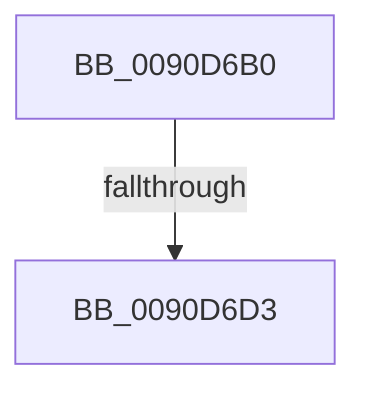

# RtlUpperString

- RVA: `0x0090D6B0`–`0x0090D6DA` (길이 `42` bytes)
- VA: `0x000000014090D6B0`
- 실행 섹션: `PAGE`
- PDB 이름 있음: `예`; PDB Function 태그: `아니요`
- unwind 정보 RVA: `0x00089438`
- 디코드: `13`개 명령, `42/42` bytes 표시
- 미해석 바이트: `0` (있으면 어셈블리에 `.byte`로 보존)

> 이 문서는 커널 이미지의 기계어와 PDB 기호를 분석해 생성했습니다. 4번과 5번은 함수 원형과 자료형을 바이너리 사용 방식에서 추정한 C 해석이며 원본 소스 복구 결과는 아닙니다.

## 1. Dependencies

- 직접 호출 지점: **0**; 고유 호출 대상: **0**
- 직접 호출자로 확인된 함수: **0**
- RIP 상대 이미지 참조: **0**

### Outgoing calls
- 직접 디코드된 call 명령이 없습니다.

### Direct callers
- 이 함수 시작 RVA로 연결되는 직접 call은 확인되지 않았습니다. 간접 호출은 완전히 역산할 수 없습니다.

### Static image references
- 디코드된 RIP-relative 메모리 참조가 없습니다.

## 2. Other-region calls and transfers

- 다른 실행 섹션으로 향하는 call: **0**
- call이 아닌 외부 분기/꼬리 이동: **2**
  - `0x0090D6D1` → [sub_0090D711 + 0x11](Unknown_function_0090D711.md) (`tail-transfer`)
  - `0x0090D6D8` → [sub_0090D711](Unknown_function_0090D711.md) (`tail-transfer`)

## 3. Assembly (complete function range)

```asm
0090D6B0  48 89 5C 24 10                  mov qword ptr [rsp + 0x10], rbx
0090D6B5  48 89 6C 24 18                  mov qword ptr [rsp + 0x18], rbp
0090D6BA  56                              push rsi
0090D6BB  48 83 EC 20                     sub rsp, 0x20
0090D6BF  0F B7 2A                        movzx ebp, word ptr [rdx]
0090D6C2  0F B7 41 02                     movzx eax, word ptr [rcx + 2]
0090D6C6  48 8B 71 08                     mov rsi, qword ptr [rcx + 8]
0090D6CA  48 8B 5A 08                     mov rbx, qword ptr [rdx + 8]
0090D6CE  66 3B E8                        cmp bp, ax
0090D6D1  77 4F                           ja 0x14090d722
0090D6D3  66 89 29                        mov word ptr [rcx], bp
0090D6D6  85 ED                           test ebp, ebp
0090D6D8  74 37                           je 0x14090d711
```

## 4. C-style interpretation (structured pseudocode)

```c
__int64 __fastcall RtlUpperString(__int64 a1, __int64 a2)
{
    __int64 v_rsp;
    unsigned __int64 v_stack_p10;
    unsigned __int64 v_stack_p18;

    v_stack_p10 = v_rbx;
    v_stack_p18 = v_rbp;
    v_rsp = (v_rsp) - (32);
    *(unsigned __int16 *)(a1) = (unsigned __int16)(*(unsigned __int16 *)(a2));
}
```

## 5. (Beta) C Style

```c
int64_t RtlUpperString(void *Arg1, void *Arg2)
{
    uint8_t *arg1 = (uint8_t *)Arg1;
    uint8_t *arg2 = (uint8_t *)Arg2;

    int64_t local_rsp;
    uint64_t v_stack_p10;
    uint64_t v_stack_p18;

    v_stack_p10 = local_rbx;
    v_stack_p18 = local_rbp;
    local_rsp = (local_rsp) - (32);
    *(uint16_t *)(arg1) = (uint16_t)(*(uint16_t *)(arg2));
}
```

### 관측된 메모리 오프셋

구조체 형식이 확인되지 않은 접근은 인자 기준의 오프셋으로만 기록했습니다.

| 기준 인자 | 오프셋 표현 | 폭 (bit) | 접근 |
|---|---:|---:|---|
| `Arg1` | `+ 0x0` | `16` | `W` |
| `Arg1` | `+ 0x2` | `16` | `R` |
| `Arg1` | `+ 0x8` | `64` | `R` |
| `Arg2` | `+ 0x0` | `16` | `R` |
| `Arg2` | `+ 0x8` | `64` | `R` |

## 6. Execution-region graph

[열기: 2D/3D 그래프와 함수 탐색 컨트롤 패널](../../../control-panel.html?section=page&rva=0x0090D6B0&view=graph)

- 2D 그래프는 위에서 아래로 흐르고, 3D 그래프는 빈 공간을 드래그해 회전합니다. Shift+드래그는 이동, 휠은 확대·축소, 함수 노드 선택은 대상 보고서 이동입니다.

### Static fallback


