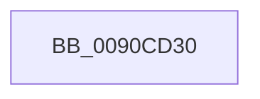

# RtlpDidUnicodeToOemWork

- RVA: `0x0090CD30`–`0x0090CD4C` (길이 `28` bytes)
- VA: `0x000000014090CD30`
- 실행 섹션: `PAGE`
- PDB 이름 있음: `예`; PDB Function 태그: `아니요`
- unwind 정보 RVA: `0x00089318`
- 디코드: `9`개 명령, `28/28` bytes 표시
- 미해석 바이트: `0` (있으면 어셈블리에 `.byte`로 보존)

> 이 문서는 커널 이미지의 기계어와 PDB 기호를 분석해 생성했습니다. 4번과 5번은 함수 원형과 자료형을 바이너리 사용 방식에서 추정한 C 해석이며 원본 소스 복구 결과는 아닙니다.

## 1. Dependencies

- 직접 호출 지점: **1**; 고유 호출 대상: **1**
- 직접 호출자로 확인된 함수: **3**
- RIP 상대 이미지 참조: **0**

### Outgoing calls
- `0x0090CD3F` → [RtlpIsUtf8Process](RtlpIsUtf8Process_function_0090DB60.md) (function, `0x0090DB60`)

### Direct callers
- [RtlUpcaseUnicodeStringToCountedOemString](RtlUpcaseUnicodeStringToCountedOemString_function_0090E4D0.md) at `0x0090E602`
- [RtlUnicodeStringToCountedOemString](RtlUnicodeStringToCountedOemString_function_0090F1A0.md) at `0x0090F256`
- [RtlUpcaseUnicodeStringToOemString](../A8/RtlUpcaseUnicodeStringToOemString_function_00A84220.md) at `0x00A842D9`

### Static image references
- 디코드된 RIP-relative 메모리 참조가 없습니다.

## 2. Other-region calls and transfers

- 다른 실행 섹션으로 향하는 call: **0**
- call이 아닌 외부 분기/꼬리 이동: **1**
  - `0x0090CD46` → [sub_0090CE1E + 0x1](Unknown_function_0090CE1E.md) (`tail-transfer`)

## 3. Assembly (complete function range)

```asm
0090CD30  40 53                           push rbx
0090CD32  55                              push rbp
0090CD33  48 83 EC 28                     sub rsp, 0x28
0090CD37  48 8B D9                        mov rbx, rcx
0090CD3A  48 8B EA                        mov rbp, rdx
0090CD3D  B1 01                           mov cl, 1
0090CD3F  E8 1C 0E 00 00                  call 0x14090db60
0090CD44  84 C0                           test al, al
0090CD46  0F 85 D3 00 00 00               jne 0x14090ce1f
```

## 4. C-style interpretation (structured pseudocode)

```c
__int64 __fastcall RtlpDidUnicodeToOemWork(__int64 a1, __int64 a2)
{
    __int64 result;
    __int64 v_rsp;

    v_rsp = (v_rsp) - (40);
    result = RtlpIsUtf8Process(1, a2, a3, a4);
}
```

## 5. (Beta) C Style

```c
int64_t RtlpDidUnicodeToOemWork(int64_t Arg1, int64_t Arg2)
{
    int64_t result;
    int64_t local_rsp;

    local_rsp = (local_rsp) - (40);
    result = RtlpIsUtf8Process(1, Arg2, a3, a4);
}
```

## 6. Execution-region graph

[열기: 2D/3D 그래프와 함수 탐색 컨트롤 패널](../../../control-panel.html?section=page&rva=0x0090CD30&view=graph)

- 2D 그래프는 위에서 아래로 흐르고, 3D 그래프는 빈 공간을 드래그해 회전합니다. Shift+드래그는 이동, 휠은 확대·축소, 함수 노드 선택은 대상 보고서 이동입니다.

### Static fallback


