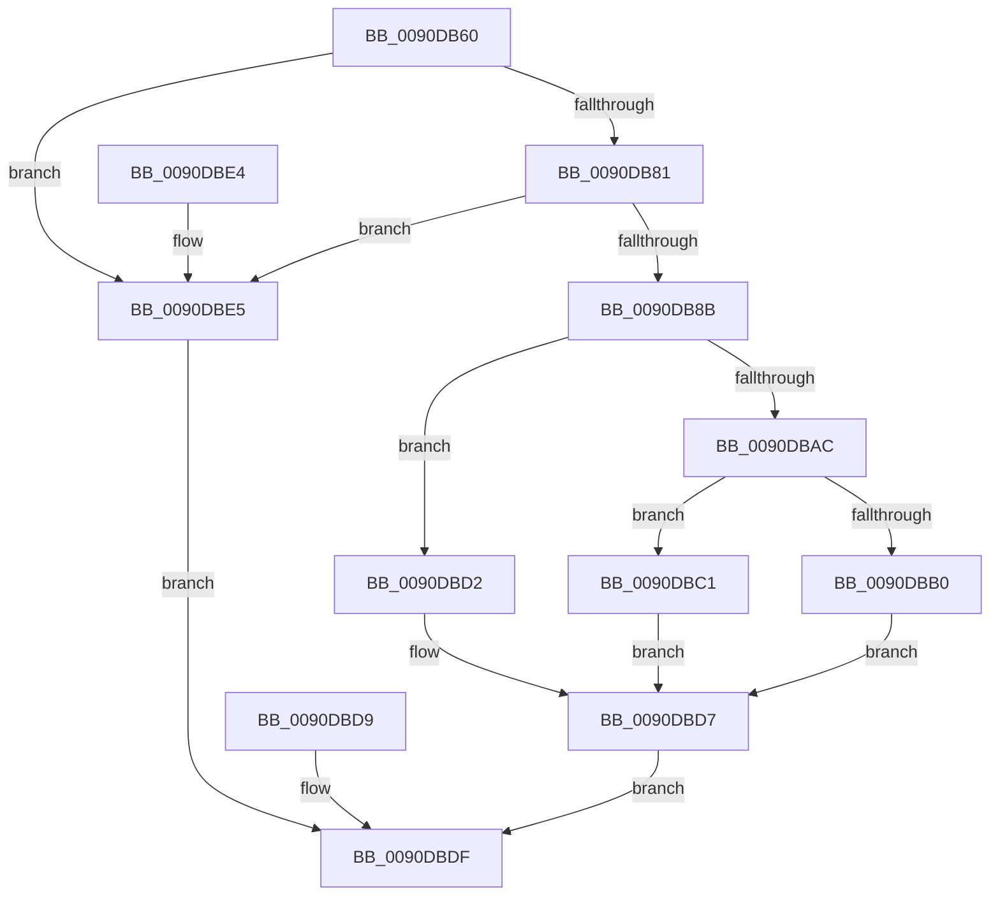

# RtlpIsUtf8Process

- RVA: `0x0090DB60`–`0x0090DBE9` (길이 `137` bytes)
- VA: `0x000000014090DB60`
- 실행 섹션: `PAGE`
- PDB 이름 있음: `예`; PDB Function 태그: `아니요`
- unwind 정보 RVA: `0x000894B8`
- 디코드: `34`개 명령, `137/137` bytes 표시
- 미해석 바이트: `0` (있으면 어셈블리에 `.byte`로 보존)

> 이 문서는 커널 이미지의 기계어와 PDB 기호를 분석해 생성했습니다. 4번과 5번은 함수 원형과 자료형을 바이너리 사용 방식에서 추정한 C 해석이며 원본 소스 복구 결과는 아닙니다.

## 1. Dependencies

- 직접 호출 지점: **1**; 고유 호출 대상: **1**
- 직접 호출자로 확인된 함수: **21**
- RIP 상대 이미지 참조: **0**

### Outgoing calls
- `0x0090DB67` → [PsGetCurrentServerSiloGlobals](../../text/2F/PsGetCurrentServerSiloGlobals_function_002FE1F0.md) (function, `0x002FE1F0`)

### Direct callers
- [CompareNamesCaseSensitive](../78/CompareNamesCaseSensitive_function_0078CA1C.md) at `0x0078CA48`
- [ComputeNameLength](../78/ComputeNameLength_function_0078CBC8.md) at `0x0078CBE8`
- [RtlAnsiStringToUnicodeString](RtlAnsiStringToUnicodeString_function_0090BEA0.md) at `0x0090BED5`
- [RtlAnsiStringToUnicodeString](RtlAnsiStringToUnicodeString_function_0090BEA0.md) at `0x0090BF56`
- [RtlMultiByteToUnicodeSize](RtlMultiByteToUnicodeSize_function_0090CBC0.md) at `0x0090CBDA`
- [RtlUpcaseUnicodeToOemN](RtlUpcaseUnicodeToOemN_function_0090CC70.md) at `0x0090CC9C`
- [RtlpDidUnicodeToOemWork](RtlpDidUnicodeToOemWork_function_0090CD30.md) at `0x0090CD3F`
- [RtlxUnicodeStringToAnsiSize](RtlxUnicodeStringToAnsiSize_function_0090CE80.md) at `0x0090CE9E`
- [RtlIsNameLegalDOS8Dot3](RtlIsNameLegalDOS8Dot3_function_0090CF30.md) at `0x0090CF74`
- [RtlUnicodeToMultiByteSize](RtlUnicodeToMultiByteSize_function_0090D110.md) at `0x0090D12A`
- [RtlUnicodeStringToAnsiString](RtlUnicodeStringToAnsiString_function_0090D1F0.md) at `0x0090D232`
- [RtlUnicodeStringToAnsiString](RtlUnicodeStringToAnsiString_function_0090D1F0.md) at `0x0090D2A7`
- [RtlMultiByteToUnicodeN](RtlMultiByteToUnicodeN_function_0090D520.md) at `0x0090D54B`
- [sub_0090D6DA](Unknown_function_0090D6DA.md) at `0x0090D6E5`
- [RtlUpperChar](RtlUpperChar_function_0090D730.md) at `0x0090D73B`
- [RtlUpcaseUnicodeToMultiByteN](RtlUpcaseUnicodeToMultiByteN_function_0090D760.md) at `0x0090D78D`
- [RtlUnicodeToMultiByteN](RtlUnicodeToMultiByteN_function_0090D820.md) at `0x0090D842`
- [RtlAnsiCharToUnicodeChar](RtlAnsiCharToUnicodeChar_function_0090D980.md) at `0x0090D99C`
- [RtlAnsiCharToUnicodeChar](RtlAnsiCharToUnicodeChar_function_0090D980.md) at `0x0090D9D4`
- [RtlUpcaseUnicodeStringToCountedOemString](RtlUpcaseUnicodeStringToCountedOemString_function_0090E4D0.md) at `0x0090E509`
- [RtlUpcaseUnicodeStringToCountedOemString](RtlUpcaseUnicodeStringToCountedOemString_function_0090E4D0.md) at `0x0090E590`
- [RtlGenerate8dot3Name](RtlGenerate8dot3Name_function_0090E950.md) at `0x0090E99B`
- [RtlUnicodeToOemN](RtlUnicodeToOemN_function_0090F2B0.md) at `0x0090F2D1`
- [RtlOemToUnicodeN](RtlOemToUnicodeN_function_0090F330.md) at `0x0090F35D`
- [RtlIsValidOemCharacter](RtlIsValidOemCharacter_function_0090F5C0.md) at `0x0090F5D4`

### Static image references
- 디코드된 RIP-relative 메모리 참조가 없습니다.

## 2. Other-region calls and transfers

- 다른 실행 섹션으로 향하는 call: **1**
  - `0x0090DB67` → [PsGetCurrentServerSiloGlobals](../../text/2F/PsGetCurrentServerSiloGlobals_function_002FE1F0.md) (`PAGE` → `.text`)
- 별도 외부 분기/꼬리 이동을 확인하지 못했습니다.

## 3. Assembly (complete function range)

```asm
0090DB60  48 83 EC 38                     sub rsp, 0x38
0090DB64  0F B6 D1                        movzx edx, cl
0090DB67  E8 84 06 9F FF                  call 0x1402fe1f0
0090DB6C  F0 83 0C 24 00                  lock or dword ptr [rsp], 0
0090DB71  41 B8 E9 FD 00 00               mov r8d, 0xfde9
0090DB77  66 44 39 80 08 04 00 00         cmp word ptr [rax + 0x408], r8w
0090DB7F  74 64                           je 0x14090dbe5
0090DB81  66 44 39 80 48 04 00 00         cmp word ptr [rax + 0x448], r8w
0090DB89  74 5A                           je 0x14090dbe5
0090DB8B  C6 44 24 20 00                  mov byte ptr [rsp + 0x20], 0
0090DB90  65 48 8B 04 25 88 01 00 00      mov rax, qword ptr gs:[0x188]
0090DB99  48 8B 80 B8 00 00 00            mov rax, qword ptr [rax + 0xb8]
0090DBA0  48 8B 88 E0 02 00 00            mov rcx, qword ptr [rax + 0x2e0]
0090DBA7  48 85 C9                        test rcx, rcx
0090DBAA  74 26                           je 0x14090dbd2
0090DBAC  84 D2                           test dl, dl
0090DBAE  75 11                           jne 0x14090dbc1
0090DBB0  66 44 39 81 4C 03 00 00         cmp word ptr [rcx + 0x34c], r8w
0090DBB8  0F 94 C0                        sete al
0090DBBB  88 44 24 20                     mov byte ptr [rsp + 0x20], al
0090DBBF  EB 16                           jmp 0x14090dbd7
0090DBC1  66 44 39 81 4E 03 00 00         cmp word ptr [rcx + 0x34e], r8w
0090DBC9  0F 94 C0                        sete al
0090DBCC  88 44 24 20                     mov byte ptr [rsp + 0x20], al
0090DBD0  EB 05                           jmp 0x14090dbd7
0090DBD2  0F B6 44 24 20                  movzx eax, byte ptr [rsp + 0x20]
0090DBD7  EB 06                           jmp 0x14090dbdf
0090DBD9  32 C0                           xor al, al
0090DBDB  88 44 24 20                     mov byte ptr [rsp + 0x20], al
0090DBDF  48 83 C4 38                     add rsp, 0x38
0090DBE3  C3                              ret
0090DBE4  CC                              int3
0090DBE5  B0 01                           mov al, 1
0090DBE7  EB F6                           jmp 0x14090dbdf
```

## 4. C-style interpretation (structured pseudocode)

```c
__int64 __fastcall RtlpIsUtf8Process(unsigned __int8 a1)
{
    __int64 result;
    __int64 v_rsp;
    unsigned __int8 v_stack_m18;
    unsigned int v_stack_m38;

    v_rsp = (v_rsp) - (56);
    result = PsGetCurrentServerSiloGlobals(a1, a1, a3, a4);
    if ((*(unsigned __int16 *)(result + 1032)) == ((unsigned __int16)((unsigned int)(0xFDE9ULL)))) goto loc_0090DBE5;
    if ((*(unsigned __int16 *)(result + 1096)) == ((unsigned __int16)((unsigned int)(0xFDE9ULL)))) goto loc_0090DBE5;
    v_stack_m18 = 0;
    if (*(unsigned __int64 *)(*(unsigned __int64 *)(*(unsigned __int64 *)(gs_base + (0 + 392)) + 184) + 736) == 0) goto loc_0090DBD2;
    if (a1 != 0) goto loc_0090DBC1;
    result = ((*(unsigned __int16 *)(*(unsigned __int64 *)(*(unsigned __int64 *)(*(unsigned __int64 *)(gs_base + (0 + 392)) + 184) + 736) + 844)) == ((unsigned __int16)((unsigned int)(0xFDE9ULL)))) ? 1 : 0;
    v_stack_m18 = (unsigned __int8)(result);
    goto loc_0090DBD7;
loc_0090DBC1:
    result = ((*(unsigned __int16 *)(*(unsigned __int64 *)(*(unsigned __int64 *)(*(unsigned __int64 *)(gs_base + (0 + 392)) + 184) + 736) + 846)) == ((unsigned __int16)((unsigned int)(0xFDE9ULL)))) ? 1 : 0;
    v_stack_m18 = (unsigned __int8)(result);
    goto loc_0090DBD7;
loc_0090DBD2:
loc_0090DBD7:
    goto loc_0090DBDF;
loc_0090DBDF:
    v_rsp = (v_rsp) + (56);
    return v_stack_m18;
loc_0090DBE5:
    goto loc_0090DBDF;
}
```

## 5. (Beta) C Style

```c
int64_t RtlpIsUtf8Process(uint8_t Arg1)
{
    int64_t result;
    int64_t local_rsp;
    uint8_t v_stack_m18;
    uint32_t v_stack_m38;

    local_rsp = (local_rsp) - (56);
    result = PsGetCurrentServerSiloGlobals(Arg1, Arg1, a3, a4);
    if ((*(uint16_t *)(result + 0x408)) == ((uint16_t)((uint32_t)(0xFDE9ULL)))) goto loc_0090DBE5;
    if ((*(uint16_t *)(result + 0x448)) == ((uint16_t)((uint32_t)(0xFDE9ULL)))) goto loc_0090DBE5;
    v_stack_m18 = 0;
    if (*(uint64_t *)(*(uint64_t *)(*(uint64_t *)(gs_base + (0 + 0x188)) + 0xB8) + 0x2E0) == 0) goto loc_0090DBD2;
    if (Arg1 != 0) goto loc_0090DBC1;
    result = ((*(uint16_t *)(*(uint64_t *)(*(uint64_t *)(*(uint64_t *)(gs_base + (0 + 0x188)) + 0xB8) + 0x2E0) + 0x34C)) == ((uint16_t)((uint32_t)(0xFDE9ULL)))) ? 1 : 0;
    v_stack_m18 = (uint8_t)(result);
    goto loc_0090DBD7;
loc_0090DBC1:
    result = ((*(uint16_t *)(*(uint64_t *)(*(uint64_t *)(*(uint64_t *)(gs_base + (0 + 0x188)) + 0xB8) + 0x2E0) + 0x34E)) == ((uint16_t)((uint32_t)(0xFDE9ULL)))) ? 1 : 0;
    v_stack_m18 = (uint8_t)(result);
    goto loc_0090DBD7;
loc_0090DBD2:
loc_0090DBD7:
    goto loc_0090DBDF;
loc_0090DBDF:
    local_rsp = (local_rsp) + (56);
    return v_stack_m18;
loc_0090DBE5:
    goto loc_0090DBDF;
}
```

## 6. Execution-region graph

[열기: 2D/3D 그래프와 함수 탐색 컨트롤 패널](../../../control-panel.html?section=page&rva=0x0090DB60&view=graph)

- 2D 그래프는 위에서 아래로 흐르고, 3D 그래프는 빈 공간을 드래그해 회전합니다. Shift+드래그는 이동, 휠은 확대·축소, 함수 노드 선택은 대상 보고서 이동입니다.

### Static fallback


