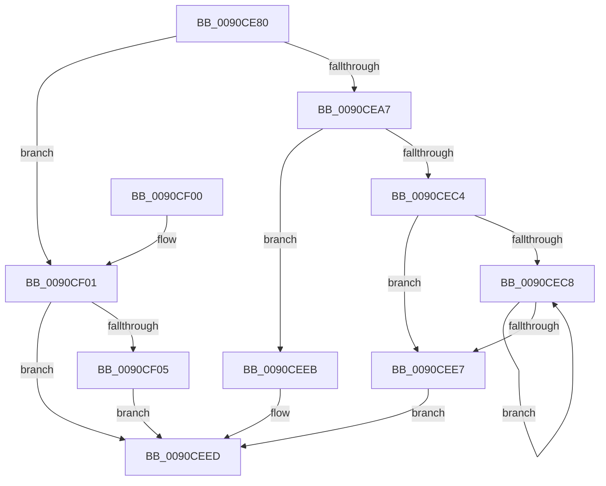

# RtlxUnicodeStringToAnsiSize

- RVA: `0x0090CE80`–`0x0090CF20` (길이 `160` bytes)
- VA: `0x000000014090CE80`
- 실행 섹션: `PAGE`
- PDB 이름 있음: `예`; PDB Function 태그: `아니요`
- unwind 정보 RVA: `0x00089384`
- 디코드: `52`개 명령, `160/160` bytes 표시
- 미해석 바이트: `0` (있으면 어셈블리에 `.byte`로 보존)

> 이 문서는 커널 이미지의 기계어와 PDB 기호를 분석해 생성했습니다. 4번과 5번은 함수 원형과 자료형을 바이너리 사용 방식에서 추정한 C 해석이며 원본 소스 복구 결과는 아닙니다.

## 1. Dependencies

- 직접 호출 지점: **3**; 고유 호출 대상: **3**
- 직접 호출자로 확인된 함수: **2**
- RIP 상대 이미지 참조: **0**

### Outgoing calls
- `0x0090CE9E` → [RtlpIsUtf8Process](RtlpIsUtf8Process_function_0090DB60.md) (function, `0x0090DB60`)
- `0x0090CEAD` → [PsGetCurrentServerSiloGlobals](../../text/2F/PsGetCurrentServerSiloGlobals_function_002FE1F0.md) (function, `0x002FE1F0`)
- `0x0090CF15` → [RtlUnicodeToUTF8N](RtlUnicodeToUTF8N_function_0090DBF0.md) (function, `0x0090DBF0`)

### Direct callers
- [DbgUnicodeStringToAnsiString](../../text/4A/DbgUnicodeStringToAnsiString_function_004AE190.md) at `0x004AE1A8`
- [ExpSystemErrorHandler2](../../pagelk/B7/ExpSystemErrorHandler2_function_00B72C30.md) at `0x00B72E90`
- [ExpSystemErrorHandler2](../../pagelk/B7/ExpSystemErrorHandler2_function_00B72C30.md) at `0x00B730C7`
- [ExpSystemErrorHandler2](../../pagelk/B7/ExpSystemErrorHandler2_function_00B72C30.md) at `0x00B7320C`

### Static image references
- 디코드된 RIP-relative 메모리 참조가 없습니다.

## 2. Other-region calls and transfers

- 다른 실행 섹션으로 향하는 call: **1**
  - `0x0090CEAD` → [PsGetCurrentServerSiloGlobals](../../text/2F/PsGetCurrentServerSiloGlobals_function_002FE1F0.md) (`PAGE` → `.text`)
- 별도 외부 분기/꼬리 이동을 확인하지 못했습니다.

## 3. Assembly (complete function range)

```asm
0090CE80  48 89 5C 24 10                  mov qword ptr [rsp + 0x10], rbx
0090CE85  48 89 74 24 18                  mov qword ptr [rsp + 0x18], rsi
0090CE8A  57                              push rdi
0090CE8B  48 83 EC 30                     sub rsp, 0x30
0090CE8F  0F B7 39                        movzx edi, word ptr [rcx]
0090CE92  33 DB                           xor ebx, ebx
0090CE94  48 8B 71 08                     mov rsi, qword ptr [rcx + 8]
0090CE98  33 C9                           xor ecx, ecx
0090CE9A  89 5C 24 40                     mov dword ptr [rsp + 0x40], ebx
0090CE9E  E8 BD 0C 00 00                  call 0x14090db60
0090CEA3  84 C0                           test al, al
0090CEA5  75 5A                           jne 0x14090cf01
0090CEA7  F0 09 1C 24                     lock or dword ptr [rsp], ebx
0090CEAB  8B D3                           mov edx, ebx
0090CEAD  E8 3E 13 9F FF                  call 0x1402fe1f0
0090CEB2  D1 EF                           shr edi, 1
0090CEB4  4C 8B 80 30 04 00 00            mov r8, qword ptr [rax + 0x430]
0090CEBB  66 39 98 14 04 00 00            cmp word ptr [rax + 0x414], bx
0090CEC2  74 27                           je 0x14090ceeb
0090CEC4  85 FF                           test edi, edi
0090CEC6  74 1F                           je 0x14090cee7
0090CEC8  0F B7 06                        movzx eax, word ptr [rsi]
0090CECB  48 8D 76 02                     lea rsi, [rsi + 2]
0090CECF  41 0F B7 0C 40                  movzx ecx, word ptr [r8 + rax*2]
0090CED4  66 C1 E9 08                     shr cx, 8
0090CED8  F6 D9                           neg cl
0090CEDA  1B C0                           sbb eax, eax
0090CEDC  F7 D8                           neg eax
0090CEDE  FF C0                           inc eax
0090CEE0  03 D0                           add edx, eax
0090CEE2  83 C7 FF                        add edi, -1
0090CEE5  75 E1                           jne 0x14090cec8
0090CEE7  8B DA                           mov ebx, edx
0090CEE9  EB 02                           jmp 0x14090ceed
0090CEEB  8B DF                           mov ebx, edi
0090CEED  48 8B 74 24 50                  mov rsi, qword ptr [rsp + 0x50]
0090CEF2  8D 43 01                        lea eax, [rbx + 1]
0090CEF5  48 8B 5C 24 48                  mov rbx, qword ptr [rsp + 0x48]
0090CEFA  48 83 C4 30                     add rsp, 0x30
0090CEFE  5F                              pop rdi
0090CEFF  C3                              ret
0090CF00  CC                              int3
0090CF01  85 FF                           test edi, edi
0090CF03  74 E8                           je 0x14090ceed
0090CF05  4C 8B CE                        mov r9, rsi
0090CF08  89 7C 24 20                     mov dword ptr [rsp + 0x20], edi
0090CF0C  4C 8D 44 24 40                  lea r8, [rsp + 0x40]
0090CF11  33 D2                           xor edx, edx
0090CF13  33 C9                           xor ecx, ecx
0090CF15  E8 D6 0C 00 00                  call 0x14090dbf0
0090CF1A  8B 5C 24 40                     mov ebx, dword ptr [rsp + 0x40]
0090CF1E  EB CD                           jmp 0x14090ceed
```

## 4. C-style interpretation (structured pseudocode)

```c
__int64 __fastcall RtlxUnicodeStringToAnsiSize(__int64 a1)
{
    __int64 result;
    __int64 v_rbx;
    __int64 v_rdi;
    __int64 v_rsp;
    unsigned int v_stack_m38;
    unsigned __int64 v_stack_p10;
    unsigned __int64 v_stack_p18;
    unsigned int v_stack_p20;
    unsigned __int64 v_stack_p40;
    unsigned int v_stack_p8;

    v_stack_p10 = v_rbx;
    v_stack_p18 = v_rsi;
    v_rsp = (v_rsp) - (48);
    v_rbx = 0;
    a1 = 0;
    v_stack_p8 = 0;
    result = RtlpIsUtf8Process(a1, a2, a3, a4);
    if ((unsigned __int8)(result) != 0) goto loc_0090CF01;
    result = PsGetCurrentServerSiloGlobals(a1, 0, a3, a4);
    v_rdi = (unsigned int)((*(unsigned __int16 *)(a1)) >> (1));
    if ((*(unsigned __int16 *)(result + 1044)) == 0) goto loc_0090CEEB;
    if ((unsigned int)(v_rdi) == 0) goto loc_0090CEE7;
loc_0090CEC8:
    a1 = (unsigned __int16)((*(unsigned __int16 *)(*(unsigned __int64 *)(result + 1072) + *(unsigned __int16 *)(*(unsigned __int64 *)(a1 + 8)) * 2)) >> (8));
    a1 = (unsigned __int8)(-(a1));
    result = (unsigned int)(-(*(unsigned __int16 *)(*(unsigned __int64 *)(a1 + 8))));
    result = (unsigned int)((result) + 1);
    a2 = (unsigned int)((0) + ((unsigned int)(result)));
    v_rdi = (unsigned int)((v_rdi) + (-1));
    if (condition_is_not_equal) goto loc_0090CEC8;
loc_0090CEE7:
    goto loc_0090CEED;
loc_0090CEEB:
loc_0090CEED:
    v_rsp = (v_rsp) + (48);
    return (unsigned int)((unsigned int)(v_rdi)) + 1;
loc_0090CF01:
    if ((unsigned int)(v_rdi) == 0) goto loc_0090CEED;
    v_stack_p20 = (unsigned int)(v_rdi);
    a2 = 0;
    a1 = 0;
    result = RtlUnicodeToUTF8N(a1, a2, v_stack_p40, v_stack_p18);
    goto loc_0090CEED;
}
```

## 5. (Beta) C Style

```c
int64_t RtlxUnicodeStringToAnsiSize(void *Arg1)
{
    uint8_t *arg1 = (uint8_t *)Arg1;

    int64_t result;
    int64_t local_rbx;
    int64_t local_rdi;
    int64_t local_rsp;
    uint32_t v_stack_m38;
    uint64_t v_stack_p10;
    uint64_t v_stack_p18;
    uint32_t v_stack_p20;
    uint64_t v_stack_p40;
    uint32_t v_stack_p8;

    v_stack_p10 = local_rbx;
    v_stack_p18 = local_rsi;
    local_rsp = (local_rsp) - (48);
    local_rbx = 0;
    Arg1 = 0;
    v_stack_p8 = 0;
    result = RtlpIsUtf8Process(Arg1, a2, a3, a4);
    if ((uint8_t)(result) != 0) goto loc_0090CF01;
    result = PsGetCurrentServerSiloGlobals(Arg1, 0, a3, a4);
    local_rdi = (uint32_t)((*(uint16_t *)(arg1)) >> (1));
    if ((*(uint16_t *)(result + 0x414)) == 0) goto loc_0090CEEB;
    if ((uint32_t)(local_rdi) == 0) goto loc_0090CEE7;
loc_0090CEC8:
    Arg1 = (uint16_t)((*(uint16_t *)(*(uint64_t *)(result + 0x430) + *(uint16_t *)(*(uint64_t *)(arg1 + 0x8)) * 2)) >> (8));
    Arg1 = (uint8_t)(-(Arg1));
    result = (uint32_t)(-(*(uint16_t *)(*(uint64_t *)(arg1 + 0x8))));
    result = (uint32_t)((result) + 1);
    a2 = (uint32_t)((0) + ((uint32_t)(result)));
    local_rdi = (uint32_t)((local_rdi) + (-1));
    if (condition_is_not_equal) goto loc_0090CEC8;
loc_0090CEE7:
    goto loc_0090CEED;
loc_0090CEEB:
loc_0090CEED:
    local_rsp = (local_rsp) + (48);
    return (uint32_t)((uint32_t)(local_rdi)) + 1;
loc_0090CF01:
    if ((uint32_t)(local_rdi) == 0) goto loc_0090CEED;
    v_stack_p20 = (uint32_t)(local_rdi);
    a2 = 0;
    Arg1 = 0;
    result = RtlUnicodeToUTF8N(Arg1, a2, v_stack_p40, v_stack_p18);
    goto loc_0090CEED;
}
```

### 관측된 메모리 오프셋

구조체 형식이 확인되지 않은 접근은 인자 기준의 오프셋으로만 기록했습니다.

| 기준 인자 | 오프셋 표현 | 폭 (bit) | 접근 |
|---|---:|---:|---|
| `Arg1` | `+ 0x0` | `16` | `R` |
| `Arg1` | `+ 0x8` | `64` | `R` |

## 6. Execution-region graph

[열기: 2D/3D 그래프와 함수 탐색 컨트롤 패널](../../../control-panel.html?section=page&rva=0x0090CE80&view=graph)

- 2D 그래프는 위에서 아래로 흐르고, 3D 그래프는 빈 공간을 드래그해 회전합니다. Shift+드래그는 이동, 휠은 확대·축소, 함수 노드 선택은 대상 보고서 이동입니다.

### Static fallback


