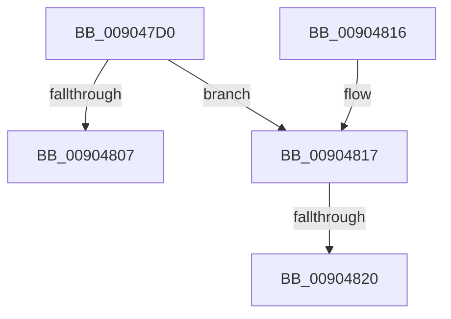

# SeAuditingWithTokenForSubcategory

- RVA: `0x009047D0`–`0x00904828` (길이 `88` bytes)
- VA: `0x00000001409047D0`
- 실행 섹션: `PAGE`
- PDB 이름 있음: `예`; PDB Function 태그: `예`
- unwind 정보 RVA: `0x00088B08`
- 디코드: `25`개 명령, `88/88` bytes 표시
- 미해석 바이트: `0` (있으면 어셈블리에 `.byte`로 보존)

> 이 문서는 커널 이미지의 기계어와 PDB 기호를 분석해 생성했습니다. 4번과 5번은 함수 원형과 자료형을 바이너리 사용 방식에서 추정한 C 해석이며 원본 소스 복구 결과는 아닙니다.

## 1. Dependencies

- 직접 호출 지점: **1**; 고유 호출 대상: **1**
- 직접 호출자로 확인된 함수: **12**
- RIP 상대 이미지 참조: **1**

### Outgoing calls
- `0x009047EE` → [SepAuditingForSubCategory](../../text/47/SepAuditingForSubCategory_function_00477E84.md) (function, `0x00477E84`)

### Direct callers
- [SeAdtRegistryValueChangedAuditAlarm](../79/SeAdtRegistryValueChangedAuditAlarm_function_0079DDD4.md) at `0x0079DE91`
- [SeExchangePrimaryToken](../7A/SeExchangePrimaryToken_function_007A07BC.md) at `0x007A09C5`
- [ObCompleteObjectDuplication](../89/ObCompleteObjectDuplication_function_0089387C.md) at `0x00893B39`
- [ObDuplicateObject](../8C/ObDuplicateObject_function_008C4FA0.md) at `0x008C5EF4`
- [PipSetDevNodeProblem](../8F/PipSetDevNodeProblem_function_008FDE0C.md) at `0x008FE01A`
- [PspExitLastThread](PspExitLastThread_function_00904184.md) at `0x00904215`
- [SepAdtTokenRightAdjusted](SepAdtTokenRightAdjusted_function_0090445C.md) at `0x009044D6`
- [PiPnpRtlSetDeviceRegProperty](../96/PiPnpRtlSetDeviceRegProperty_function_0096360C.md) at `0x00963737`
- [PipClearDevNodeProblem](../A2/PipClearDevNodeProblem_function_00A27C8C.md) at `0x00A27DF9`
- [sub_00B1EBE0](../B1/Unknown_function_00B1EBE0.md) at `0x00B1ED18`
- [sub_00B1EBE0](../B1/Unknown_function_00B1EBE0.md) at `0x00B1EDAF`
- [sub_00B1EBE0](../B1/Unknown_function_00B1EBE0.md) at `0x00B1EE5C`
- [sub_00B1EBE0](../B1/Unknown_function_00B1EBE0.md) at `0x00B1EEA8`
- [sub_00B280B0](../B2/Unknown_function_00B280B0.md) at `0x00B280C2`
- [sub_00B29934](../B2/Unknown_function_00B29934.md) at `0x00B29C0D`
- [sub_00B29934](../B2/Unknown_function_00B29934.md) at `0x00B29C9F`

### Static image references
- `0x009047FA` → RVA `0x00F04BE0` (`.data`; read)

## 2. Other-region calls and transfers

- 다른 실행 섹션으로 향하는 call: **1**
  - `0x009047EE` → [SepAuditingForSubCategory](../../text/47/SepAuditingForSubCategory_function_00477E84.md) (`PAGE` → `.text`)
- call이 아닌 외부 분기/꼬리 이동: **2**
  - `0x0090481A` → [sub_00B20D1A](../B2/Unknown_function_00B20D1A.md) (`tail-transfer`)
  - `0x00904823` → [sub_00B20D1A + 0x1B](../B2/Unknown_function_00B20D1A.md) (`tail-transfer`)

## 3. Assembly (complete function range)

```asm
009047D0  48 89 5C 24 10                  mov qword ptr [rsp + 0x10], rbx
009047D5  57                              push rdi
009047D6  48 83 EC 50                     sub rsp, 0x50
009047DA  0F 57 C0                        xorps xmm0, xmm0
009047DD  48 8B DA                        mov rbx, rdx
009047E0  B2 01                           mov dl, 1
009047E2  8B F9                           mov edi, ecx
009047E4  0F 11 44 24 30                  movups xmmword ptr [rsp + 0x30], xmm0
009047E9  0F 11 44 24 40                  movups xmmword ptr [rsp + 0x40], xmm0
009047EE  E8 91 36 B7 FF                  call 0x140477e84
009047F3  83 C7 9C                        add edi, -0x64
009047F6  88 44 24 60                     mov byte ptr [rsp + 0x60], al
009047FA  48 8D 0D DF 03 60 00            lea rcx, [rip + 0x6003df]
00904801  83 3C B9 00                     cmp dword ptr [rcx + rdi*4], 0
00904805  75 10                           jne 0x140904817
00904807  8A 44 24 60                     mov al, byte ptr [rsp + 0x60]
0090480B  48 8B 5C 24 68                  mov rbx, qword ptr [rsp + 0x68]
00904810  48 83 C4 50                     add rsp, 0x50
00904814  5F                              pop rdi
00904815  C3                              ret
00904816  CC                              int3
00904817  48 85 DB                        test rbx, rbx
0090481A  0F 84 FA C4 21 00               je 0x140b20d1a
00904820  4C 8B CB                        mov r9, rbx
00904823  E9 0D C5 21 00                  jmp 0x140b20d35
```

## 4. C-style interpretation (structured pseudocode)

```c
__int64 __fastcall SeAuditingWithTokenForSubcategory(int a1, __int64 a2)
{
    __int64 result;
    __int64 v_rdi;
    __int64 v_rsp;
    unsigned __int64 v_stack_m18;
    unsigned __int64 v_stack_m28;
    unsigned __int64 v_stack_p10;
    unsigned __int8 v_stack_p8;

    v_stack_p10 = v_rbx;
    v_rsp = (v_rsp) - (80);
    v_stack_m28 = v_xmm0;
    v_stack_m18 = v_xmm0;
    result = SepAuditingForSubCategory(a1, 1, a3, a4);
    v_rdi = (unsigned int)(((unsigned int)(a1)) + (-100));
    v_stack_p8 = (unsigned __int8)(result);
    if ((*(unsigned int *)(v_rip + 6292447 + v_rdi * 4)) != 0) goto loc_00904817;
    v_rsp = (v_rsp) + (80);
    return v_stack_p8;
loc_00904817:
}
```

## 5. (Beta) C Style

```c
int64_t SeAuditingWithTokenForSubcategory(int32_t Arg1, int64_t Arg2)
{
    int64_t result;
    int64_t local_rdi;
    int64_t local_rsp;
    uint64_t v_stack_m18;
    uint64_t v_stack_m28;
    uint64_t v_stack_p10;
    uint8_t v_stack_p8;

    v_stack_p10 = local_rbx;
    local_rsp = (local_rsp) - (80);
    v_stack_m28 = v_xmm0;
    v_stack_m18 = v_xmm0;
    result = SepAuditingForSubCategory(Arg1, 1, a3, a4);
    local_rdi = (uint32_t)(((uint32_t)(Arg1)) + (-100));
    v_stack_p8 = (uint8_t)(result);
    if ((*(uint32_t *)(v_rip + 0x6003DF + local_rdi * 4)) != 0) goto loc_00904817;
    local_rsp = (local_rsp) + (80);
    return v_stack_p8;
loc_00904817:
}
```

## 6. Execution-region graph

[열기: 2D/3D 그래프와 함수 탐색 컨트롤 패널](../../../control-panel.html?section=page&rva=0x009047D0&view=graph)

- 2D 그래프는 위에서 아래로 흐르고, 3D 그래프는 빈 공간을 드래그해 회전합니다. Shift+드래그는 이동, 휠은 확대·축소, 함수 노드 선택은 대상 보고서 이동입니다.

### Static fallback


