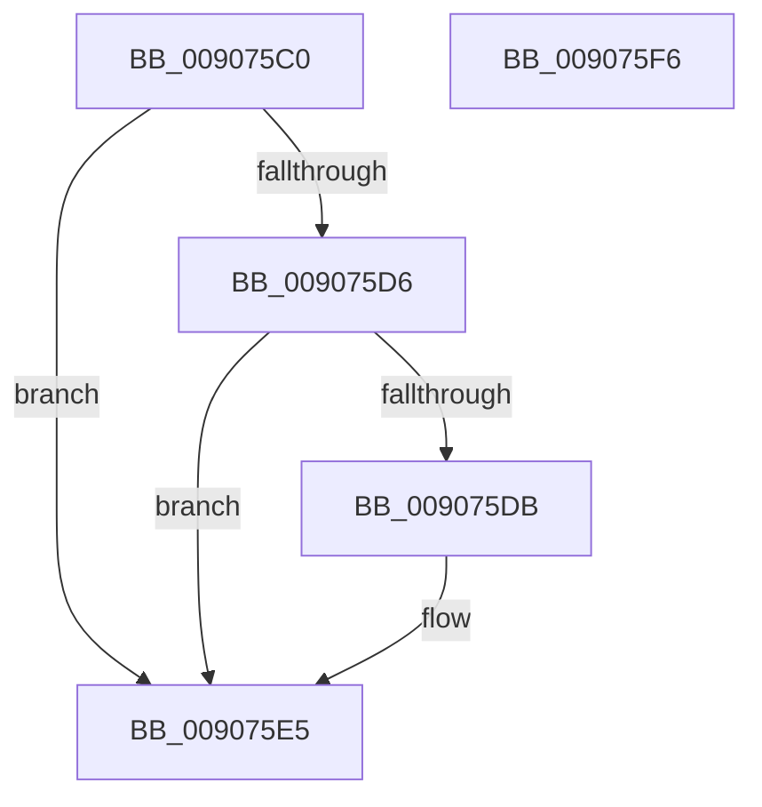

# SeDeassignPrimaryToken

- RVA: `0x009075C0`–`0x009075F7` (길이 `55` bytes)
- VA: `0x00000001409075C0`
- 실행 섹션: `PAGE`
- PDB 이름 있음: `예`; PDB Function 태그: `아니요`
- unwind 정보 RVA: `0x0005C788`
- 디코드: `16`개 명령, `55/55` bytes 표시
- 미해석 바이트: `0` (있으면 어셈블리에 `.byte`로 보존)

> 이 문서는 커널 이미지의 기계어와 PDB 기호를 분석해 생성했습니다. 4번과 5번은 함수 원형과 자료형을 바이너리 사용 방식에서 추정한 C 해석이며 원본 소스 복구 결과는 아닙니다.

## 1. Dependencies

- 직접 호출 지점: **1**; 고유 호출 대상: **1**
- 직접 호출자로 확인된 함수: **2**
- RIP 상대 이미지 참조: **0**

### Outgoing calls
- `0x009075EC` → [ObfDereferenceObject](../../text/2F/ObfDereferenceObject_function_002F9350.md) (function, `0x002F9350`)

### Direct callers
- [PspProcessDelete](PspProcessDelete_function_00907B90.md) at `0x00907DE7`
- [SeAssignPrimaryToken](../9F/SeAssignPrimaryToken_function_009F117C.md) at `0x009F1217`

### Static image references
- 디코드된 RIP-relative 메모리 참조가 없습니다.

## 2. Other-region calls and transfers

- 다른 실행 섹션으로 향하는 call: **1**
  - `0x009075EC` → [ObfDereferenceObject](../../text/2F/ObfDereferenceObject_function_002F9350.md) (`PAGE` → `.text`)
- 별도 외부 분기/꼬리 이동을 확인하지 못했습니다.

## 3. Assembly (complete function range)

```asm
009075C0  48 83 EC 28                     sub rsp, 0x28
009075C4  33 C0                           xor eax, eax
009075C6  48 87 81 48 02 00 00            xchg qword ptr [rcx + 0x248], rax
009075CD  48 8B C8                        mov rcx, rax
009075D0  48 83 E1 F0                     and rcx, 0xfffffffffffffff0
009075D4  74 0F                           je 0x1409075e5
009075D6  83 E0 0F                        and eax, 0xf
009075D9  76 0A                           jbe 0x1409075e5
009075DB  F7 D8                           neg eax
009075DD  48 63 D0                        movsxd rdx, eax
009075E0  F0 48 01 51 D0                  lock add qword ptr [rcx - 0x30], rdx
009075E5  C6 81 CC 00 00 00 00            mov byte ptr [rcx + 0xcc], 0
009075EC  E8 5F 1D 9F FF                  call 0x1402f9350
009075F1  48 83 C4 28                     add rsp, 0x28
009075F5  C3                              ret
009075F6  CC                              int3
```

## 4. C-style interpretation (structured pseudocode)

```c
__int64 __fastcall SeDeassignPrimaryToken(__int64 a1)
{
    __int64 result;
    __int64 v_rsp;

    v_rsp = (v_rsp) - (40);
    result = 0;
    a1 = (0) & (-16);
    if (condition_is_equal) goto loc_009075E5;
    result = (unsigned int)((result) & (15));
    if (!(condition_is_below_or_equal)) {
        result = (unsigned int)(-(result));
        a2 = (int)((unsigned int)(result));
    }
    *(unsigned __int8 *)(a1 + 204) = 0;
    result = ObfDereferenceObject(a1, a2, a3, a4);
    v_rsp = (v_rsp) + (40);
    return result;
}
```

## 5. (Beta) C Style

```c
int64_t SeDeassignPrimaryToken(void *Arg1)
{
    uint8_t *arg1 = (uint8_t *)Arg1;

    int64_t result;
    int64_t local_rsp;

    local_rsp = (local_rsp) - (40);
    result = 0;
    Arg1 = (0) & (-16);
    if (condition_is_equal) goto loc_009075E5;
    result = (uint32_t)((result) & (15));
    if (!(condition_is_below_or_equal)) {
        result = (uint32_t)(-(result));
        a2 = (int32_t)((uint32_t)(result));
    }
    *(uint8_t *)(arg1 + 0xCC) = 0;
    result = ObfDereferenceObject(Arg1, a2, a3, a4);
    local_rsp = (local_rsp) + (40);
    return result;
}
```

### 관측된 메모리 오프셋

구조체 형식이 확인되지 않은 접근은 인자 기준의 오프셋으로만 기록했습니다.

| 기준 인자 | 오프셋 표현 | 폭 (bit) | 접근 |
|---|---:|---:|---|
| `Arg1` | `+ 0x248` | `64` | `R/W` |

## 6. Execution-region graph

[열기: 2D/3D 그래프와 함수 탐색 컨트롤 패널](../../../control-panel.html?section=page&rva=0x009075C0&view=graph)

- 2D 그래프는 위에서 아래로 흐르고, 3D 그래프는 빈 공간을 드래그해 회전합니다. Shift+드래그는 이동, 휠은 확대·축소, 함수 노드 선택은 대상 보고서 이동입니다.

### Static fallback


