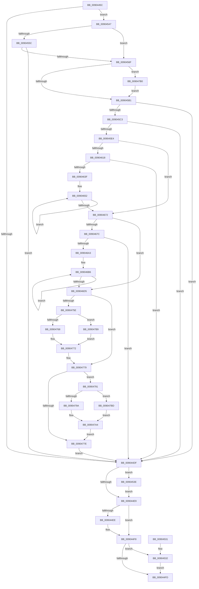

# SepAdtTokenRightAdjusted

- RVA: `0x0090445C`–`0x009047C1` (길이 `869` bytes)
- VA: `0x000000014090445C`
- 실행 섹션: `PAGE`
- PDB 이름 있음: `예`; PDB Function 태그: `아니요`
- unwind 정보 RVA: `0x00088AE0`
- 디코드: `217`개 명령, `869/869` bytes 표시
- 미해석 바이트: `0` (있으면 어셈블리에 `.byte`로 보존)

> 이 문서는 커널 이미지의 기계어와 PDB 기호를 분석해 생성했습니다. 4번과 5번은 함수 원형과 자료형을 바이너리 사용 방식에서 추정한 C 해석이며 원본 소스 복구 결과는 아닙니다.

## 1. Dependencies

- 직접 호출 지점: **15**; 고유 호출 대상: **11**
- 직접 호출자로 확인된 함수: **1**
- RIP 상대 이미지 참조: **2**

### Outgoing calls
- `0x009044BB` → [SeCaptureSubjectContext](../86/SeCaptureSubjectContext_function_0086B820.md) (function, `0x0086B820`)
- `0x009044D6` → [SeAuditingWithTokenForSubcategory](SeAuditingWithTokenForSubcategory_function_009047D0.md) (function, `0x009047D0`)
- `0x009044F3` → [ExFreePoolWithTag](../../poolcode/B8/ExFreePoolWithTag_function_00B82870.md) (function, `0x00B82870`)
- `0x00904502` → [SeReleaseSubjectContext](../86/SeReleaseSubjectContext_function_0086B710.md) (function, `0x0086B710`)
- `0x00904511` → [_security_check_cookie](../../text/6A/_security_check_cookie_function_006AC640.md) (function, `0x006AC640`)
- `0x00904537` → [ExFreePoolWithTag](../../poolcode/B8/ExFreePoolWithTag_function_00B82870.md) (function, `0x00B82870`)
- `0x00904540` → [ExFreePoolWithTag](../../poolcode/B8/ExFreePoolWithTag_function_00B82870.md) (function, `0x00B82870`)
- `0x0090454C` → [SepAdtAuditablePrivilege](../../text/49/SepAdtAuditablePrivilege_function_0049EC6C.md) (function, `0x0049EC6C`)
- `0x00904562` → [SepAdtAuditablePrivilege](../../text/49/SepAdtAuditablePrivilege_function_0049EC6C.md) (function, `0x0049EC6C`)
- `0x0090457C` → [memset](../../text/6C/memset_function_006C6C40.md) (function, `0x006C6C40`)
- `0x009045B1` → [PsGetCurrentThreadProcess](../../text/47/PsGetCurrentThreadProcess_function_0047C7E0.md) (function, `0x0047C7E0`)
- `0x009045D7` → [PsGetAllocatedFullProcessImageNameEx](../91/PsGetAllocatedFullProcessImageNameEx_function_0091D6F0.md) (function, `0x0091D6F0`)
- `0x0090462E` → [ExAllocatePool2](../../poolcode/B8/ExAllocatePool2_function_00B820F0.md) (function, `0x00B820F0`)
- `0x00904692` → [ExAllocatePool2](../../poolcode/B8/ExAllocatePool2_function_00B820F0.md) (function, `0x00B820F0`)
- `0x00904787` → [SepAdtLogAuditRecord](../../text/22/SepAdtLogAuditRecord_function_00224B6C.md) (function, `0x00224B6C`)

### Direct callers
- [SepAdjustPrivileges](../9C/SepAdjustPrivileges_function_009C8DFC.md) at `0x009C9150`

### Static image references
- `0x0090447B` → RVA `0x00E0A740` (`.data`; read)
- `0x00904715` → RVA `0x000013A8` (`.rdata`; read)

## 2. Other-region calls and transfers

- 다른 실행 섹션으로 향하는 call: **11**
  - `0x009044F3` → [ExFreePoolWithTag](../../poolcode/B8/ExFreePoolWithTag_function_00B82870.md) (`PAGE` → `POOLCODE`)
  - `0x00904511` → [_security_check_cookie](../../text/6A/_security_check_cookie_function_006AC640.md) (`PAGE` → `.text`)
  - `0x00904537` → [ExFreePoolWithTag](../../poolcode/B8/ExFreePoolWithTag_function_00B82870.md) (`PAGE` → `POOLCODE`)
  - `0x00904540` → [ExFreePoolWithTag](../../poolcode/B8/ExFreePoolWithTag_function_00B82870.md) (`PAGE` → `POOLCODE`)
  - `0x0090454C` → [SepAdtAuditablePrivilege](../../text/49/SepAdtAuditablePrivilege_function_0049EC6C.md) (`PAGE` → `.text`)
  - `0x00904562` → [SepAdtAuditablePrivilege](../../text/49/SepAdtAuditablePrivilege_function_0049EC6C.md) (`PAGE` → `.text`)
  - `0x0090457C` → [memset](../../text/6C/memset_function_006C6C40.md) (`PAGE` → `.text`)
  - `0x009045B1` → [PsGetCurrentThreadProcess](../../text/47/PsGetCurrentThreadProcess_function_0047C7E0.md) (`PAGE` → `.text`)
  - `0x0090462E` → [ExAllocatePool2](../../poolcode/B8/ExAllocatePool2_function_00B820F0.md) (`PAGE` → `POOLCODE`)
  - `0x00904692` → [ExAllocatePool2](../../poolcode/B8/ExAllocatePool2_function_00B820F0.md) (`PAGE` → `POOLCODE`)
  - `0x00904787` → [SepAdtLogAuditRecord](../../text/22/SepAdtLogAuditRecord_function_00224B6C.md) (`PAGE` → `.text`)
- 별도 외부 분기/꼬리 이동을 확인하지 못했습니다.

## 3. Assembly (complete function range)

```asm
0090445C  48 89 5C 24 08                  mov qword ptr [rsp + 8], rbx
00904461  55                              push rbp
00904462  56                              push rsi
00904463  57                              push rdi
00904464  41 54                           push r12
00904466  41 55                           push r13
00904468  41 56                           push r14
0090446A  41 57                           push r15
0090446C  48 8D AC 24 60 FC FF FF         lea rbp, [rsp - 0x3a0]
00904474  48 81 EC A0 04 00 00            sub rsp, 0x4a0
0090447B  48 8B 05 BE 62 50 00            mov rax, qword ptr [rip + 0x5062be]
00904482  48 33 C4                        xor rax, rsp
00904485  48 89 85 90 03 00 00            mov qword ptr [rbp + 0x390], rax
0090448C  48 83 64 24 28 00               and qword ptr [rsp + 0x28], 0
00904492  0F 57 C0                        xorps xmm0, xmm0
00904495  41 8B D8                        mov ebx, r8d
00904498  48 89 4C 24 30                  mov qword ptr [rsp + 0x30], rcx
0090449D  48 8D 4C 24 48                  lea rcx, [rsp + 0x48]
009044A2  89 5C 24 20                     mov dword ptr [rsp + 0x20], ebx
009044A6  0F 11 44 24 48                  movups xmmword ptr [rsp + 0x48], xmm0
009044AB  4D 8B E9                        mov r13, r9
009044AE  4C 8B FA                        mov r15, rdx
009044B1  0F 11 44 24 58                  movups xmmword ptr [rsp + 0x58], xmm0
009044B6  45 33 F6                        xor r14d, r14d
009044B9  33 F6                           xor esi, esi
009044BB  E8 60 73 F6 FF                  call 0x14086b820
009044C0  48 8B 7C 24 48                  mov rdi, qword ptr [rsp + 0x48]
009044C5  B9 8B 00 00 00                  mov ecx, 0x8b
009044CA  48 8B 54 24 58                  mov rdx, qword ptr [rsp + 0x58]
009044CF  48 85 FF                        test rdi, rdi
009044D2  48 0F 45 D7                     cmovne rdx, rdi
009044D6  E8 F5 02 00 00                  call 0x1409047d0
009044DB  84 C0                           test al, al
009044DD  75 68                           jne 0x140904547
009044DF  48 8B 4C 24 28                  mov rcx, qword ptr [rsp + 0x28]
009044E4  48 85 C9                        test rcx, rcx
009044E7  75 55                           jne 0x14090453e
009044E9  4D 85 F6                        test r14, r14
009044EC  74 0A                           je 0x1409044f8
009044EE  33 D2                           xor edx, edx
009044F0  49 8B CE                        mov rcx, r14
009044F3  E8 78 E3 27 00                  call 0x140b82870
009044F8  48 85 F6                        test rsi, rsi
009044FB  75 35                           jne 0x140904532
009044FD  48 8D 4C 24 48                  lea rcx, [rsp + 0x48]
00904502  E8 09 72 F6 FF                  call 0x14086b710
00904507  48 8B 8D 90 03 00 00            mov rcx, qword ptr [rbp + 0x390]
0090450E  48 33 CC                        xor rcx, rsp
00904511  E8 2A 81 DA FF                  call 0x1406ac640
00904516  48 8B 9C 24 E0 04 00 00         mov rbx, qword ptr [rsp + 0x4e0]
0090451E  48 81 C4 A0 04 00 00            add rsp, 0x4a0
00904525  41 5F                           pop r15
00904527  41 5E                           pop r14
00904529  41 5D                           pop r13
0090452B  41 5C                           pop r12
0090452D  5F                              pop rdi
0090452E  5E                              pop rsi
0090452F  5D                              pop rbp
00904530  C3                              ret
00904531  CC                              int3
00904532  33 D2                           xor edx, edx
00904534  48 8B CE                        mov rcx, rsi
00904537  E8 34 E3 27 00                  call 0x140b82870
0090453C  EB BF                           jmp 0x1409044fd
0090453E  33 D2                           xor edx, edx
00904540  E8 2B E3 27 00                  call 0x140b82870
00904545  EB A2                           jmp 0x1409044e9
00904547  8B D3                           mov edx, ebx
00904549  49 8B CF                        mov rcx, r15
0090454C  E8 1B A7 B9 FF                  call 0x14049ec6c
00904551  44 8B A5 00 04 00 00            mov r12d, dword ptr [rbp + 0x400]
00904558  84 C0                           test al, al
0090455A  75 13                           jne 0x14090456f
0090455C  41 8B D4                        mov edx, r12d
0090455F  49 8B CD                        mov rcx, r13
00904562  E8 05 A7 B9 FF                  call 0x14049ec6c
00904567  84 C0                           test al, al
00904569  0F 84 70 FF FF FF               je 0x1409044df
0090456F  33 D2                           xor edx, edx
00904571  48 8D 4C 24 70                  lea rcx, [rsp + 0x70]
00904576  41 B8 18 04 00 00               mov r8d, 0x418
0090457C  E8 BF 26 DC FF                  call 0x1406c6c40
00904581  B8 8B 00 00 00                  mov eax, 0x8b
00904586  C7 44 24 70 05 00 00 00         mov dword ptr [rsp + 0x70], 5
0090458E  66 89 45 80                     mov word ptr [rbp - 0x80], ax
00904592  C7 44 24 74 5F 12 00 00         mov dword ptr [rsp + 0x74], 0x125f
0090459A  8D 48 85                        lea ecx, [rax - 0x7b]
0090459D  8D 41 F8                        lea eax, [rcx - 8]
009045A0  66 89 45 82                     mov word ptr [rbp - 0x7e], ax
009045A4  40 38 B5 08 04 00 00            cmp byte ptr [rbp + 0x408], sil
009045AB  0F 84 FF 01 00 00               je 0x1409047b0
009045B1  E8 2A 82 B7 FF                  call 0x14047c7e0
009045B6  48 39 B0 50 03 00 00            cmp qword ptr [rax + 0x350], rsi
009045BD  0F 84 1C FF FF FF               je 0x1409044df
009045C3  48 8B 88 D0 01 00 00            mov rcx, qword ptr [rax + 0x1d0]
009045CA  48 8D 54 24 28                  lea rdx, [rsp + 0x28]
009045CF  48 89 4C 24 40                  mov qword ptr [rsp + 0x40], rcx
009045D4  48 8B C8                        mov rcx, rax
009045D7  E8 14 91 01 00                  call 0x14091d6f0
009045DC  85 C0                           test eax, eax
009045DE  0F 88 FB FE FF FF               js 0x1409044df
009045E4  48 8B 4C 24 58                  mov rcx, qword ptr [rsp + 0x58]
009045E9  48 85 FF                        test rdi, rdi
009045EC  48 8B C1                        mov rax, rcx
009045EF  48 0F 45 C7                     cmovne rax, rdi
009045F3  48 0F 45 CF                     cmovne rcx, rdi
009045F7  48 8B 7C 24 30                  mov rdi, qword ptr [rsp + 0x30]
009045FC  48 8B 80 98 00 00 00            mov rax, qword ptr [rax + 0x98]
00904603  48 8B 59 18                     mov rbx, qword ptr [rcx + 0x18]
00904607  48 8B 7F 18                     mov rdi, qword ptr [rdi + 0x18]
0090460B  48 8B 00                        mov rax, qword ptr [rax]
0090460E  48 89 44 24 38                  mov qword ptr [rsp + 0x38], rax
00904613  45 85 E4                        test r12d, r12d
00904616  74 5A                           je 0x140904672
00904618  43 8D 14 64                     lea edx, [r12 + r12*2]
0090461C  B9 00 01 00 00                  mov ecx, 0x100
00904621  C1 E2 02                        shl edx, 2
00904624  41 B8 53 65 41 70               mov r8d, 0x70416553
0090462A  48 83 C2 14                     add rdx, 0x14
0090462E  E8 BD DA 27 00                  call 0x140b820f0
00904633  4C 8B F0                        mov r14, rax
00904636  48 85 C0                        test rax, rax
00904639  0F 84 A0 FE FF FF               je 0x1409044df
0090463F  48 8B D0                        mov rdx, rax
00904642  C7 40 04 01 00 00 00            mov dword ptr [rax + 4], 1
00904649  49 2B D5                        sub rdx, r13
0090464C  44 89 20                        mov dword ptr [rax], r12d
0090464F  4D 8B CC                        mov r9, r12
00904652  F2 41 0F 10 45 00               movsd xmm0, qword ptr [r13]
00904658  F2 42 0F 11 44 2A 08            movsd qword ptr [rdx + r13 + 8], xmm0
0090465F  41 8B 45 08                     mov eax, dword ptr [r13 + 8]
00904663  42 89 44 2A 10                  mov dword ptr [rdx + r13 + 0x10], eax
00904668  4D 8D 6D 0C                     lea r13, [r13 + 0xc]
0090466C  49 83 E9 01                     sub r9, 1
00904670  75 E0                           jne 0x140904652
00904672  44 8B 64 24 20                  mov r12d, dword ptr [rsp + 0x20]
00904677  45 85 E4                        test r12d, r12d
0090467A  74 59                           je 0x1409046d5
0090467C  43 8D 14 64                     lea edx, [r12 + r12*2]
00904680  B9 00 01 00 00                  mov ecx, 0x100
00904685  C1 E2 02                        shl edx, 2
00904688  41 B8 53 65 41 70               mov r8d, 0x70416553
0090468E  48 83 C2 14                     add rdx, 0x14
00904692  E8 59 DA 27 00                  call 0x140b820f0
00904697  48 8B F0                        mov rsi, rax
0090469A  48 85 C0                        test rax, rax
0090469D  0F 84 3C FE FF FF               je 0x1409044df
009046A3  48 8B C8                        mov rcx, rax
009046A6  C7 40 04 01 00 00 00            mov dword ptr [rax + 4], 1
009046AD  49 2B CF                        sub rcx, r15
009046B0  44 89 20                        mov dword ptr [rax], r12d
009046B3  41 8B D4                        mov edx, r12d
009046B6  F2 41 0F 10 07                  movsd xmm0, qword ptr [r15]
009046BB  F2 42 0F 11 44 39 08            movsd qword ptr [rcx + r15 + 8], xmm0
009046C2  41 8B 47 08                     mov eax, dword ptr [r15 + 8]
009046C6  42 89 44 39 10                  mov dword ptr [rcx + r15 + 0x10], eax
009046CB  4D 8D 7F 0C                     lea r15, [r15 + 0xc]
009046CF  48 83 EA 01                     sub rdx, 1
009046D3  75 E1                           jne 0x1409046b6
009046D5  48 8B 4C 24 38                  mov rcx, qword ptr [rsp + 0x38]
009046DA  BA 08 00 00 00                  mov edx, 8
009046DF  48 89 4D A0                     mov qword ptr [rbp - 0x60], rcx
009046E3  C7 45 88 04 00 00 00            mov dword ptr [rbp - 0x78], 4
009046EA  C7 45 A8 01 00 00 00            mov dword ptr [rbp - 0x58], 1
009046F1  0F B6 41 01                     movzx eax, byte ptr [rcx + 1]
009046F5  48 8B 4C 24 28                  mov rcx, qword ptr [rsp + 0x28]
009046FA  C7 45 AC 20 00 00 00            mov dword ptr [rbp - 0x54], 0x20
00904701  C7 45 C8 05 00 00 00            mov dword ptr [rbp - 0x38], 5
00904708  8D 04 85 08 00 00 00            lea eax, [rax*4 + 8]
0090470F  89 55 CC                        mov dword ptr [rbp - 0x34], edx
00904712  89 45 8C                        mov dword ptr [rbp - 0x74], eax
00904715  48 8D 05 8C CC 6F FF            lea rax, [rip - 0x903374]
0090471C  48 89 45 C0                     mov qword ptr [rbp - 0x40], rax
00904720  0F B7 01                        movzx eax, word ptr [rcx]
00904723  83 C0 10                        add eax, 0x10
00904726  48 89 5D D0                     mov qword ptr [rbp - 0x30], rbx
0090472A  89 45 0C                        mov dword ptr [rbp + 0xc], eax
0090472D  48 8B 44 24 40                  mov rax, qword ptr [rsp + 0x40]
00904732  48 89 45 30                     mov qword ptr [rbp + 0x30], rax
00904736  C7 45 E8 23 00 00 00            mov dword ptr [rbp - 0x18], 0x23
0090473D  89 55 EC                        mov dword ptr [rbp - 0x14], edx
00904740  48 89 7D F0                     mov qword ptr [rbp - 0x10], rdi
00904744  C7 45 08 02 00 00 00            mov dword ptr [rbp + 8], 2
0090474B  48 89 4D 20                     mov qword ptr [rbp + 0x20], rcx
0090474F  C7 45 28 0B 00 00 00            mov dword ptr [rbp + 0x28], 0xb
00904756  89 55 2C                        mov dword ptr [rbp + 0x2c], edx
00904759  4D 85 F6                        test r14, r14
0090475C  74 1B                           je 0x140904779
0090475E  41 8B 06                        mov eax, dword ptr [r14]
00904761  89 55 48                        mov dword ptr [rbp + 0x48], edx
00904764  85 C0                           test eax, eax
00904766  74 51                           je 0x1409047b9
00904768  8D 04 40                        lea eax, [rax + rax*2]
0090476B  8D 04 85 08 00 00 00            lea eax, [rax*4 + 8]
00904772  89 45 4C                        mov dword ptr [rbp + 0x4c], eax
00904775  4C 89 75 60                     mov qword ptr [rbp + 0x60], r14
00904779  48 85 F6                        test rsi, rsi
0090477C  75 13                           jne 0x140904791
0090477E  48 8D 4C 24 70                  lea rcx, [rsp + 0x70]
00904783  89 54 24 78                     mov dword ptr [rsp + 0x78], edx
00904787  E8 E0 03 92 FF                  call 0x140224b6c
0090478C  E9 4E FD FF FF                  jmp 0x1409044df
00904791  8B 06                           mov eax, dword ptr [rsi]
00904793  89 55 68                        mov dword ptr [rbp + 0x68], edx
00904796  85 C0                           test eax, eax
00904798  74 23                           je 0x1409047bd
0090479A  8D 04 40                        lea eax, [rax + rax*2]
0090479D  8D 04 85 08 00 00 00            lea eax, [rax*4 + 8]
009047A4  89 45 6C                        mov dword ptr [rbp + 0x6c], eax
009047A7  48 89 B5 80 00 00 00            mov qword ptr [rbp + 0x80], rsi
009047AE  EB CE                           jmp 0x14090477e
009047B0  66 89 4D 82                     mov word ptr [rbp - 0x7e], cx
009047B4  E9 F8 FD FF FF                  jmp 0x1409045b1
009047B9  8B C2                           mov eax, edx
009047BB  EB B5                           jmp 0x140904772
009047BD  8B C2                           mov eax, edx
009047BF  EB E3                           jmp 0x1409047a4
```

## 4. C-style interpretation (structured pseudocode)

```c
__int64 __fastcall SepAdtTokenRightAdjusted(__int64 a1, __int64 a2, int a3, __int64 a4, unsigned int a5, unsigned __int8 a6)
{
    __int64 result;
    __int64 v_r14;
    __int64 v_rsi;
    __int64 v_rsp;
    unsigned __int64 v_stack_m358;
    unsigned int v_stack_m36C;
    unsigned int v_stack_m370;
    unsigned __int64 v_stack_m378;
    unsigned int v_stack_m38C;
    unsigned int v_stack_m390;
    unsigned __int64 v_stack_m3A8;
    unsigned int v_stack_m3AC;
    unsigned int v_stack_m3B0;
    unsigned __int64 v_stack_m3B8;
    unsigned int v_stack_m3CC;
    unsigned int v_stack_m3D0;
    unsigned __int64 v_stack_m3D8;
    unsigned __int64 v_stack_m3E8;
    unsigned int v_stack_m3EC;
    unsigned int v_stack_m3F0;
    unsigned __int64 v_stack_m408;
    unsigned int v_stack_m40C;
    unsigned int v_stack_m410;
    unsigned __int64 v_stack_m418;
    unsigned int v_stack_m42C;
    unsigned int v_stack_m430;
    unsigned __int64 v_stack_m438;
    unsigned int v_stack_m44C;
    unsigned int v_stack_m450;
    unsigned __int16 v_stack_m456;
    unsigned __int16 v_stack_m458;
    unsigned __int64 v_stack_m48;
    unsigned __int64 v_stack_m480;
    unsigned __int64 v_stack_m490;
    unsigned __int64 v_stack_m4A8;
    unsigned __int64 v_stack_m4B0;
    unsigned int v_stack_m4B8;
    unsigned int v_stack_p20;
    unsigned __int64 v_stack_p28;
    unsigned __int64 v_stack_p30;
    unsigned __int64 v_stack_p38;
    unsigned __int64 v_stack_p40;
    unsigned __int64 v_stack_p58;
    unsigned __int64 v_stack_p70;
    unsigned int v_stack_p74;
    unsigned int v_stack_p78;
    unsigned __int64 v_stack_p8;

    v_stack_p8 = v_rbx;
    v_rsp = (v_rsp) - (0x4A0ULL);
    result = (*(unsigned __int64 *)(v_rip + 5268158)) ^ (v_rsp);
    v_stack_m48 = result;
    v_stack_m4A8 = a1;
    v_stack_m4B8 = (unsigned int)((unsigned int)(a3));
    v_stack_m490 = v_xmm0;
    v_stack_m480 = v_xmm0;
    v_r14 = 0;
    v_rsi = 0;
    result = SeCaptureSubjectContext(v_stack_m490, a2, a3, a4);
    a2 = v_stack_m480;
    if (v_stack_m490 != 0) { a2 = v_stack_m490; }
    result = SeAuditingWithTokenForSubcategory(139, a2, a3, a4);
    if ((unsigned __int8)(result) != 0) goto loc_00904547;
loc_009044DF:
    if (v_stack_m4B0 != 0) goto loc_0090453E;
loc_009044E9:
    if (0 != 0) {
        a2 = 0;
        a1 = 0;
        result = ExFreePoolWithTag(a1, a2, a3, a4);
    }
    if (0 != 0) goto loc_00904532;
loc_009044FD:
    result = SeReleaseSubjectContext(v_stack_m490, a2, a3, a4);
    a1 = (v_stack_m48) ^ (v_rsp);
    result = _security_check_cookie(a1, a2, a3, a4);
    v_rsp = (v_rsp) + (0x4A0ULL);
    return result;
loc_00904532:
    a2 = 0;
    result = ExFreePoolWithTag(0, a2, a3, a4);
    goto loc_009044FD;
loc_0090453E:
    a2 = 0;
    result = ExFreePoolWithTag(0, a2, a3, a4);
    goto loc_009044E9;
loc_00904547:
    result = SepAdtAuditablePrivilege(0, (unsigned int)((unsigned int)(v_stack_p8)), a3, a4);
    if ((unsigned __int8)(result) != 0) goto loc_0090456F;
    result = SepAdtAuditablePrivilege(a4, (unsigned int)((unsigned int)((unsigned int)(a5))), a3, a4);
    if ((unsigned __int8)(result) == 0) goto loc_009044DF;
loc_0090456F:
    a2 = 0;
    result = memset(v_stack_p70, a2, (unsigned int)(0x418ULL), a4);
    v_stack_p70 = 5;
    v_stack_m458 = 139;
    v_stack_p74 = 0x125FULL;
    v_stack_m456 = (unsigned __int16)(139 - 123 - 8);
    if (a6 == 0) goto loc_009047B0;
loc_009045B1:
    result = PsGetCurrentThreadProcess(139 - 123, a2, (unsigned int)(0x418ULL), a4);
    if ((*(unsigned __int64 *)(result + 848)) == 0) goto loc_009044DF;
    v_stack_p40 = *(unsigned __int64 *)(result + 464);
    result = PsGetAllocatedFullProcessImageNameEx(result, v_stack_p28, (unsigned int)(0x418ULL), a4);
    if (sign_flag) goto loc_009044DF;
    result = v_stack_p58;
    if (v_stack_m490 != 0) { result = v_stack_m490; }
    a1 = v_stack_p58;
    if (v_stack_m490 != 0) { a1 = v_stack_m490; }
    v_stack_p38 = *(unsigned __int64 *)(*(unsigned __int64 *)(result + 152));
    if ((unsigned int)((unsigned int)(a5)) == 0) goto loc_00904672;
    a2 = (unsigned int)(((unsigned int)(a5) + (unsigned int)(a5) * 2) << (2));
    a2 = (a2) + (20);
    result = ExAllocatePool2(256, a2, (unsigned int)(0x70416553ULL), a4);
    if (result == 0) goto loc_009044DF;
    *(unsigned int *)(result + 4) = 1;
    a2 = (result) - (a4);
    *(unsigned int *)(result) = (unsigned int)((unsigned int)(a5));
loc_00904652:
    *(unsigned __int64 *)(a2 + a4 * 1 + 8) = v_xmm0;
    *(unsigned int *)(a2 + a4 * 1 + 16) = (unsigned int)((unsigned int)(*(unsigned int *)(a4 + 8)));
    a4 = ((unsigned int)(a5)) - (1);
    if (condition_is_not_equal) goto loc_00904652;
loc_00904672:
    if ((unsigned int)((unsigned int)(v_stack_p20)) == 0) goto loc_009046D5;
    a2 = (unsigned int)(((unsigned int)(v_stack_p20) + (unsigned int)(v_stack_p20) * 2) << (2));
    a2 = (a2) + (20);
    result = ExAllocatePool2(256, a2, (unsigned int)(0x70416553ULL), a4);
    if (result == 0) goto loc_009044DF;
    *(unsigned int *)(result + 4) = 1;
    a1 = (result) - (a2);
    *(unsigned int *)(result) = (unsigned int)((unsigned int)(v_stack_p20));
loc_009046B6:
    *(unsigned __int64 *)(a1 + a2 * 1 + 8) = v_xmm0;
    *(unsigned int *)(a1 + a2 * 1 + 16) = (unsigned int)((unsigned int)(*(unsigned int *)(a2 + 8)));
    a2 = ((unsigned int)((unsigned int)((unsigned int)(v_stack_p20)))) - (1);
    if (condition_is_not_equal) goto loc_009046B6;
loc_009046D5:
    v_stack_m438 = v_stack_p38;
    v_stack_m450 = 4;
    v_stack_m430 = 1;
    v_stack_m42C = 32;
    v_stack_m410 = 5;
    v_stack_m40C = 8;
    v_stack_m44C = (unsigned int)(*(unsigned __int8 *)(v_stack_p38 + 1) * 4 + 8);
    v_stack_m418 = v_rip - 9450356;
    result = (unsigned int)((*(unsigned __int16 *)(v_stack_p28)) + (16));
    v_stack_m408 = *(unsigned __int64 *)(a1 + 24);
    v_stack_m3CC = (unsigned int)(result);
    v_stack_m3A8 = v_stack_p40;
    v_stack_m3F0 = 35;
    v_stack_m3EC = 8;
    v_stack_m3E8 = *(unsigned __int64 *)(v_stack_p30 + 24);
    v_stack_m3D0 = 2;
    v_stack_m3B8 = v_stack_p28;
    v_stack_m3B0 = 11;
    v_stack_m3AC = 8;
    if (result == 0) goto loc_00904779;
    v_stack_m390 = 8;
    if ((unsigned int)((unsigned int)(*(unsigned int *)(result))) == 0) goto loc_009047B9;
loc_00904772:
    v_stack_m38C = (unsigned int)((unsigned int)(*(unsigned int *)(result)) + (unsigned int)(*(unsigned int *)(result)) * 2 * 4 + 8);
    v_stack_m378 = result;
loc_00904779:
    if (result != 0) goto loc_00904791;
loc_0090477E:
    v_stack_p78 = 8;
    result = SepAdtLogAuditRecord(v_stack_p70, 8, (unsigned int)(0x70416553ULL), a4);
    goto loc_009044DF;
loc_00904791:
    v_stack_m370 = 8;
    if ((unsigned int)((unsigned int)(*(unsigned int *)(result))) == 0) goto loc_009047BD;
loc_009047A4:
    v_stack_m36C = (unsigned int)((unsigned int)(*(unsigned int *)(result)) + (unsigned int)(*(unsigned int *)(result)) * 2 * 4 + 8);
    v_stack_m358 = result;
    goto loc_0090477E;
loc_009047B0:
    v_stack_m456 = (unsigned __int16)(v_stack_p70);
    goto loc_009045B1;
loc_009047B9:
    goto loc_00904772;
loc_009047BD:
    goto loc_009047A4;
}
```

## 5. (Beta) C Style

```c
int64_t SepAdtTokenRightAdjusted(int64_t Arg1, void *Arg2, int32_t Arg3, void *Arg4, uint32_t Arg5, uint8_t Arg6)
{
    uint8_t *arg2 = (uint8_t *)Arg2;
    uint8_t *arg4 = (uint8_t *)Arg4;

    int64_t result;
    int64_t local_r14;
    int64_t local_rsi;
    int64_t local_rsp;
    uint64_t v_stack_m358;
    uint32_t v_stack_m36C;
    uint32_t v_stack_m370;
    uint64_t v_stack_m378;
    uint32_t v_stack_m38C;
    uint32_t v_stack_m390;
    uint64_t v_stack_m3A8;
    uint32_t v_stack_m3AC;
    uint32_t v_stack_m3B0;
    uint64_t v_stack_m3B8;
    uint32_t v_stack_m3CC;
    uint32_t v_stack_m3D0;
    uint64_t v_stack_m3D8;
    uint64_t v_stack_m3E8;
    uint32_t v_stack_m3EC;
    uint32_t v_stack_m3F0;
    uint64_t v_stack_m408;
    uint32_t v_stack_m40C;
    uint32_t v_stack_m410;
    uint64_t v_stack_m418;
    uint32_t v_stack_m42C;
    uint32_t v_stack_m430;
    uint64_t v_stack_m438;
    uint32_t v_stack_m44C;
    uint32_t v_stack_m450;
    uint16_t v_stack_m456;
    uint16_t v_stack_m458;
    uint64_t v_stack_m48;
    uint64_t v_stack_m480;
    uint64_t v_stack_m490;
    uint64_t v_stack_m4A8;
    uint64_t v_stack_m4B0;
    uint32_t v_stack_m4B8;
    uint32_t v_stack_p20;
    uint64_t v_stack_p28;
    uint64_t v_stack_p30;
    uint64_t v_stack_p38;
    uint64_t v_stack_p40;
    uint64_t v_stack_p58;
    uint64_t v_stack_p70;
    uint32_t v_stack_p74;
    uint32_t v_stack_p78;
    uint64_t v_stack_p8;

    v_stack_p8 = local_rbx;
    local_rsp = (local_rsp) - (0x4A0ULL);
    result = (*(uint64_t *)(v_rip + 0x5062BE)) ^ (local_rsp);
    v_stack_m48 = result;
    v_stack_m4A8 = Arg1;
    v_stack_m4B8 = (uint32_t)((uint32_t)(Arg3));
    v_stack_m490 = v_xmm0;
    v_stack_m480 = v_xmm0;
    local_r14 = 0;
    local_rsi = 0;
    result = SeCaptureSubjectContext(v_stack_m490, Arg2, Arg3, Arg4);
    Arg2 = v_stack_m480;
    if (v_stack_m490 != 0) { Arg2 = v_stack_m490; }
    result = SeAuditingWithTokenForSubcategory(139, Arg2, Arg3, Arg4);
    if ((uint8_t)(result) != 0) goto loc_00904547;
loc_009044DF:
    if (v_stack_m4B0 != 0) goto loc_0090453E;
loc_009044E9:
    if (0 != 0) {
        Arg2 = 0;
        Arg1 = 0;
        result = ExFreePoolWithTag(Arg1, Arg2, Arg3, Arg4);
    }
    if (0 != 0) goto loc_00904532;
loc_009044FD:
    result = SeReleaseSubjectContext(v_stack_m490, Arg2, Arg3, Arg4);
    Arg1 = (v_stack_m48) ^ (local_rsp);
    result = _security_check_cookie(Arg1, Arg2, Arg3, Arg4);
    local_rsp = (local_rsp) + (0x4A0ULL);
    return result;
loc_00904532:
    Arg2 = 0;
    result = ExFreePoolWithTag(0, Arg2, Arg3, Arg4);
    goto loc_009044FD;
loc_0090453E:
    Arg2 = 0;
    result = ExFreePoolWithTag(0, Arg2, Arg3, Arg4);
    goto loc_009044E9;
loc_00904547:
    result = SepAdtAuditablePrivilege(0, (uint32_t)((uint32_t)(v_stack_p8)), Arg3, Arg4);
    if ((uint8_t)(result) != 0) goto loc_0090456F;
    result = SepAdtAuditablePrivilege(Arg4, (uint32_t)((uint32_t)((uint32_t)(Arg5))), Arg3, Arg4);
    if ((uint8_t)(result) == 0) goto loc_009044DF;
loc_0090456F:
    Arg2 = 0;
    result = memset(v_stack_p70, Arg2, (uint32_t)(0x418ULL), Arg4);
    v_stack_p70 = 5;
    v_stack_m458 = 139;
    v_stack_p74 = 0x125FULL;
    v_stack_m456 = (uint16_t)(139 - 123 - 8);
    if (Arg6 == 0) goto loc_009047B0;
loc_009045B1:
    result = PsGetCurrentThreadProcess(139 - 123, Arg2, (uint32_t)(0x418ULL), Arg4);
    if ((*(uint64_t *)(result + 0x350)) == 0) goto loc_009044DF;
    v_stack_p40 = *(uint64_t *)(result + 0x1D0);
    result = PsGetAllocatedFullProcessImageNameEx(result, v_stack_p28, (uint32_t)(0x418ULL), Arg4);
    if (sign_flag) goto loc_009044DF;
    result = v_stack_p58;
    if (v_stack_m490 != 0) { result = v_stack_m490; }
    Arg1 = v_stack_p58;
    if (v_stack_m490 != 0) { Arg1 = v_stack_m490; }
    v_stack_p38 = *(uint64_t *)(*(uint64_t *)(result + 0x98));
    if ((uint32_t)((uint32_t)(Arg5)) == 0) goto loc_00904672;
    Arg2 = (uint32_t)(((uint32_t)(Arg5) + (uint32_t)(Arg5) * 2) << (2));
    Arg2 = (Arg2) + (20);
    result = ExAllocatePool2(256, Arg2, (uint32_t)(0x70416553ULL), Arg4);
    if (result == 0) goto loc_009044DF;
    *(uint32_t *)(result + 0x4) = 1;
    Arg2 = (result) - (Arg4);
    *(uint32_t *)(result) = (uint32_t)((uint32_t)(Arg5));
loc_00904652:
    *(uint64_t *)(arg2 + arg4 * 1 + 0x8) = v_xmm0;
    *(uint32_t *)(arg2 + arg4 * 1 + 0x10) = (uint32_t)((uint32_t)(*(uint32_t *)(arg4 + 0x8)));
    Arg4 = ((uint32_t)(Arg5)) - (1);
    if (condition_is_not_equal) goto loc_00904652;
loc_00904672:
    if ((uint32_t)((uint32_t)(v_stack_p20)) == 0) goto loc_009046D5;
    Arg2 = (uint32_t)(((uint32_t)(v_stack_p20) + (uint32_t)(v_stack_p20) * 2) << (2));
    Arg2 = (Arg2) + (20);
    result = ExAllocatePool2(256, Arg2, (uint32_t)(0x70416553ULL), Arg4);
    if (result == 0) goto loc_009044DF;
    *(uint32_t *)(result + 0x4) = 1;
    Arg1 = (result) - (Arg2);
    *(uint32_t *)(result) = (uint32_t)((uint32_t)(v_stack_p20));
loc_009046B6:
    *(uint64_t *)(Arg1 + arg2 * 1 + 0x8) = v_xmm0;
    *(uint32_t *)(Arg1 + arg2 * 1 + 0x10) = (uint32_t)((uint32_t)(*(uint32_t *)(arg2 + 0x8)));
    Arg2 = ((uint32_t)((uint32_t)((uint32_t)(v_stack_p20)))) - (1);
    if (condition_is_not_equal) goto loc_009046B6;
loc_009046D5:
    v_stack_m438 = v_stack_p38;
    v_stack_m450 = 4;
    v_stack_m430 = 1;
    v_stack_m42C = 32;
    v_stack_m410 = 5;
    v_stack_m40C = 8;
    v_stack_m44C = (uint32_t)(*(uint8_t *)(v_stack_p38 + 0x1) * 4 + 8);
    v_stack_m418 = v_rip - 9450356;
    result = (uint32_t)((*(uint16_t *)(v_stack_p28)) + (16));
    v_stack_m408 = *(uint64_t *)(Arg1 + 0x18);
    v_stack_m3CC = (uint32_t)(result);
    v_stack_m3A8 = v_stack_p40;
    v_stack_m3F0 = 35;
    v_stack_m3EC = 8;
    v_stack_m3E8 = *(uint64_t *)(v_stack_p30 + 0x18);
    v_stack_m3D0 = 2;
    v_stack_m3B8 = v_stack_p28;
    v_stack_m3B0 = 11;
    v_stack_m3AC = 8;
    if (result == 0) goto loc_00904779;
    v_stack_m390 = 8;
    if ((uint32_t)((uint32_t)(*(uint32_t *)(result))) == 0) goto loc_009047B9;
loc_00904772:
    v_stack_m38C = (uint32_t)((uint32_t)(*(uint32_t *)(result)) + (uint32_t)(*(uint32_t *)(result)) * 2 * 4 + 8);
    v_stack_m378 = result;
loc_00904779:
    if (result != 0) goto loc_00904791;
loc_0090477E:
    v_stack_p78 = 8;
    result = SepAdtLogAuditRecord(v_stack_p70, 8, (uint32_t)(0x70416553ULL), Arg4);
    goto loc_009044DF;
loc_00904791:
    v_stack_m370 = 8;
    if ((uint32_t)((uint32_t)(*(uint32_t *)(result))) == 0) goto loc_009047BD;
loc_009047A4:
    v_stack_m36C = (uint32_t)((uint32_t)(*(uint32_t *)(result)) + (uint32_t)(*(uint32_t *)(result)) * 2 * 4 + 8);
    v_stack_m358 = result;
    goto loc_0090477E;
loc_009047B0:
    v_stack_m456 = (uint16_t)(v_stack_p70);
    goto loc_009045B1;
loc_009047B9:
    goto loc_00904772;
loc_009047BD:
    goto loc_009047A4;
}
```

### 관측된 메모리 오프셋

구조체 형식이 확인되지 않은 접근은 인자 기준의 오프셋으로만 기록했습니다.

| 기준 인자 | 오프셋 표현 | 폭 (bit) | 접근 |
|---|---:|---:|---|
| `Arg2` | `+ 0x0` | `64` | `R` |
| `Arg2` | `+ 0x8` | `32` | `R` |
| `Arg2` | `+ 0xC` | `64` | `R` |
| `Arg4` | `+ 0x0` | `64` | `R` |
| `Arg4` | `+ 0x8` | `32` | `R` |
| `Arg4` | `+ 0xC` | `64` | `R` |

## 6. Execution-region graph

[열기: 2D/3D 그래프와 함수 탐색 컨트롤 패널](../../../control-panel.html?section=page&rva=0x0090445C&view=graph)

- 2D 그래프는 위에서 아래로 흐르고, 3D 그래프는 빈 공간을 드래그해 회전합니다. Shift+드래그는 이동, 휠은 확대·축소, 함수 노드 선택은 대상 보고서 이동입니다.

### Static fallback


