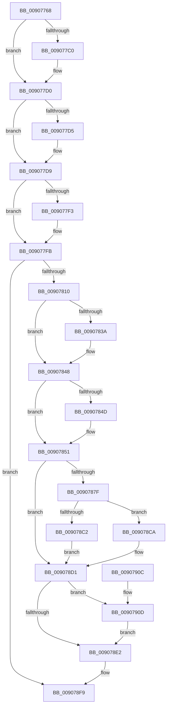

# sub_00907768

- RVA: `0x00907768`–`0x00907917` (길이 `431` bytes)
- VA: `0x0000000140907768`
- 실행 섹션: `PAGE`
- PDB 이름 있음: `아니요`; PDB Function 태그: `아니요`
- unwind 정보 RVA: `0x00088DB0`
- 디코드: `114`개 명령, `431/431` bytes 표시
- 미해석 바이트: `0` (있으면 어셈블리에 `.byte`로 보존)

> 이 문서는 커널 이미지의 기계어와 PDB 기호를 분석해 생성했습니다. 4번과 5번은 함수 원형과 자료형을 바이너리 사용 방식에서 추정한 C 해석이며 원본 소스 복구 결과는 아닙니다.

## 1. Dependencies

- 직접 호출 지점: **15**; 고유 호출 대상: **12**
- 직접 호출자로 확인된 함수: **2**
- RIP 상대 이미지 참조: **6**

### Outgoing calls
- `0x009077A7` → [KeAbPreAcquire](../../text/21/KeAbPreAcquire_function_00210230.md) (function, `0x00210230`)
- `0x009077CB` → [ExfAcquirePushLockSharedEx](../../text/21/ExfAcquirePushLockSharedEx_function_0021044C.md) (function, `0x0021044C`)
- `0x009077DE` → [sub_008D368C](../8D/Unknown_function_008D368C.md) (function, `0x008D368C`)
- `0x009077F6` → [ExfReleasePushLockShared](../../text/26/ExfReleasePushLockShared_function_00263440.md) (function, `0x00263440`)
- `0x009077FE` → [KeAbPostRelease](../../text/2E/KeAbPostRelease_function_002E1600.md) (function, `0x002E1600`)
- `0x00907803` → [KeLeaveGuardedRegion](../../text/2E/KeLeaveGuardedRegion_function_002E2C40.md) (function, `0x002E2C40`)
- `0x00907829` → [KeAbPreAcquire](../../text/21/KeAbPreAcquire_function_00210230.md) (function, `0x00210230`)
- `0x00907843` → [ExfAcquirePushLockExclusiveEx](../../text/20/ExfAcquirePushLockExclusiveEx_function_0020FC90.md) (function, `0x0020FC90`)
- `0x00907874` → [sub_008D3DC0](../8D/Unknown_function_008D3DC0.md) (function, `0x008D3DC0`)
- `0x009078B4` → [memcpy](../../text/6C/memcpy_function_006C6840.md) (function, `0x006C6840`)
- `0x009078B9` → [Feature_58333519__private_IsEnabledDeviceUsageNoInline](../../text/4F/Feature_58333519__private_IsEnabledDeviceUsageNoInline_function_004F5D4C.md) (function, `0x004F5D4C`)
- `0x009078E5` → [KeAbPostRelease](../../text/2E/KeAbPostRelease_function_002E1600.md) (function, `0x002E1600`)
- `0x009078EA` → [KeLeaveGuardedRegion](../../text/2E/KeLeaveGuardedRegion_function_002E2C40.md) (function, `0x002E2C40`)
- `0x009078F4` → [sub_008D40CC](../8D/Unknown_function_008D40CC.md) (function, `0x008D40CC`)
- `0x00907910` → [ExfTryToWakePushLock](../../text/26/ExfTryToWakePushLock_function_00265DD0.md) (function, `0x00265DD0`)

### Direct callers
- [sub_008D3420](../8D/Unknown_function_008D3420.md) at `0x008D367B`
- [PspProcessDelete](PspProcessDelete_function_00907B90.md) at `0x00907CAC`

### Static image references
- `0x00907781` → RVA `0x00E3EA68` (`.data`; read)
- `0x0090786A` → RVA `0x00E3EA40` (`.data`; read)
- `0x0090788A` → RVA `0x00E3EA44` (`.data`; read)
- `0x009078A6` → RVA `0x00E3EA50` (`.data`; read)
- `0x009078C2` → RVA `0x00E3EA44` (`.data`; read/write)
- `0x009078D1` → RVA `0x00E3EA68` (`.data`; read/write)

## 2. Other-region calls and transfers

- 다른 실행 섹션으로 향하는 call: **12**
  - `0x009077A7` → [KeAbPreAcquire](../../text/21/KeAbPreAcquire_function_00210230.md) (`PAGE` → `.text`)
  - `0x009077CB` → [ExfAcquirePushLockSharedEx](../../text/21/ExfAcquirePushLockSharedEx_function_0021044C.md) (`PAGE` → `.text`)
  - `0x009077F6` → [ExfReleasePushLockShared](../../text/26/ExfReleasePushLockShared_function_00263440.md) (`PAGE` → `.text`)
  - `0x009077FE` → [KeAbPostRelease](../../text/2E/KeAbPostRelease_function_002E1600.md) (`PAGE` → `.text`)
  - `0x00907803` → [KeLeaveGuardedRegion](../../text/2E/KeLeaveGuardedRegion_function_002E2C40.md) (`PAGE` → `.text`)
  - `0x00907829` → [KeAbPreAcquire](../../text/21/KeAbPreAcquire_function_00210230.md) (`PAGE` → `.text`)
  - `0x00907843` → [ExfAcquirePushLockExclusiveEx](../../text/20/ExfAcquirePushLockExclusiveEx_function_0020FC90.md) (`PAGE` → `.text`)
  - `0x009078B4` → [memcpy](../../text/6C/memcpy_function_006C6840.md) (`PAGE` → `.text`)
  - `0x009078B9` → [Feature_58333519__private_IsEnabledDeviceUsageNoInline](../../text/4F/Feature_58333519__private_IsEnabledDeviceUsageNoInline_function_004F5D4C.md) (`PAGE` → `.text`)
  - `0x009078E5` → [KeAbPostRelease](../../text/2E/KeAbPostRelease_function_002E1600.md) (`PAGE` → `.text`)
  - `0x009078EA` → [KeLeaveGuardedRegion](../../text/2E/KeLeaveGuardedRegion_function_002E2C40.md) (`PAGE` → `.text`)
  - `0x00907910` → [ExfTryToWakePushLock](../../text/26/ExfTryToWakePushLock_function_00265DD0.md) (`PAGE` → `.text`)
- 별도 외부 분기/꼬리 이동을 확인하지 못했습니다.

## 3. Assembly (complete function range)

```asm
00907768  48 89 5C 24 08                  mov qword ptr [rsp + 8], rbx
0090776D  55                              push rbp
0090776E  56                              push rsi
0090776F  57                              push rdi
00907770  41 56                           push r14
00907772  41 57                           push r15
00907774  48 83 EC 30                     sub rsp, 0x30
00907778  65 48 8B 04 25 88 01 00 00      mov rax, qword ptr gs:[0x188]
00907781  48 8D 2D E0 72 53 00            lea rbp, [rip + 0x5372e0]
00907788  48 8B F1                        mov rsi, rcx
0090778B  48 83 CB FF                     or rbx, 0xffffffffffffffff
0090778F  45 33 F6                        xor r14d, r14d
00907792  45 33 C0                        xor r8d, r8d
00907795  33 D2                           xor edx, edx
00907797  4C 89 74 24 70                  mov qword ptr [rsp + 0x70], r14
0090779C  66 01 98 E6 01 00 00            add word ptr [rax + 0x1e6], bx
009077A3  48 8B CD                        mov rcx, rbp
009077A6  90                              nop
009077A7  E8 84 8A 90 FF                  call 0x140210230
009077AC  48 8B F8                        mov rdi, rax
009077AF  45 8D 7E 11                     lea r15d, [r14 + 0x11]
009077B3  33 C0                           xor eax, eax
009077B5  F0 4C 0F B1 3D AA 72 53 00      lock cmpxchg qword ptr [rip + 0x5372aa], r15
009077BE  74 10                           je 0x1409077d0
009077C0  4C 8B CD                        mov r9, rbp
009077C3  4C 8B C7                        mov r8, rdi
009077C6  33 D2                           xor edx, edx
009077C8  48 8B CD                        mov rcx, rbp
009077CB  E8 7C 8C 90 FF                  call 0x14021044c
009077D0  48 85 FF                        test rdi, rdi
009077D3  74 04                           je 0x1409077d9
009077D5  C6 47 0A 01                     mov byte ptr [rdi + 0xa], 1
009077D9  33 D2                           xor edx, edx
009077DB  48 8B CE                        mov rcx, rsi
009077DE  E8 A9 BE FC FF                  call 0x1408d368c
009077E3  8B F8                           mov edi, eax
009077E5  49 8B C7                        mov rax, r15
009077E8  F0 4C 0F B1 35 77 72 53 00      lock cmpxchg qword ptr [rip + 0x537277], r14
009077F1  74 08                           je 0x1409077fb
009077F3  48 8B CD                        mov rcx, rbp
009077F6  E8 45 BC 95 FF                  call 0x140263440
009077FB  48 8B CD                        mov rcx, rbp
009077FE  E8 FD 9D 9D FF                  call 0x1402e1600
00907803  E8 38 B4 9D FF                  call 0x1402e2c40
00907808  85 FF                           test edi, edi
0090780A  0F 88 E9 00 00 00               js 0x1409078f9
00907810  65 48 8B 04 25 88 01 00 00      mov rax, qword ptr gs:[0x188]
00907819  45 33 C0                        xor r8d, r8d
0090781C  33 D2                           xor edx, edx
0090781E  48 8B CD                        mov rcx, rbp
00907821  66 01 98 E6 01 00 00            add word ptr [rax + 0x1e6], bx
00907828  90                              nop
00907829  E8 02 8A 90 FF                  call 0x140210230
0090782E  F0 48 0F BA 6D 00 00            lock bts qword ptr [rbp], 0
00907835  48 8B F8                        mov rdi, rax
00907838  73 0E                           jae 0x140907848
0090783A  4C 8B C5                        mov r8, rbp
0090783D  48 8B D0                        mov rdx, rax
00907840  48 8B CD                        mov rcx, rbp
00907843  E8 48 84 90 FF                  call 0x14020fc90
00907848  48 85 FF                        test rdi, rdi
0090784B  74 04                           je 0x140907851
0090784D  C6 47 0A 01                     mov byte ptr [rdi + 0xa], 1
00907851  48 8D 44 24 68                  lea rax, [rsp + 0x68]
00907856  89 5C 24 68                     mov dword ptr [rsp + 0x68], ebx
0090785A  4C 8D 4C 24 70                  lea r9, [rsp + 0x70]
0090785F  48 89 44 24 20                  mov qword ptr [rsp + 0x20], rax
00907864  41 B8 08 00 00 00               mov r8d, 8
0090786A  48 8D 0D CF 71 53 00            lea rcx, [rip + 0x5371cf]
00907871  48 8B D6                        mov rdx, rsi
00907874  E8 47 C5 FC FF                  call 0x1408d3dc0
00907879  8B F8                           mov edi, eax
0090787B  85 C0                           test eax, eax
0090787D  78 52                           js 0x1409078d1
0090787F  8B 0D BB 71 53 00               mov ecx, dword ptr [rip + 0x5371bb]
00907885  44 8B 4C 24 68                  mov r9d, dword ptr [rsp + 0x68]
0090788A  44 8B 05 B3 71 53 00            mov r8d, dword ptr [rip + 0x5371b3]
00907891  45 2B C1                        sub r8d, r9d
00907894  41 FF C8                        dec r8d
00907897  41 8D 51 01                     lea edx, [r9 + 1]
0090789B  44 0F AF C1                     imul r8d, ecx
0090789F  0F AF D1                        imul edx, ecx
009078A2  41 0F AF C9                     imul ecx, r9d
009078A6  48 03 15 A3 71 53 00            add rdx, qword ptr [rip + 0x5371a3]
009078AD  48 03 0D 9C 71 53 00            add rcx, qword ptr [rip + 0x53719c]
009078B4  E8 87 EF DB FF                  call 0x1406c6840
009078B9  E8 8E E4 BE FF                  call 0x1404f5d4c
009078BE  85 C0                           test eax, eax
009078C0  75 08                           jne 0x1409078ca
009078C2  FF 0D 7C 71 53 00               dec dword ptr [rip + 0x53717c]
009078C8  EB 07                           jmp 0x1409078d1
009078CA  F0 01 1D 73 71 53 00            lock add dword ptr [rip + 0x537173], ebx
009078D1  F0 48 0F C1 1D 8E 71 53 00      lock xadd qword ptr [rip + 0x53718e], rbx
009078DA  80 E3 06                        and bl, 6
009078DD  80 FB 02                        cmp bl, 2
009078E0  74 2B                           je 0x14090790d
009078E2  48 8B CD                        mov rcx, rbp
009078E5  E8 16 9D 9D FF                  call 0x1402e1600
009078EA  E8 51 B3 9D FF                  call 0x1402e2c40
009078EF  48 8B 4C 24 70                  mov rcx, qword ptr [rsp + 0x70]
009078F4  E8 D3 C7 FC FF                  call 0x1408d40cc
009078F9  48 8B 5C 24 60                  mov rbx, qword ptr [rsp + 0x60]
009078FE  8B C7                           mov eax, edi
00907900  48 83 C4 30                     add rsp, 0x30
00907904  41 5F                           pop r15
00907906  41 5E                           pop r14
00907908  5F                              pop rdi
00907909  5E                              pop rsi
0090790A  5D                              pop rbp
0090790B  C3                              ret
0090790C  CC                              int3
0090790D  48 8B CD                        mov rcx, rbp
00907910  E8 BB E4 95 FF                  call 0x140265dd0
00907915  EB CB                           jmp 0x1409078e2
```

## 4. C-style interpretation (structured pseudocode)

```c
__int64 __fastcall sub_00907768(__int64 a1, int a2, int a3)
{
    __int64 result;
    __int64 v_r14;
    __int64 v_rbx;
    __int64 v_rsp;
    unsigned __int64 v_stack_m38;
    unsigned __int64 v_stack_p10;
    unsigned __int64 v_stack_p18;
    unsigned __int64 v_stack_p8;

    v_stack_p8 = v_rbx;
    v_rsp = (v_rsp) - (48);
    v_rbx = (v_rbx) | (-1);
    v_r14 = 0;
    a3 = 0;
    a2 = 0;
    v_stack_p18 = 0;
    result = KeAbPreAcquire(v_rip + 5468896, a2, a3, a4);
    result = 0;
    if (!(condition_is_equal)) {
        a4 = v_rip + 5468896;
        a3 = 0;
        a2 = 0;
        a1 = v_rip + 5468896;
        result = ExfAcquirePushLockSharedEx(a1, a2, a3, a4);
    }
    if (result != 0) {
        *(unsigned __int8 *)(result + 10) = 1;
    }
    a2 = 0;
    result = sub_008D368C(a1, a2, a3, a4);
    result = v_r14 + 17;
    if (!(condition_is_equal)) {
        a1 = v_rip + 5468896;
        result = ExfReleasePushLockShared(a1, a2, a3, a4);
    }
    result = KeAbPostRelease(v_rip + 5468896, a2, a3, a4);
    result = KeLeaveGuardedRegion(v_rip + 5468896, a2, a3, a4);
    if (sign_flag) goto loc_009078F9;
    a3 = 0;
    a2 = 0;
    result = KeAbPreAcquire(v_rip + 5468896, a2, a3, a4);
    if (!(condition_is_above_or_equal)) {
        a3 = v_rip + 5468896;
        a2 = result;
        a1 = v_rip + 5468896;
        result = ExfAcquirePushLockExclusiveEx(a1, a2, a3, a4);
    }
    if (result != 0) {
        *(unsigned __int8 *)(result + 10) = 1;
    }
    v_stack_p10 = (unsigned int)(v_rbx);
    v_stack_m38 = v_stack_p10;
    result = sub_008D3DC0(v_rip + 5468623, a1, 8, v_stack_p18);
    if (sign_flag) goto loc_009078D1;
    a3 = (unsigned int)(((unsigned int)(*(unsigned int *)(v_rip + 5468595))) - ((unsigned int)((unsigned int)(v_stack_p10))));
    a3 = (unsigned int)((a3) - 1);
    a3 = (unsigned int)((a3) * ((unsigned int)((unsigned int)(*(unsigned int *)(v_rip + 5468603)))));
    a2 = (unsigned int)(((unsigned int)(v_stack_p10) + 1) * ((unsigned int)((unsigned int)(*(unsigned int *)(v_rip + 5468603)))));
    a1 = (unsigned int)(((unsigned int)(*(unsigned int *)(v_rip + 5468603))) * ((unsigned int)((unsigned int)(v_stack_p10))));
    a2 = (a2) + (*(unsigned __int64 *)(v_rip + 5468579));
    a1 = (a1) + (*(unsigned __int64 *)(v_rip + 5468572));
    result = memcpy(a1, a2, a3, (unsigned int)(v_stack_p10));
    result = Feature_58333519__private_IsEnabledDeviceUsageNoInline(a1, a2, a3, (unsigned int)(v_stack_p10));
    if ((unsigned int)(result) != 0) goto loc_009078CA;
    goto loc_009078D1;
loc_009078CA:
loc_009078D1:
    v_rbx = (unsigned __int8)((v_rbx) & (6));
    if (((unsigned __int8)(v_rbx)) == 2) goto loc_0090790D;
loc_009078E2:
    result = KeAbPostRelease(v_rip + 5468896, a2, a3, (unsigned int)(v_stack_p10));
    result = KeLeaveGuardedRegion(v_rip + 5468896, a2, a3, (unsigned int)(v_stack_p10));
    result = sub_008D40CC(v_stack_p18, a2, a3, (unsigned int)(v_stack_p10));
loc_009078F9:
    v_rsp = (v_rsp) + (48);
    return (unsigned int)((unsigned int)((unsigned int)((unsigned int)(result))));
loc_0090790D:
    result = ExfTryToWakePushLock(v_rip + 5468896, a2, a3, (unsigned int)(v_stack_p10));
    goto loc_009078E2;
}
```

## 5. (Beta) C Style

```c
int64_t sub_00907768(int64_t Arg1, int32_t Arg2, int32_t Arg3)
{
    int64_t result;
    int64_t local_r14;
    int64_t local_rbx;
    int64_t local_rsp;
    uint64_t v_stack_m38;
    uint64_t v_stack_p10;
    uint64_t v_stack_p18;
    uint64_t v_stack_p8;

    v_stack_p8 = local_rbx;
    local_rsp = (local_rsp) - (48);
    local_rbx = (local_rbx) | (-1);
    local_r14 = 0;
    Arg3 = 0;
    Arg2 = 0;
    v_stack_p18 = 0;
    result = KeAbPreAcquire(v_rip + 5468896, Arg2, Arg3, a4);
    result = 0;
    if (!(condition_is_equal)) {
        a4 = v_rip + 5468896;
        Arg3 = 0;
        Arg2 = 0;
        Arg1 = v_rip + 5468896;
        result = ExfAcquirePushLockSharedEx(Arg1, Arg2, Arg3, a4);
    }
    if (result != 0) {
        *(uint8_t *)(result + 0xA) = 1;
    }
    Arg2 = 0;
    result = sub_008D368C(Arg1, Arg2, Arg3, a4);
    result = local_r14 + 17;
    if (!(condition_is_equal)) {
        Arg1 = v_rip + 5468896;
        result = ExfReleasePushLockShared(Arg1, Arg2, Arg3, a4);
    }
    result = KeAbPostRelease(v_rip + 5468896, Arg2, Arg3, a4);
    result = KeLeaveGuardedRegion(v_rip + 5468896, Arg2, Arg3, a4);
    if (sign_flag) goto loc_009078F9;
    Arg3 = 0;
    Arg2 = 0;
    result = KeAbPreAcquire(v_rip + 5468896, Arg2, Arg3, a4);
    if (!(condition_is_above_or_equal)) {
        Arg3 = v_rip + 5468896;
        Arg2 = result;
        Arg1 = v_rip + 5468896;
        result = ExfAcquirePushLockExclusiveEx(Arg1, Arg2, Arg3, a4);
    }
    if (result != 0) {
        *(uint8_t *)(result + 0xA) = 1;
    }
    v_stack_p10 = (uint32_t)(local_rbx);
    v_stack_m38 = v_stack_p10;
    result = sub_008D3DC0(v_rip + 5468623, Arg1, 8, v_stack_p18);
    if (sign_flag) goto loc_009078D1;
    Arg3 = (uint32_t)(((uint32_t)(*(uint32_t *)(v_rip + 0x5371B3))) - ((uint32_t)((uint32_t)(v_stack_p10))));
    Arg3 = (uint32_t)((Arg3) - 1);
    Arg3 = (uint32_t)((Arg3) * ((uint32_t)((uint32_t)(*(uint32_t *)(v_rip + 0x5371BB)))));
    Arg2 = (uint32_t)(((uint32_t)(v_stack_p10) + 1) * ((uint32_t)((uint32_t)(*(uint32_t *)(v_rip + 0x5371BB)))));
    Arg1 = (uint32_t)(((uint32_t)(*(uint32_t *)(v_rip + 0x5371BB))) * ((uint32_t)((uint32_t)(v_stack_p10))));
    Arg2 = (Arg2) + (*(uint64_t *)(v_rip + 0x5371A3));
    Arg1 = (Arg1) + (*(uint64_t *)(v_rip + 0x53719C));
    result = memcpy(Arg1, Arg2, Arg3, (uint32_t)(v_stack_p10));
    result = Feature_58333519__private_IsEnabledDeviceUsageNoInline(Arg1, Arg2, Arg3, (uint32_t)(v_stack_p10));
    if ((uint32_t)(result) != 0) goto loc_009078CA;
    goto loc_009078D1;
loc_009078CA:
loc_009078D1:
    local_rbx = (uint8_t)((local_rbx) & (6));
    if (((uint8_t)(local_rbx)) == 2) goto loc_0090790D;
loc_009078E2:
    result = KeAbPostRelease(v_rip + 5468896, Arg2, Arg3, (uint32_t)(v_stack_p10));
    result = KeLeaveGuardedRegion(v_rip + 5468896, Arg2, Arg3, (uint32_t)(v_stack_p10));
    result = sub_008D40CC(v_stack_p18, Arg2, Arg3, (uint32_t)(v_stack_p10));
loc_009078F9:
    local_rsp = (local_rsp) + (48);
    return (uint32_t)((uint32_t)((uint32_t)((uint32_t)(result))));
loc_0090790D:
    result = ExfTryToWakePushLock(v_rip + 5468896, Arg2, Arg3, (uint32_t)(v_stack_p10));
    goto loc_009078E2;
}
```

## 6. Execution-region graph

[열기: 2D/3D 그래프와 함수 탐색 컨트롤 패널](../../../control-panel.html?section=page&rva=0x00907768&view=graph)

- 2D 그래프는 위에서 아래로 흐르고, 3D 그래프는 빈 공간을 드래그해 회전합니다. Shift+드래그는 이동, 휠은 확대·축소, 함수 노드 선택은 대상 보고서 이동입니다.

### Static fallback


