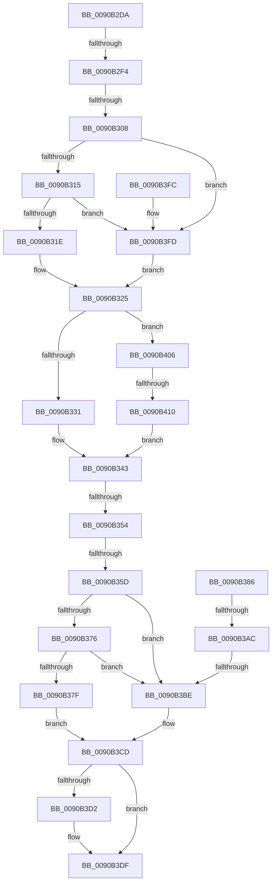

# sub_0090B2DA

- RVA: `0x0090B2DA`–`0x0090B427` (길이 `333` bytes)
- VA: `0x000000014090B2DA`
- 실행 섹션: `PAGE`
- PDB 이름 있음: `아니요`; PDB Function 태그: `아니요`
- unwind 정보 RVA: `0x00089144`
- 디코드: `83`개 명령, `333/333` bytes 표시
- 미해석 바이트: `0` (있으면 어셈블리에 `.byte`로 보존)

> 이 문서는 커널 이미지의 기계어와 PDB 기호를 분석해 생성했습니다. 4번과 5번은 함수 원형과 자료형을 바이너리 사용 방식에서 추정한 C 해석이며 원본 소스 복구 결과는 아닙니다.

## 1. Dependencies

- 직접 호출 지점: **3**; 고유 호출 대상: **3**
- 직접 호출자로 확인된 함수: **0**
- RIP 상대 이미지 참조: **0**

### Outgoing calls
- `0x0090B376` → [ExfAcquireRundownProtection](../../text/34/ExfAcquireRundownProtection_function_0034C050.md) (function, `0x0034C050`)
- `0x0090B3AF` → [KeAbPostRelease](../../text/2E/KeAbPostRelease_function_002E1600.md) (function, `0x002E1600`)
- `0x0090B3DA` → [ExFreePoolWithTag](../../poolcode/B8/ExFreePoolWithTag_function_00B82870.md) (function, `0x00B82870`)

### Direct callers
- 이 함수 시작 RVA로 연결되는 직접 call은 확인되지 않았습니다. 간접 호출은 완전히 역산할 수 없습니다.

### Static image references
- 디코드된 RIP-relative 메모리 참조가 없습니다.

## 2. Other-region calls and transfers

- 다른 실행 섹션으로 향하는 call: **3**
  - `0x0090B376` → [ExfAcquireRundownProtection](../../text/34/ExfAcquireRundownProtection_function_0034C050.md) (`PAGE` → `.text`)
  - `0x0090B3AF` → [KeAbPostRelease](../../text/2E/KeAbPostRelease_function_002E1600.md) (`PAGE` → `.text`)
  - `0x0090B3DA` → [ExFreePoolWithTag](../../poolcode/B8/ExFreePoolWithTag_function_00B82870.md) (`PAGE` → `POOLCODE`)
- call이 아닌 외부 분기/꼬리 이동: **7**
  - `0x0090B2EE` → [sub_0090B43E](Unknown_function_0090B43E.md) (`tail-transfer`)
  - `0x0090B302` → [sub_0090B43E + 0x2A5](Unknown_function_0090B43E.md) (`tail-transfer`)
  - `0x0090B34E` → [sub_0090B43E + 0x37](Unknown_function_0090B43E.md) (`tail-transfer`)
  - `0x0090B357` → [sub_0090B43E + 0x37](Unknown_function_0090B43E.md) (`tail-transfer`)
  - `0x0090B3A6` → [sub_0090B43E + 0x2F1](Unknown_function_0090B43E.md) (`tail-transfer`)
  - `0x0090B3B8` → [sub_0090B43E + 0x246](Unknown_function_0090B43E.md) (`tail-transfer`)
  - `0x0090B40A` → [sub_0090B43E + 0x16D](Unknown_function_0090B43E.md) (`tail-transfer`)

## 3. Assembly (complete function range)

```asm
0090B2DA  48 89 B4 24 C8 00 00 00         mov qword ptr [rsp + 0xc8], rsi
0090B2E2  4C 89 6C 24 70                  mov qword ptr [rsp + 0x70], r13
0090B2E7  4C 39 A0 70 03 00 00            cmp qword ptr [rax + 0x370], r12
0090B2EE  0F 84 4A 01 00 00               je 0x14090b43e
0090B2F4  48 8B 93 E8 05 00 00            mov rdx, qword ptr [rbx + 0x5e8]
0090B2FB  48 89 55 D0                     mov qword ptr [rbp - 0x30], rdx
0090B2FF  48 85 D2                        test rdx, rdx
0090B302  0F 84 DB 03 00 00               je 0x14090b6e3
0090B308  4C 8B 6D 58                     mov r13, qword ptr [rbp + 0x58]
0090B30C  4D 85 ED                        test r13, r13
0090B30F  0F 85 E8 00 00 00               jne 0x14090b3fd
0090B315  48 85 FF                        test rdi, rdi
0090B318  0F 85 DF 00 00 00               jne 0x14090b3fd
0090B31E  B8 01 00 00 00                  mov eax, 1
0090B323  33 F6                           xor esi, esi
0090B325  89 45 B8                        mov dword ptr [rbp - 0x48], eax
0090B328  45 85 FF                        test r15d, r15d
0090B32B  0F 85 D5 00 00 00               jne 0x14090b406
0090B331  49 8B 9E 70 03 00 00            mov rbx, qword ptr [r14 + 0x370]
0090B338  48 83 C3 08                     add rbx, 8
0090B33C  C7 45 B8 01 00 00 00            mov dword ptr [rbp - 0x48], 1
0090B343  48 8B 3B                        mov rdi, qword ptr [rbx]
0090B346  48 89 7D C0                     mov qword ptr [rbp - 0x40], rdi
0090B34A  44 39 65 B8                     cmp dword ptr [rbp - 0x48], r12d
0090B34E  0F 84 21 01 00 00               je 0x14090b475
0090B354  48 85 FF                        test rdi, rdi
0090B357  0F 84 18 01 00 00               je 0x14090b475
0090B35D  48 8D 4F 08                     lea rcx, [rdi + 8]
0090B361  0F 0D 09                        prefetchw byte ptr [rcx]
0090B364  48 8B 01                        mov rax, qword ptr [rcx]
0090B367  48 83 E0 FE                     and rax, 0xfffffffffffffffe
0090B36B  48 8D 50 02                     lea rdx, [rax + 2]
0090B36F  F0 48 0F B1 11                  lock cmpxchg qword ptr [rcx], rdx
0090B374  74 48                           je 0x14090b3be
0090B376  E8 D5 0C A4 FF                  call 0x14034c050
0090B37B  84 C0                           test al, al
0090B37D  75 3F                           jne 0x14090b3be
0090B37F  BE 34 00 00 C0                  mov esi, 0xc0000034
0090B384  EB 47                           jmp 0x14090b3cd
0090B386  48 89 07                        mov qword ptr [rdi], rax
0090B389  48 C7 C1 FF FF FF FF            mov rcx, 0xffffffffffffffff
0090B390  48 89 77 08                     mov qword ptr [rdi + 8], rsi
0090B394  48 89 78 08                     mov qword ptr [rax + 8], rdi
0090B398  48 89 3E                        mov qword ptr [rsi], rdi
0090B39B  F0 49 0F C1 0E                  lock xadd qword ptr [r14], rcx
0090B3A0  80 E1 06                        and cl, 6
0090B3A3  80 F9 02                        cmp cl, 2
0090B3A6  0F 84 83 03 00 00               je 0x14090b72f
0090B3AC  49 8B CE                        mov rcx, r14
0090B3AF  E8 4C 62 9D FF                  call 0x1402e1600
0090B3B4  83 7D B8 00                     cmp dword ptr [rbp - 0x48], 0
0090B3B8  0F 85 C6 02 00 00               jne 0x14090b684
0090B3BE  48 8B 7D C0                     mov rdi, qword ptr [rbp - 0x40]
0090B3C2  48 8B 45 38                     mov rax, qword ptr [rbp + 0x38]
0090B3C6  48 89 38                        mov qword ptr [rax], rdi
0090B3C9  33 C0                           xor eax, eax
0090B3CB  8B F0                           mov esi, eax
0090B3CD  4D 85 E4                        test r12, r12
0090B3D0  74 0D                           je 0x14090b3df
0090B3D2  BA 57 6E 66 20                  mov edx, 0x20666e57
0090B3D7  49 8B CC                        mov rcx, r12
0090B3DA  E8 91 74 27 00                  call 0x140b82870
0090B3DF  4C 8B 6C 24 70                  mov r13, qword ptr [rsp + 0x70]
0090B3E4  8B C6                           mov eax, esi
0090B3E6  48 8B B4 24 C8 00 00 00         mov rsi, qword ptr [rsp + 0xc8]
0090B3EE  48 83 C4 78                     add rsp, 0x78
0090B3F2  41 5F                           pop r15
0090B3F4  41 5E                           pop r14
0090B3F6  41 5C                           pop r12
0090B3F8  5F                              pop rdi
0090B3F9  5B                              pop rbx
0090B3FA  5D                              pop rbp
0090B3FB  C3                              ret
0090B3FC  CC                              int3
0090B3FD  33 F6                           xor esi, esi
0090B3FF  8B C6                           mov eax, esi
0090B401  E9 1F FF FF FF                  jmp 0x14090b325
0090B406  41 83 FF 04                     cmp r15d, 4
0090B40A  0F 85 9B 01 00 00               jne 0x14090b5ab
0090B410  49 8B 9E 70 03 00 00            mov rbx, qword ptr [r14 + 0x370]
0090B417  48 83 C3 10                     add rbx, 0x10
0090B41B  C7 45 B8 01 00 00 00            mov dword ptr [rbp - 0x48], 1
0090B422  E9 1C FF FF FF                  jmp 0x14090b343
```

## 4. C-style interpretation (structured pseudocode)

```c
__int64 __fastcall sub_0090B2DA(__int64 a1, __int64 a2, __int64 a3, __int64 a4, __int64 a5, __int64 a6, __int64 a7, __int64 a8, __int64 a9, __int64 a10, __int64 a11, __int64 a12, __int64 a13, __int64 a14, __int64 a15, __int64 a16, __int64 a17, __int64 a18, __int64 a19, __int64 a20, __int64 a21, __int64 a22, __int64 a23, __int64 a24, __int64 a25)
{
    __int64 result;
    __int64 v_rbx;
    __int64 v_rsi;
    __int64 v_rsp;
    unsigned __int64 v_stack_p70;
    unsigned __int64 v_stack_pC8;

    v_stack_pC8 = v_rsi;
    v_stack_p70 = v_r13;
    *(unsigned __int64 *)(v_rbp - 48) = *(unsigned __int64 *)(v_rbx + 1512);
    if (*(unsigned __int64 *)(v_rbp + 88) != 0) goto loc_0090B3FD;
    if (v_rdi != 0) goto loc_0090B3FD;
    v_rsi = 0;
loc_0090B325:
    *(unsigned int *)(v_rbp - 72) = 1;
    if ((unsigned int)(v_r15) != 0) goto loc_0090B406;
    v_rbx = (*(unsigned __int64 *)(v_r14 + 880)) + (8);
    *(unsigned int *)(v_rbp - 72) = 1;
loc_0090B343:
    *(unsigned __int64 *)(v_rbp - 64) = *(unsigned __int64 *)(v_rbx);
    result = (*(unsigned __int64 *)(*(unsigned __int64 *)(v_rbx) + 8)) & (-2);
    if (condition_is_equal) goto loc_0090B3BE;
    result = ExfAcquireRundownProtection(*(unsigned __int64 *)(v_rbx) + 8, result + 2, a3, a4);
    if ((unsigned __int8)(result) != 0) goto loc_0090B3BE;
    goto loc_0090B3CD;
loc_0090B3BE:
    *(unsigned __int64 *)(*(unsigned __int64 *)(v_rbp + 56)) = *(unsigned __int64 *)(v_rbp - 64);
    result = 0;
loc_0090B3CD:
    if (v_r12 != 0) {
        a2 = 0x20666E57ULL;
        a1 = v_r12;
        result = ExFreePoolWithTag(a1, a2, a3, a4);
    }
    v_rsp = (v_rsp) + (120);
    return 0;
loc_0090B3FD:
    v_rsi = 0;
    goto loc_0090B325;
loc_0090B406:
    v_rbx = (*(unsigned __int64 *)(v_r14 + 880)) + (16);
    *(unsigned int *)(v_rbp - 72) = 1;
    goto loc_0090B343;
}
```

## 5. (Beta) C Style

```c
int64_t sub_0090B2DA(int64_t Arg1, int64_t Arg2, int64_t Arg3, int64_t Arg4, uint64_t Arg5, uint64_t Arg6, uint64_t Arg7, uint64_t Arg8, uint64_t Arg9, uint64_t Arg10, uint64_t Arg11, uint64_t Arg12, uint64_t Arg13, int64_t Arg14, uint64_t Arg15, uint64_t Arg16, uint64_t Arg17, uint64_t Arg18, uint64_t Arg19, uint64_t Arg20, uint64_t Arg21, uint64_t Arg22, uint64_t Arg23, uint64_t Arg24, int64_t Arg25)
{
    int64_t result;
    int64_t local_rbx;
    int64_t local_rsi;
    int64_t local_rsp;
    uint64_t v_stack_p70;
    uint64_t v_stack_pC8;

    v_stack_pC8 = local_rsi;
    v_stack_p70 = local_r13;
    *(uint64_t *)(local_rbp - 0x30) = *(uint64_t *)(local_rbx + 0x5E8);
    if (*(uint64_t *)(local_rbp + 0x58) != 0) goto loc_0090B3FD;
    if (local_rdi != 0) goto loc_0090B3FD;
    local_rsi = 0;
loc_0090B325:
    *(uint32_t *)(local_rbp - 0x48) = 1;
    if ((uint32_t)(local_r15) != 0) goto loc_0090B406;
    local_rbx = (*(uint64_t *)(local_r14 + 0x370)) + (8);
    *(uint32_t *)(local_rbp - 0x48) = 1;
loc_0090B343:
    *(uint64_t *)(local_rbp - 0x40) = *(uint64_t *)(local_rbx);
    result = (*(uint64_t *)(*(uint64_t *)(local_rbx) + 0x8)) & (-2);
    if (condition_is_equal) goto loc_0090B3BE;
    result = ExfAcquireRundownProtection(*(uint64_t *)(local_rbx) + 8, result + 2, Arg3, Arg4);
    if ((uint8_t)(result) != 0) goto loc_0090B3BE;
    goto loc_0090B3CD;
loc_0090B3BE:
    *(uint64_t *)(*(uint64_t *)(local_rbp + 0x38)) = *(uint64_t *)(local_rbp - 0x40);
    result = 0;
loc_0090B3CD:
    if (local_r12 != 0) {
        Arg2 = 0x20666E57ULL;
        Arg1 = local_r12;
        result = ExFreePoolWithTag(Arg1, Arg2, Arg3, Arg4);
    }
    local_rsp = (local_rsp) + (120);
    return 0;
loc_0090B3FD:
    local_rsi = 0;
    goto loc_0090B325;
loc_0090B406:
    local_rbx = (*(uint64_t *)(local_r14 + 0x370)) + (16);
    *(uint32_t *)(local_rbp - 0x48) = 1;
    goto loc_0090B343;
}
```

## 6. Execution-region graph

[열기: 2D/3D 그래프와 함수 탐색 컨트롤 패널](../../../control-panel.html?section=page&rva=0x0090B2DA&view=graph)

- 2D 그래프는 위에서 아래로 흐르고, 3D 그래프는 빈 공간을 드래그해 회전합니다. Shift+드래그는 이동, 휠은 확대·축소, 함수 노드 선택은 대상 보고서 이동입니다.

### Static fallback


