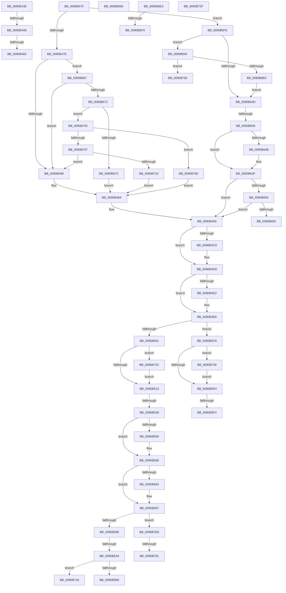

# sub_0090B43E

- RVA: `0x0090B43E`–`0x0090B79F` (길이 `865` bytes)
- VA: `0x000000014090B43E`
- 실행 섹션: `PAGE`
- PDB 이름 있음: `아니요`; PDB Function 태그: `아니요`
- unwind 정보 RVA: `0x00089170`
- 디코드: `215`개 명령, `865/865` bytes 표시
- 미해석 바이트: `0` (있으면 어셈블리에 `.byte`로 보존)

> 이 문서는 커널 이미지의 기계어와 PDB 기호를 분석해 생성했습니다. 4번과 5번은 함수 원형과 자료형을 바이너리 사용 방식에서 추정한 C 해석이며 원본 소스 복구 결과는 아닙니다.

## 1. Dependencies

- 직접 호출 지점: **23**; 고유 호출 대상: **15**
- 직접 호출자로 확인된 함수: **0**
- RIP 상대 이미지 참조: **0**

### Outgoing calls
- `0x0090B442` → [ExpWnfAllocateScopeMap](ExpWnfAllocateScopeMap_function_00909D60.md) (function, `0x00909D60`)
- `0x0090B46B` → [ExFreePoolWithTag](../../poolcode/B8/ExFreePoolWithTag_function_00B82870.md) (function, `0x00B82870`)
- `0x0090B4B7` → [KeAbPreAcquire](../../text/21/KeAbPreAcquire_function_00210230.md) (function, `0x00210230`)
- `0x0090B4D8` → [ExfAcquirePushLockSharedEx](../../text/21/ExfAcquirePushLockSharedEx_function_0021044C.md) (function, `0x0021044C`)
- `0x0090B4F0` → [ExpWnfFindScopeInstance](../9F/ExpWnfFindScopeInstance_function_009FFDE8.md) (function, `0x009FFDE8`)
- `0x0090B516` → [KeAbPostRelease](../../text/2E/KeAbPostRelease_function_002E1600.md) (function, `0x002E1600`)
- `0x0090B529` → [ExpWnfAllocateScopeInstance](../A7/ExpWnfAllocateScopeInstance_function_00A7BF30.md) (function, `0x00A7BF30`)
- `0x0090B540` → [KeAbPreAcquire](../../text/21/KeAbPreAcquire_function_00210230.md) (function, `0x00210230`)
- `0x0090B559` → [ExfAcquirePushLockExclusiveEx](../../text/20/ExfAcquirePushLockExclusiveEx_function_0020FC90.md) (function, `0x0020FC90`)
- `0x0090B575` → [ExpWnfFindScopeInstance](../9F/ExpWnfFindScopeInstance_function_009FFDE8.md) (function, `0x009FFDE8`)
- `0x0090B58E` → [ExAcquireRundownProtection](../../text/21/ExAcquireRundownProtection_function_00216620.md) (function, `0x00216620`)
- `0x0090B5CA` → [ExAcquireRundownProtection](../../text/21/ExAcquireRundownProtection_function_00216620.md) (function, `0x00216620`)
- `0x0090B5E7` → [KeAbPostRelease](../../text/2E/KeAbPostRelease_function_002E1600.md) (function, `0x002E1600`)
- `0x0090B62F` → [ExpWnfGetCurrentScopeInstance](../98/ExpWnfGetCurrentScopeInstance_function_0098FE40.md) (function, `0x0098FE40`)
- `0x0090B6A2` → [ExAllocatePool2](../../poolcode/B8/ExAllocatePool2_function_00B820F0.md) (function, `0x00B820F0`)
- `0x0090B6D7` → [ExpWnfGetCurrentScopeInstance](../98/ExpWnfGetCurrentScopeInstance_function_0098FE40.md) (function, `0x0098FE40`)
- `0x0090B6EA` → [ExpWnfCreateProcessContext](../A4/ExpWnfCreateProcessContext_function_00A48B54.md) (function, `0x00A48B54`)
- `0x0090B732` → [ExfTryToWakePushLock](../../text/26/ExfTryToWakePushLock_function_00265DD0.md) (function, `0x00265DD0`)
- `0x0090B73F` → [ExfReleasePushLockShared](../../text/26/ExfReleasePushLockShared_function_00263440.md) (function, `0x00263440`)
- `0x0090B74C` → [ExfReleasePushLockShared](../../text/26/ExfReleasePushLockShared_function_00263440.md) (function, `0x00263440`)
- `0x0090B763` → [RtlLengthSid](../../text/45/RtlLengthSid_function_0045D270.md) (function, `0x0045D270`)
- `0x0090B771` → [ExAcquireRundownProtection](../../text/21/ExAcquireRundownProtection_function_00216620.md) (function, `0x00216620`)
- `0x0090B794` → [ExfTryToWakePushLock](../../text/26/ExfTryToWakePushLock_function_00265DD0.md) (function, `0x00265DD0`)

### Direct callers
- 이 함수 시작 RVA로 연결되는 직접 call은 확인되지 않았습니다. 간접 호출은 완전히 역산할 수 없습니다.

### Static image references
- 디코드된 RIP-relative 메모리 참조가 없습니다.

## 2. Other-region calls and transfers

- 다른 실행 섹션으로 향하는 call: **16**
  - `0x0090B46B` → [ExFreePoolWithTag](../../poolcode/B8/ExFreePoolWithTag_function_00B82870.md) (`PAGE` → `POOLCODE`)
  - `0x0090B4B7` → [KeAbPreAcquire](../../text/21/KeAbPreAcquire_function_00210230.md) (`PAGE` → `.text`)
  - `0x0090B4D8` → [ExfAcquirePushLockSharedEx](../../text/21/ExfAcquirePushLockSharedEx_function_0021044C.md) (`PAGE` → `.text`)
  - `0x0090B516` → [KeAbPostRelease](../../text/2E/KeAbPostRelease_function_002E1600.md) (`PAGE` → `.text`)
  - `0x0090B540` → [KeAbPreAcquire](../../text/21/KeAbPreAcquire_function_00210230.md) (`PAGE` → `.text`)
  - `0x0090B559` → [ExfAcquirePushLockExclusiveEx](../../text/20/ExfAcquirePushLockExclusiveEx_function_0020FC90.md) (`PAGE` → `.text`)
  - `0x0090B58E` → [ExAcquireRundownProtection](../../text/21/ExAcquireRundownProtection_function_00216620.md) (`PAGE` → `.text`)
  - `0x0090B5CA` → [ExAcquireRundownProtection](../../text/21/ExAcquireRundownProtection_function_00216620.md) (`PAGE` → `.text`)
  - `0x0090B5E7` → [KeAbPostRelease](../../text/2E/KeAbPostRelease_function_002E1600.md) (`PAGE` → `.text`)
  - `0x0090B6A2` → [ExAllocatePool2](../../poolcode/B8/ExAllocatePool2_function_00B820F0.md) (`PAGE` → `POOLCODE`)
  - `0x0090B732` → [ExfTryToWakePushLock](../../text/26/ExfTryToWakePushLock_function_00265DD0.md) (`PAGE` → `.text`)
  - `0x0090B73F` → [ExfReleasePushLockShared](../../text/26/ExfReleasePushLockShared_function_00263440.md) (`PAGE` → `.text`)
  - `0x0090B74C` → [ExfReleasePushLockShared](../../text/26/ExfReleasePushLockShared_function_00263440.md) (`PAGE` → `.text`)
  - `0x0090B763` → [RtlLengthSid](../../text/45/RtlLengthSid_function_0045D270.md) (`PAGE` → `.text`)
  - `0x0090B771` → [ExAcquireRundownProtection](../../text/21/ExAcquireRundownProtection_function_00216620.md) (`PAGE` → `.text`)
  - `0x0090B794` → [ExfTryToWakePushLock](../../text/26/ExfTryToWakePushLock_function_00265DD0.md) (`PAGE` → `.text`)
- call이 아닌 외부 분기/꼬리 이동: **18**
  - `0x0090B44B` → [sub_0090B2DA + 0x105](Unknown_function_0090B2DA.md) (`tail-transfer`)
  - `0x0090B45C` → [sub_0090B2DA + 0x1A](Unknown_function_0090B2DA.md) (`tail-transfer`)
  - `0x0090B470` → [sub_0090B2DA + 0x1A](Unknown_function_0090B2DA.md) (`tail-transfer`)
  - `0x0090B532` → [sub_0090B2DA + 0xF3](Unknown_function_0090B2DA.md) (`tail-transfer`)
  - `0x0090B59E` → [sub_0090B2DA + 0xAC](Unknown_function_0090B2DA.md) (`tail-transfer`)
  - `0x0090B5C1` → [sub_0090B2DA + 0x69](Unknown_function_0090B2DA.md) (`tail-transfer`)
  - `0x0090B5EE` → [sub_0090B2DA + 0xE8](Unknown_function_0090B2DA.md) (`tail-transfer`)
  - `0x0090B5F9` → [sub_0090B2DA + 0xF3](Unknown_function_0090B2DA.md) (`tail-transfer`)
  - `0x0090B63F` → [sub_0090B2DA + 0xF3](Unknown_function_0090B2DA.md) (`tail-transfer`)
  - `0x0090B662` → [sub_0090B2DA + 0x83](Unknown_function_0090B2DA.md) (`tail-transfer`)
  - `0x0090B68F` → [sub_0090B2DA + 0xE4](Unknown_function_0090B2DA.md) (`tail-transfer`)
  - `0x0090B6F3` → [sub_0090B2DA + 0x105](Unknown_function_0090B2DA.md) (`tail-transfer`)
  - `0x0090B6FD` → [sub_0090B2DA + 0x2E](Unknown_function_0090B2DA.md) (`tail-transfer`)
  - `0x0090B72A` → [sub_0090B2DA + 0x69](Unknown_function_0090B2DA.md) (`tail-transfer`)
  - `0x0090B737` → [sub_0090B2DA + 0xD2](Unknown_function_0090B2DA.md) (`tail-transfer`)
  - `0x0090B75B` → [sub_0090B2DA + 0x105](Unknown_function_0090B2DA.md) (`tail-transfer`)
  - `0x0090B78B` → [sub_00B21254](../B2/Unknown_function_00B21254.md) (`tail-transfer`)
  - `0x0090B79A` → [sub_00B21254](../B2/Unknown_function_00B21254.md) (`tail-transfer`)

## 3. Assembly (complete function range)

```asm
0090B43E  48 8D 4D C8                     lea rcx, [rbp - 0x38]
0090B442  E8 19 E9 FF FF                  call 0x140909d60
0090B447  8B F0                           mov esi, eax
0090B449  85 C0                           test eax, eax
0090B44B  78 92                           js 0x14090b3df
0090B44D  48 8B 4D C8                     mov rcx, qword ptr [rbp - 0x38]
0090B451  33 C0                           xor eax, eax
0090B453  F0 49 0F B1 8E 70 03 00 00      lock cmpxchg qword ptr [r14 + 0x370], rcx
0090B45C  0F 84 92 FE FF FF               je 0x14090b2f4
0090B462  48 8B 4D C8                     mov rcx, qword ptr [rbp - 0x38]
0090B466  BA 57 6E 66 20                  mov edx, 0x20666e57
0090B46B  E8 00 74 27 00                  call 0x140b82870
0090B470  E9 7F FE FF FF                  jmp 0x14090b2f4
0090B475  4D 85 ED                        test r13, r13
0090B478  0F 84 80 01 00 00               je 0x14090b5fe
0090B47E  41 83 FF 04                     cmp r15d, 4
0090B482  0F 85 DF 01 00 00               jne 0x14090b667
0090B488  8B C6                           mov eax, esi
0090B48A  89 45 BC                        mov dword ptr [rbp - 0x44], eax
0090B48D  89 75 B8                        mov dword ptr [rbp - 0x48], esi
0090B490  49 8B 86 70 03 00 00            mov rax, qword ptr [r14 + 0x370]
0090B497  4B 8D 0C 7F                     lea rcx, [r15 + r15*2]
0090B49B  48 8D 71 05                     lea rsi, [rcx + 5]
0090B49F  45 33 C0                        xor r8d, r8d
0090B4A2  48 8D 49 04                     lea rcx, [rcx + 4]
0090B4A6  33 D2                           xor edx, edx
0090B4A8  4C 8D 34 C8                     lea r14, [rax + rcx*8]
0090B4AC  48 8D 34 F0                     lea rsi, [rax + rsi*8]
0090B4B0  49 8B CE                        mov rcx, r14
0090B4B3  48 89 75 E0                     mov qword ptr [rbp - 0x20], rsi
0090B4B7  E8 74 4D 90 FF                  call 0x140210230
0090B4BC  48 8B F8                        mov rdi, rax
0090B4BF  B9 11 00 00 00                  mov ecx, 0x11
0090B4C4  33 C0                           xor eax, eax
0090B4C6  F0 49 0F B1 0E                  lock cmpxchg qword ptr [r14], rcx
0090B4CB  74 10                           je 0x14090b4dd
0090B4CD  4D 8B CE                        mov r9, r14
0090B4D0  4C 8B C7                        mov r8, rdi
0090B4D3  33 D2                           xor edx, edx
0090B4D5  49 8B CE                        mov rcx, r14
0090B4D8  E8 6F 4F 90 FF                  call 0x14021044c
0090B4DD  48 85 FF                        test rdi, rdi
0090B4E0  74 04                           je 0x14090b4e6
0090B4E2  C6 47 0A 01                     mov byte ptr [rdi + 0xa], 1
0090B4E6  44 8B 45 BC                     mov r8d, dword ptr [rbp - 0x44]
0090B4EA  49 8B D5                        mov rdx, r13
0090B4ED  48 8B CE                        mov rcx, rsi
0090B4F0  E8 F3 48 0F 00                  call 0x1409ffde8
0090B4F5  48 8B F8                        mov rdi, rax
0090B4F8  48 85 C0                        test rax, rax
0090B4FB  0F 85 C5 00 00 00               jne 0x14090b5c6
0090B501  B8 11 00 00 00                  mov eax, 0x11
0090B506  33 C9                           xor ecx, ecx
0090B508  F0 49 0F B1 0E                  lock cmpxchg qword ptr [r14], rcx
0090B50D  0F 85 29 02 00 00               jne 0x14090b73c
0090B513  49 8B CE                        mov rcx, r14
0090B516  E8 E5 60 9D FF                  call 0x1402e1600
0090B51B  44 8B 4D BC                     mov r9d, dword ptr [rbp - 0x44]
0090B51F  48 8D 4D C0                     lea rcx, [rbp - 0x40]
0090B523  4D 8B C5                        mov r8, r13
0090B526  41 8B D7                        mov edx, r15d
0090B529  E8 02 0A 17 00                  call 0x140a7bf30
0090B52E  8B F0                           mov esi, eax
0090B530  85 C0                           test eax, eax
0090B532  0F 88 95 FE FF FF               js 0x14090b3cd
0090B538  45 33 C0                        xor r8d, r8d
0090B53B  33 D2                           xor edx, edx
0090B53D  49 8B CE                        mov rcx, r14
0090B540  E8 EB 4C 90 FF                  call 0x140210230
0090B545  F0 49 0F BA 2E 00               lock bts qword ptr [r14], 0
0090B54B  48 8B F8                        mov rdi, rax
0090B54E  73 0E                           jae 0x14090b55e
0090B550  4D 8B C6                        mov r8, r14
0090B553  48 8B D0                        mov rdx, rax
0090B556  49 8B CE                        mov rcx, r14
0090B559  E8 32 47 90 FF                  call 0x14020fc90
0090B55E  48 85 FF                        test rdi, rdi
0090B561  74 04                           je 0x14090b567
0090B563  C6 47 0A 01                     mov byte ptr [rdi + 0xa], 1
0090B567  48 8B 75 E0                     mov rsi, qword ptr [rbp - 0x20]
0090B56B  49 8B D5                        mov rdx, r13
0090B56E  44 8B 45 BC                     mov r8d, dword ptr [rbp - 0x44]
0090B572  48 8B CE                        mov rcx, rsi
0090B575  E8 6E 48 0F 00                  call 0x1409ffde8
0090B57A  48 8B F8                        mov rdi, rax
0090B57D  48 85 C0                        test rax, rax
0090B580  0F 85 E7 01 00 00               jne 0x14090b76d
0090B586  48 8B 7D C0                     mov rdi, qword ptr [rbp - 0x40]
0090B58A  48 8D 4F 08                     lea rcx, [rdi + 8]
0090B58E  E8 8D B0 90 FF                  call 0x140216620
0090B593  48 8B 06                        mov rax, qword ptr [rsi]
0090B596  48 83 C7 20                     add rdi, 0x20
0090B59A  48 39 70 08                     cmp qword ptr [rax + 8], rsi
0090B59E  0F 84 E2 FD FF FF               je 0x14090b386
0090B5A4  B9 03 00 00 00                  mov ecx, 3
0090B5A9  CD 29                           int 0x29
0090B5AB  41 83 FF 05                     cmp r15d, 5
0090B5AF  0F 84 63 01 00 00               je 0x14090b718
0090B5B5  41 8D 5F FF                     lea ebx, [r15 - 1]
0090B5B9  48 8D 5B 04                     lea rbx, [rbx + 4]
0090B5BD  48 8D 1C DA                     lea rbx, [rdx + rbx*8]
0090B5C1  E9 7D FD FF FF                  jmp 0x14090b343
0090B5C6  48 8D 48 08                     lea rcx, [rax + 8]
0090B5CA  E8 51 B0 90 FF                  call 0x140216620
0090B5CF  0F B6 D8                        movzx ebx, al
0090B5D2  33 C9                           xor ecx, ecx
0090B5D4  B8 11 00 00 00                  mov eax, 0x11
0090B5D9  F0 49 0F B1 0E                  lock cmpxchg qword ptr [r14], rcx
0090B5DE  0F 85 65 01 00 00               jne 0x14090b749
0090B5E4  49 8B CE                        mov rcx, r14
0090B5E7  E8 14 60 9D FF                  call 0x1402e1600
0090B5EC  84 DB                           test bl, bl
0090B5EE  0F 85 CE FD FF FF               jne 0x14090b3c2
0090B5F4  BE 34 00 00 C0                  mov esi, 0xc0000034
0090B5F9  E9 CF FD FF FF                  jmp 0x14090b3cd
0090B5FE  48 8B 55 48                     mov rdx, qword ptr [rbp + 0x48]
0090B602  48 8D 45 D8                     lea rax, [rbp - 0x28]
0090B606  48 8B 4D 40                     mov rcx, qword ptr [rbp + 0x40]
0090B60A  4C 8D 4D D8                     lea r9, [rbp - 0x28]
0090B60E  48 89 45 E0                     mov qword ptr [rbp - 0x20], rax
0090B612  45 8B C7                        mov r8d, r15d
0090B615  B8 08 00 00 00                  mov eax, 8
0090B61A  89 45 BC                        mov dword ptr [rbp - 0x44], eax
0090B61D  48 8D 45 B8                     lea rax, [rbp - 0x48]
0090B621  48 89 44 24 28                  mov qword ptr [rsp + 0x28], rax
0090B626  48 8D 45 BC                     lea rax, [rbp - 0x44]
0090B62A  48 89 44 24 20                  mov qword ptr [rsp + 0x20], rax
0090B62F  E8 0C 48 08 00                  call 0x14098fe40
0090B634  8B F0                           mov esi, eax
0090B636  3D 23 00 00 C0                  cmp eax, 0xc0000023
0090B63B  74 57                           je 0x14090b694
0090B63D  85 F6                           test esi, esi
0090B63F  0F 88 88 FD FF FF               js 0x14090b3cd
0090B645  83 7D BC 00                     cmp dword ptr [rbp - 0x44], 0
0090B649  74 04                           je 0x14090b64f
0090B64B  4C 8B 6D E0                     mov r13, qword ptr [rbp - 0x20]
0090B64F  83 7D B8 00                     cmp dword ptr [rbp - 0x48], 0
0090B653  0F 84 37 FE FF FF               je 0x14090b490
0090B659  48 85 FF                        test rdi, rdi
0090B65C  0F 84 2E FE FF FF               je 0x14090b490
0090B662  E9 F6 FC FF FF                  jmp 0x14090b35d
0090B667  41 8B CF                        mov ecx, r15d
0090B66A  45 85 FF                        test r15d, r15d
0090B66D  0F 84 15 FE FF FF               je 0x14090b488
0090B673  83 E9 01                        sub ecx, 1
0090B676  0F 85 86 00 00 00               jne 0x14090b702
0090B67C  8D 41 04                        lea eax, [rcx + 4]
0090B67F  E9 06 FE FF FF                  jmp 0x14090b48a
0090B684  48 8B 4D C0                     mov rcx, qword ptr [rbp - 0x40]
0090B688  33 C0                           xor eax, eax
0090B68A  F0 48 0F B1 0B                  lock cmpxchg qword ptr [rbx], rcx
0090B68F  E9 2A FD FF FF                  jmp 0x14090b3be
0090B694  8B 55 BC                        mov edx, dword ptr [rbp - 0x44]
0090B697  B9 00 01 00 00                  mov ecx, 0x100
0090B69C  41 B8 57 6E 66 20               mov r8d, 0x20666e57
0090B6A2  E8 49 6A 27 00                  call 0x140b820f0
0090B6A7  4C 8B E0                        mov r12, rax
0090B6AA  48 85 C0                        test rax, rax
0090B6AD  0F 84 A3 00 00 00               je 0x14090b756
0090B6B3  48 8B 55 48                     mov rdx, qword ptr [rbp + 0x48]
0090B6B7  4D 8B CC                        mov r9, r12
0090B6BA  48 8B 4D 40                     mov rcx, qword ptr [rbp + 0x40]
0090B6BE  45 8B C7                        mov r8d, r15d
0090B6C1  48 89 45 E0                     mov qword ptr [rbp - 0x20], rax
0090B6C5  48 8D 45 B8                     lea rax, [rbp - 0x48]
0090B6C9  48 89 44 24 28                  mov qword ptr [rsp + 0x28], rax
0090B6CE  48 8D 45 BC                     lea rax, [rbp - 0x44]
0090B6D2  48 89 44 24 20                  mov qword ptr [rsp + 0x20], rax
0090B6D7  E8 64 47 08 00                  call 0x14098fe40
0090B6DC  8B F0                           mov esi, eax
0090B6DE  E9 5A FF FF FF                  jmp 0x14090b63d
0090B6E3  48 8D 55 D0                     lea rdx, [rbp - 0x30]
0090B6E7  48 8B CB                        mov rcx, rbx
0090B6EA  E8 65 D4 13 00                  call 0x140a48b54
0090B6EF  8B F0                           mov esi, eax
0090B6F1  85 C0                           test eax, eax
0090B6F3  0F 88 E6 FC FF FF               js 0x14090b3df
0090B6F9  48 8B 55 D0                     mov rdx, qword ptr [rbp - 0x30]
0090B6FD  E9 06 FC FF FF                  jmp 0x14090b308
0090B702  83 E9 01                        sub ecx, 1
0090B705  74 59                           je 0x14090b760
0090B707  83 F9 01                        cmp ecx, 1
0090B70A  0F 85 78 FD FF FF               jne 0x14090b488
0090B710  8D 41 07                        lea eax, [rcx + 7]
0090B713  E9 72 FD FF FF                  jmp 0x14090b48a
0090B718  49 8B 9E 70 03 00 00            mov rbx, qword ptr [r14 + 0x370]
0090B71F  48 83 C3 18                     add rbx, 0x18
0090B723  C7 45 B8 01 00 00 00            mov dword ptr [rbp - 0x48], 1
0090B72A  E9 14 FC FF FF                  jmp 0x14090b343
0090B72F  49 8B CE                        mov rcx, r14
0090B732  E8 99 A6 95 FF                  call 0x140265dd0
0090B737  E9 70 FC FF FF                  jmp 0x14090b3ac
0090B73C  49 8B CE                        mov rcx, r14
0090B73F  E8 FC 7C 95 FF                  call 0x140263440
0090B744  E9 CA FD FF FF                  jmp 0x14090b513
0090B749  49 8B CE                        mov rcx, r14
0090B74C  E8 EF 7C 95 FF                  call 0x140263440
0090B751  E9 8E FE FF FF                  jmp 0x14090b5e4
0090B756  BE 9A 00 00 C0                  mov esi, 0xc000009a
0090B75B  E9 7F FC FF FF                  jmp 0x14090b3df
0090B760  49 8B CD                        mov rcx, r13
0090B763  E8 08 1B B5 FF                  call 0x14045d270
0090B768  E9 1D FD FF FF                  jmp 0x14090b48a
0090B76D  48 8D 48 08                     lea rcx, [rax + 8]
0090B771  E8 AA AE 90 FF                  call 0x140216620
0090B776  0F B6 D8                        movzx ebx, al
0090B779  48 C7 C1 FF FF FF FF            mov rcx, 0xffffffffffffffff
0090B780  F0 49 0F C1 0E                  lock xadd qword ptr [r14], rcx
0090B785  80 E1 06                        and cl, 6
0090B788  80 F9 02                        cmp cl, 2
0090B78B  0F 85 C3 5A 21 00               jne 0x140b21254
0090B791  49 8B CE                        mov rcx, r14
0090B794  E8 37 A6 95 FF                  call 0x140265dd0
0090B799  90                              nop
0090B79A  E9 B5 5A 21 00                  jmp 0x140b21254
```

## 4. C-style interpretation (structured pseudocode)

```c
__int64 __fastcall sub_0090B43E(__int64 a1, __int64 a2, int a3)
{
    __int64 result;
    unsigned __int64 v_stack_p20;
    unsigned __int64 v_stack_p28;

    result = ExpWnfAllocateScopeMap(v_rbp - 56, a2, a3, a4);
    result = 0;
    result = ExFreePoolWithTag(*(unsigned __int64 *)(v_rbp - 56), (unsigned int)(0x20666E57ULL), a3, a4);
}
```

## 5. (Beta) C Style

```c
int64_t sub_0090B43E(int64_t Arg1, int64_t Arg2, int32_t Arg3)
{
    int64_t result;
    uint64_t v_stack_p20;
    uint64_t v_stack_p28;

    result = ExpWnfAllocateScopeMap(local_rbp - 56, Arg2, Arg3, a4);
    result = 0;
    result = ExFreePoolWithTag(*(uint64_t *)(local_rbp - 0x38), (uint32_t)(0x20666E57ULL), Arg3, a4);
}
```

## 6. Execution-region graph

[열기: 2D/3D 그래프와 함수 탐색 컨트롤 패널](../../../control-panel.html?section=page&rva=0x0090B43E&view=graph)

- 2D 그래프는 위에서 아래로 흐르고, 3D 그래프는 빈 공간을 드래그해 회전합니다. Shift+드래그는 이동, 휠은 확대·축소, 함수 노드 선택은 대상 보고서 이동입니다.

### Static fallback


