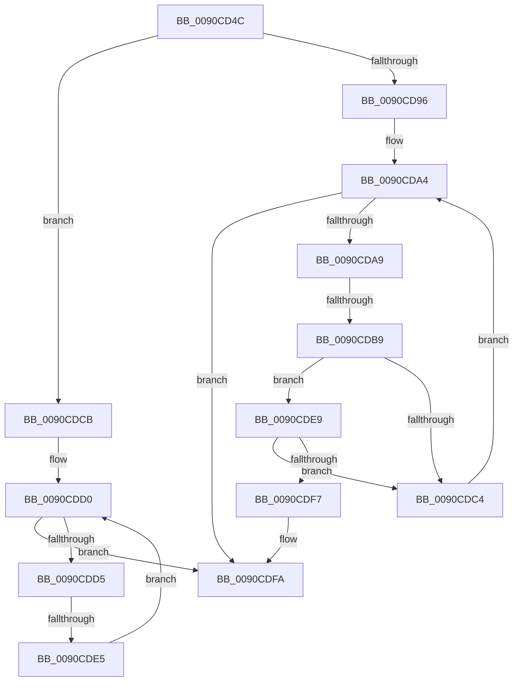

# sub_0090CD4C

- RVA: `0x0090CD4C`–`0x0090CE1E` (길이 `210` bytes)
- VA: `0x000000014090CD4C`
- 실행 섹션: `PAGE`
- PDB 이름 있음: `아니요`; PDB Function 태그: `아니요`
- unwind 정보 RVA: `0x00089324`
- 디코드: `57`개 명령, `210/210` bytes 표시
- 미해석 바이트: `0` (있으면 어셈블리에 `.byte`로 보존)

> 이 문서는 커널 이미지의 기계어와 PDB 기호를 분석해 생성했습니다. 4번과 5번은 함수 원형과 자료형을 바이너리 사용 방식에서 추정한 C 해석이며 원본 소스 복구 결과는 아닙니다.

## 1. Dependencies

- 직접 호출 지점: **1**; 고유 호출 대상: **1**
- 직접 호출자로 확인된 함수: **0**
- RIP 상대 이미지 참조: **0**

### Outgoing calls
- `0x0090CD6D` → [PsGetCurrentServerSiloGlobals](../../text/2F/PsGetCurrentServerSiloGlobals_function_002FE1F0.md) (function, `0x002FE1F0`)

### Direct callers
- 이 함수 시작 RVA로 연결되는 직접 call은 확인되지 않았습니다. 간접 호출은 완전히 역산할 수 없습니다.

### Static image references
- 디코드된 RIP-relative 메모리 참조가 없습니다.

## 2. Other-region calls and transfers

- 다른 실행 섹션으로 향하는 call: **1**
  - `0x0090CD6D` → [PsGetCurrentServerSiloGlobals](../../text/2F/PsGetCurrentServerSiloGlobals_function_002FE1F0.md) (`PAGE` → `.text`)
- call이 아닌 외부 분기/꼬리 이동: **2**
  - `0x0090CDB7` → [sub_0090CE29](Unknown_function_0090CE29.md) (`tail-transfer`)
  - `0x0090CDE3` → [sub_0090CE29 + 0x3A](Unknown_function_0090CE29.md) (`tail-transfer`)

## 3. Assembly (complete function range)

```asm
0090CD4C  48 89 74 24 40                  mov qword ptr [rsp + 0x40], rsi
0090CD51  48 89 7C 24 48                  mov qword ptr [rsp + 0x48], rdi
0090CD56  4C 89 64 24 50                  mov qword ptr [rsp + 0x50], r12
0090CD5B  4C 89 74 24 58                  mov qword ptr [rsp + 0x58], r14
0090CD60  4C 89 7C 24 20                  mov qword ptr [rsp + 0x20], r15
0090CD65  F0 83 0C 24 00                  lock or dword ptr [rsp], 0
0090CD6A  41 B6 01                        mov r14b, 1
0090CD6D  E8 7E 14 9F FF                  call 0x1402fe1f0
0090CD72  0F B7 0B                        movzx ecx, word ptr [rbx]
0090CD75  66 83 B8 54 04 00 00 00         cmp word ptr [rax + 0x454], 0
0090CD7D  48 8B B8 A0 04 00 00            mov rdi, qword ptr [rax + 0x4a0]
0090CD84  44 0F B7 90 4C 04 00 00         movzx r10d, word ptr [rax + 0x44c]
0090CD8C  44 0F B7 B8 50 04 00 00         movzx r15d, word ptr [rax + 0x450]
0090CD94  74 35                           je 0x14090cdcb
0090CD96  33 C0                           xor eax, eax
0090CD98  44 8B D9                        mov r11d, ecx
0090CD9B  44 8B C8                        mov r9d, eax
0090CD9E  41 BC 00 01 00 00               mov r12d, 0x100
0090CDA4  41 3B C3                        cmp eax, r11d
0090CDA7  73 51                           jae 0x14090cdfa
0090CDA9  4C 8B 43 08                     mov r8, qword ptr [rbx + 8]
0090CDAD  42 0F B6 14 00                  movzx edx, byte ptr [rax + r8]
0090CDB2  66 83 3C 57 00                  cmp word ptr [rdi + rdx*2], 0
0090CDB7  75 70                           jne 0x14090ce29
0090CDB9  0F BE D2                        movsx edx, dl
0090CDBC  41 0F B6 CA                     movzx ecx, r10b
0090CDC0  3B D1                           cmp edx, ecx
0090CDC2  74 25                           je 0x14090cde9
0090CDC4  FF C0                           inc eax
0090CDC6  41 FF C1                        inc r9d
0090CDC9  EB D9                           jmp 0x14090cda4
0090CDCB  33 C0                           xor eax, eax
0090CDCD  44 8B C9                        mov r9d, ecx
0090CDD0  41 3B C1                        cmp eax, r9d
0090CDD3  73 25                           jae 0x14090cdfa
0090CDD5  48 8B 4B 08                     mov rcx, qword ptr [rbx + 8]
0090CDD9  0F BE 14 08                     movsx edx, byte ptr [rax + rcx]
0090CDDD  41 0F B6 CA                     movzx ecx, r10b
0090CDE1  3B D1                           cmp edx, ecx
0090CDE3  74 7E                           je 0x14090ce63
0090CDE5  FF C0                           inc eax
0090CDE7  EB E7                           jmp 0x14090cdd0
0090CDE9  48 8B 4D 08                     mov rcx, qword ptr [rbp + 8]
0090CDED  41 8B D1                        mov edx, r9d
0090CDF0  66 44 39 3C 51                  cmp word ptr [rcx + rdx*2], r15w
0090CDF5  74 CD                           je 0x14090cdc4
0090CDF7  45 32 F6                        xor r14b, r14b
0090CDFA  4C 8B 7C 24 20                  mov r15, qword ptr [rsp + 0x20]
0090CDFF  41 0F B6 C6                     movzx eax, r14b
0090CE03  4C 8B 74 24 58                  mov r14, qword ptr [rsp + 0x58]
0090CE08  4C 8B 64 24 50                  mov r12, qword ptr [rsp + 0x50]
0090CE0D  48 8B 7C 24 48                  mov rdi, qword ptr [rsp + 0x48]
0090CE12  48 8B 74 24 40                  mov rsi, qword ptr [rsp + 0x40]
0090CE17  48 83 C4 28                     add rsp, 0x28
0090CE1B  5D                              pop rbp
0090CE1C  5B                              pop rbx
0090CE1D  C3                              ret
```

## 4. C-style interpretation (structured pseudocode)

```c
__int64 __fastcall sub_0090CD4C(__int64 a1, __int64 a2, __int64 a3, __int64 a4, __int64 a5, __int64 a6, __int64 a7, __int64 a8, __int64 a9, __int64 a10, __int64 a11)
{
    __int64 result;
    __int64 v_r14;
    __int64 v_rsp;
    unsigned int v_stack_p0;
    unsigned __int64 v_stack_p20;
    unsigned __int64 v_stack_p40;
    unsigned __int64 v_stack_p48;
    unsigned __int64 v_stack_p50;
    unsigned __int64 v_stack_p58;

    v_stack_p40 = v_rsi;
    v_stack_p48 = v_rdi;
    v_stack_p50 = v_r12;
    v_stack_p58 = v_r14;
    v_stack_p20 = v_r15;
    result = PsGetCurrentServerSiloGlobals(a1, a2, a3, a4);
    if ((*(unsigned __int16 *)(result + 1108)) == 0) goto loc_0090CDCB;
    result = 0;
loc_0090CDA4:
    if (0 >= ((unsigned int)((unsigned int)((unsigned int)(*(unsigned __int16 *)(v_rbx)))))) goto loc_0090CDFA;
    if (((unsigned int)((__int8)((unsigned __int8)(*(unsigned __int8 *)(result + *(unsigned __int64 *)(v_rbx + 8) * 1))))) == ((unsigned int)((unsigned __int8)(*(unsigned __int16 *)(result + 1100))))) goto loc_0090CDE9;
loc_0090CDC4:
    result = (unsigned int)((result) + 1);
    a4 = (unsigned int)((0) + 1);
    goto loc_0090CDA4;
loc_0090CDCB:
    result = 0;
loc_0090CDD0:
    if (0 >= ((unsigned int)((unsigned int)((unsigned int)((unsigned __int8)(*(unsigned __int16 *)(result + 1100))))))) goto loc_0090CDFA;
    result = (unsigned int)((result) + 1);
    goto loc_0090CDD0;
loc_0090CDE9:
    if ((*(unsigned __int16 *)(*(unsigned __int64 *)(v_rbp + 8) + (unsigned int)((unsigned int)((unsigned int)((unsigned int)((unsigned __int8)(*(unsigned __int16 *)(result + 1100)))))) * 2)) == ((unsigned __int16)(*(unsigned __int16 *)(result + 1104)))) goto loc_0090CDC4;
    v_r14 = 0;
loc_0090CDFA:
    v_rsp = (v_rsp) + (40);
    return 0;
}
```

## 5. (Beta) C Style

```c
int64_t sub_0090CD4C(int64_t Arg1, int64_t Arg2, int64_t Arg3, int64_t Arg4, uint64_t Arg5, uint64_t Arg6, uint64_t Arg7, int64_t Arg8, int64_t Arg9, int64_t Arg10, int64_t Arg11)
{
    int64_t result;
    int64_t local_r14;
    int64_t local_rsp;
    uint32_t v_stack_p0;
    uint64_t v_stack_p20;
    uint64_t v_stack_p40;
    uint64_t v_stack_p48;
    uint64_t v_stack_p50;
    uint64_t v_stack_p58;

    v_stack_p40 = local_rsi;
    v_stack_p48 = local_rdi;
    v_stack_p50 = local_r12;
    v_stack_p58 = local_r14;
    v_stack_p20 = local_r15;
    result = PsGetCurrentServerSiloGlobals(Arg1, Arg2, Arg3, Arg4);
    if ((*(uint16_t *)(result + 0x454)) == 0) goto loc_0090CDCB;
    result = 0;
loc_0090CDA4:
    if (0 >= ((uint32_t)((uint32_t)((uint32_t)(*(uint16_t *)(local_rbx)))))) goto loc_0090CDFA;
    if (((uint32_t)((int8_t)((uint8_t)(*(uint8_t *)(result + *(uint64_t *)(local_rbx + 0x8) * 1))))) == ((uint32_t)((uint8_t)(*(uint16_t *)(result + 0x44C))))) goto loc_0090CDE9;
loc_0090CDC4:
    result = (uint32_t)((result) + 1);
    Arg4 = (uint32_t)((0) + 1);
    goto loc_0090CDA4;
loc_0090CDCB:
    result = 0;
loc_0090CDD0:
    if (0 >= ((uint32_t)((uint32_t)((uint32_t)((uint8_t)(*(uint16_t *)(result + 0x44C))))))) goto loc_0090CDFA;
    result = (uint32_t)((result) + 1);
    goto loc_0090CDD0;
loc_0090CDE9:
    if ((*(uint16_t *)(*(uint64_t *)(local_rbp + 0x8) + (uint32_t)((uint32_t)((uint32_t)((uint32_t)((uint8_t)(*(uint16_t *)(result + 0x44C)))))) * 2)) == ((uint16_t)(*(uint16_t *)(result + 0x450)))) goto loc_0090CDC4;
    local_r14 = 0;
loc_0090CDFA:
    local_rsp = (local_rsp) + (40);
    return 0;
}
```

## 6. Execution-region graph

[열기: 2D/3D 그래프와 함수 탐색 컨트롤 패널](../../../control-panel.html?section=page&rva=0x0090CD4C&view=graph)

- 2D 그래프는 위에서 아래로 흐르고, 3D 그래프는 빈 공간을 드래그해 회전합니다. Shift+드래그는 이동, 휠은 확대·축소, 함수 노드 선택은 대상 보고서 이동입니다.

### Static fallback


