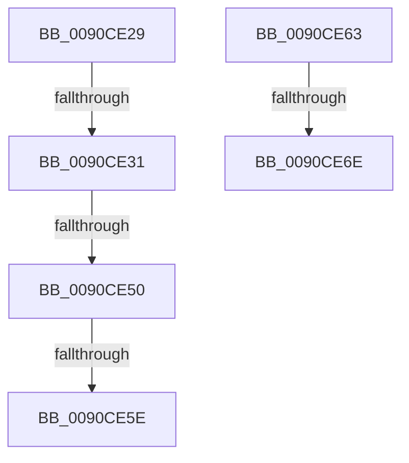

# sub_0090CE29

- RVA: `0x0090CE29`–`0x0090CE73` (길이 `74` bytes)
- VA: `0x000000014090CE29`
- 실행 섹션: `PAGE`
- PDB 이름 있음: `아니요`; PDB Function 태그: `아니요`
- unwind 정보 RVA: `0x00089360`
- 디코드: `20`개 명령, `74/74` bytes 표시
- 미해석 바이트: `0` (있으면 어셈블리에 `.byte`로 보존)

> 이 문서는 커널 이미지의 기계어와 PDB 기호를 분석해 생성했습니다. 4번과 5번은 함수 원형과 자료형을 바이너리 사용 방식에서 추정한 C 해석이며 원본 소스 복구 결과는 아닙니다.

## 1. Dependencies

- 직접 호출 지점: **0**; 고유 호출 대상: **0**
- 직접 호출자로 확인된 함수: **0**
- RIP 상대 이미지 참조: **0**

### Outgoing calls
- 직접 디코드된 call 명령이 없습니다.

### Direct callers
- 이 함수 시작 RVA로 연결되는 직접 call은 확인되지 않았습니다. 간접 호출은 완전히 역산할 수 없습니다.

### Static image references
- 디코드된 RIP-relative 메모리 참조가 없습니다.

## 2. Other-region calls and transfers

- 다른 실행 섹션으로 향하는 call: **0**
- call이 아닌 외부 분기/꼬리 이동: **6**
  - `0x0090CE2F` → [sub_0090CD4C + 0x6D](Unknown_function_0090CD4C.md) (`tail-transfer`)
  - `0x0090CE4A` → [sub_0090CD4C + 0x78](Unknown_function_0090CD4C.md) (`tail-transfer`)
  - `0x0090CE5C` → [sub_0090CD4C + 0xAB](Unknown_function_0090CD4C.md) (`tail-transfer`)
  - `0x0090CE5E` → [sub_0090CD4C + 0x78](Unknown_function_0090CD4C.md) (`tail-transfer`)
  - `0x0090CE6C` → [sub_0090CD4C + 0xAB](Unknown_function_0090CD4C.md) (`tail-transfer`)
  - `0x0090CE6E` → [sub_0090CD4C + 0x99](Unknown_function_0090CD4C.md) (`tail-transfer`)

## 3. Assembly (complete function range)

```asm
0090CE29  8D 70 01                        lea esi, [rax + 1]
0090CE2C  41 3B F3                        cmp esi, r11d
0090CE2F  73 88                           jae 0x14090cdb9
0090CE31  46 0F B6 04 06                  movzx r8d, byte ptr [rsi + r8]
0090CE36  0F BE C2                        movsx eax, dl
0090CE39  0F B7 D0                        movzx edx, ax
0090CE3C  8B C6                           mov eax, esi
0090CE3E  41 0F AF D4                     imul edx, r12d
0090CE42  66 44 03 C2                     add r8w, dx
0090CE46  66 45 3B C2                     cmp r8w, r10w
0090CE4A  0F 85 74 FF FF FF               jne 0x14090cdc4
0090CE50  48 8B 4D 08                     mov rcx, qword ptr [rbp + 8]
0090CE54  41 8B D1                        mov edx, r9d
0090CE57  66 44 39 3C 51                  cmp word ptr [rcx + rdx*2], r15w
0090CE5C  75 99                           jne 0x14090cdf7
0090CE5E  E9 61 FF FF FF                  jmp 0x14090cdc4
0090CE63  48 8B 4D 08                     mov rcx, qword ptr [rbp + 8]
0090CE67  66 44 39 3C 41                  cmp word ptr [rcx + rax*2], r15w
0090CE6C  75 89                           jne 0x14090cdf7
0090CE6E  E9 72 FF FF FF                  jmp 0x14090cde5
```

## 4. C-style interpretation (structured pseudocode)

```c
__int64 __fastcall sub_0090CE29(__int64 a1, unsigned __int8 a2, __int64 a3, int a4)
{
    a2 = (unsigned int)(((unsigned __int16)((__int8)(a2))) * ((unsigned int)(v_r12)));
    a3 = (unsigned __int16)((*(unsigned __int8 *)(result + 1 + a3 * 1)) + (a2));
}
```

## 5. (Beta) C Style

```c
int64_t sub_0090CE29(int64_t Arg1, uint8_t Arg2, int64_t Arg3, int32_t Arg4)
{
    Arg2 = (uint32_t)(((uint16_t)((int8_t)(Arg2))) * ((uint32_t)(local_r12)));
    Arg3 = (uint16_t)((*(uint8_t *)(result + 0x1 + Arg3 * 1)) + (Arg2));
}
```

## 6. Execution-region graph

[열기: 2D/3D 그래프와 함수 탐색 컨트롤 패널](../../../control-panel.html?section=page&rva=0x0090CE29&view=graph)

- 2D 그래프는 위에서 아래로 흐르고, 3D 그래프는 빈 공간을 드래그해 회전합니다. Shift+드래그는 이동, 휠은 확대·축소, 함수 노드 선택은 대상 보고서 이동입니다.

### Static fallback


